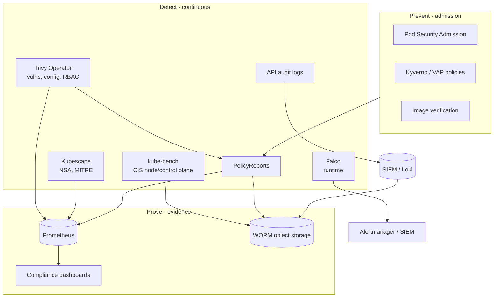
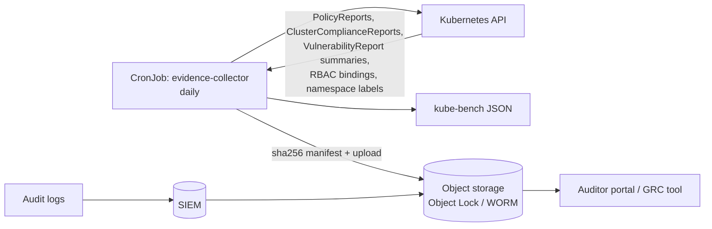

# Compliance - CIS Benchmarks, Continuous Scanning and Evidence

## Learning Objectives
- Understand what "compliance" means for a Kubernetes platform and who consumes the output
- Assess clusters against the CIS Kubernetes Benchmark with kube-bench
- Run continuous posture and vulnerability scanning with Trivy Operator and Kubescape
- Use Kyverno PolicyReports as a standard, queryable compliance signal
- Configure Kubernetes audit logging that satisfies auditors without drowning you
- Detect runtime threats with Falco
- Map technical controls to SOC 2, PCI DSS and ISO 27001 and automate evidence collection

## Prerequisites
- [Policy Engine](./policy-engine.md) and [Pod Security](./pod-security.md)
- [Supply Chain Security](./supply-chain.md) (for vulnerability and SBOM context)
- [RBAC](../01-kubernetes-fundamentals/rbac.md)
- Prometheus/Alertmanager basics ([Alerting](../10-observability/alerting.md))
- A Kubernetes 1.28+ cluster, `kubectl`, Helm 3

---

## Compliance as a Platform Capability

Compliance is the ability to **prove**, on demand and continuously, that agreed controls are in place. On a shared platform that proof is a product feature: if the platform can demonstrate encryption, access control, change management and vulnerability management for every tenant, product teams inherit those controls instead of re-implementing them for each audit.



| Layer | Question It Answers | Tools |
|-------|---------------------|-------|
| **Prevent** | Can a non-compliant change get in? | PSA, Kyverno, ValidatingAdmissionPolicy, image verification |
| **Detect** | Is anything already running out of compliance? | kube-bench, Trivy Operator, Kubescape, PolicyReports, Falco |
| **Prove** | Can we show an auditor, for a past date range? | Audit logs, report archives, dashboards, Git history |

### Frameworks You Will Meet

| Framework | Type | Kubernetes Relevance |
|-----------|------|---------------------|
| **CIS Kubernetes Benchmark** | Prescriptive technical config checks | Control plane, etcd, kubelet, policies |
| **CIS EKS / GKE / AKS Benchmarks** | Managed-service variants | Only the parts you control (nodes, policies) |
| **NSA/CISA Kubernetes Hardening Guide** | Technical guidance | Pod security, network separation, auth, logging |
| **MITRE ATT&CK for Containers** | Threat matrix | Detection coverage mapping |
| **SOC 2** (AICPA TSC) | Attestation of controls | Access, change management, monitoring |
| **PCI DSS v4.0** | Mandatory for card data | Segmentation, hardening, vulnerability mgmt, logging |
| **ISO/IEC 27001:2022** | ISMS certification | Annex A technical controls |

Technical benchmarks (CIS, NSA) produce **findings**; audit frameworks (SOC 2, PCI, ISO) consume them as **evidence** that a control operates.

---

## CIS Kubernetes Benchmark with kube-bench

The [CIS Kubernetes Benchmark](https://www.cisecurity.org/benchmark/kubernetes) groups checks into sections:

| Section | Scope | Who Owns It on Managed K8s |
|---------|-------|---------------------------|
| 1. Control Plane Components | API server, controller-manager, scheduler flags and file permissions | Cloud provider |
| 2. etcd | TLS, peer auth, data dir permissions | Cloud provider |
| 3. Control Plane Configuration | Authentication, audit logging | Shared |
| 4. Worker Nodes | kubelet config, file permissions | You (node images) |
| 5. Policies | RBAC, Pod Security, NetworkPolicy, secrets, namespaces | You (platform) |

Each recommendation is **Automated** (checkable by a tool) or **Manual** (needs human judgment), and has a profile **Level 1** (practical baseline) or **Level 2** (defense-in-depth, may impact functionality).

[kube-bench](https://github.com/aquasecurity/kube-bench) implements the automated checks. It auto-detects the Kubernetes version and selects the matching benchmark; managed variants are selected by `--benchmark` (e.g. `eks-1.5.0`, `gke-1.6.0`) or the platform-specific job manifests in the repo.

### Running kube-bench as a Job

```yaml
# kube-bench-node-job.yaml - checks worker node config (section 4)
apiVersion: batch/v1
kind: Job
metadata:
  name: kube-bench-node
  namespace: compliance
  labels:
    platform.mycompany.io/component: compliance-scanner
spec:
  ttlSecondsAfterFinished: 86400
  template:
    spec:
      hostPID: true                          # needed to inspect kubelet process flags
      restartPolicy: Never
      containers:
        - name: kube-bench
          image: docker.io/aquasec/kube-bench:v0.10.1
          command: ["kube-bench", "run", "--targets", "node", "--json", "--outputfile", "/output/node.json"]
          volumeMounts:
            - { name: var-lib-kubelet, mountPath: /var/lib/kubelet, readOnly: true }
            - { name: etc-systemd,     mountPath: /etc/systemd,     readOnly: true }
            - { name: etc-kubernetes,  mountPath: /etc/kubernetes,  readOnly: true }
            - { name: output,          mountPath: /output }
      volumes:
        - { name: var-lib-kubelet, hostPath: { path: /var/lib/kubelet } }
        - { name: etc-systemd,     hostPath: { path: /etc/systemd } }
        - { name: etc-kubernetes,  hostPath: { path: /etc/kubernetes } }
        - { name: output,          emptyDir: {} }
```

> This Job needs `hostPID` and `hostPath`, so the `compliance` namespace must be labelled `pod-security.kubernetes.io/enforce=privileged` (see [Pod Security](./pod-security.md#exemption-guidance)). Restrict who can create Pods there. To scan every node, run it as a DaemonSet or schedule one Job per node with `nodeName`.

```bash
# Quick interactive run
kubectl apply -f https://raw.githubusercontent.com/aquasecurity/kube-bench/main/job.yaml
kubectl wait --for=condition=complete job/kube-bench --timeout=120s
kubectl logs job/kube-bench | tail -20
```

Sample output:

```text
[INFO] 4 Worker Node Security Configuration
[INFO] 4.1 Worker Node Configuration Files
[PASS] 4.1.1 Ensure that the kubelet service file permissions are set to 600 or more restrictive (Automated)
[FAIL] 4.2.6 Ensure that the --make-iptables-util-chains argument is set to true (Automated)
...
== Summary node ==
21 checks PASS
2 checks FAIL
3 checks WARN
0 checks INFO
```

### Typical Remediations

| Check | Finding | Fix |
|-------|---------|-----|
| 1.2.x `--anonymous-auth=false` | Anonymous API access enabled | Set API server flag (self-managed only) |
| 1.2.x `--audit-log-path` set | No audit log | Configure audit policy (below) |
| 4.2.1 kubelet `--anonymous-auth=false` | Kubelet accepts anonymous requests | `authentication.anonymous.enabled: false` in `KubeletConfiguration` |
| 4.2.x `--read-only-port=0` | Unauthenticated kubelet read port | `readOnlyPort: 0` |
| 5.1.x Minimize cluster-admin | Too many `cluster-admin` bindings | RBAC review ([RBAC](../01-kubernetes-fundamentals/rbac.md)) |
| 5.2.x Pod Security | Namespaces without enforcement | PSA labels on every namespace |
| 5.3.2 NetworkPolicy | Namespaces without policies | Kyverno `generate` default-deny ([Policy Engine](./policy-engine.md#clusterpolicy-generation)) |
| 5.4.1 Secrets as env vars | Secrets exposed via env | Mount as files; use External Secrets |

Bake node-level fixes into the node image (Packer, Bottlerocket, Talos) and section 5 fixes into the platform's default policies — then kube-bench becomes a **regression test**, not a to-do list.

---

## Trivy Operator

[Trivy Operator](https://aquasecurity.github.io/trivy-operator/latest/) continuously scans workloads and writes results as Kubernetes CRDs in the `aquasecurity.github.io/v1alpha1` group.

```bash
helm repo add aqua https://aquasecurity.github.io/helm-charts/
helm repo update
helm upgrade --install trivy-operator aqua/trivy-operator \
  --namespace trivy-system --create-namespace \
  --values trivy-operator-values.yaml
```

```yaml
# trivy-operator-values.yaml
operator:
  scanJobsConcurrentLimit: 5           # cap scan load on the cluster
  vulnerabilityScannerScanOnlyCurrentRevisions: true
  configAuditScannerEnabled: true
  rbacAssessmentScannerEnabled: true
  infraAssessmentScannerEnabled: true
  exposedSecretScannerEnabled: true
  clusterComplianceEnabled: true
  sbomGenerationEnabled: true
trivy:
  ignoreUnfixed: true                  # focus on actionable CVEs
  severity: "UNKNOWN,LOW,MEDIUM,HIGH,CRITICAL"
serviceMonitor:
  enabled: true                        # expose metrics to Prometheus Operator
excludeNamespaces: "kube-system,trivy-system"
```

### Report Types

| CRD | Scope | Contents |
|-----|-------|----------|
| `VulnerabilityReport` | Namespaced (per container) | CVEs in the image, fixed versions |
| `ConfigAuditReport` | Namespaced | Misconfigurations (privileged, no limits, ...) |
| `ExposedSecretReport` | Namespaced | Secrets baked into image layers |
| `RbacAssessmentReport` / `ClusterRbacAssessmentReport` | Namespaced / Cluster | Risky Roles/ClusterRoles |
| `InfraAssessmentReport` | Namespaced | Control-plane / node config checks |
| `SbomReport` | Namespaced | CycloneDX SBOM of each image |
| `ClusterComplianceReport` | Cluster | Aggregated status against a framework spec |

```bash
# Highest-risk images across the cluster
kubectl get vulnerabilityreports -A \
  -o custom-columns='NS:.metadata.namespace,NAME:.metadata.name,CRIT:.report.summary.criticalCount,HIGH:.report.summary.highCount' \
  | sort -k3 -nr | head

# Built-in compliance specs (names vary by version: k8s-cis-*, k8s-nsa-*, k8s-pss-*)
kubectl get clustercompliancereports
kubectl get clustercompliancereport k8s-pss-restricted-0.1 -o jsonpath='{.status.summary}'
```

### Prometheus Metrics

```promql
# Critical vulnerabilities by namespace
sum by (namespace) (trivy_image_vulnerabilities{severity="Critical"})

# Config audit failures by severity
sum by (severity) (trivy_resource_configaudits)
```

```yaml
# prometheusrule-trivy.yaml
apiVersion: monitoring.coreos.com/v1
kind: PrometheusRule
metadata:
  name: trivy-compliance
  namespace: monitoring
spec:
  groups:
    - name: vulnerability-management
      rules:
        - alert: CriticalVulnerabilityInProduction
          expr: |
            sum by (namespace, resource_name) (
              trivy_image_vulnerabilities{severity="Critical"}
              * on (namespace) group_left()
              kube_namespace_labels{label_platform_mycompany_io_environment="production"}
            ) > 0
          for: 24h                    # remediation SLA starts; page only if unaddressed
          labels:
            severity: warning
            team: platform-security
          annotations:
            summary: "Critical CVE in {{ $labels.namespace }}/{{ $labels.resource_name }} for 24h"
```

> `kube_namespace_labels` only exposes labels allow-listed in kube-state-metrics (`--metric-labels-allowlist=namespaces=[platform.mycompany.io/environment]`). Routing and severity conventions are covered in [Alerting](../10-observability/alerting.md).

---

## Kubescape

[Kubescape](https://kubescape.io/) (CNCF incubating) scans clusters, manifests and Helm charts against several frameworks and is especially useful for **shift-left** checks in CI.

```bash
# One-off cluster scans
kubescape scan framework nsa
kubescape scan framework mitre
kubescape scan framework cis-v1.23-t1.0.1

# Scan manifests before merge (fails CI below a compliance score)
kubescape scan framework nsa ./clusters/production --compliance-threshold 90 --format junit --output results.xml

# List available frameworks
kubescape list frameworks
```

| Framework | Focus |
|-----------|-------|
| `nsa` | NSA/CISA Kubernetes Hardening Guide |
| `mitre` | MITRE ATT&CK techniques (exec into container, privileged container, exposed dashboard...) |
| `cis-*` | CIS Kubernetes Benchmark (incl. EKS/AKS variants) |
| `allcontrols`, `security` | Broad control sets |

For continuous in-cluster scanning, install the operator chart:

```bash
helm repo add kubescape https://kubescape.github.io/helm-charts/
helm upgrade --install kubescape kubescape/kubescape-operator \
  -n kubescape --create-namespace --set clusterName=$(kubectl config current-context)
```

| | Trivy Operator | Kubescape |
|---|---|---|
| Strength | Image vulnerabilities, SBOMs, secrets | Framework coverage, risk scoring, CI integration |
| Output | CRDs + Prometheus metrics | CRDs (storage API), JSON/JUnit/SARIF, metrics |
| Runtime | No | Optional eBPF node agent |

Many platforms run Trivy Operator for vulnerabilities and Kubescape in CI for posture — pick one *in-cluster* source of truth per finding type to avoid duplicate tickets.

---

## Kyverno PolicyReports

The Policy WG's `PolicyReport` / `ClusterPolicyReport` CRDs (`wgpolicyk8s.io/v1alpha2`) give a **tool-neutral format** for policy results. Kyverno writes them for every policy running in `Audit` mode and for background scans; other tools (Trivy adapters, Falco via Falcosidekick) can emit them too.

```yaml
# Example PolicyReport written by Kyverno (abridged)
apiVersion: wgpolicyk8s.io/v1alpha2
kind: PolicyReport
metadata:
  name: 6b2c9f2e-...           # one report per resource in recent Kyverno versions
  namespace: team-payments-prod
  labels:
    app.kubernetes.io/managed-by: kyverno
scope:
  apiVersion: apps/v1
  kind: Deployment
  name: checkout-api
  namespace: team-payments-prod
results:
  - policy: pss-restricted-tenants
    rule: restricted
    result: pass
    scored: true
    source: kyverno
    severity: high
    category: Pod Security
    timestamp: { seconds: 1761196800, nanos: 0 }
  - policy: verify-mycompany-supply-chain
    rule: verify-signature-and-attestations
    result: fail
    message: "image ghcr.io/mycompany/checkout-api:1.4.2 is not signed by an expected identity"
    scored: true
    source: kyverno
summary:
  pass: 1
  fail: 1
  warn: 0
  error: 0
  skip: 0
```

```bash
# Failing results across the cluster
kubectl get policyreports -A -o json | jq -r '
  .items[] | .metadata.namespace as $ns | .scope.name as $res
  | .results[]? | select(.result=="fail")
  | [$ns, $res, .policy, .rule] | @tsv' | column -t

# Summary per namespace
kubectl get policyreports -A
```

Add [Policy Reporter](https://kyverno.github.io/policy-reporter/) for a UI, Prometheus metrics (`policy_report_result`) and push targets (Slack, Loki, S3, Security Hub):

```bash
helm repo add policy-reporter https://kyverno.github.io/policy-reporter
helm upgrade --install policy-reporter policy-reporter/policy-reporter \
  -n policy-reporter --create-namespace \
  --set metrics.enabled=true --set ui.enabled=true
```

### Compliance-Oriented Kyverno Policies

Annotate policies with control IDs so reports roll up to frameworks:

```yaml
# kyverno-cis-5-4-1-no-secret-env.yaml
apiVersion: kyverno.io/v1
kind: ClusterPolicy
metadata:
  name: disallow-secrets-in-env
  annotations:
    policies.kyverno.io/title: Secrets should be mounted as files, not env vars
    policies.kyverno.io/category: CIS Benchmark
    policies.kyverno.io/severity: medium
    compliance.platform.mycompany.io/controls: "CIS-5.4.1,SOC2-CC6.1,ISO27001-A.8.12"
spec:
  validationFailureAction: Audit
  background: true
  rules:
    - name: no-secretkeyref
      match:
        any:
          - resources:
              kinds: ["Pod"]
      validate:
        message: "Use a mounted Secret volume instead of env[].valueFrom.secretKeyRef (CIS 5.4.1)"
        pattern:
          spec:
            containers:
              - =(env):
                  - =(valueFrom):
                      X(secretKeyRef): "null"     # X() negation anchor: key must not exist
---
# kyverno-require-owner-labels.yaml - ownership is an audit prerequisite
apiVersion: kyverno.io/v1
kind: ClusterPolicy
metadata:
  name: require-data-classification
  annotations:
    compliance.platform.mycompany.io/controls: "ISO27001-A.5.12,PCI-DSS-12.5.1"
spec:
  validationFailureAction: Enforce
  rules:
    - name: data-classification-label
      match:
        any:
          - resources:
              kinds: ["Namespace"]
              selector:
                matchExpressions:
                  - key: platform.mycompany.io/tenant
                    operator: Exists
      validate:
        message: "Tenant namespaces must declare platform.mycompany.io/data-classification"
        pattern:
          metadata:
            labels:
              platform.mycompany.io/data-classification: "public | internal | confidential | restricted"
```

Kyverno also publishes ready-made policy sets (`pod-security`, `best-practices`, `other`) in the [kyverno/policies](https://github.com/kyverno/policies) repo — vendor them through GitOps rather than writing from scratch. The policies used in this repo live in [code/policy-engine](https://github.com/GitOpsHub/platform-engineering-on-kubernetes/tree/main/code/policy-engine/) and [Lab 05](../../labs/lab-05-policy-engine/).

---

## Kubernetes Audit Logging

Every compliance framework asks "who did what, when?" The API server audit log answers that. It is configured with an `audit.k8s.io/v1` Policy; the **first matching rule wins**.

| Level | Logs |
|-------|------|
| `None` | Nothing |
| `Metadata` | User, verb, resource, timestamps, response code — no bodies |
| `Request` | Metadata + request body |
| `RequestResponse` | Metadata + request and response bodies |

```yaml
# /etc/kubernetes/audit/audit-policy.yaml
apiVersion: audit.k8s.io/v1
kind: Policy
# Skip the RequestReceived stage - ResponseComplete carries the same info plus the result
omitStages:
  - RequestReceived
rules:
  # 1. Drop high-volume, low-value noise
  - level: None
    users: ["system:kube-proxy"]
    verbs: ["watch"]
    resources:
      - group: ""
        resources: ["endpoints", "services", "services/status"]
  - level: None
    userGroups: ["system:nodes"]
    verbs: ["get"]
    resources:
      - group: ""
        resources: ["nodes", "nodes/status"]
  - level: None
    nonResourceURLs: ["/healthz*", "/livez*", "/readyz*", "/version", "/metrics"]
  - level: None
    resources:
      - group: "coordination.k8s.io"
        resources: ["leases"]
  - level: None
    resources:
      - group: ""
        resources: ["events"]

  # 2. Secrets, ConfigMaps, tokens: metadata only - NEVER log bodies (would leak secret values)
  - level: Metadata
    resources:
      - group: ""
        resources: ["secrets", "configmaps", "serviceaccounts/token"]
      - group: "authentication.k8s.io"
        resources: ["tokenreviews"]

  # 3. Interactive access to workloads - high-signal for incident response
  - level: RequestResponse
    resources:
      - group: ""
        resources: ["pods/exec", "pods/attach", "pods/portforward", "pods/ephemeralcontainers"]

  # 4. Access-control and policy changes: full detail
  - level: RequestResponse
    verbs: ["create", "update", "patch", "delete", "deletecollection"]
    resources:
      - group: "rbac.authorization.k8s.io"
      - group: "admissionregistration.k8s.io"
      - group: "kyverno.io"
      - group: "platform.mycompany.io"     # Tenant / Environment / Workload changes
      - group: ""
        resources: ["namespaces"]

  # 5. Other writes: request bodies
  - level: Request
    verbs: ["create", "update", "patch", "delete", "deletecollection"]

  # 6. Everything else (reads): metadata
  - level: Metadata
```

```text
# kube-apiserver flags (self-managed)
--audit-policy-file=/etc/kubernetes/audit/audit-policy.yaml
--audit-log-path=/var/log/kubernetes/audit/audit.log
--audit-log-maxage=7          # days kept on disk; ship to central storage for long retention
--audit-log-maxbackup=10
--audit-log-maxsize=100       # MB per file
```

Managed services expose audit logs through their own pipelines (EKS control-plane logging to CloudWatch, GKE Cloud Audit Logs, AKS diagnostic settings). Ship them to your SIEM or Loki ([Logging Stack](../10-observability/logging-stack.md)) and retain according to policy — PCI DSS v4.0 requirement 10.5.1 asks for 12 months, with 3 months immediately available.

PSA writes `pod-security.kubernetes.io/audit-violations` annotations into these events, giving you a free report of pods that would fail stricter enforcement.

```logql
# Loki: who exec'd into production pods in the last 24h?
{job="kube-audit"} | json
  | objectRef_subresource="exec" and objectRef_namespace=~".*-prod"
  | line_format "{{.user_username}} -> {{.objectRef_namespace}}/{{.objectRef_name}}"
```

---

## Runtime Detection with Falco

Admission and scanning cover what you *deploy*; [Falco](https://falco.org/) (CNCF graduated) watches what containers *do*, using eBPF to observe syscalls.

```bash
helm repo add falcosecurity https://falcosecurity.github.io/charts
helm upgrade --install falco falcosecurity/falco \
  -n falco --create-namespace \
  --set driver.kind=modern_ebpf \
  --set falcosidekick.enabled=true \
  --set falcosidekick.config.alertmanager.hostport=http://alertmanager-operated.monitoring:9093
```

Falco ships default rules (e.g. *Terminal shell in container*, *Read sensitive file untrusted*, *Contact K8S API Server From Container*). Add platform-specific rules:

```yaml
# falco-custom-rules.yaml (values: customRules)
customRules:
  platform-rules.yaml: |-
    - list: platform_package_managers
      items: [apt, apt-get, apk, yum, dnf, pip, pip3, npm]

    - rule: Package Manager Run in Production Container
      desc: Immutable production containers must never install packages at runtime
      condition: >
        spawned_process and container
        and proc.name in (platform_package_managers)
        and k8s.ns.name endswith "-prod"
      output: >
        Package manager run in production container
        (user=%user.name cmd=%proc.cmdline ns=%k8s.ns.name pod=%k8s.pod.name
         image=%container.image.repository)
      priority: ERROR
      tags: [platform, mitre_persistence, T1072, PCI_DSS_11.5]

    - rule: Write Below Binary Dir in Tenant Container
      desc: Detect drift - binaries modified after container start
      condition: >
        open_write and container
        and fd.directory in (/bin, /sbin, /usr/bin, /usr/sbin)
        and k8s.ns.labels["platform.mycompany.io/tenant"] != ""
      output: "Binary dir written (file=%fd.name ns=%k8s.ns.name pod=%k8s.pod.name cmd=%proc.cmdline)"
      priority: CRITICAL
      tags: [platform, drift]
```

| Signal | Prevent | Detect |
|--------|---------|--------|
| Privileged container | PSA restricted | Falco *Launch Privileged Container* |
| Shell in container | `readOnlyRootFilesystem`, distroless | Falco *Terminal shell in container* |
| `kubectl exec` | RBAC on `pods/exec` | Audit log rule 3 |
| Crypto miner | Image verification | Falco outbound connection / CPU anomaly rules |

Falco findings route through Falcosidekick to Alertmanager, Slack, a SIEM, or as PolicyReports — keep severity mapping consistent with [Alerting](../10-observability/alerting.md).

---

## Mapping Controls to Frameworks

Auditors reason in control objectives, engineers in YAML. A control matrix bridges the two; keep it in Git next to the policies.

| Platform Control | Implementation | SOC 2 (TSC 2017) | PCI DSS v4.0 | ISO 27001:2022 Annex A |
|------------------|----------------|------------------|--------------|------------------------|
| SSO + RBAC, no shared admin | OIDC, RBAC, Tenant-scoped roles | CC6.1, CC6.2, CC6.3 | 7.2, 8.2, 8.3 | 5.15, 5.18, 8.2 |
| Hardened configuration | CIS benchmark, PSA restricted, node images | CC6.8, CC7.1 | 2.2 | 8.9 |
| Network segmentation | Default-deny NetworkPolicy per tenant | CC6.6 | 1.2, 1.3 | 8.20, 8.22 |
| Change management | GitOps, PR review, signed images | CC8.1 | 6.5.1, 6.5.2 | 8.32 |
| Secure SDLC & supply chain | SLSA provenance, SBOM, image verification | CC8.1 | 6.2, 6.3.2 | 8.25, 8.28 |
| Vulnerability management | Trivy Operator, remediation SLAs | CC7.1 | 6.3.1, 6.3.3, 11.3 | 8.8 |
| Logging & monitoring | API audit logs, Falco, SIEM | CC7.2, CC7.3 | 10.2, 10.4, 10.5.1 | 8.15, 8.16 |
| Integrity monitoring | Falco drift rules, read-only root FS | CC7.1 | 11.5.2 | 8.16 |
| Encryption at rest/in transit | KMS secrets encryption, mTLS/TLS ingress | CC6.1, CC6.7 | 3.5, 4.2 | 8.24 |
| Backup & recovery | Velero, tested restores ([Disaster Recovery](../11-reliability/disaster-recovery.md)) | A1.2, A1.3 | 12.10.1 | 8.13, 5.30 |
| Availability & capacity | SLOs, autoscaling ([SLOs](../11-reliability/slos-slis.md), [Capacity](../11-reliability/capacity-planning.md)) | A1.1 | — | 8.6 |

> Control IDs are given as orientation; your auditor's interpretation and your organization's control set are authoritative.

---

## Automated Evidence Collection

Evidence must be **timestamped, tamper-evident and retrievable for a past period**. Screenshots taken the week before the audit are not continuous compliance.



```yaml
# evidence-collector-cronjob.yaml
apiVersion: batch/v1
kind: CronJob
metadata:
  name: evidence-collector
  namespace: compliance
spec:
  schedule: "15 2 * * *"                  # daily at 02:15 UTC
  concurrencyPolicy: Forbid
  jobTemplate:
    spec:
      template:
        spec:
          serviceAccountName: evidence-collector   # read-only ClusterRole: get/list on report CRDs, RBAC, namespaces
          restartPolicy: OnFailure
          securityContext:
            runAsNonRoot: true
            runAsUser: 65532
            seccompProfile: { type: RuntimeDefault }
          containers:
            - name: collect
              image: registry.mycompany.io/platform/evidence-collector@sha256:9a7e...  # kubectl + jq + aws cli
              securityContext:
                allowPrivilegeEscalation: false
                readOnlyRootFilesystem: true
                capabilities: { drop: ["ALL"] }
              env:
                - name: EVIDENCE_BUCKET
                  value: s3://mycompany-compliance-evidence
              command: ["/bin/sh", "-c"]
              args:
                - |
                  set -euo pipefail
                  D=$(date -u +%Y-%m-%d); OUT=/work/$D; mkdir -p "$OUT"
                  kubectl get policyreports,clusterpolicyreports -A -o json > "$OUT/policyreports.json"
                  kubectl get clustercompliancereports -o json        > "$OUT/compliance-reports.json"
                  kubectl get vulnerabilityreports -A -o json \
                    | jq '[.items[] | {ns: .metadata.namespace, name: .metadata.name,
                           image: .report.artifact.repository, tag: .report.artifact.tag,
                           summary: .report.summary}]'            > "$OUT/vuln-summary.json"
                  kubectl get clusterrolebindings,rolebindings -A -o json > "$OUT/rbac-bindings.json"
                  kubectl get ns -o json | jq '[.items[] | {name: .metadata.name, labels: .metadata.labels}]' \
                                                                  > "$OUT/namespace-labels.json"
                  (cd "$OUT" && sha256sum *.json > MANIFEST.sha256)
                  aws s3 cp --recursive "$OUT" "$EVIDENCE_BUCKET/$D/"
              volumeMounts:
                - { name: work, mountPath: /work }
          volumes:
            - { name: work, emptyDir: {} }
```

Combine this with:

- **Git history** of the GitOps and policy repos (change management evidence: who approved what, when).
- **CI logs and attestations** (supply-chain evidence; see [Supply Chain](./supply-chain.md)).
- **Prometheus long-term storage** of compliance metrics (trend evidence: "critical CVEs over the last 12 months").
- **DR test reports** from scheduled restore drills ([Disaster Recovery](../11-reliability/disaster-recovery.md)).

---

## Hands-On Exercises

### Exercise 1: Build a compliance baseline for a kind cluster

Goal: collect findings from kube-bench, Trivy Operator, a Kyverno PolicyReport and Kubescape,
then reduce them to two numbers. Before you start, save the policy from
[Compliance-Oriented Kyverno Policies](#compliance-oriented-kyverno-policies) as
`kyverno-cis-5-4-1-no-secret-env.yaml`.

**Prerequisites:** Kind cluster (1.28+), Helm, Kyverno ([Lab 05](../../labs/lab-05-policy-engine/)), optionally kube-prometheus-stack ([Lab 06](../../labs/lab-06-observability-stack/)).

```bash
# 1. Prepare a privileged namespace for node scanners
kubectl create ns compliance
kubectl label ns compliance pod-security.kubernetes.io/enforce=privileged

# 2. CIS node checks with kube-bench
kubectl -n compliance apply -f https://raw.githubusercontent.com/aquasecurity/kube-bench/main/job.yaml
kubectl -n compliance wait --for=condition=complete job/kube-bench --timeout=180s
kubectl -n compliance logs job/kube-bench | grep -E '^\[FAIL\]|== Summary'

# 3. Trivy Operator
helm repo add aqua https://aquasecurity.github.io/helm-charts/ && helm repo update
helm upgrade --install trivy-operator aqua/trivy-operator -n trivy-system --create-namespace \
  --set operator.clusterComplianceEnabled=true
kubectl create deployment vulnerable --image=nginx:1.19     # intentionally old image
sleep 90
kubectl get vulnerabilityreports -o wide
kubectl get configauditreports -o wide

# 4. Kyverno audit-mode policy -> PolicyReport
kubectl apply -f kyverno-cis-5-4-1-no-secret-env.yaml
kubectl create secret generic demo --from-literal=password=s3cr3t
kubectl run leaky --image=busybox:1.36 --restart=Never \
  --overrides='{"spec":{"containers":[{"name":"leaky","image":"busybox:1.36","command":["sleep","3600"],
    "env":[{"name":"PW","valueFrom":{"secretKeyRef":{"name":"demo","key":"password"}}}]}]}}'
kubectl get policyreports -o wide

# 5. Kubescape NSA scan
kubescape scan framework nsa --format pretty-printer

# 6. Produce a one-page summary
kubectl get vulnerabilityreports -A -o json | jq '[.items[].report.summary.criticalCount] | add'
kubectl get policyreports -A -o json | jq '[.items[].summary.fail] | add'
```

Expected output:

```text
# step 2 (counts vary)
[FAIL] 1.1.12 Ensure that the etcd data directory ownership is set to etcd:etcd
== Summary total ==
# step 3
NAMESPACE   NAME                              REPOSITORY    TAG    SCANNER
default     replicaset-vulnerable-...         library/nginx  1.19  Trivy
# step 4
NAMESPACE   NAME                          PASS   FAIL   WARN   ERROR   SKIP
default     cpol-no-secret-env-vars       0      1      0       0       0
```

Check: step 6 prints a number greater than 0 for each command, because `nginx:1.19` has known
critical CVEs and `leaky` violates the audit policy. The exact PolicyReport name depends on your
policy.

**Stretch goals:**
1. Enable an audit policy in Kind (`kubeadmConfigPatches` with `audit-policy-file`, as in [Pod Security](./pod-security.md#cluster-wide-defaults-and-exemptions)) and find your `kubectl exec` in the log.
2. Install Falco with `driver.kind=modern_ebpf`, exec into a pod and observe the *Terminal shell in container* event.
3. Run the evidence-collector script locally and upload to a MinIO bucket with object locking enabled.

**Cleanup:**
```bash
kubectl delete deployment vulnerable; kubectl delete pod leaky; kubectl delete secret demo
helm uninstall trivy-operator -n trivy-system
kubectl delete ns compliance trivy-system
```

---

## Troubleshooting

### kube-bench reports many FAIL on managed Kubernetes
You ran the generic benchmark. Use the provider-specific job/benchmark (EKS, GKE, AKS) — control plane checks are the provider's responsibility and are out of scope.

### kube-bench: `unable to determine benchmark version`
Pass `--benchmark` or `--version` explicitly, and ensure `kubectl version` works from the Pod (ServiceAccount permissions).

### Trivy Operator: no VulnerabilityReports appear
```bash
kubectl -n trivy-system logs deploy/trivy-operator | grep -i error
kubectl -n trivy-system get jobs
```
Common causes: scan jobs blocked by PSA in `trivy-system`, no egress to the vulnerability DB (`ghcr.io/aquasecurity/trivy-db`), or private registry credentials missing. For air-gapped clusters, mirror the DB and set `trivy.dbRepository`.

### PolicyReports are empty although policies are in Audit mode
Background scanning may be disabled (`background: false`) or the Kyverno reports controller is not running:
```bash
kubectl -n kyverno get deploy
kubectl -n kyverno logs deploy/kyverno-reports-controller | tail
```

### Audit log volume is overwhelming
Check rule ordering — a broad `RequestResponse` rule above the `None` rules defeats them. Measure with `apiserver_audit_event_total` and drop `watch`/`list` noise from controllers.

### Falco driver fails to load
`modern_ebpf` requires kernel ≥ 5.8 with BTF. On older kernels use `driver.kind=ebpf` or `kmod`. Check `kubectl -n falco logs ds/falco -c falco-driver-loader`.

---

## Best Practices

1. **Prevent, then detect.** Every detective control should have a preventive twin where possible.
2. **Annotate policies with control IDs** so reports roll up to frameworks automatically.
3. **One source of truth per finding type** to avoid duplicate tickets and conflicting numbers.
4. **Set remediation SLAs** (e.g. Critical 7 days, High 30 days) and alert on SLA breach, not on every CVE.
5. **Store evidence immutably** (object lock) with a hash manifest, and test that you can retrieve last quarter's.
6. **Never log Secret bodies** in audit logs.
7. **Make compliance visible to tenants** — per-namespace PolicyReports and dashboards turn audits into self-service.

---

## Further Reading

### Benchmarks & Frameworks
- [CIS Kubernetes Benchmark](https://www.cisecurity.org/benchmark/kubernetes)
- [NSA/CISA Kubernetes Hardening Guidance](https://media.defense.gov/2022/Aug/29/2003066362/-1/-1/0/CTR_KUBERNETES_HARDENING_GUIDANCE_1.2_20220829.PDF)
- [MITRE ATT&CK Containers Matrix](https://attack.mitre.org/matrices/enterprise/containers/)
- [PCI DSS v4.0](https://www.pcisecuritystandards.org/)

### Tools
- [kube-bench](https://github.com/aquasecurity/kube-bench)
- [Trivy Operator](https://aquasecurity.github.io/trivy-operator/latest/)
- [Kubescape](https://kubescape.io/docs/)
- [Kyverno Policy Reports](https://kyverno.io/docs/policy-reports/) and [Policy Reporter](https://kyverno.github.io/policy-reporter/)
- [Kubernetes Auditing](https://kubernetes.io/docs/tasks/debug/debug-cluster/audit/)
- [Falco](https://falco.org/docs/)

---

## Next Steps

1. **Complete Lab 05**: [Policy Engine](../../labs/lab-05-policy-engine/) — add control-ID annotations to the lab policies
2. **Complete Lab 06**: [Observability Stack](../../labs/lab-06-observability-stack/) — chart compliance metrics in Grafana
3. **Read**: [Alerting](../10-observability/alerting.md) — route Falco and vulnerability alerts correctly
4. **Read**: [Disaster Recovery](../11-reliability/disaster-recovery.md) — backups are a compliance control too
5. **Revisit**: [Pod Security](./pod-security.md) and [Supply Chain](./supply-chain.md)
