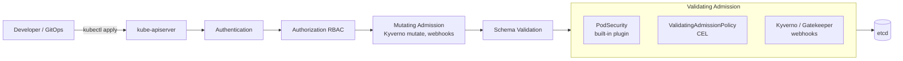
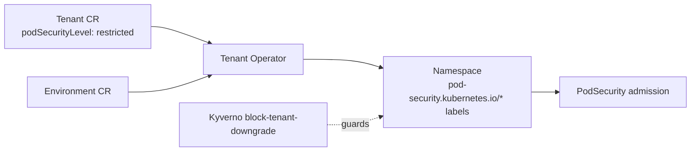
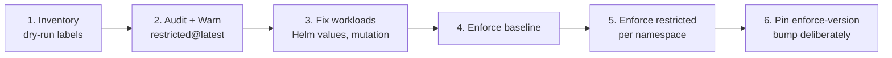

# Pod Security - Pod Security Admission and Pod Security Standards

## Learning Objectives
- Understand the three Pod Security Standards (Privileged, Baseline, Restricted) and what each one forbids
- Configure Pod Security Admission (PSA) per namespace with `enforce`, `audit` and `warn` modes
- Set cluster-wide defaults and exemptions with `PodSecurityConfiguration`
- Write workloads that pass the `restricted` profile without fighting it
- Close the gaps PSA leaves open using ValidatingAdmissionPolicy (CEL) and Kyverno
- Migrate safely from PodSecurityPolicy (removed in 1.25) or from "nothing" to enforced standards
- Bake pod security into the platform's `Tenant` and `Environment` APIs

## Prerequisites
- Kubernetes fundamentals: Pods, namespaces, admission control ([Kubernetes Architecture](../01-kubernetes-fundamentals/kubernetes-architecture.md))
- RBAC basics ([RBAC](../01-kubernetes-fundamentals/rbac.md))
- Familiarity with policy engines ([Policy Engine](./policy-engine.md))
- A Kubernetes 1.28+ cluster (Kind/k3d is fine) and `kubectl`

---

## Why Pod Security Matters

A Pod spec is a very powerful request. With the wrong fields a single container can:

- run as `root` with `privileged: true` and effectively own the node
- share the host's network, PID or IPC namespace (`hostNetwork`, `hostPID`, `hostIPC`)
- mount the node filesystem via `hostPath` (including `/var/run/containerd/containerd.sock`)
- add Linux capabilities such as `SYS_ADMIN` or `NET_RAW`
- disable seccomp/AppArmor and gain access to hundreds of extra syscalls

In a multi-tenant platform, any of these turns a compromised application into a compromised cluster. Pod security is the **guardrail that keeps workloads inside their container boundary**, and it is one of the few controls every platform should enforce from day one.



PSA is a **built-in validating admission plugin** — no webhook, no extra deployment, no availability risk. That makes it the right foundation; webhooks and CEL policies layer on top for anything PSA cannot express.

---

## The Pod Security Standards

The [Pod Security Standards](https://kubernetes.io/docs/concepts/security/pod-security-standards/) define three cumulative profiles:

| Profile | Intent | Typical Users |
|---------|--------|---------------|
| **Privileged** | Unrestricted. Allows everything, including known privilege escalations | CNI, CSI drivers, node agents, `kube-system` |
| **Baseline** | Minimally restrictive. Blocks *known* privilege escalations while accepting most default Pod specs | Legacy or third-party apps you cannot easily change |
| **Restricted** | Hardened, following current best practice. Requires explicit non-root, dropped capabilities, seccomp | All tenant application workloads |

### Baseline Controls

| Control | Restricted Fields | Allowed Values |
|---------|-------------------|----------------|
| HostProcess (Windows) | `securityContext.windowsOptions.hostProcess` | unset / `false` |
| Host namespaces | `spec.hostNetwork`, `spec.hostPID`, `spec.hostIPC` | unset / `false` |
| Privileged containers | `securityContext.privileged` | unset / `false` |
| Capabilities | `securityContext.capabilities.add` | Only the default set: `AUDIT_WRITE`, `CHOWN`, `DAC_OVERRIDE`, `FOWNER`, `FSETID`, `KILL`, `MKNOD`, `NET_BIND_SERVICE`, `SETFCAP`, `SETGID`, `SETPCAP`, `SETUID`, `SYS_CHROOT` |
| HostPath volumes | `spec.volumes[*].hostPath` | not allowed |
| Host ports | `ports[*].hostPort` | unset / `0` |
| AppArmor | `securityContext.appArmorProfile.type` (and legacy annotation) | unset, `RuntimeDefault`, `Localhost` |
| SELinux | `seLinuxOptions.type` | unset, `container_t`, `container_init_t`, `container_kvm_t`, `container_engine_t` (user/role must be unset) |
| `/proc` mount | `securityContext.procMount` | unset / `Default` |
| Seccomp | `securityContext.seccompProfile.type` | must not be `Unconfined` |
| Sysctls | `spec.securityContext.sysctls[*].name` | only the "safe" namespaced set (e.g. `net.ipv4.ip_unprivileged_port_start`, `net.ipv4.ping_group_range`, `kernel.shm_rmid_forced`) |

### Restricted Controls (in addition to Baseline)

| Control | Requirement |
|---------|-------------|
| Volume types | Only `configMap`, `csi`, `downwardAPI`, `emptyDir`, `ephemeral`, `persistentVolumeClaim`, `projected`, `secret` |
| Privilege escalation | `allowPrivilegeEscalation: false` on every container |
| Running as non-root | `runAsNonRoot: true` (pod or every container) |
| Non-root UID | `runAsUser` must not be `0` |
| Seccomp | `seccompProfile.type` must be explicitly `RuntimeDefault` or `Localhost` |
| Capabilities | Must `drop: ["ALL"]`; may only `add: ["NET_BIND_SERVICE"]` |

> **Note:** Controls apply to `containers`, `initContainers` and `ephemeralContainers`. A debug container added with `kubectl debug` must also comply in a `restricted` namespace — use `kubectl debug --profile=restricted`.

---

## Pod Security Admission

PSA has been GA since Kubernetes 1.25 and is enabled by default. It is configured with **namespace labels**:

```text
pod-security.kubernetes.io/<MODE>: <LEVEL>
pod-security.kubernetes.io/<MODE>-version: <VERSION>
```

| Mode | Effect on Pods | Effect on Workload Objects (Deployment, Job, ...) |
|------|----------------|---------------------------------------------------|
| `enforce` | Violating Pods are **rejected** | Not evaluated — the object is created, but its Pods fail |
| `audit` | Allowed; violation recorded as audit annotation | Evaluated against the Pod template |
| `warn` | Allowed; user sees a `Warning:` in the API response | Evaluated against the Pod template |

`<VERSION>` pins the policy definition (`v1.28`, `v1.30`, ...) or tracks `latest`. Pinning `enforce-version` protects you from a cluster upgrade that tightens a control; set `warn-version`/`audit-version` to `latest` so you see upcoming changes early.

### Namespace Configuration

```yaml
# namespace-team-payments.yaml
apiVersion: v1
kind: Namespace
metadata:
  name: team-payments-prod
  labels:
    platform.mycompany.io/tenant: payments
    platform.mycompany.io/environment: production
    # Reject anything that is not "restricted" as defined in Kubernetes v1.30
    pod-security.kubernetes.io/enforce: restricted
    pod-security.kubernetes.io/enforce-version: v1.30
    # Surface the *latest* definition so upgrades never surprise us
    pod-security.kubernetes.io/warn: restricted
    pod-security.kubernetes.io/warn-version: latest
    pod-security.kubernetes.io/audit: restricted
    pod-security.kubernetes.io/audit-version: latest
```

A common rollout uses different levels per mode — enforce what you can today, warn/audit on what you want tomorrow:

```yaml
# namespace-legacy-app.yaml
apiVersion: v1
kind: Namespace
metadata:
  name: legacy-billing
  labels:
    pod-security.kubernetes.io/enforce: baseline      # hard floor today
    pod-security.kubernetes.io/enforce-version: v1.30
    pod-security.kubernetes.io/warn: restricted       # nudge developers
    pod-security.kubernetes.io/audit: restricted      # measure the gap
```

### What a Violation Looks Like

```bash
$ kubectl -n team-payments-prod run nginx --image=nginx:1.27
Error from server (Forbidden): pods "nginx" is forbidden: violates PodSecurity "restricted:v1.30":
allowPrivilegeEscalation != false (container "nginx" must set securityContext.allowPrivilegeEscalation=false),
unrestricted capabilities (container "nginx" must set securityContext.capabilities.drop=["ALL"]),
runAsNonRoot != true (pod or container "nginx" must set securityContext.runAsNonRoot=true),
seccompProfile (pod or container "nginx" must set securityContext.seccompProfile.type to "RuntimeDefault" or "Localhost")
```

For a Deployment the API call **succeeds** (with a warning) and the failure shows up on the ReplicaSet:

```bash
$ kubectl -n team-payments-prod get events --field-selector reason=FailedCreate
LAST SEEN   TYPE      REASON         OBJECT                     MESSAGE
12s         Warning   FailedCreate   replicaset/web-7d9c8b6f5   Error creating: pods "web-7d9c8b6f5-x2k4p" is forbidden: violates PodSecurity "restricted:v1.30": ...
```

This is the #1 source of "my deployment has 0 pods" tickets. Enabling `warn` alongside `enforce` makes the problem visible at `kubectl apply` / Argo CD sync time.

---

## Cluster-Wide Defaults and Exemptions

Namespaces without labels fall back to the API server defaults, which are `privileged` unless you configure otherwise. Set safer defaults with an `AdmissionConfiguration` passed via `--admission-control-config-file`:

```yaml
# /etc/kubernetes/admission/admission-config.yaml
apiVersion: apiserver.config.k8s.io/v1
kind: AdmissionConfiguration
plugins:
  - name: PodSecurity
    configuration:
      apiVersion: pod-security.admission.config.k8s.io/v1
      kind: PodSecurityConfiguration
      # Applied to namespaces that have no pod-security.kubernetes.io labels
      defaults:
        enforce: "baseline"
        enforce-version: "latest"
        audit: "restricted"
        audit-version: "latest"
        warn: "restricted"
        warn-version: "latest"
      exemptions:
        # Authenticated usernames to exempt (use sparingly; prefer namespaces)
        usernames: []
        # RuntimeClass names to exempt (e.g. a sandboxed runtime you trust)
        runtimeClasses: []
        # Namespaces to exempt entirely
        namespaces:
          - kube-system
          - cilium-system
          - csi-drivers
```

```yaml
# kind-psa-cluster.yaml - wiring the config into a Kind control plane
kind: Cluster
apiVersion: kind.x-k8s.io/v1alpha4
nodes:
  - role: control-plane
    kubeadmConfigPatches:
      - |
        kind: ClusterConfiguration
        apiServer:
          extraArgs:
            admission-control-config-file: /etc/kubernetes/admission/admission-config.yaml
          extraVolumes:
            - name: admission
              hostPath: /etc/kubernetes/admission
              mountPath: /etc/kubernetes/admission
              readOnly: true
              pathType: DirectoryOrCreate
    extraMounts:
      - hostPath: ./admission
        containerPath: /etc/kubernetes/admission
```

> **Managed Kubernetes:** EKS, GKE and AKS do not let you change API server flags. Instead, label every namespace explicitly (ideally via your Tenant operator or a Kyverno mutate policy, see below) and treat the cluster default as `privileged`.

### Exemption Guidance

| Exemption Type | Use When | Risk |
|----------------|----------|------|
| Namespace | System add-ons that genuinely need host access (CNI, CSI, node exporters) | Anything that can create Pods in that namespace is unrestricted — lock down RBAC |
| RuntimeClass | Workloads isolated by gVisor/Kata where host escape risk is mitigated | Must trust the runtime's isolation |
| Username | Controllers that create Pods directly | Exempts **all** pods it creates; does not apply to pods created by controllers on behalf of users |

Prefer labelling system namespaces `privileged` explicitly over exemptions — labels are visible, auditable and GitOps-managed.

---

## Writing Restricted-Compliant Workloads

```yaml
# deployment-restricted.yaml
apiVersion: apps/v1
kind: Deployment
metadata:
  name: checkout-api
  namespace: team-payments-prod
  labels:
    platform.mycompany.io/workload: checkout-api
spec:
  replicas: 3
  selector:
    matchLabels:
      app.kubernetes.io/name: checkout-api
  template:
    metadata:
      labels:
        app.kubernetes.io/name: checkout-api
    spec:
      automountServiceAccountToken: false   # not a PSS control, but best practice
      securityContext:                       # Pod-level defaults
        runAsNonRoot: true                   # restricted: required
        runAsUser: 10001                     # restricted: must not be 0
        runAsGroup: 10001
        fsGroup: 10001
        seccompProfile:
          type: RuntimeDefault               # restricted: required (pod or container)
      containers:
        - name: api
          image: ghcr.io/mycompany/checkout-api@sha256:3f1c...e9a2   # digest-pinned (see supply-chain.md)
          ports:
            - containerPort: 8080            # >1024, no NET_BIND_SERVICE needed
          securityContext:
            allowPrivilegeEscalation: false  # restricted: required per container
            readOnlyRootFilesystem: true     # not a PSS control; enforce via VAP below
            capabilities:
              drop: ["ALL"]                  # restricted: required
          resources:
            requests: { cpu: 100m, memory: 128Mi }
            limits: { memory: 256Mi }
          volumeMounts:
            - name: tmp
              mountPath: /tmp
      volumes:
        - name: tmp
          emptyDir: {}                       # allowed volume type
```

### Common Fixes

| Symptom | Cause | Fix |
|---------|-------|-----|
| `runAsNonRoot != true` but image has `USER` set | PSA only checks the spec, not the image | Set `runAsNonRoot: true` explicitly |
| `container has runAsNonRoot and image will run as root` (kubelet error, Pod in `CreateContainerConfigError`) | Image defaults to UID 0 | Set `runAsUser` to a non-zero UID, or rebuild the image with a numeric `USER 10001` |
| App must bind port 80/443 | Ports < 1024 are privileged | Listen on 8080 and map via Service `port: 80 targetPort: 8080`, or `add: ["NET_BIND_SERVICE"]` |
| App writes to `/var/cache/...` | Read-only root FS | Mount an `emptyDir` at that path |
| Init container `chown`s a volume | Needs `CHOWN`/root | Use `fsGroup` + `fsGroupChangePolicy: OnRootMismatch` instead |
| Helm chart from a vendor fails | Chart defaults are permissive | Override `podSecurityContext`/`securityContext` values; most mainstream charts expose them |

### Seccomp Profiles

`RuntimeDefault` uses the container runtime's default seccomp profile (containerd and CRI-O both block ~50+ dangerous syscalls such as `keyctl`, `unshare` and `mount`). For stricter needs, use `Localhost` profiles distributed by the [Security Profiles Operator](https://github.com/kubernetes-sigs/security-profiles-operator):

```yaml
# pod-localhost-seccomp.yaml (fragment)
securityContext:
  seccompProfile:
    type: Localhost
    localhostProfile: operator/team-payments-prod/checkout-api.json  # relative to kubelet seccomp root
```

The kubelet flag `--seccomp-default` (GA in 1.27) makes `RuntimeDefault` the default for every Pod on a node, but PSA `restricted` still requires the field to be **set in the spec**, so keep setting it explicitly.

### User Namespaces (beta)

User namespaces map container UID 0 to an unprivileged UID on the host, so even a container "running as root" is not root on the node. The feature is **beta** (since 1.30, enabled by default from 1.33) and requires a recent container runtime and a Linux kernel with idmap mount support for the filesystems in use:

```yaml
# pod-userns.yaml (fragment)
spec:
  hostUsers: false     # run in a dedicated user namespace
```

Treat it as defense-in-depth on top of `restricted`, not a replacement, and check your distribution's support before relying on it.

---

## Closing the Gaps PSA Leaves Open

PSA is deliberately narrow: three fixed profiles, Pod fields only, no mutation, no custom messages. Common platform requirements it **does not** cover:

| Requirement | PSA? | Recommended Tool |
|-------------|------|------------------|
| `readOnlyRootFilesystem: true` | No | ValidatingAdmissionPolicy |
| Images only from approved registries / pinned by digest | No | VAP or Kyverno ([supply-chain.md](./supply-chain.md)) |
| `automountServiceAccountToken: false` | No | VAP / Kyverno |
| Exempt a single workload, not a whole namespace | No | Kyverno `podSecurity` with `exclude` |
| Auto-add `seccompProfile`, `drop: ALL` | No (no mutation) | Kyverno mutate |
| Set namespace PSA labels from tenant metadata | No | Kyverno mutate / Tenant operator |

### ValidatingAdmissionPolicy: Read-Only Root Filesystem

ValidatingAdmissionPolicy (VAP) is GA in 1.30 (`admissionregistration.k8s.io/v1`). Like PSA it runs in-process, so it has no webhook availability risk. Syntax details are covered in [Policy Engine](./policy-engine.md#cel-common-expression-language); here is a pod-security-focused example:

```yaml
# vap-readonly-rootfs.yaml
apiVersion: admissionregistration.k8s.io/v1
kind: ValidatingAdmissionPolicy
metadata:
  name: require-readonly-rootfs.platform.mycompany.io
spec:
  failurePolicy: Fail
  matchConstraints:
    resourceRules:
      - apiGroups: [""]
        apiVersions: ["v1"]
        operations: ["CREATE", "UPDATE"]
        resources: ["pods"]
  variables:
    # Collect every container type into one list
    - name: allContainers
      expression: >-
        object.spec.containers +
        (has(object.spec.initContainers) ? object.spec.initContainers : [])
  validations:
    - expression: >-
        variables.allContainers.all(c,
          has(c.securityContext) &&
          has(c.securityContext.readOnlyRootFilesystem) &&
          c.securityContext.readOnlyRootFilesystem == true)
      messageExpression: >-
        'all containers must set securityContext.readOnlyRootFilesystem=true; offending: ' +
        variables.allContainers.filter(c, !has(c.securityContext) ||
          !has(c.securityContext.readOnlyRootFilesystem) ||
          c.securityContext.readOnlyRootFilesystem != true).map(c, c.name).join(', ')
      reason: Forbidden
---
# vap-readonly-rootfs-binding.yaml
apiVersion: admissionregistration.k8s.io/v1
kind: ValidatingAdmissionPolicyBinding
metadata:
  name: require-readonly-rootfs-tenants
spec:
  policyName: require-readonly-rootfs.platform.mycompany.io
  # Start with [Warn, Audit]; switch to [Deny] once reports are clean
  validationActions: [Warn, Audit]
  matchResources:
    namespaceSelector:
      matchExpressions:
        - key: platform.mycompany.io/tenant
          operator: Exists
```

Because VAP matches Pods, Deployment authors only learn about violations through ReplicaSet events. Add a second rule on `apps/v1` workloads (checking `object.spec.template.spec`) if you want feedback at `kubectl apply` time.

### Kyverno: Per-Workload Exceptions with `podSecurity`

Kyverno's `validate.podSecurity` rule evaluates the same Pod Security Standards as PSA (it uses the upstream library), but adds fine-grained exclusions:

```yaml
# kyverno-pss-restricted.yaml
apiVersion: kyverno.io/v1
kind: ClusterPolicy
metadata:
  name: pss-restricted-tenants
  annotations:
    policies.kyverno.io/title: Pod Security Standards (Restricted) for tenants
    policies.kyverno.io/category: Pod Security
spec:
  # Kyverno 1.13+ also supports a per-rule `failureAction`; the spec-level field still works
  validationFailureAction: Enforce
  background: true
  rules:
    - name: restricted
      match:
        any:
          - resources:
              kinds: ["Pod"]
              namespaceSelector:
                matchExpressions:
                  - key: platform.mycompany.io/tenant
                    operator: Exists
      validate:
        podSecurity:
          level: restricted
          version: latest
          exclude:
            # Allow the Istio CNI-less init container to add NET_ADMIN/NET_RAW only
            - controlName: Capabilities
              images:
                - "docker.io/istio/proxyv2*"
              restrictedField: spec.initContainers[*].securityContext.capabilities.add
              values: ["NET_ADMIN", "NET_RAW"]
```

For one-off, time-boxed exceptions use a Kyverno `PolicyException` (`kyverno.io/v2`) rather than editing the policy — exceptions then become reviewable, owned objects in Git.

### Kyverno: Mutating Secure Defaults

Mutation reduces friction: developers get compliant specs without memorising every field.

```yaml
# kyverno-mutate-secure-defaults.yaml
apiVersion: kyverno.io/v1
kind: ClusterPolicy
metadata:
  name: add-secure-pod-defaults
spec:
  rules:
    - name: default-seccomp-and-nonroot
      match:
        any:
          - resources:
              kinds: ["Pod"]
              namespaceSelector:
                matchExpressions:
                  - key: platform.mycompany.io/tenant
                    operator: Exists
      mutate:
        patchStrategicMerge:
          spec:
            securityContext:
              +(runAsNonRoot): true          # "+()" = add only if absent
              +(seccompProfile):
                type: RuntimeDefault
            containers:
              - (name): "*"                  # anchor: apply to every container
                securityContext:
                  +(allowPrivilegeEscalation): false
                  +(capabilities):
                    drop: ["ALL"]
```

> **Ordering:** Mutating admission runs **before** PSA, so mutated defaults are what PSA evaluates. If the Kyverno webhook is down and `failurePolicy: Ignore`, Pods arrive unmutated and PSA rejects them — a safe failure mode.

### Kyverno: Namespace Labels from Tenant Metadata

```yaml
# kyverno-psa-labels-from-tier.yaml
apiVersion: kyverno.io/v1
kind: ClusterPolicy
metadata:
  name: set-psa-labels-by-tier
spec:
  rules:
    - name: restricted-for-tenant-namespaces
      match:
        any:
          - resources:
              kinds: ["Namespace"]
              selector:
                matchLabels:
                  platform.mycompany.io/security-tier: restricted
      mutate:
        patchStrategicMerge:
          metadata:
            labels:
              pod-security.kubernetes.io/enforce: restricted
              pod-security.kubernetes.io/enforce-version: v1.30
              pod-security.kubernetes.io/warn: restricted
              pod-security.kubernetes.io/warn-version: latest
    - name: block-tenant-downgrade
      match:
        any:
          - resources:
              kinds: ["Namespace"]
              selector:
                matchLabels:
                  platform.mycompany.io/security-tier: restricted
      validate:
        message: "Tenant namespaces may not weaken pod-security.kubernetes.io/enforce"
        pattern:
          metadata:
            labels:
              pod-security.kubernetes.io/enforce: restricted
```

Also restrict who can **edit namespace labels** via RBAC: anyone with `patch namespaces` can relabel a namespace to `privileged`. Tenants should never hold that verb (see [RBAC](../01-kubernetes-fundamentals/rbac.md)).

---

## Platform Integration: Security Tiers in the Tenant API

On a platform, developers should never hand-write PSA labels. The `Tenant` and `Environment` CRDs (`platform.mycompany.io/v1alpha1`) express intent; the operator renders labels.

```yaml
# tenant-payments.yaml
apiVersion: platform.mycompany.io/v1alpha1
kind: Tenant
metadata:
  name: payments
spec:
  owners:
    - group: payments-engineers
  security:
    podSecurityLevel: restricted      # restricted | baseline (privileged requires platform approval)
    podSecurityVersion: v1.30
---
# environment-payments-prod.yaml
apiVersion: platform.mycompany.io/v1alpha1
kind: Environment
metadata:
  name: payments-prod
spec:
  tenantRef: payments
  tier: production
```



| Tier | `enforce` | `warn` / `audit` | Who approves |
|------|-----------|------------------|--------------|
| `restricted` (default) | restricted | restricted@latest | Self-service |
| `baseline` | baseline | restricted@latest | Platform team review |
| `privileged` | privileged | baseline | Security team + time-boxed |

See the [tenant-operator](../../code/tenant-operator/) code for the reconciliation loop that applies these labels.

---

## Migrating to Pod Security Admission

PodSecurityPolicy was removed in Kubernetes 1.25. Whether you are migrating from PSP or rolling out pod security for the first time, the process is the same: **measure, warn, enforce**.



### Step 1: Dry-run Against Every Namespace

`--dry-run=server` evaluates existing Pods against the new label and prints warnings without changing anything:

```bash
# Which namespaces would break under "restricted"?
kubectl label --dry-run=server --overwrite ns --all \
  pod-security.kubernetes.io/enforce=restricted

# Example output
# Warning: existing pods in namespace "legacy-billing" violate the new PodSecurity enforce level "restricted:latest"
# Warning: legacy-billing-worker-6f7d (and 2 other pods): allowPrivilegeEscalation != false, runAsNonRoot != true
# namespace/legacy-billing labeled (server dry run)
```

### Step 2: Turn on Audit and Warn Everywhere

```bash
# label-audit-warn.sh - non-disruptive: affects only warnings and audit logs
for ns in $(kubectl get ns -l platform.mycompany.io/tenant -o name); do
  kubectl label --overwrite "$ns" \
    pod-security.kubernetes.io/audit=restricted \
    pod-security.kubernetes.io/audit-version=latest \
    pod-security.kubernetes.io/warn=restricted \
    pod-security.kubernetes.io/warn-version=latest
done
```

Audit violations appear as the `pod-security.kubernetes.io/audit-violations` annotation in API server audit events (see [compliance.md](./compliance.md#kubernetes-audit-logging)). The API server also exposes metrics:

```promql
# Pods evaluated against PSA, by decision and policy level
sum by (decision, policy_level, mode) (rate(pod_security_evaluations_total[5m]))

# Requests exempted from PSA
sum by (resource) (rate(pod_security_exemptions_total[1h]))
```

### Step 3: Map PSP Fields (if migrating)

| PSP Field | PSA / Replacement |
|-----------|-------------------|
| `privileged: false` | baseline |
| `hostNetwork/hostPID/hostIPC: false` | baseline |
| `allowedHostPaths` | baseline forbids all hostPath; use exemptions or Kyverno for allow-lists |
| `requiredDropCapabilities: [ALL]` | restricted |
| `runAsUser.rule: MustRunAsNonRoot` | restricted |
| `seLinux`, `supplementalGroups`, `fsGroup` ranges | Kyverno / VAP (PSA does not validate ranges) |
| `readOnlyRootFilesystem: true` | VAP / Kyverno |
| `allowedUnsafeSysctls` | baseline safe set only |
| Mutating defaults (`defaultAddCapabilities`, `runAsUser` defaults) | Kyverno mutate |

### Step 4 & 5: Enforce

Commit labels through GitOps (or the Tenant spec) one namespace group at a time, watching `FailedCreate` events and the `pod_security_evaluations_total{decision="deny"}` metric.

---

## Hands-On Exercise

### Lab: Roll Out Restricted Pod Security on a Tenant Namespace

**Prerequisites:** Kind or k3d cluster (1.28+), `kubectl`, optionally Kyverno ([Lab 05](../../labs/lab-05-policy-engine/)).

```bash
# 1. Create a tenant namespace in audit/warn mode only
kubectl create namespace psa-demo
kubectl label ns psa-demo platform.mycompany.io/tenant=demo \
  pod-security.kubernetes.io/warn=restricted \
  pod-security.kubernetes.io/audit=restricted

# 2. Deploy an insecure workload - observe the warnings but successful creation
kubectl -n psa-demo create deployment insecure --image=nginx:1.27
# Warning: would violate PodSecurity "restricted:latest": allowPrivilegeEscalation != false ...

# 3. Dry-run enforcement
kubectl label --dry-run=server --overwrite ns psa-demo \
  pod-security.kubernetes.io/enforce=restricted

# 4. Enforce and roll the deployment - watch it fail
kubectl label --overwrite ns psa-demo \
  pod-security.kubernetes.io/enforce=restricted \
  pod-security.kubernetes.io/enforce-version=latest
kubectl -n psa-demo rollout restart deployment insecure
kubectl -n psa-demo get events --field-selector reason=FailedCreate

# 5. Fix it: use an unprivileged image and a compliant securityContext
kubectl -n psa-demo delete deployment insecure
cat <<'EOF' | kubectl apply -f -
apiVersion: apps/v1
kind: Deployment
metadata:
  name: secure
  namespace: psa-demo
spec:
  replicas: 1
  selector:
    matchLabels: { app: secure }
  template:
    metadata:
      labels: { app: secure }
    spec:
      securityContext:
        runAsNonRoot: true
        runAsUser: 101
        seccompProfile: { type: RuntimeDefault }
      containers:
        - name: nginx
          image: nginxinc/nginx-unprivileged:1.27
          ports: [{ containerPort: 8080 }]
          securityContext:
            allowPrivilegeEscalation: false
            capabilities: { drop: ["ALL"] }
EOF
kubectl -n psa-demo rollout status deployment secure

# 6. Try to escape with a debug container - must use the restricted profile
kubectl -n psa-demo debug -it deploy/secure --image=busybox:1.36 --profile=restricted -- sh
```

**Stretch goals:**
1. Apply `vap-readonly-rootfs.yaml` with `validationActions: [Warn]`, then fix the `secure` deployment by adding `readOnlyRootFilesystem: true` and `emptyDir` mounts for `/tmp` and `/var/cache/nginx`.
2. Install the `add-secure-pod-defaults` Kyverno policy and re-run `kubectl create deployment` with plain `nginxinc/nginx-unprivileged` — it should now pass without hand-written `securityContext`.
3. Query `pod_security_evaluations_total` from the API server (`kubectl get --raw /metrics | grep pod_security`).

**Cleanup:**
```bash
kubectl delete namespace psa-demo
```

---

## Troubleshooting

### Deployment shows 0/N ready, no Pods exist
```bash
kubectl -n <ns> describe rs -l app=<name> | grep -A3 FailedCreate
kubectl get ns <ns> --show-labels
```
PSA `enforce` rejects Pods, not Deployments. Fix the Pod template or adjust the namespace level.

### Pod admitted but stuck in `CreateContainerConfigError`
```text
Error: container has runAsNonRoot and image will run as root
```
The spec passes PSA, but the kubelet detected that the image's user is root (or a non-numeric username it cannot verify). Set a numeric `runAsUser` or rebuild the image with `USER 10001`.

### Warnings appear but nothing is enforced
Check labels are spelled exactly — PSA silently ignores unknown keys, and an invalid level value causes evaluation errors:
```bash
kubectl get ns <ns> -o jsonpath='{.metadata.labels}' | jq
kubectl get --raw /metrics | grep pod_security_errors_total
```

### System add-on (CNI, CSI, node-exporter) fails after enabling cluster defaults
The add-on needs host access. Label its namespace `pod-security.kubernetes.io/enforce=privileged` explicitly, and restrict who can create Pods there.

### Kyverno and PSA disagree
Kyverno `podSecurity` with `version: latest` may track a newer Kubernetes definition than your API server. Pin both to the same version (e.g. `v1.30`).

### Upgrade broke workloads
A namespace using `enforce-version: latest` picked up a tightened control. Pin `enforce-version` to the previous minor, fix workloads using `warn-version: latest` output, then bump.

---

## Best Practices

1. **Default to `restricted`** for all tenant namespaces; make `baseline` an exception that requires review.
2. **Always set `warn` and `audit`** alongside `enforce` so developers see problems at deploy time.
3. **Pin `enforce-version`**, track `latest` for `warn`/`audit`.
4. **Generate labels from platform APIs** (Tenant/Environment), never by hand, and block downgrades.
5. **Prefer explicit `privileged` labels** for system namespaces over API server exemptions.
6. **Layer CEL/Kyverno** for `readOnlyRootFilesystem`, registries, token automount and per-workload exceptions.
7. **Ship secure defaults** in your [Helm charts](../../code/helm-charts/) and scaffolding templates so compliant is the path of least resistance.

---

## Further Reading

### Official Documentation
- [Pod Security Standards](https://kubernetes.io/docs/concepts/security/pod-security-standards/)
- [Pod Security Admission](https://kubernetes.io/docs/concepts/security/pod-security-admission/)
- [Enforce Pod Security Standards with Namespace Labels](https://kubernetes.io/docs/tasks/configure-pod-container/enforce-standards-namespace-labels/)
- [Migrate from PodSecurityPolicy to the Built-In PodSecurity Admission Controller](https://kubernetes.io/docs/tasks/configure-pod-container/migrate-from-psp/)
- [User Namespaces](https://kubernetes.io/docs/concepts/workloads/pods/user-namespaces/)
- [Validating Admission Policy](https://kubernetes.io/docs/reference/access-authn-authz/validating-admission-policy/)

### Tools
- [Kyverno Pod Security policies](https://kyverno.io/policies/?policytypes=Pod%2520Security)
- [Security Profiles Operator](https://github.com/kubernetes-sigs/security-profiles-operator)

### Articles
- [Kubernetes Hardening Guide (NSA/CISA)](https://media.defense.gov/2022/Aug/29/2003066362/-1/-1/0/CTR_KUBERNETES_HARDENING_GUIDANCE_1.2_20220829.PDF)

---

## Next Steps

1. **Complete Lab 05**: [Policy Engine lab](../../labs/lab-05-policy-engine/) — combine PSA with Kyverno and CEL
2. **Read**: [Supply Chain Security](./supply-chain.md) — control *what* runs, not just *how* it runs
3. **Read**: [Compliance](./compliance.md) — turn PSA audit data into compliance evidence
4. **Revisit**: [Policy Engine](./policy-engine.md) for deeper Kyverno/Gatekeeper/CEL patterns
