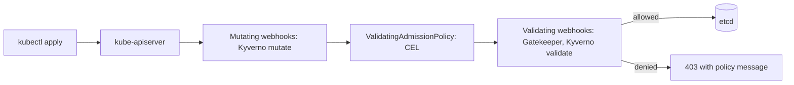

# Policy Engine - OPA Gatekeeper, Kyverno, CEL

## Learning Objectives
- Understand policy enforcement in Kubernetes
- Implement OPA Gatekeeper constraints and templates
- Create Kyverno policies for validation and mutation
- Use CEL (Common Expression Language) for native validation
- Test and debug policies

## Prerequisites
- Kubernetes fundamentals, especially admission control ([Kubernetes Architecture](../01-kubernetes-fundamentals/kubernetes-architecture.md))
- RBAC basics ([RBAC](../01-kubernetes-fundamentals/rbac.md))
- A kind or k3d cluster and `kubectl`; Helm 3.x for installing the engines
- Basic Rego (for Gatekeeper) or YAML (for Kyverno)

---

## Policy Engine Comparison

| Feature | OPA Gatekeeper | Kyverno | CEL (Native) |
|---------|---------------|---------|--------------|
| Language | Rego | YAML | CEL |
| Mutation | Limited | Full | No |
| Generation | No | Yes | No |
| Webhook | Validating/Mutating | Validating/Mutating | Validating |
| Ecosystem | Large | Growing | Built-in |
| Learning Curve | High | Low | Medium |

### Where Policies Run



Kyverno generate rules run asynchronously after admission, so they never block a request.

---

## OPA Gatekeeper

### Installation
```bash
# Install Gatekeeper
kubectl apply -f https://raw.githubusercontent.com/open-policy-agent/gatekeeper/release-3.14/deploy/gatekeeper.yaml

# Verify
kubectl get pods -n gatekeeper-system
```

### Constraint Template
```yaml
# constrainttemplate-requiredlabels.yaml
apiVersion: templates.gatekeeper.sh/v1
kind: ConstraintTemplate
metadata:
  name: k8srequiredlabels
spec:
  crd:
    spec:
      names:
        kind: K8sRequiredLabels
      validation:
        openAPIV3Schema:
          properties:
            labels:
              type: array
              items:
                type: string
            message:
              type: string
  targets:
    - target: admission.k8s.gatekeeper.sh
      rego: |
        package k8srequiredlabels
        
        violation[{"msg": msg, "details": {"missing_labels": missing}}] {
          provided := {label | input.review.object.metadata.labels[label]}
          required := {label | label := input.parameters.labels[_]}
          missing := required - provided
          count(missing) > 0
          msg := sprintf("missing required labels: %v", [missing])
        }
        
        violation[{"msg": msg}] {
          input.parameters.message
          msg := input.parameters.message
        }
```

### Constraint (Policy Instance)
```yaml
# constraint-requiredlabels.yaml
apiVersion: constraints.gatekeeper.sh/v1beta1
kind: K8sRequiredLabels
metadata:
  name: namespace-required-labels
spec:
  match:
    kinds:
      - apiGroups: [""]
        kinds: ["Namespace"]
  parameters:
    labels:
      - "platform.mycompany.io/owner"
      - "platform.mycompany.io/environment"
      - "platform.mycompany.io/team"
    message: "All namespaces must have owner, environment, and team labels"
```

### Sync Existing Resources
```yaml
# constraint-sync.yaml
apiVersion: constraints.gatekeeper.sh/v1beta1
kind: K8sRequiredLabels
metadata:
  name: namespace-required-labels
  annotations:
    # Enable dry-run for existing resources
    metadata.gatekeeper.sh/allow-sync: "true"
spec:
  match:
    kinds:
      - apiGroups: [""]
        kinds: ["Namespace"]
  parameters:
    labels:
      - "platform.mycompany.io/owner"
      - "platform.mycompany.io/environment"
```

### Audit Existing Resources
```bash
# Run audit
kubectl exec -n gatekeeper-system deploy/gatekeeper-audit -- \
  audit --output=json | jq '.results[] | select(.kind=="K8sRequiredLabels")'

# Or use kubectl plugin
kubectl gatekeeper audit
```

### Advanced Gatekeeper Policies

#### Allowed Repositories
```yaml
# constrainttemplate-allowedrepos.yaml
apiVersion: templates.gatekeeper.sh/v1
kind: ConstraintTemplate
metadata:
  name: k8sallowedrepos
spec:
  crd:
    spec:
      names:
        kind: K8sAllowedRepos
      validation:
        openAPIV3Schema:
          properties:
            repos:
              type: array
              items:
                type: string
  targets:
    - target: admission.k8s.gatekeeper.sh
      rego: |
        package k8sallowedrepos
        
        violation[{"msg": msg}] {
          container := input.review.object.spec.containers[_]
          not allowed_repo(container.image)
          msg := sprintf("Container %s uses disallowed image repository: %s", [container.name, container.image])
        }
        
        allowed_repo(image) {
          allowed := input.parameters.repos[_]
          startswith(image, allowed)
        }
```

```yaml
# constraint-allowedrepos.yaml
apiVersion: constraints.gatekeeper.sh/v1beta1
kind: K8sAllowedRepos
metadata:
  name: allowed-container-repos
spec:
  match:
    kinds:
      - apiGroups: [""]
        kinds: ["Pod"]
      - apiGroups: ["apps"]
        kinds: ["Deployment", "StatefulSet", "DaemonSet", "ReplicaSet"]
  parameters:
    repos:
      - "ghcr.io/myorg/"
      - "gcr.io/my-project/"
      - "registry.mycompany.com/"
```

#### Resource Limits Required
```yaml
# constrainttemplate-resourcelimits.yaml
apiVersion: templates.gatekeeper.sh/v1
kind: ConstraintTemplate
metadata:
  name: k8sresourcelimits
spec:
  crd:
    spec:
      names:
        kind: K8sResourceLimits
      validation:
        openAPIV3Schema:
          properties:
            cpu:
              type: string
            memory:
              type: string
  targets:
    - target: admission.k8s.gatekeeper.sh
      rego: |
        package k8sresourcelimits
        
        violation[{"msg": msg}] {
          container := input.review.object.spec.containers[_]
          not container.resources.limits.cpu
          msg := sprintf("Container %s missing CPU limit", [container.name])
        }
        
        violation[{"msg": msg}] {
          container := input.review.object.spec.containers[_]
          not container.resources.limits.memory
          msg := sprintf("Container %s missing memory limit", [container.name])
        }
        
        violation[{"msg": msg}] {
          container := input.review.object.spec.containers[_]
          limit := container.resources.limits.cpu
          limit > input.parameters.cpu
          msg := sprintf("Container %s CPU limit %s exceeds maximum %s", [container.name, limit, input.parameters.cpu])
        }
```

---

## Kyverno

### Installation
```bash
# Install Kyverno
kubectl create -f https://github.com/kyverno/kyverno/releases/download/v1.11.0/install.yaml

# Verify
kubectl get pods -n kyverno
```

### ClusterPolicy (Validation)
```yaml
# policylabel-required.yaml
apiVersion: kyverno.io/v1
kind: ClusterPolicy
metadata:
  name: require-labels
spec:
  validationFailureAction: Enforce
  background: true
  rules:
    - name: check-labels
      match:
        any:
          - resources:
              kinds:
                - Namespace
                - Deployment
                - Service
                - Ingress
      validate:
        message: "Resources must have required labels"
        pattern:
          metadata:
            labels:
              platform.mycompany.io/owner: "?*"
              platform.mycompany.io/environment: "?*"
              platform.mycompany.io/team: "?*"
```

### ClusterPolicy (Mutation)
```yaml
# policylabel-mutate.yaml
apiVersion: kyverno.io/v1
kind: ClusterPolicy
metadata:
  name: add-default-labels
spec:
  mutationFailureAction: Fail
  rules:
    - name: add-labels
      match:
        any:
          - resources:
              kinds:
                - Pod
                - Deployment
                - StatefulSet
                - DaemonSet
                - Job
                - CronJob
      mutate:
        patchStrategicMerge:
          metadata:
            labels:
              platform.mycompany.io/managed-by: "kyverno"
              platform.mycompany.io/cluster: "production"
      # Only mutate if not present
      preconditions:
        all:
          - key: "{{ request.object.metadata.labels['platform.mycompany.io/managed-by'] }}"
            operator: NotEquals
            value: "kyverno"
```

### ClusterPolicy (Generation)
```yaml
# policygenerate-networkpolicy.yaml
apiVersion: kyverno.io/v1
kind: ClusterPolicy
metadata:
  name: generate-networkpolicy
spec:
  rules:
    - name: generate-deny-all
      match:
        any:
          - resources:
              kinds:
                - Namespace
      generate:
        kind: NetworkPolicy
        apiVersion: networking.k8s.io/v1
        name: deny-all-ingress
        namespace: "{{request.object.metadata.name}}"
        synchronize: true
        data:
          spec:
            podSelector: {}
            policyTypes:
              - Ingress
            ingress: []
```

### ClusterPolicy (Image Verification)
```yaml
# policyverify-images.yaml
apiVersion: kyverno.io/v1
kind: ClusterPolicy
metadata:
  name: verify-image-signatures
spec:
  validationFailureAction: Enforce
  background: true
  rules:
    - name: verify-cosign
      match:
        any:
          - resources:
              kinds:
                - Pod
      verifyImages:
        - image: "ghcr.io/myorg/*"
          key: |
            -----BEGIN PUBLIC KEY-----
            ...
            -----END PUBLIC KEY-----
        - image: "gcr.io/my-project/*"
          attestations:
            - type: cosign.sigstore.dev/attestation/slsa
              conditions:
                - all:
                    - key: "{{ payload.predicate.buildType }}"
                      operator: Equals
                      value: "https://slsa-framework.github.io/github-actions/workflow@v1"
```

---

## CEL (Common Expression Language)

### ValidatingAdmissionPolicy (Kubernetes 1.26+)
```yaml
# validatingadmissionpolicy-requiredlabels.yaml
apiVersion: admissionregistration.k8s.io/v1
kind: ValidatingAdmissionPolicy
metadata:
  name: required-labels.policies.mycompany.io
spec:
  failurePolicy: Fail
  matchConstraints:
    resourceRules:
      - apiGroups: [""]
        apiVersions: ["v1"]
        operations: ["CREATE", "UPDATE"]
        resources: ["namespaces"]
      - apiGroups: ["apps"]
        apiVersions: ["v1"]
        operations: ["CREATE", "UPDATE"]
        resources: ["deployments", "statefulsets", "daemonsets"]
  validations:
    - expression: |
        has(object.metadata.labels) &&
        object.metadata.labels.exists(k, k.startsWith("platform.mycompany.io/"))
      message: "Resources must have at least one platform.mycompany.io/* label"
      reason: "MissingRequiredLabel"
    - expression: |
        has(object.metadata.labels) &&
        "platform.mycompany.io/owner" in object.metadata.labels &&
        "platform.mycompany.io/environment" in object.metadata.labels
      message: "Resources must have owner and environment labels"
      reason: "MissingRequiredLabels"
---
apiVersion: admissionregistration.k8s.io/v1
kind: ValidatingAdmissionPolicyBinding
metadata:
  name: required-labels-binding
spec:
  policyName: required-labels.policies.mycompany.io
  validationActions: [Deny]
  matchResources:
    namespaceSelector:
      matchExpressions:
        - key: kubernetes.io/metadata.name
          operator: NotIn
          values: ["kube-system", "gatekeeper-system", "kyverno"]
```

### CEL Expressions Reference

#### Common Patterns
```cel
# Check label exists
has(object.metadata.labels) && "key" in object.metadata.labels

# Check label value matches regex
object.metadata.labels["key"].matches(r"^v\d+\.\d+\.\d+$")

# Check annotation
has(object.metadata.annotations) && "key" in object.metadata.annotations

# Check resource limits
has(object.spec.template.spec.containers) &&
object.spec.template.spec.containers.all(c, 
  has(c.resources.limits) && 
  has(c.resources.limits.cpu) && 
  has(c.resources.limits.memory)
)

# Check image registry
object.spec.template.spec.containers.all(c,
  c.image.startsWith("ghcr.io/myorg/") || c.image.startsWith("gcr.io/my-project/")
)

# Check privileged containers
object.spec.template.spec.containers.all(c,
  !has(c.securityContext) || !c.securityContext.privileged == true
)

# Check host network/namespace
!has(object.spec.template.spec.hostNetwork) || object.spec.template.spec.hostNetwork == false
!has(object.spec.template.spec.hostPID) || object.spec.template.spec.hostPID == false

# Check runAsNonRoot
object.spec.template.spec.containers.all(c,
  has(c.securityContext) && c.securityContext.runAsNonRoot == true
) || 
has(object.spec.template.spec.securityContext) && 
object.spec.template.spec.securityContext.runAsNonRoot == true
```

---

## Policy Testing

### Gatekeeper Test Framework
```yaml
# test-constraint.yaml
apiVersion: gator.test.gatekeeper.sh/v1alpha1
kind: TestCase
metadata:
  name: test-required-labels
spec:
  template: k8srequiredlabels
  constraint: |
    apiVersion: constraints.gatekeeper.sh/v1beta1
    kind: K8sRequiredLabels
    metadata:
      name: test-required-labels
    spec:
      match:
        kinds:
          - apiGroups: [""]
            kinds: ["Namespace"]
      parameters:
        labels: ["owner", "environment"]
  cases:
    - name: namespace-with-labels-passes
      object: |
        apiVersion: v1
        kind: Namespace
        metadata:
          name: test-ns
          labels:
            owner: "team-a"
            environment: "production"
      expectedViolations: 0
    - name: namespace-without-labels-fails
      object: |
        apiVersion: v1
        kind: Namespace
        metadata:
          name: test-ns
      expectedViolations: 1
```

```bash
# Run tests
gatekeeper test --verbose ./test-constraint.yaml
```

### Kyverno Test Framework
```yaml
# test-policy.yaml
apiVersion: kyverno.io/v1alpha1
kind: PolicyTest
metadata:
  name: test-require-labels
spec:
  policies:
    - policylabel-required.yaml
  resources:
    - |
      apiVersion: v1
      kind: Namespace
      metadata:
        name: test-pass
        labels:
          platform.mycompany.io/owner: "team-a"
          platform.mycompany.io/environment: "production"
          platform.mycompany.io/team: "platform"
  results:
    - policy: require-labels
      rule: check-labels
      resources:
        - test-pass
      result: pass
```

```bash
# Run tests
kyverno test test-policy.yaml
```

### CEL Policy Testing
```bash
# Use cel-go for unit testing CEL expressions
# Or test with kubectl dry-run
kubectl apply -f resource.yaml --dry-run=server
```

---

## Hands-On Exercises

These exercises use the policies in [Lab 05: Policy Engine](../../labs/lab-05-policy-engine/README.md).
Run them from the repository root against a kind cluster where the lab's `setup.sh` has installed
Gatekeeper and Kyverno. Install the Kyverno CLI and `opa` or `gator` for the test steps.

### Exercise 1: Audit before you enforce

Goal: watch a CEL policy report a violation without blocking it.

```bash
kubectl apply -f labs/lab-05-policy-engine/cel-policies/
# Edit labs/lab-05-policy-engine/cel-policies/disallow-latest-tag.yaml so the binding has
# validationActions: ["Warn", "Audit"], then re-apply it and create a non-compliant pod.
kubectl apply -f labs/lab-05-policy-engine/cel-policies/disallow-latest-tag.yaml
kubectl apply -f labs/lab-05-policy-engine/tests/fixtures/pod-latest-tag.yaml
```

Expected output: the pod is created, and `kubectl` prints a warning that names the policy:

```text
Warning: Validation failed for ValidatingAdmissionPolicy 'disallow-latest-tag': ...
pod/<pod-name> created
```

Check: `kubectl get pod -n <namespace-in-fixture>` shows the pod `Running` (replace
`<namespace-in-fixture>` with the namespace in `pod-latest-tag.yaml`). Switch the binding back
to `["Deny"]`, re-apply it, delete the pod and apply the fixture again. The apply now fails with
`denied request`.

### Exercise 2: Prove a policy blocks what it should

Goal: extend a policy test suite and see it fail before you fix the policy.

1. Run the Gatekeeper suite: `gator verify labs/lab-05-policy-engine/gatekeeper-policies/tests/...`
   (expected: every case reports `ok`).
2. Add one fixture under `gatekeeper-policies/tests/resources/` that violates the required-labels
   rule in a way the suite does not cover, such as a label with an empty value, and list it in
   `suite.yaml`.
3. Re-run the suite and confirm it fails, then tighten the Rego until it passes.

Check: the final run ends with all cases `ok` and exit code 0 (`echo $?`).

### Exercise 3: Write a Kyverno mutation instead of a denial

Goal: replace a rejection with a default so tenants are not blocked.

1. Copy `labs/lab-05-policy-engine/kyverno-policies/require-labels.yaml` and compare it with
   `add-default-labels.yaml` in the same directory.
2. Change the copy from `validate` to `mutate` so it adds a default `team` label.
3. Run `kyverno test labs/lab-05-policy-engine/kyverno-policies/tests/`.

Expected output: a results table with every row `Pass`. Check: the mutated resource in the test
output carries the `team` label. Then explain why mutation is harder to audit than validation.

---

## Best Practices

1. **Start with Audit Mode**: Use `validationFailureAction: Audit` first
2. **Test Thoroughly**: Unit test all policies before enforcing
3. **Use Namespace Selectors**: Exclude system namespaces
4. **Gradual Rollout**: Apply to non-production first
5. **Monitor Violations**: Alert on policy violations
6. **Document Exceptions**: Process for policy exceptions
7. **Version Policies**: Store in Git with version control

---

## Troubleshooting

### Gatekeeper
```bash
# Check constraint status
kubectl get constraint K8sRequiredLabels -o yaml

# Check violations
kubectl get constraints -o jsonpath='{.items[*].status.violations}'

# Check audit results
kubectl get constraint K8sRequiredLabels -o jsonpath='{.status.auditTimestamp}'

# Debug Rego
opa eval -i input.json -d policy.rego "data.k8srequiredlabels.violation"
```

### Kyverno
```bash
# Check policy status
kubectl get clusterpolicy require-labels -o yaml

# Check policy reports
kubectl get policyreport -A

# Check generated resources
kubectl get generatedresources -A
```

### CEL
```bash
# Check policy binding
kubectl get validatingadmissionpolicybinding required-labels-binding -o yaml

# Check admission review
kubectl get events --field-selector reason=FailedAdmission
```

---

## Further Reading

- [OPA Gatekeeper](https://open-policy-agent.github.io/gatekeeper/)
- [Kyverno Documentation](https://kyverno.io/docs/)
- [Kubernetes CEL](https://kubernetes.io/docs/reference/using-api/cel/)
- [Policy Testing](https://github.com/kyverno/kyverno/tree/main/docs/writing-policies/testing)
