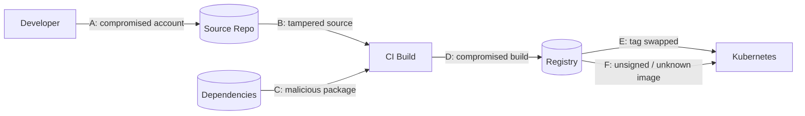
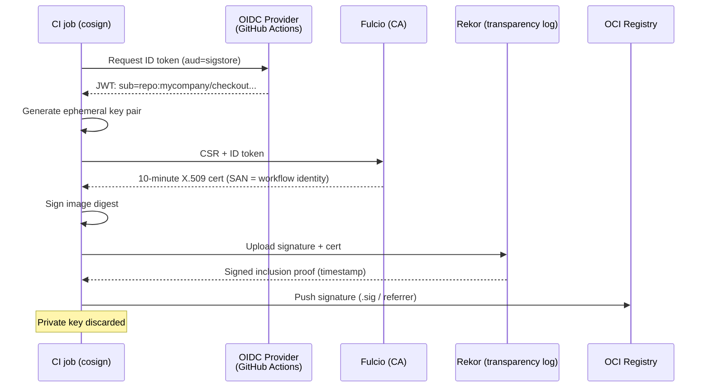
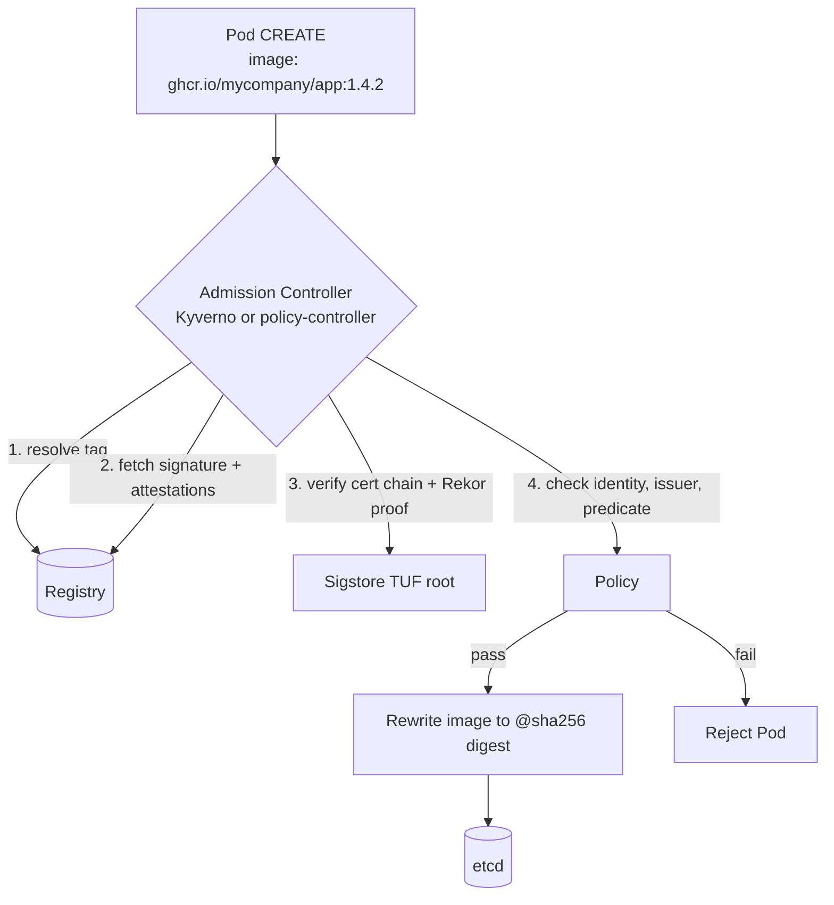
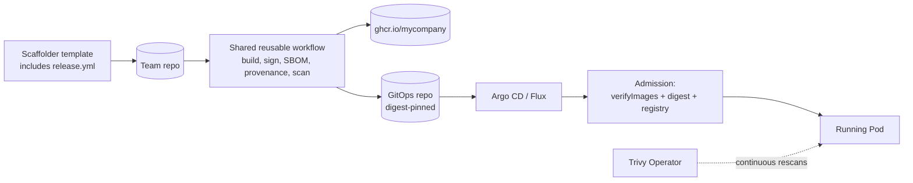

# Software Supply Chain Security - SLSA, Sigstore, in-toto

## Learning Objectives
- Understand the software supply chain threat model and where attacks happen
- Apply the SLSA v1.0 Build track levels to your CI pipelines
- Sign and verify container images keylessly with Sigstore cosign v2
- Produce SBOMs (Syft, Trivy) and attach them as in-toto attestations
- Generate SLSA build provenance in GitHub Actions
- Enforce "only signed, provenance-backed, digest-pinned images run here" with Kyverno or the Sigstore policy-controller
- Design a paved-road supply chain the platform provides to every team

## Prerequisites
- Container image fundamentals: manifests, digests, registries ([Image Spec](../02-container-runtime/image-spec.md))
- Image signing and scanning basics ([Image Security](../02-container-runtime/image-security.md))
- Admission control and Kyverno ([Policy Engine](./policy-engine.md))
- A GitHub repository with Actions enabled and a registry (GHCR works out of the box)
- CLI tools: `cosign` v2.x, `syft`, `trivy`, `crane`, `gh`

---

## The Supply Chain Threat Model

Your cluster runs whatever image reference ends up in a Pod spec. Every step between a developer's commit and that Pod is an attack surface.



| Threat | Real-World Example | Control |
|--------|-------------------|---------|
| A. Source tampering via compromised credentials | PHP git server compromise (2021) | Branch protection, signed commits, 2-person review |
| B/D. Build system compromise | SolarWinds SUNBURST (2020), Codecov bash uploader (2021) | Hosted, isolated builders; SLSA provenance |
| C. Malicious / compromised dependency | `xz-utils` backdoor (2024), `event-stream` (2018) | SBOMs, dependency pinning, vulnerability scanning |
| E. Mutable tags repointed | `:latest` silently replaced | Digest pinning |
| F. Arbitrary images deployed | Cryptominers from public registries | Signature + provenance verification at admission |

The platform's job: make the secure path the **default** path. Teams should get signing, SBOMs and provenance by using the platform's CI templates, and the cluster should refuse anything that did not come through that path.

---

## SLSA v1.0

[SLSA](https://slsa.dev/spec/v1.0/) (Supply-chain Levels for Software Artifacts) is an OpenSSF framework of incrementally adoptable levels. v1.0 defines the **Build track**:

| Level | Name | Requirements | What It Prevents |
|-------|------|-------------|------------------|
| Build L0 | No guarantees | — | — |
| Build L1 | Provenance exists | The build process is consistent and produces provenance describing how the artifact was built | Mistakes; enables inventory and debugging |
| Build L2 | Hosted build platform | Builds run on a hosted platform that **generates and signs** the provenance itself | Tampering after the build; forging provenance without compromising the platform |
| Build L3 | Hardened builds | Builds are isolated from each other; signing secrets are inaccessible to user-defined build steps | Tampering *during* the build by other tenants or the build script itself |

Key ideas:

- **Provenance** is a signed statement: "artifact with digest X was built by builder B from source S at commit C using build definition D."
- The level describes the **build platform's** guarantees, not your code quality.
- GitHub-hosted runners + reusable workflows that isolate signing (e.g. `slsa-github-generator`) reach **Build L3**. GitHub Artifact Attestations (`actions/attest-build-provenance`) give **L2** out of the box, and L3 when invoked from a reusable workflow that isolates the build.

---

## Sigstore Overview

[Sigstore](https://www.sigstore.dev/) removes the hardest part of signing — key management — by using short-lived certificates bound to an OIDC identity.



| Component | Role |
|-----------|------|
| **cosign** | CLI to sign/verify images, blobs and attestations |
| **Fulcio** | Certificate authority issuing short-lived certs for OIDC identities |
| **Rekor** | Append-only transparency log; proves the signature existed while the cert was valid |
| **policy-controller** | Kubernetes admission controller enforcing `ClusterImagePolicy` |

Because the certificate expires within minutes, verification relies on the **Rekor timestamp** to prove signing happened during the validity window. Verification therefore checks *who* signed (identity + issuer), not *which key*.

### Keyless Signing with cosign v2

cosign v2 defaults to keyless mode. Always sign **by digest**, never by tag:

```bash
# sign.sh - run inside CI with an OIDC token available
IMAGE=ghcr.io/mycompany/checkout-api
DIGEST=$(crane digest "${IMAGE}:1.4.2")          # sha256:3f1c...

# --yes skips the interactive "upload to public transparency log?" prompt
cosign sign --yes "${IMAGE}@${DIGEST}"
```

### Verifying Signatures

Verification **requires** an expected identity and issuer — that's what makes keyless meaningful:

```bash
# verify.sh
cosign verify \
  --certificate-identity "https://github.com/mycompany/checkout-api/.github/workflows/release.yml@refs/heads/main" \
  --certificate-oidc-issuer "https://token.actions.githubusercontent.com" \
  ghcr.io/mycompany/checkout-api@sha256:3f1c...e9a2 | jq '.[0].optional'

# Allow any workflow on main from any repo in the org
cosign verify \
  --certificate-identity-regexp '^https://github.com/mycompany/[^/]+/\.github/workflows/release\.yml@refs/heads/main$' \
  --certificate-oidc-issuer "https://token.actions.githubusercontent.com" \
  ghcr.io/mycompany/checkout-api@sha256:3f1c...e9a2
```

The identity for GitHub Actions is the **workflow file reference** (`<repo>/.github/workflows/<file>@<ref>`). You can additionally constrain Fulcio certificate extensions, e.g. `--certificate-github-workflow-repository mycompany/checkout-api`.

### Key-Based Signing (Air-Gapped / Private Infra)

When public Sigstore is not acceptable, either run a private Sigstore stack (Fulcio + Rekor via the `sigstore/scaffold` Helm charts) or sign with a KMS-held key:

```bash
cosign generate-key-pair --kms awskms:///alias/platform-image-signing
cosign sign --yes --key awskms:///alias/platform-image-signing "${IMAGE}@${DIGEST}"
cosign verify --key awskms:///alias/platform-image-signing "${IMAGE}@${DIGEST}"
```

---

## Attestations and in-toto

A signature says "this identity vouches for this digest." An **attestation** says "this identity claims *this specific fact* about this digest." Sigstore attestations use the [in-toto Attestation Framework](https://github.com/in-toto/attestation):

```json
// in-toto-statement.json (simplified) - wrapped in a signed DSSE envelope
{
  "_type": "https://in-toto.io/Statement/v1",
  "subject": [
    {
      "name": "ghcr.io/mycompany/checkout-api",
      "digest": { "sha256": "3f1c...e9a2" }
    }
  ],
  "predicateType": "https://slsa.dev/provenance/v1",
  "predicate": {
    "buildDefinition": {
      "buildType": "https://actions.github.io/buildtypes/workflow/v1",
      "externalParameters": {
        "workflow": {
          "ref": "refs/heads/main",
          "repository": "https://github.com/mycompany/checkout-api",
          "path": ".github/workflows/release.yml"
        }
      },
      "resolvedDependencies": [
        { "uri": "git+https://github.com/mycompany/checkout-api@refs/heads/main",
          "digest": { "gitCommit": "a1b2c3d..." } }
      ]
    },
    "runDetails": {
      "builder": { "id": "https://github.com/actions/runner/github-hosted" },
      "metadata": { "invocationId": "https://github.com/mycompany/checkout-api/actions/runs/123/attempts/1" }
    }
  }
}
```

| Layer | Purpose |
|-------|---------|
| **Statement** | Binds a predicate to one or more artifact digests (`subject`) |
| **Predicate** | The claim: SLSA provenance, SPDX/CycloneDX SBOM, vulnerability scan, test results... |
| **DSSE envelope** | Signs the statement (payload type `application/vnd.in-toto+json`) |

Common predicate types:

| Predicate | `predicateType` URI | cosign `--type` |
|-----------|---------------------|-----------------|
| SLSA Provenance v1 | `https://slsa.dev/provenance/v1` | `slsaprovenance1` |
| SLSA Provenance v0.2 | `https://slsa.dev/provenance/v0.2` | `slsaprovenance` |
| SPDX SBOM | `https://spdx.dev/Document` | `spdxjson` |
| CycloneDX SBOM | `https://cyclonedx.org/bom` | `cyclonedx` |
| Vulnerability scan | `https://cosign.sigstore.dev/attestation/vuln/v1` | `vuln` |

---

## SBOMs

A Software Bill of Materials lists every package in an image — essential for answering "are we affected by CVE-X?" in minutes instead of days.

```bash
# sbom.sh
IMAGE=ghcr.io/mycompany/checkout-api@sha256:3f1c...e9a2

# Syft: SPDX JSON (also supports cyclonedx-json, syft-json)
syft "${IMAGE}" -o spdx-json=sbom.spdx.json

# Trivy: CycloneDX
trivy image --format cyclonedx --output sbom.cdx.json "${IMAGE}"

# Attach the SBOM as a signed attestation
cosign attest --yes --type spdxjson --predicate sbom.spdx.json "${IMAGE}"

# Later: verify and extract the SBOM
cosign verify-attestation --type spdxjson \
  --certificate-identity-regexp '^https://github.com/mycompany/' \
  --certificate-oidc-issuer https://token.actions.githubusercontent.com \
  "${IMAGE}" | jq -r '.payload' | base64 -d | jq '.predicate.packages | length'

# Re-scan an SBOM for newly disclosed CVEs without pulling the image
trivy sbom --severity HIGH,CRITICAL sbom.cdx.json
```

| Format | Steward | Strengths |
|--------|---------|-----------|
| SPDX 2.3 | Linux Foundation (ISO/IEC 5962) | Licensing, legal compliance, widely mandated |
| CycloneDX 1.5+ | OWASP | Security focus, VEX support, services and ML-BOMs |

**VEX** (Vulnerability Exploitability eXchange) documents complement SBOMs by stating "CVE-X is *not exploitable* in this product" — Trivy can consume them with `--vex` to suppress known false positives.

---

## Provenance in GitHub Actions

### Option A: GitHub Artifact Attestations

`actions/attest-build-provenance` produces SLSA v1 provenance signed via Sigstore (public-good instance for public repos, GitHub's instance for private repos) and stores it in GitHub's attestation API and, optionally, in the registry.

```yaml
# .github/workflows/release.yml
name: release
on:
  push:
    branches: [main]

permissions:
  contents: read

jobs:
  build:
    runs-on: ubuntu-latest
    permissions:
      contents: read
      packages: write        # push to GHCR
      id-token: write        # OIDC token for Sigstore (keyless)
      attestations: write    # write to GitHub attestation store
    outputs:
      digest: ${{ steps.build.outputs.digest }}
    steps:
      - uses: actions/checkout@v4

      - uses: docker/setup-buildx-action@v3

      - uses: docker/login-action@v3
        with:
          registry: ghcr.io
          username: ${{ github.actor }}
          password: ${{ secrets.GITHUB_TOKEN }}

      - name: Build and push
        id: build
        uses: docker/build-push-action@v6
        with:
          push: true
          tags: ghcr.io/${{ github.repository }}:${{ github.sha }}

      - uses: sigstore/cosign-installer@v3

      - name: Sign image (keyless)
        run: cosign sign --yes ghcr.io/${{ github.repository }}@${{ steps.build.outputs.digest }}

      - name: Generate SBOM
        uses: anchore/sbom-action@v0
        with:
          image: ghcr.io/${{ github.repository }}@${{ steps.build.outputs.digest }}
          format: spdx-json
          output-file: sbom.spdx.json

      - name: Attest SBOM (cosign / in-toto)
        run: |
          cosign attest --yes --type spdxjson --predicate sbom.spdx.json \
            ghcr.io/${{ github.repository }}@${{ steps.build.outputs.digest }}

      - name: Attest build provenance (GitHub)
        uses: actions/attest-build-provenance@v2
        with:
          subject-name: ghcr.io/${{ github.repository }}
          subject-digest: ${{ steps.build.outputs.digest }}
          push-to-registry: true

      - name: Gate on critical vulnerabilities
        uses: aquasecurity/trivy-action@0.28.0
        with:
          image-ref: ghcr.io/${{ github.repository }}@${{ steps.build.outputs.digest }}
          severity: CRITICAL
          ignore-unfixed: true
          exit-code: "1"
```

Verify with the GitHub CLI:

```bash
gh attestation verify oci://ghcr.io/mycompany/checkout-api@sha256:3f1c...e9a2 \
  --owner mycompany \
  --signer-workflow mycompany/checkout-api/.github/workflows/release.yml
```

> **Repository hygiene:** Pin third-party actions to full commit SHAs in production (`uses: actions/checkout@<sha> # v4.2.2`) and let Dependabot/Renovate bump them. A tag-referenced action is itself a mutable supply-chain dependency.

### Option B: slsa-github-generator (SLSA Build L3)

The [SLSA GitHub generator](https://github.com/slsa-framework/slsa-github-generator) runs provenance generation in an isolated reusable workflow, so your build steps never touch the signing identity:

```yaml
# .github/workflows/release-slsa3.yml (excerpt)
jobs:
  build:
    # ... same build job as above, exposing outputs.image and outputs.digest
  provenance:
    needs: [build]
    permissions:
      actions: read          # read workflow run info
      id-token: write        # sign provenance
      packages: write        # upload provenance to registry
    # Reusable workflows MUST be referenced by tag (@vX.Y.Z), not SHA
    uses: slsa-framework/slsa-github-generator/.github/workflows/generator_container_slsa3.yml@v2.0.0
    with:
      image: ghcr.io/${{ github.repository }}
      digest: ${{ needs.build.outputs.digest }}
      registry-username: ${{ github.actor }}
    secrets:
      registry-password: ${{ secrets.GITHUB_TOKEN }}
```

```bash
# Verify with slsa-verifier
slsa-verifier verify-image ghcr.io/mycompany/checkout-api@sha256:3f1c...e9a2 \
  --source-uri github.com/mycompany/checkout-api \
  --source-branch main

# Or with cosign - note the identity is the *generator* workflow, not yours
cosign verify-attestation --type slsaprovenance \
  --certificate-identity-regexp '^https://github.com/slsa-framework/slsa-github-generator/\.github/workflows/generator_container_slsa3\.yml@refs/tags/v[0-9]+\.[0-9]+\.[0-9]+$' \
  --certificate-oidc-issuer https://token.actions.githubusercontent.com \
  ghcr.io/mycompany/checkout-api@sha256:3f1c...e9a2
```

| | Artifact Attestations | slsa-github-generator |
|---|---|---|
| Setup | One step | Separate reusable-workflow job |
| SLSA level | L2 (L3 via isolated reusable workflow) | L3 |
| Provenance format | SLSA v1 (Sigstore bundle) | SLSA v0.2 (container generator) |
| Verification | `gh attestation verify`, cosign, Kyverno | `slsa-verifier`, cosign, Kyverno |
| Non-GitHub registries | Yes (`push-to-registry`) | Yes |

---

## Digest Pinning

Tags are mutable pointers; digests are content addresses. Signatures and attestations are bound to **digests**, so admission must evaluate digests too.

```bash
# Resolve a tag to its digest
crane digest ghcr.io/mycompany/checkout-api:1.4.2
docker buildx imagetools inspect ghcr.io/mycompany/checkout-api:1.4.2 --format '{{json .Manifest.Digest}}'
```

```yaml
# deployment fragment - tag kept for humans, digest used by the runtime
containers:
  - name: api
    image: ghcr.io/mycompany/checkout-api:1.4.2@sha256:3f1c...e9a2
```

Three ways to get there:

1. **CI writes digests** into GitOps manifests (Flux image automation, Argo CD Image Updater, Kustomize `images[].digest`).
2. **Kyverno `mutateDigest: true`** resolves tags at admission time and rewrites the Pod spec (shown below).
3. **Reject tags** with a CEL policy:

```yaml
# vap-require-digest.yaml
apiVersion: admissionregistration.k8s.io/v1
kind: ValidatingAdmissionPolicy
metadata:
  name: require-image-digest.platform.mycompany.io
spec:
  failurePolicy: Fail
  matchConstraints:
    resourceRules:
      - apiGroups: [""]
        apiVersions: ["v1"]
        operations: ["CREATE", "UPDATE"]
        resources: ["pods"]
  validations:
    - expression: >-
        object.spec.containers.all(c, c.image.contains('@sha256:')) &&
        (!has(object.spec.initContainers) ||
         object.spec.initContainers.all(c, c.image.contains('@sha256:')))
      message: "Images must be referenced by digest (image@sha256:...)"
    - expression: >-
        object.spec.containers.all(c,
          c.image.startsWith('ghcr.io/mycompany/') ||
          c.image.startsWith('registry.mycompany.io/'))
      message: "Images must come from an approved registry"
---
apiVersion: admissionregistration.k8s.io/v1
kind: ValidatingAdmissionPolicyBinding
metadata:
  name: require-image-digest-prod
spec:
  policyName: require-image-digest.platform.mycompany.io
  validationActions: [Deny]
  matchResources:
    namespaceSelector:
      matchLabels:
        platform.mycompany.io/environment: production
```

---

## Enforcing at Admission



### Kyverno `verifyImages` (Keyless)

[Policy Engine](./policy-engine.md#clusterpolicy-image-verification) shows a key-based example; here is the production keyless version requiring signature, SLSA provenance and an SBOM:

```yaml
# kyverno-verify-supply-chain.yaml
apiVersion: kyverno.io/v1
kind: ClusterPolicy
metadata:
  name: verify-mycompany-supply-chain
  annotations:
    policies.kyverno.io/title: Verify signature, provenance and SBOM
spec:
  validationFailureAction: Enforce
  background: false                # verification needs registry access at admission time
  webhookTimeoutSeconds: 30        # registry + Rekor round-trips take time
  rules:
    - name: verify-signature-and-attestations
      match:
        any:
          - resources:
              kinds: ["Pod"]
              namespaceSelector:
                matchLabels:
                  platform.mycompany.io/environment: production
      verifyImages:
        - imageReferences:
            - "ghcr.io/mycompany/*"
          mutateDigest: true       # rewrite tag -> digest after verification
          verifyDigest: true       # require digest-referenced images
          required: true           # images must have been verified (prevents bypass via annotations)
          attestors:
            - entries:
                - keyless:
                    subject: "https://github.com/mycompany/*/.github/workflows/release.yml@refs/heads/main"
                    issuer: "https://token.actions.githubusercontent.com"
                    rekor:
                      url: https://rekor.sigstore.dev
          attestations:
            # SBOM must be attached and must be SPDX
            - type: https://spdx.dev/Document
              attestors:
                - entries:
                    - keyless:
                        subject: "https://github.com/mycompany/*/.github/workflows/release.yml@refs/heads/main"
                        issuer: "https://token.actions.githubusercontent.com"
              conditions:
                - all:
                    - key: "{{ spdxVersion }}"
                      operator: Equals
                      value: "SPDX-2.3"
            # SLSA provenance from the L3 generator
            - type: https://slsa.dev/provenance/v0.2
              attestors:
                - entries:
                    - keyless:
                        subject: "https://github.com/slsa-framework/slsa-github-generator/.github/workflows/generator_container_slsa3.yml@refs/tags/v*"
                        issuer: "https://token.actions.githubusercontent.com"
              conditions:
                - all:
                    - key: "{{ invocation.configSource.uri }}"
                      operator: Equals
                      value: "git+https://github.com/mycompany/*"
                    - key: "{{ invocation.configSource.entryPoint }}"
                      operator: Equals
                      value: ".github/workflows/release-slsa3.yml"
```

Attestation `conditions` are evaluated against the **predicate** of the matched statement, so keys refer to predicate fields directly. Kyverno caches verification results (configurable via `--imageVerifyCacheEnabled` / `--imageVerifyCacheTTLDuration` on the admission controller) to keep latency low.

### Sigstore policy-controller

The [policy-controller](https://docs.sigstore.dev/policy-controller/overview/) is Sigstore's own admission webhook. It is opt-in per namespace and uses `ClusterImagePolicy`:

```bash
helm repo add sigstore https://sigstore.github.io/helm-charts
helm upgrade --install policy-controller sigstore/policy-controller \
  -n cosign-system --create-namespace

# Opt a namespace in
kubectl label namespace team-payments-prod policy.sigstore.dev/include=true
```

```yaml
# clusterimagepolicy-mycompany.yaml
apiVersion: policy.sigstore.dev/v1beta1
kind: ClusterImagePolicy
metadata:
  name: mycompany-keyless
spec:
  mode: enforce                    # or "warn"
  images:
    - glob: "ghcr.io/mycompany/**"
  authorities:
    - name: release-workflow
      keyless:
        url: https://fulcio.sigstore.dev
        identities:
          - issuer: https://token.actions.githubusercontent.com
            subjectRegExp: '^https://github\.com/mycompany/[^/]+/\.github/workflows/release\.yml@refs/heads/main$'
      ctlog:
        url: https://rekor.sigstore.dev
      attestations:
        - name: must-have-spdx-sbom
          predicateType: spdxjson
          policy:
            type: cue
            data: |
              predicateType: "https://spdx.dev/Document"
---
# clusterimagepolicy-allow-base.yaml - allow upstream images signed by their maintainers
apiVersion: policy.sigstore.dev/v1beta1
kind: ClusterImagePolicy
metadata:
  name: chainguard-images
spec:
  images:
    - glob: "cgr.dev/chainguard/**"
  authorities:
    - keyless:
        url: https://fulcio.sigstore.dev
        identities:
          - issuer: https://token.actions.githubusercontent.com
            subject: https://github.com/chainguard-images/images/.github/workflows/release.yaml@refs/heads/main
```

An image must satisfy **every** `ClusterImagePolicy` whose glob matches it; within one policy, any single authority suffices. Images in an opted-in namespace that match **no** policy are rejected by default (configurable via the `no-match-policy` setting).

### Choosing an Enforcer

| | Kyverno `verifyImages` | Sigstore policy-controller | Ratify + Gatekeeper |
|---|---|---|---|
| Signature formats | cosign, Notary v2 (Notation) | cosign | Notation, cosign |
| Attestation policy language | Kyverno conditions / JMESPath | CUE, Rego | Rego |
| Mutate tag → digest | Yes | Yes (resolves to digest) | No |
| Scope model | Policy match (any resource) | Namespace opt-in label | Constraint match |
| Best if you already run | Kyverno | Nothing else | Gatekeeper |

---

## The Platform's Paved Road



1. **Reusable workflow** owned by the platform team (`mycompany/platform-workflows/.github/workflows/container-release.yml`) — teams call it, never copy it. Signing identity becomes one well-known workflow, which simplifies verification policies.
2. **Templates** in the service catalog include the workflow from day one.
3. **Admission** enforces signature + provenance in production, `Audit` in dev.
4. **Continuous scanning** re-evaluates running images as new CVEs land ([Compliance](./compliance.md#trivy-operator)).
5. **Base images** come from a curated, signed set (distroless, Chainguard, or internally rebuilt).

---

## Hands-On Exercise

### Lab: Sign, Attest and Enforce

**Prerequisites:** Kind cluster with Kyverno installed ([Lab 05](../../labs/lab-05-policy-engine/)), `cosign`, `syft`, `crane`, a GitHub account.

```bash
# 1. Run a local registry reachable from Kind (or use ttl.sh for throwaway images)
IMAGE=ttl.sh/pe-k8s-demo-$(uuidgen | tr 'A-Z' 'a-z' | cut -c1-8):1h
crane copy cgr.dev/chainguard/nginx:latest "$IMAGE"
DIGEST=$(crane digest "$IMAGE")
REF="${IMAGE%:*}@${DIGEST}"
echo "$REF"

# 2. Sign keylessly with your own identity (opens a browser for OIDC login)
cosign sign --yes "$REF"

# 3. Verify - note the identity is your email and the issuer your IdP
cosign verify \
  --certificate-identity you@example.com \
  --certificate-oidc-issuer https://github.com/login/oauth \
  "$REF"

# 4. Generate and attach an SBOM
syft "$REF" -o spdx-json=sbom.spdx.json
cosign attest --yes --type spdxjson --predicate sbom.spdx.json "$REF"
cosign tree "$REF"      # shows signatures and attestations attached to the digest

# 5. Enforce in-cluster: adapt kyverno-verify-supply-chain.yaml
#    - imageReferences: ["ttl.sh/pe-k8s-demo-*"]
#    - subject: you@example.com, issuer: https://github.com/login/oauth
#    - drop the SLSA attestation block
kubectl apply -f kyverno-verify-supply-chain.yaml
kubectl create ns supply-demo
kubectl label ns supply-demo platform.mycompany.io/environment=production

# 6. Signed image passes and is rewritten to a digest
kubectl -n supply-demo run signed --image="$IMAGE"
kubectl -n supply-demo get pod signed -o jsonpath='{.spec.containers[0].image}'

# 7. An unsigned image under the same prefix is rejected
UNSIGNED=ttl.sh/pe-k8s-demo-unsigned:1h
crane copy cgr.dev/chainguard/busybox:latest "$UNSIGNED"
kubectl -n supply-demo run unsigned --image="$UNSIGNED"   # expect: denied
```

**Stretch goals:**
1. Push the lab repo to GitHub and run the `release.yml` workflow above; update the policy to the workflow identity.
2. Replace Kyverno with the Sigstore policy-controller and the `mycompany-keyless` `ClusterImagePolicy`.
3. Run `gh attestation verify` against the image built by Actions.

**Cleanup:**
```bash
kubectl delete ns supply-demo
kubectl delete clusterpolicy verify-mycompany-supply-chain
```

---

## Troubleshooting

### `no matching signatures` / `none of the expected identities matched`
```bash
# Inspect what identity actually signed the image
cosign verify --certificate-identity-regexp '.*' --certificate-oidc-issuer-regexp '.*' "$REF" \
  | jq -r '.[].optional | {Subject, Issuer}'
```
Usually the workflow path, branch (`refs/heads/main` vs `refs/tags/v1.2.3`) or reusable-workflow identity differs from the policy.

### Kyverno: `failed to verify image ... context deadline exceeded`
Registry or Rekor is slow/unreachable from the cluster. Raise `webhookTimeoutSeconds`, check egress NetworkPolicies for the `kyverno` namespace, and confirm proxy settings. For private registries, configure `imageRegistryCredentials` on the rule or Kyverno's `--imagePullSecrets` flag.

### Signature exists but verification says the image is unsigned
You signed a **tag** that was later repointed, or a multi-arch **index** vs a platform-specific manifest. Always sign `image@sha256:<index-digest>`; cosign `--recursive` signs each platform manifest too.

### Attestation found but conditions fail
Dump the predicate and compare field paths:
```bash
cosign verify-attestation --type slsaprovenance ... "$REF" | jq -r '.payload' | base64 -d | jq '.predicate'
```
SLSA v0.2 uses `invocation.configSource`, v1 uses `buildDefinition.externalParameters` — policies are not interchangeable.

### Private Sigstore / air-gapped clusters
Kyverno and policy-controller need the TUF root of your private Sigstore instance (`cosign initialize --mirror ... --root ...`; Kyverno `--tufRoot`/`--tufMirror` flags; policy-controller `TrustRoot` CRD).

---

## Best Practices

1. **Sign digests, deploy digests.** Never trust a tag in production.
2. **Verify identities, not just signatures.** A valid Sigstore signature from *anyone* is worthless.
3. **Centralize the release workflow** so there is one signing identity to trust.
4. **Attest everything you'd want during an incident**: provenance, SBOM, scan results.
5. **Roll out in `Audit`/`warn` first**, then enforce per environment.
6. **Pin CI dependencies** (actions by SHA, base images by digest) and automate updates.
7. **Treat the policy as code**: test policies in CI with `kyverno test` / `chainsaw` (see [Policy Engine](./policy-engine.md#policy-testing)).

---

## Further Reading

### Specifications
- [SLSA v1.0 Specification](https://slsa.dev/spec/v1.0/)
- [in-toto Attestation Framework](https://github.com/in-toto/attestation)
- [SPDX](https://spdx.dev/) and [CycloneDX](https://cyclonedx.org/)

### Tools
- [Sigstore documentation](https://docs.sigstore.dev/) — cosign, Fulcio, Rekor, policy-controller
- [Kyverno: Verify Images](https://kyverno.io/docs/writing-policies/verify-images/)
- [GitHub Artifact Attestations](https://docs.github.com/en/actions/security-for-github-actions/using-artifact-attestations)
- [slsa-github-generator](https://github.com/slsa-framework/slsa-github-generator) and [slsa-verifier](https://github.com/slsa-framework/slsa-verifier)
- [Syft](https://github.com/anchore/syft), [Trivy](https://trivy.dev/)

### Guidance
- [CNCF Software Supply Chain Best Practices](https://github.com/cncf/tag-security/tree/main/supply-chain-security)
- [OpenSSF Scorecard](https://securityscorecards.dev/)

---

## Next Steps

1. **Read**: [Compliance](./compliance.md) — continuously scan what is already running and produce evidence
2. **Revisit**: [Image Security](../02-container-runtime/image-security.md) for scanning internals
3. **Practice**: Add `verifyImages` to the [Lab 05 policy set](../../labs/lab-05-policy-engine/) and the [policy-engine code](../../code/policy-engine/)
4. **Explore**: [Pod Security](./pod-security.md) — combine "what runs" with "how it runs"
