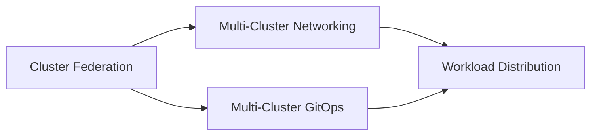

# 13 - Multi-Cluster

Running a platform across a **fleet** of clusters: provisioning, connecting, configuring, and placing workloads on them.

## Reading Order

| # | Document | Summary |
|---|----------|---------|
| 1 | [Cluster Federation](./cluster-federation.md) | Why fleets; the three layers of multi-cluster management; Cluster API & ClusterClass; Karmada; OCM, Rancher Fleet, KubeFed history |
| 2 | [Multi-Cluster Networking](./multi-cluster-networking.md) | IP planning, MCS API (`ServiceExport`/`ServiceImport`), Submariner, Cilium Cluster Mesh, Istio multi-cluster |
| 3 | [Multi-Cluster GitOps](./multi-cluster-gitops.md) | Fleet GitOps topologies, clusters-as-data repository design, registration automation, progressive rollouts in waves |
| 4 | [Workload Distribution](./workload-distribution.md) | Distribution models, placement intent via the `Workload` API, Karmada scheduling & failover, GSLB, data gravity |

## Prerequisites

- [05 - GitOps](../05-gitops/gitops-principles.md), especially [Argo CD](../05-gitops/argocd-deep-dive.md) and [Flux](../05-gitops/flux-deep-dive.md)
- [03 - Networking Fundamentals](../03-networking-fundamentals/cni-overview.md)
- [04 - Infrastructure as Code](../04-infrastructure-as-code/crossplane.md)

## Where This Leads

- Next section: [14 - Platform Evolution](../14-platform-evolution/README.md)
- Tool-level multi-cluster GitOps mechanics: [docs/05-gitops/multi-cluster-gitops.md](../05-gitops/multi-cluster-gitops.md)
- Labs: [Lab 07: Multi-Tenancy](../../labs/lab-07-multi-tenancy/), [Lab 08: Platform Upgrade](../../labs/lab-08-platform-upgrade/)
- Code: [`code/terraform-modules/`](https://github.com/GitOpsHub/platform-engineering-on-kubernetes/tree/main/code/terraform-modules/), [`code/workload-operator/`](https://github.com/GitOpsHub/platform-engineering-on-kubernetes/tree/main/code/workload-operator/)
