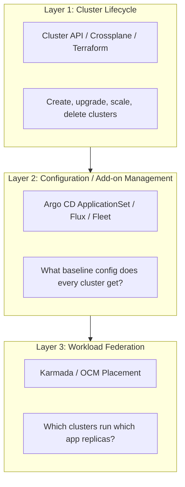
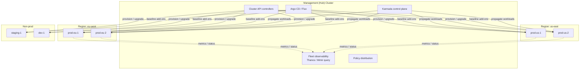
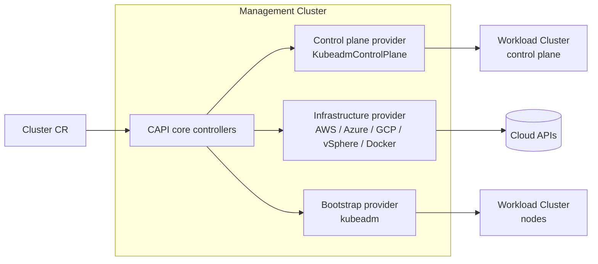
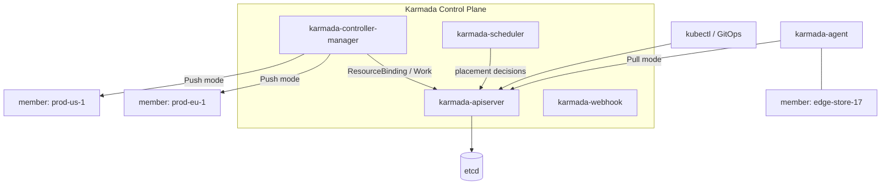
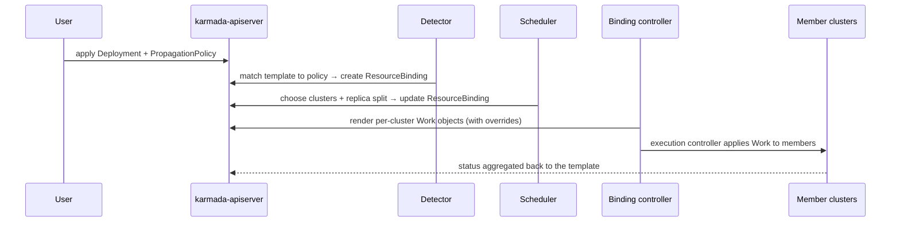

# Cluster Federation and Fleet Management

## Learning Objectives
- Explain why platform teams run fleets of clusters instead of one large cluster
- Distinguish the three layers of multi-cluster management: **lifecycle**, **configuration**, and **workload federation**
- Provision and upgrade clusters declaratively with **Cluster API** (`cluster.x-k8s.io/v1beta1`) and `ClusterClass`
- Federate workloads across clusters with **Karmada** (`PropagationPolicy`, `OverridePolicy`)
- Compare Karmada, Open Cluster Management, Rancher Fleet, and the archived KubeFed project
- Design a hub-and-spoke fleet architecture with a clear blast-radius model

## Prerequisites
- Kubernetes architecture and the controller pattern ([Kubernetes Architecture](../01-kubernetes-fundamentals/kubernetes-architecture.md), [Controllers & Operators](../01-kubernetes-fundamentals/controllers-operators.md))
- GitOps fundamentals ([GitOps Principles](../05-gitops/gitops-principles.md))
- Infrastructure as Code basics ([Crossplane](../04-infrastructure-as-code/crossplane.md), [Terraform & Kubernetes](../04-infrastructure-as-code/terraform-kubernetes.md))
- Tools: `kubectl`, `kind` (v0.20+), `clusterctl`, `karmadactl` (or the `kubectl karmada` plugin), Docker

---

## Why Multiple Clusters?

A single Kubernetes cluster is a single failure domain, a single upgrade unit, and a single security boundary. As a platform grows, those properties stop being acceptable. Common drivers:

| Driver | Why one cluster isn't enough |
|--------|------------------------------|
| **Blast radius** | A bad admission webhook, CRD upgrade, or etcd problem takes down everything on that cluster |
| **Availability** | Regional cloud outages; a cluster cannot span regions reliably (etcd latency) |
| **Data residency / compliance** | Workloads must run in specific jurisdictions (GDPR, sovereignty rules) |
| **Scale limits** | Upstream-tested limits (≈5,000 nodes, 150,000 pods) and, in practice, much lower API-server/etcd comfort zones |
| **Tenant isolation** | Hard multi-tenancy (regulated or untrusted tenants) is easier with cluster-per-tenant |
| **Upgrade safety** | Canary a Kubernetes minor version on one cluster before the rest of the fleet |
| **Edge / latency** | Run close to users, factories, stores, or devices |
| **Organizational** | Different business units, cost centers, or acquired companies |

The cost: every additional cluster adds control-plane overhead, add-on installs, credentials, upgrades, and monitoring. **Fleet management** is the discipline of making N clusters cost roughly the same operational effort as one.

> **Rule of thumb:** treat clusters as cattle, not pets. If creating a new production-ready cluster takes more than a pull request and some minutes of automation, your fleet will not scale.

---

## The Three Layers of Multi-Cluster Management

"Federation" is an overloaded term. It helps to separate three concerns, each solved by different tools:



| Layer | Question it answers | Typical tools | Covered in |
|-------|--------------------|---------------|-----------|
| 1. Lifecycle | "Does the cluster exist, at the right version and size?" | Cluster API, Crossplane, Terraform, managed services (EKS/GKE/AKS) | This doc |
| 2. Configuration | "Does every cluster have cert-manager, policies, observability agents?" | Argo CD, Flux, Rancher Fleet, OCM add-ons | [Multi-Cluster GitOps](./multi-cluster-gitops.md) |
| 3. Workload federation | "Where should these 12 replicas run, and what happens if a cluster dies?" | Karmada, OCM, (formerly KubeFed) | This doc + [Workload Distribution](./workload-distribution.md) |

Many organizations only need layers 1 and 2: each app is pinned to specific clusters through GitOps, and "federation" is simply consistent configuration. Layer 3 becomes valuable when you want a scheduler to decide placement dynamically.

---

## Fleet Architecture: Hub and Spoke

Almost every multi-cluster tool uses a **hub-and-spoke** (a.k.a. management/workload) topology.



### Design decisions for the hub

| Decision | Options | Guidance |
|----------|---------|----------|
| Push vs pull | Hub connects to spoke API servers (push) vs agents on spokes call home (pull) | Pull scales better and works through NAT/firewalls; push is simpler to start |
| Hub HA | Single hub vs hub per region vs hub-of-hubs | The hub is not in the data path, but losing it freezes change. Back it up (Velero) and make it reproducible from Git |
| Hub tenancy | Shared with workloads vs dedicated | **Dedicated.** The hub holds credentials for every cluster — treat it as a tier-0 asset |
| Credential model | Long-lived kubeconfigs vs short-lived tokens / workload identity | Prefer short-lived, scoped credentials; avoid `cluster-admin` kubeconfigs in Git or CI |

> **Blast-radius warning:** a hub with write access to every cluster is a single point of *compromise*. Combine least-privilege credentials, pull-mode agents where possible, and policy that prevents the hub from pushing changes to all clusters simultaneously (progressive rollouts — see [Multi-Cluster GitOps](./multi-cluster-gitops.md)).

---

## Layer 1: Cluster Lifecycle with Cluster API

[Cluster API](https://cluster-api.sigs.k8s.io/) (CAPI) is a Kubernetes SIG project that lets you manage clusters using Kubernetes-style declarative APIs. A **management cluster** runs CAPI controllers; you create `Cluster` objects, and **providers** turn them into real infrastructure.

### CAPI Architecture



| Provider type | Responsibility | Examples |
|--------------|----------------|----------|
| Core | `Cluster`, `Machine`, `MachineSet`, `MachineDeployment`, `MachineHealthCheck` | cluster-api |
| Bootstrap | Turns a machine into a Kubernetes node (cloud-init/ignition) | kubeadm (CABPK), Talos, k3s |
| Control plane | Manages control-plane machines and upgrades | KubeadmControlPlane, managed (EKS/AKS/GKE) control planes |
| Infrastructure | VMs, networks, load balancers | CAPA (AWS), CAPZ (Azure), CAPG (GCP), CAPV (vSphere), CAPD (Docker, for testing) |

> **API version note:** this guide uses `cluster.x-k8s.io/v1beta1`, which is broadly supported by providers. Recent CAPI releases introduce a `v1beta2` API; check your CAPI and provider versions' compatibility matrix before upgrading manifests.

### A Cluster Defined with ClusterClass (Managed Topology)

Writing every `Machine*` object by hand doesn't scale. **ClusterClass** defines a reusable cluster "shape"; each cluster then only declares its `topology`.

```yaml
# clusters/prod-eu-1/cluster.yaml
apiVersion: cluster.x-k8s.io/v1beta1
kind: Cluster
metadata:
  name: prod-eu-1
  namespace: fleet-prod
  labels:
    # Fleet metadata consumed by GitOps generators and Karmada
    platform.mycompany.io/environment: production
    platform.mycompany.io/region: eu-west
    platform.mycompany.io/tier: general
spec:
  clusterNetwork:
    pods:
      cidrBlocks: ["10.20.0.0/16"]     # Non-overlapping per cluster (matters for multi-cluster networking!)
    services:
      cidrBlocks: ["10.120.0.0/16"]
  topology:
    class: platform-standard           # References the ClusterClass below
    version: v1.30.4                   # Bump this to upgrade control plane, then workers
    controlPlane:
      replicas: 3
    workers:
      machineDeployments:
        - class: general-purpose
          name: md-general
          replicas: 6
        - class: memory-optimized
          name: md-memory
          replicas: 2
    variables:
      - name: region
        value: eu-west-1
```

```yaml
# clusterclasses/platform-standard.yaml (abridged)
apiVersion: cluster.x-k8s.io/v1beta1
kind: ClusterClass
metadata:
  name: platform-standard
  namespace: fleet-prod
spec:
  controlPlane:
    ref:
      apiVersion: controlplane.cluster.x-k8s.io/v1beta1
      kind: KubeadmControlPlaneTemplate
      name: platform-standard-cp
    machineInfrastructure:
      ref:
        apiVersion: infrastructure.cluster.x-k8s.io/v1beta1
        kind: DockerMachineTemplate      # Swap for AWSMachineTemplate, AzureMachineTemplate, ...
        name: platform-standard-cp-machine
  infrastructure:
    ref:
      apiVersion: infrastructure.cluster.x-k8s.io/v1beta1
      kind: DockerClusterTemplate
      name: platform-standard-cluster
  workers:
    machineDeployments:
      - class: general-purpose
        template:
          bootstrap:
            ref:
              apiVersion: bootstrap.cluster.x-k8s.io/v1beta1
              kind: KubeadmConfigTemplate
              name: platform-standard-worker
          infrastructure:
            ref:
              apiVersion: infrastructure.cluster.x-k8s.io/v1beta1
              kind: DockerMachineTemplate
              name: platform-standard-worker-machine
  variables:
    - name: region
      required: true
      schema:
        openAPIV3Schema:
          type: string
  # patches: [...]  # JSON patches that inject variables into templates
```

**Why this matters for platform teams:** ClusterClass is the multi-cluster equivalent of a Helm chart for clusters. The platform team owns the class; a fleet upgrade becomes "change `version` in N small files" — or one file if you template them with an ApplicationSet.

### Self-healing nodes with MachineHealthCheck

```yaml
# clusters/prod-eu-1/machinehealthcheck.yaml
apiVersion: cluster.x-k8s.io/v1beta1
kind: MachineHealthCheck
metadata:
  name: prod-eu-1-workers
  namespace: fleet-prod
spec:
  clusterName: prod-eu-1
  maxUnhealthy: 40%                    # Stop remediating if too many fail at once (likely a wider outage)
  nodeStartupTimeout: 10m
  selector:
    matchLabels:
      cluster.x-k8s.io/deployment-name: prod-eu-1-md-general
  unhealthyConditions:
    - type: Ready
      status: Unknown
      timeout: 300s
    - type: Ready
      status: "False"
      timeout: 300s
```

### Bootstrapping baseline add-ons

Two common options to install the CNI and other "day-0" add-ons into new clusters:

1. **ClusterResourceSet** (`addons.cluster.x-k8s.io/v1beta1`) — applies ConfigMap/Secret-wrapped manifests to clusters matching a label selector. Simple, but apply-once by default and not a full GitOps engine.
2. **GitOps registration** (recommended) — a controller on the hub registers each new cluster with Argo CD or Flux, and ApplicationSets take over. See [Multi-Cluster GitOps](./multi-cluster-gitops.md).

```yaml
# addons/cni-crs.yaml
apiVersion: addons.cluster.x-k8s.io/v1beta1
kind: ClusterResourceSet
metadata:
  name: cilium-cni
  namespace: fleet-prod
spec:
  strategy: Reconcile                  # Re-apply when the ConfigMap changes (default: ApplyOnce)
  clusterSelector:
    matchLabels:
      platform.mycompany.io/cni: cilium
  resources:
    - kind: ConfigMap
      name: cilium-manifests
```

### Upgrading a cluster

```bash
# Change the topology version in Git (GitOps), or for a quick test:
kubectl -n fleet-prod patch cluster prod-eu-1 --type merge \
  -p '{"spec":{"topology":{"version":"v1.31.1"}}}'

# Watch: control plane rolls first, then each MachineDeployment
clusterctl describe cluster prod-eu-1 -n fleet-prod
kubectl -n fleet-prod get kcp,md,machines -w
```

CAPI performs **immutable, rolling replacement**: new machines at the new version join, old ones drain and are deleted. That is a major reason CAPI is attractive for fleets — upgrades are a declarative field change, not a runbook. For a full upgrade strategy, see [Lab 08: Platform Upgrade](../../labs/lab-08-platform-upgrade/).

### Alternatives for Layer 1

| Tool | Strength | Trade-off |
|------|----------|-----------|
| Cluster API | Kubernetes-native, provider ecosystem, ClusterClass | Management cluster to operate; provider maturity varies |
| Crossplane | Clusters + cloud resources (DBs, buckets) in one composition | Managed clusters only; you model the upgrade flow yourself |
| Terraform / OpenTofu | Ubiquitous, great for managed K8s | Not continuously reconciled; state files; drift between runs |
| Cloud fleet services | GKE fleets, EKS + AWS tooling, Azure Kubernetes Fleet Manager | Vendor-specific |

See [Crossplane](../04-infrastructure-as-code/crossplane.md) and [`code/terraform-modules/`](../../code/terraform-modules/) for the IaC approaches.

---

## Layer 3: Workload Federation with Karmada

[Karmada](https://karmada.io/) (Kubernetes Armada) is a CNCF project that provides a **Kubernetes-native federation control plane**. You apply ordinary Kubernetes resources (Deployments, Services, ConfigMaps) to the Karmada API server, then attach **policies** describing where and how they should be propagated.

### Karmada Architecture



The resource flow:



### Joining member clusters

```bash
# Install the Karmada control plane into a host cluster (one of several install methods;
# Helm chart and the karmada-operator are alternatives)
karmadactl init --kubeconfig ~/.kube/hub.config

# Push mode: control plane talks to the member API server directly
karmadactl join prod-eu-1 \
  --kubeconfig /etc/karmada/karmada-apiserver.config \
  --cluster-kubeconfig ~/.kube/prod-eu-1.config

# Pull mode (member behind NAT/firewall): create a token on Karmada, register from the member
karmadactl token create --print-register-command \
  --kubeconfig /etc/karmada/karmada-apiserver.config
# ...then run the printed `karmadactl register ...` command against the member cluster

# Label clusters with fleet metadata (used by placement rules)
kubectl --kubeconfig /etc/karmada/karmada-apiserver.config \
  label cluster prod-eu-1 platform.mycompany.io/region=eu-west platform.mycompany.io/environment=production

kubectl --kubeconfig /etc/karmada/karmada-apiserver.config get clusters
```

### PropagationPolicy: where should this run?

```yaml
# federation/checkout-api/deployment.yaml — a plain Deployment, applied to Karmada
apiVersion: apps/v1
kind: Deployment
metadata:
  name: checkout-api
  namespace: shop
  labels:
    app: checkout-api
    platform.mycompany.io/tenant: payments
spec:
  replicas: 12                          # Total across the fleet; Karmada divides it
  selector:
    matchLabels:
      app: checkout-api
  template:
    metadata:
      labels:
        app: checkout-api
    spec:
      containers:
        - name: api
          image: ghcr.io/mycompany/checkout-api:1.14.2
          resources:
            requests:
              cpu: 250m
              memory: 256Mi
---
# federation/checkout-api/propagation.yaml
apiVersion: policy.karmada.io/v1alpha1
kind: PropagationPolicy
metadata:
  name: checkout-api
  namespace: shop
spec:
  resourceSelectors:
    - apiVersion: apps/v1
      kind: Deployment
      name: checkout-api
  propagateDeps: true                   # Also propagate referenced ConfigMaps/Secrets/ServiceAccounts
  placement:
    clusterAffinity:
      labelSelector:
        matchLabels:
          platform.mycompany.io/environment: production
    spreadConstraints:
      - spreadByField: region           # Built-in field derived from Cluster spec.region
        maxGroups: 2
        minGroups: 2                    # Must land in at least two regions
      - spreadByField: cluster          # Region spreading is combined with a cluster constraint
        minGroups: 2
        maxGroups: 4
    replicaScheduling:
      replicaSchedulingType: Divided    # Split the 12 replicas (vs Duplicated: 12 in each)
      replicaDivisionPreference: Weighted
      weightPreference:
        dynamicWeight: AvailableReplicas  # Weight by how many replicas each cluster can fit
```

### OverridePolicy: per-cluster differences

```yaml
# federation/checkout-api/override.yaml
apiVersion: policy.karmada.io/v1alpha1
kind: OverridePolicy
metadata:
  name: checkout-api-regional
  namespace: shop
spec:
  resourceSelectors:
    - apiVersion: apps/v1
      kind: Deployment
      name: checkout-api
  overrideRules:
    - targetCluster:
        labelSelector:
          matchLabels:
            platform.mycompany.io/region: eu-west
      overriders:
        imageOverrider:
          - component: Registry
            operator: replace
            value: eu.registry.mycompany.io   # Pull from the regional mirror
        plaintext:
          - path: /spec/template/spec/containers/0/env
            operator: add
            value:
              - name: DATA_REGION
                value: eu
```

### Cluster-scoped and namespace-wide policies

- `ClusterPropagationPolicy` — the cluster-scoped variant, for CRDs, ClusterRoles, Namespaces, or for matching resources across namespaces.
- `FederatedResourceQuota` — quota for a namespace across the whole fleet, split per cluster.
- Priority and preemption between policies let a platform-wide default policy coexist with team-specific ones.

### Inspecting what Karmada did

```bash
export KUBECONFIG=/etc/karmada/karmada-apiserver.config

kubectl -n shop get resourcebinding                 # one binding per propagated resource
kubectl -n shop get resourcebinding checkout-api-deployment -o yaml | yq '.spec.clusters'
# - name: prod-eu-1
#   replicas: 7
# - name: prod-us-1
#   replicas: 5

kubectl get work -A | grep checkout-api             # per-cluster rendered manifests
kubectl -n shop get deploy checkout-api -o yaml | yq '.status'   # aggregated status
```

---

## Other Federation and Fleet Tools

### Open Cluster Management (OCM)

[OCM](https://open-cluster-management.io/) (CNCF) uses a pull-based hub/agent model. Key APIs:

- `ManagedCluster` — a registered spoke (the agent registers itself; the hub admin accepts it)
- `ManagedClusterSet` + `ManagedClusterSetBinding` — group clusters and grant namespaces access to them
- `Placement` — selects clusters by labels/claims, with prioritizers (e.g. by allocatable resources)
- `ManifestWork` — the unit of delivery to a spoke
- Add-on framework — used for policy, application, and observability add-ons; integrates with Argo CD via a placement-driven generator

```yaml
# ocm/placement.yaml
apiVersion: cluster.open-cluster-management.io/v1beta1
kind: Placement
metadata:
  name: prod-two-clusters
  namespace: shop
spec:
  numberOfClusters: 2
  clusterSets:
    - production
  predicates:
    - requiredClusterSelector:
        labelSelector:
          matchLabels:
            platform.mycompany.io/tier: general
  prioritizerPolicy:
    mode: Additive
    configurations:
      - scoreCoordinate:
          builtIn: ResourceAllocatableMemory
```

### Rancher Fleet

[Fleet](https://fleet.rancher.io/) is a GitOps engine designed for very large numbers of (often small/edge) clusters. A `GitRepo` resource on the hub is turned into **bundles**, and agents on downstream clusters pull them. Targeting uses cluster labels and `ClusterGroup`s; per-target customization lives in `fleet.yaml`. Fleet sits mostly in Layer 2, but its scale focus makes it a frequent choice for edge fleets.

```yaml
# fleet/gitrepo.yaml
apiVersion: fleet.cattle.io/v1alpha1
kind: GitRepo
metadata:
  name: platform-baseline
  namespace: fleet-default
spec:
  repo: https://github.com/mycompany/platform-config
  branch: main
  paths:
    - baseline
  targets:
    - name: production
      clusterSelector:
        matchLabels:
          platform.mycompany.io/environment: production
```

### KubeFed (historical)

Kubernetes Cluster Federation (KubeFed, "Federation v2") introduced `Federated*` wrapper types (e.g. `FederatedDeployment`). The project was **archived by SIG Multicluster in 2023**. Its lesson — wrapping every type in a federated twin is cumbersome — influenced Karmada's design of reusing native Kubernetes APIs. Don't start new work on KubeFed.

### SIG Multicluster standards

Rather than one federation tool, SIG Multicluster now focuses on small standard APIs that tools can share:

- **ClusterSet** concept and **"namespace sameness"** (a namespace means the same thing in every cluster of a set)
- **Multi-Cluster Services API** (`ServiceExport` / `ServiceImport`) — see [Multi-Cluster Networking](./multi-cluster-networking.md)
- **About API** (`ClusterProperty`) for cluster identity
- **ClusterProfile API** — a standard inventory representation of clusters for fleet managers

### Comparison

| | Karmada | OCM | Rancher Fleet | Argo CD ApplicationSet | Cluster API |
|---|---|---|---|---|---|
| Primary layer | 3 (workloads) | 2 + 3 | 2 | 2 | 1 |
| Native K8s APIs for workloads | Yes | Wrapped in `ManifestWork` | Bundles from Git | Yes | n/a |
| Replica splitting across clusters | Yes | Via add-ons / placement | No | No | n/a |
| Failover / rescheduling | Yes | Placement re-evaluation | No | No | n/a |
| Pull mode | Yes (agent) | Yes (default) | Yes (default) | Argo CD agent mode emerging; mostly push | n/a |
| Cluster provisioning | No | Via integrations | No | No | Yes |

---

## Fleet Inventory and Metadata

Whatever tools you pick, **cluster metadata is the glue**. Every layer selects clusters by labels, so define a fleet label schema once and enforce it:

```yaml
# fleet/cluster-label-schema.yaml — documented contract (enforce via policy on the hub)
platform.mycompany.io/environment: production | staging | development
platform.mycompany.io/region: eu-west | us-east | ap-south
platform.mycompany.io/tier: general | gpu | regulated | edge
platform.mycompany.io/cni: cilium | calico
platform.mycompany.io/upgrade-wave: "0" | "1" | "2"     # canary → early → main
platform.mycompany.io/owner: platform-team
```

A Kyverno policy on the hub can ensure every CAPI `Cluster` carries the required labels:

```yaml
# policies/require-fleet-labels.yaml
apiVersion: kyverno.io/v1
kind: ClusterPolicy
metadata:
  name: require-fleet-labels
spec:
  validationFailureAction: Enforce
  rules:
    - name: cluster-labels
      match:
        any:
          - resources:
              kinds: ["cluster.x-k8s.io/v1beta1/Cluster"]
      validate:
        message: "Clusters must declare environment, region, and upgrade-wave labels."
        pattern:
          metadata:
            labels:
              platform.mycompany.io/environment: "?*"
              platform.mycompany.io/region: "?*"
              platform.mycompany.io/upgrade-wave: "?*"
```

See [Policy Engine](../12-security-compliance/policy-engine.md) for more on Kyverno.

---

## Hands-On Exercise

### Lab: Provision two clusters with CAPI (Docker) and federate a workload with Karmada

**Prerequisites:** Docker with ~8 GB RAM free, `kind`, `kubectl`, `clusterctl`, `karmadactl`, `yq`.

```bash
# 1. Management cluster (kind needs the Docker socket mounted for CAPD)
cat > mgmt-kind.yaml <<EOF
kind: Cluster
apiVersion: kind.x-k8s.io/v1alpha4
nodes:
  - role: control-plane
    extraMounts:
      - hostPath: /var/run/docker.sock
        containerPath: /var/run/docker.sock
EOF
kind create cluster --name mgmt --config mgmt-kind.yaml

# 2. Install CAPI with the Docker infrastructure provider (enable ClusterClass/topology)
export CLUSTER_TOPOLOGY=true
clusterctl init --infrastructure docker

# 3. Generate and apply two workload clusters (development flavor uses ClusterClass)
for c in member-a member-b; do
  clusterctl generate cluster $c --flavor development \
    --kubernetes-version v1.30.0 \
    --control-plane-machine-count=1 --worker-machine-count=1 > $c.yaml
  kubectl apply -f $c.yaml
done

# 4. Wait and fetch kubeconfigs
kubectl get clusters -w           # until both are Provisioned
for c in member-a member-b; do
  clusterctl get kubeconfig $c > $c.kubeconfig
done
# CAPD clusters need a CNI before nodes become Ready:
for c in member-a member-b; do
  kubectl --kubeconfig $c.kubeconfig apply -f \
    https://raw.githubusercontent.com/projectcalico/calico/v3.27.0/manifests/calico.yaml
done

# 5. Install Karmada into the management cluster and join the members
karmadactl init --kubeconfig ~/.kube/config
export KARMADA=/etc/karmada/karmada-apiserver.config
for c in member-a member-b; do
  karmadactl join $c --kubeconfig $KARMADA --cluster-kubeconfig $c.kubeconfig
done
kubectl --kubeconfig $KARMADA get clusters

# 6. Propagate an nginx Deployment with replicas divided 2:1
kubectl --kubeconfig $KARMADA create deployment nginx --image=nginx:1.27 --replicas=3
cat <<EOF | kubectl --kubeconfig $KARMADA apply -f -
apiVersion: policy.karmada.io/v1alpha1
kind: PropagationPolicy
metadata:
  name: nginx
spec:
  resourceSelectors:
    - apiVersion: apps/v1
      kind: Deployment
      name: nginx
  placement:
    clusterAffinity:
      clusterNames: [member-a, member-b]
    replicaScheduling:
      replicaSchedulingType: Divided
      replicaDivisionPreference: Weighted
      weightPreference:
        staticWeightList:
          - targetCluster: {clusterNames: [member-a]}
            weight: 2
          - targetCluster: {clusterNames: [member-b]}
            weight: 1
EOF

# 7. Verify
kubectl --kubeconfig member-a.kubeconfig get deploy nginx   # expect 2 replicas
kubectl --kubeconfig member-b.kubeconfig get deploy nginx   # expect 1 replica
```

> **Note:** `karmadactl init` may store generated kubeconfigs under `/etc/karmada` and need elevated permissions on some systems; check the output for the exact path. On macOS, CAPD API-server endpoints may require extra kubeconfig tweaks — see the CAPI quick start.

**Challenges:**
1. Change weights to 1:1 and watch replicas rebalance.
2. Add an `OverridePolicy` that sets a different image tag on `member-b`.
3. Upgrade `member-b` to a newer Kubernetes version by patching `spec.topology.version`.

**Cleanup:**
```bash
kubectl delete cluster member-a member-b   # CAPI deletes the Docker "machines"
kind delete cluster --name mgmt
```

---

## Troubleshooting

| Symptom | Likely cause | Fix |
|---------|-------------|-----|
| CAPI `Cluster` stuck `Provisioning` | Infra provider can't create infra; missing credentials | `clusterctl describe cluster <name> --show-conditions all`; check provider controller logs in `capi-system`/`cap*-system` |
| Nodes `NotReady` after provisioning | No CNI installed in the workload cluster | Install CNI via ClusterResourceSet or GitOps |
| `KubeadmControlPlane` upgrade stalls | New machines failing health checks; etcd quorum issues | `kubectl get kcp -o yaml` conditions; check machine bootstrap logs |
| MachineHealthCheck remediates nothing during outage | `maxUnhealthy` short-circuit triggered | Intended — investigate the wider outage before loosening |
| Karmada cluster `Ready=False` | Network path from control plane to member (push) or agent to control plane (pull) broken | `kubectl get cluster <name> -o yaml`; check `karmada-agent` logs on member |
| Resource not propagated | No matching PropagationPolicy, or policy selector mismatch | `kubectl get resourcebinding -n <ns>`; check `karmada-controller-manager` logs |
| Replicas all in one cluster | `Duplicated` vs `Divided` confusion, or other cluster lacks capacity with `dynamicWeight` | Inspect `ResourceBinding.spec.clusters`; check member allocatable |
| Same resource applied by Karmada and GitOps | Two controllers fighting over a field | Pick one owner per resource; GitOps targets Karmada API server, not members, for federated apps |

---

## Further Reading

### Official Documentation
- [Cluster API Book](https://cluster-api.sigs.k8s.io/) — concepts, ClusterClass, quick start
- [Karmada Documentation](https://karmada.io/docs/)
- [Open Cluster Management](https://open-cluster-management.io/)
- [Rancher Fleet](https://fleet.rancher.io/)
- [SIG Multicluster](https://multicluster.sigs.k8s.io/) — ClusterSet, MCS API, About API
- [Kubernetes: Considerations for large clusters](https://kubernetes.io/docs/setup/best-practices/cluster-large/)

### Articles & Talks
- KubeFed archive notice — [kubernetes-retired/kubefed](https://github.com/kubernetes-retired/kubefed)
- CNCF TAG App Delivery — [Platforms White Paper](https://tag-app-delivery.cncf.io/whitepapers/platforms/)

---

## Next Steps

1. **Read**: [Multi-Cluster Networking](./multi-cluster-networking.md) — make federated services reachable across clusters
2. **Read**: [Multi-Cluster GitOps](./multi-cluster-gitops.md) — fleet-level GitOps architecture
3. **Read**: [Workload Distribution](./workload-distribution.md) — placement, failover, and traffic steering
4. **Practice**: [Lab 08: Platform Upgrade](../../labs/lab-08-platform-upgrade/) — rolling upgrades across a fleet
