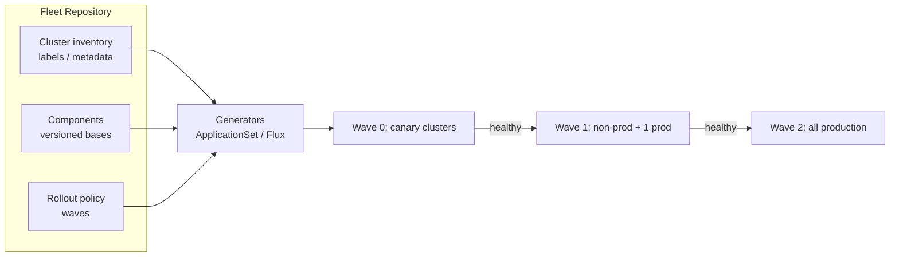
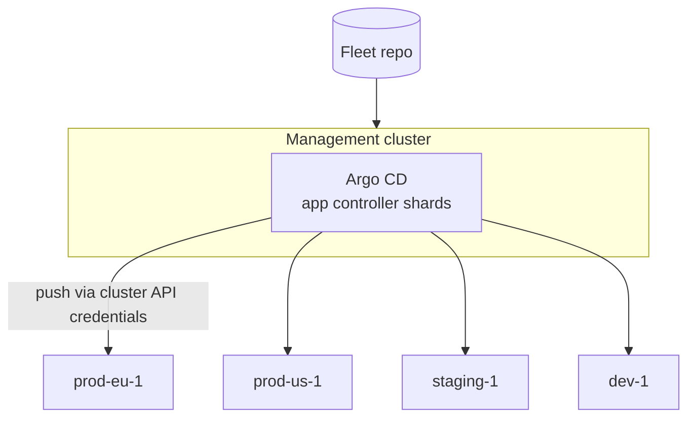
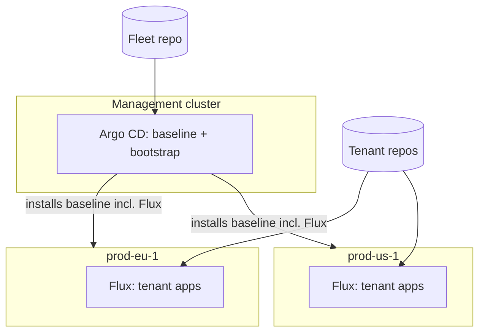
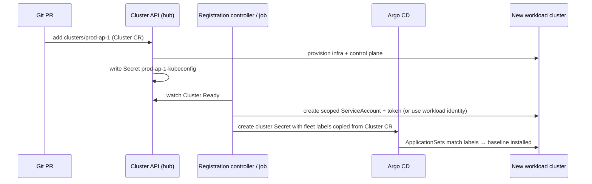
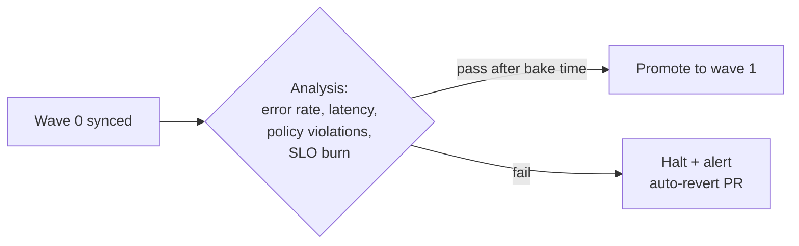

# Multi-Cluster GitOps: Fleet-Level Architecture

## Learning Objectives
- Design a GitOps architecture for a fleet of tens to hundreds of clusters
- Choose between **hub-and-spoke**, **standalone-per-cluster**, and **hybrid** GitOps topologies
- Structure a fleet repository so that clusters are *data*, not copy-pasted directories
- Automate cluster registration from Cluster API into Argo CD and Flux
- Target clusters by metadata with Argo CD **ApplicationSet** generators (cluster, matrix)
- Roll changes out progressively across fleet "waves" and stop bad changes before they reach every cluster

## Prerequisites
- [GitOps Principles](../05-gitops/gitops-principles.md)
- [Argo CD Deep Dive](../05-gitops/argocd-deep-dive.md) and/or [Flux Deep Dive](../05-gitops/flux-deep-dive.md)
- [Cluster Federation](./cluster-federation.md) — fleet layers, Cluster API, fleet label schema

> **Scope:** the tooling mechanics of Argo CD and Flux multi-cluster (cluster secrets, `destination.name`, `kubeConfig` references) are covered in [docs/05-gitops/multi-cluster-gitops.md](../05-gitops/multi-cluster-gitops.md). This document is about **fleet architecture**: topology, repository design, registration, targeting, and safe rollout at scale.

---

## The Fleet GitOps Problem

With one cluster, GitOps is "a directory in Git that matches the cluster". With 50 clusters, naive approaches break down:

| Anti-pattern | Symptom |
|--------------|---------|
| One directory per cluster, copy-pasted | A cert-manager bump is a 50-file PR; clusters drift apart silently |
| One `Application` per cluster per component, hand-written | Thousands of YAML files; nobody knows what runs where |
| Every change applied to all clusters at once | A bad Kyverno policy blocks deployments fleet-wide in minutes |
| Cluster added manually via `argocd cluster add` | New clusters are snowflakes; registration isn't reproducible |

The goal: **adding a cluster is adding one record of metadata; changing the fleet is one PR that rolls out in controlled waves.**



---

## GitOps Topologies for Fleets

### 1. Hub-and-spoke (centralized)

One GitOps control plane on a management cluster deploys to all workload clusters.



| Pros | Cons |
|------|------|
| Single UI and API for the whole fleet | Hub holds credentials for every cluster (tier-0 asset) |
| Easy cross-cluster views and ApplicationSets | Hub outage freezes all deployments |
| One place to upgrade the GitOps tool | Scale limits: controller sharding needed at hundreds of clusters / thousands of apps |
| | Requires network reachability hub → every API server |

### 2. Standalone (decentralized)

Every cluster runs its own Argo CD or Flux, pointing at its own path in Git.

| Pros | Cons |
|------|------|
| No central credential store; clusters only pull from Git | No single pane of glass (aggregate via metrics/dashboards) |
| Cluster keeps reconciling if anything central fails | N copies of the GitOps tool to upgrade |
| Works through NAT/firewalls/edge | Fleet-wide targeting must be done in Git structure, not generators |

### 3. Hybrid (most common at scale)

A hub manages **platform baseline and bootstrapping**; each workload cluster runs a local GitOps agent for **tenant applications**. Flux is popular for the local agent because it's lightweight; Argo CD's newer **agent** mode (argoproj-labs/argocd-agent) aims to combine a central UI with pull-based agents.



### Choosing

| Fleet characteristic | Recommended topology |
|---------------------|---------------------|
| < ~20 clusters, single network | Hub-and-spoke |
| Edge / retail / factory fleets, intermittent connectivity | Standalone (or Rancher Fleet / pull agents) |
| Strict separation (regulated clusters can't be reached from shared hub) | Standalone or hub-per-security-zone |
| Large enterprise, many tenants, central platform team | Hybrid |

---

## Repository Design: Clusters as Data

### Recommended layout

```
fleet-config/
├── clusters/                       # INVENTORY: one small file per cluster — metadata only
│   ├── prod-eu-1.yaml
│   ├── prod-us-1.yaml
│   ├── staging-1.yaml
│   └── dev-1.yaml
├── components/                     # VERSIONED BASES: what can be installed
│   ├── cert-manager/
│   │   ├── base/                   # HelmRelease/values or Kustomize base
│   │   └── overlays/
│   │       ├── production/
│   │       └── non-production/
│   ├── kyverno/
│   ├── cilium/
│   ├── observability-agents/
│   └── tenant-operator/
├── fleet/                          # GENERATORS: map inventory × components → deployments
│   ├── baseline-appset.yaml
│   ├── observability-appset.yaml
│   └── rollout-waves.yaml
└── tenants/                        # Tenant onboarding (Tenant CRs, see Lab 07)
    ├── payments.yaml
    └── search.yaml
```

The key idea: **`clusters/` contains metadata, not manifests.** Which components a cluster gets is derived from its labels.

```yaml
# clusters/prod-eu-1.yaml — consumed by the Argo CD git-files generator
name: prod-eu-1
server: https://prod-eu-1.k8s.mycompany.io:6443
labels:
  platform.mycompany.io/environment: production
  platform.mycompany.io/region: eu-west
  platform.mycompany.io/tier: general
  platform.mycompany.io/upgrade-wave: "1"
components:
  observability-agents: { values: { retention: 15d } }
```

In practice, many teams keep inventory on the **Argo CD cluster Secrets** (as labels) instead of files, because they're created automatically during registration (next section). Either is fine — pick one source of truth.

### Versioning components

Pin component versions so a change to `components/` doesn't instantly reach every cluster:

| Strategy | How | Trade-off |
|----------|-----|-----------|
| Git ref per wave | Wave-0 tracks `main`; later waves track a tag/branch promoted by PR | Simple, but promotion = Git operations |
| Version in cluster metadata | `components.cert-manager.version: v1.15.3` on each cluster/wave | Explicit; generators template the version |
| OCI artifacts | Publish component bundles as OCI artifacts; clusters reference digests | Immutable, works well with Flux `OCIRepository` |
| Promotion tool | Kargo or similar promotes "freight" between stages | Purpose-built, another tool to run |

---

## Cluster Registration Automation

Manual `argocd cluster add` doesn't scale. Wire registration to cluster provisioning.



### Argo CD: the cluster Secret

Argo CD stores clusters as labeled Secrets. Fleet labels on the Secret are what ApplicationSet cluster generators select on.

```yaml
# Generated by the registration controller — never committed with real credentials
apiVersion: v1
kind: Secret
metadata:
  name: cluster-prod-eu-1
  namespace: argocd
  labels:
    argocd.argoproj.io/secret-type: cluster          # Marks this Secret as a cluster
    platform.mycompany.io/environment: production
    platform.mycompany.io/region: eu-west
    platform.mycompany.io/upgrade-wave: "1"
type: Opaque
stringData:
  name: prod-eu-1
  server: https://prod-eu-1.k8s.mycompany.io:6443
  config: |
    {
      "bearerToken": "<short-lived token from registration controller>",
      "tlsClientConfig": { "caData": "<base64 CA>" }
    }
```

For managed clusters, prefer cloud-native auth over static tokens (Argo CD supports `awsAuthConfig` for EKS and `execProviderConfig` for exec plugins such as GKE/AKS credential helpers).

Implementation options for the registration controller:
- A small operator (fits [`code/environment-operator/`](../../code/environment-operator/) patterns) watching CAPI `Cluster` objects
- Crossplane composition that outputs the Argo CD Secret alongside the cluster
- Open Cluster Management's Argo CD integration, which generates cluster secrets from OCM placements
- Community projects that sync CAPI clusters into Argo CD (evaluate maturity before adopting)

### Flux: CAPI kubeconfig Secrets work directly

CAPI writes a `<cluster>-kubeconfig` Secret with the kubeconfig under the key `value`, which Flux's `kubeConfig.secretRef` can consume directly — no registration step needed for hub-mode Flux.

```yaml
# fleet/flux/prod-eu-1-baseline.yaml (on the hub, in the CAPI cluster's namespace)
apiVersion: kustomize.toolkit.fluxcd.io/v1
kind: Kustomization
metadata:
  name: prod-eu-1-baseline
  namespace: fleet-prod
spec:
  interval: 10m
  sourceRef:
    kind: GitRepository
    name: fleet-config
    namespace: flux-system
  path: ./components/baseline/overlays/production
  prune: true
  wait: true
  timeout: 10m
  kubeConfig:
    secretRef:
      name: prod-eu-1-kubeconfig        # Created by Cluster API
  postBuild:
    substitute:
      CLUSTER_NAME: prod-eu-1
      REGION: eu-west
```

> **Security note:** CAPI's generated kubeconfig is typically cluster-admin. For production, mint a scoped identity per cluster rather than using it long-term.

---

## Targeting Clusters with ApplicationSet

### Baseline add-ons for every cluster (cluster generator)

```yaml
# fleet/baseline-appset.yaml
apiVersion: argoproj.io/v1alpha1
kind: ApplicationSet
metadata:
  name: baseline-cert-manager
  namespace: argocd
spec:
  goTemplate: true
  goTemplateOptions: ["missingkey=error"]
  generators:
    - clusters:
        selector:
          matchExpressions:
            - key: platform.mycompany.io/environment
              operator: In
              values: [production, staging, development]
  template:
    metadata:
      name: 'cert-manager-{{.name}}'
      labels:
        platform.mycompany.io/component: cert-manager
        platform.mycompany.io/upgrade-wave: '{{index .metadata.labels "platform.mycompany.io/upgrade-wave"}}'
    spec:
      project: platform-baseline
      source:
        repoURL: https://github.com/mycompany/fleet-config
        targetRevision: main
        path: 'components/cert-manager/overlays/{{index .metadata.labels "platform.mycompany.io/environment"}}'
      destination:
        server: '{{.server}}'
        namespace: cert-manager
      syncPolicy:
        automated:
          prune: true
          selfHeal: true
        syncOptions:
          - CreateNamespace=true
          - ServerSideApply=true
```

### Many components × matching clusters (matrix generator)

Rather than one ApplicationSet per component, combine a list of components with the cluster generator. Each component declares which clusters it applies to.

```yaml
# fleet/platform-components-appset.yaml
apiVersion: argoproj.io/v1alpha1
kind: ApplicationSet
metadata:
  name: platform-components
  namespace: argocd
spec:
  goTemplate: true
  goTemplateOptions: ["missingkey=error"]
  generators:
    - matrix:
        generators:
          # 1) Component catalog: one JSON/YAML file per component in Git
          - git:
              repoURL: https://github.com/mycompany/fleet-config
              revision: main
              files:
                - path: components/*/component.yaml
          # 2) Clusters matching the component's declared selector
          - clusters:
              selector:
                matchLabels:
                  platform.mycompany.io/tier: '{{.targetTier}}'
  template:
    metadata:
      name: '{{.component}}-{{.name}}'
      labels:
        platform.mycompany.io/component: '{{.component}}'
        platform.mycompany.io/upgrade-wave: '{{index .metadata.labels "platform.mycompany.io/upgrade-wave"}}'
    spec:
      project: platform-baseline
      source:
        repoURL: https://github.com/mycompany/fleet-config
        targetRevision: main
        path: '{{.path.path}}/overlays/{{index .metadata.labels "platform.mycompany.io/environment"}}'
      destination:
        server: '{{.server}}'
        namespace: '{{.namespace}}'
      syncPolicy:
        syncOptions: [CreateNamespace=true]
```

```yaml
# components/kyverno/component.yaml
component: kyverno
namespace: kyverno
targetTier: general
```

The second generator references parameters (`targetTier`) produced by the first — a supported matrix feature. Keep matrix nesting to two levels; deeper combinations get hard to reason about.

### Guardrails for generated Applications

- Use an `AppProject` per concern (`platform-baseline`, `tenant-apps`) with restricted `destinations` and resource allow-lists.
- Set `spec.syncPolicy.preserveResourcesOnDeletion: true` on fleet-critical ApplicationSets so that deleting or mis-editing the ApplicationSet doesn't cascade-delete workloads on every cluster.
- Consider `applicationsSync: create-only` / `create-update` policies on the ApplicationSet controller to prevent automated deletion of generated Applications.

---

## Progressive Rollouts Across the Fleet

The most important fleet GitOps capability is **not deploying everywhere at once**. Group clusters into waves with the `platform.mycompany.io/upgrade-wave` label.

| Wave | Clusters | Purpose | Bake time |
|------|----------|---------|-----------|
| 0 | Platform team's own dev/canary clusters | Catch obvious breakage | 1–4 h |
| 1 | All non-prod + one low-traffic prod cluster | Real tenant workloads | 24 h |
| 2 | Remaining production, region by region | Full rollout | Staggered |

### Option A: ApplicationSet progressive syncs (RollingSync)

Argo CD's ApplicationSet controller supports a `RollingSync` strategy that syncs generated Applications step by step, based on labels on those Applications. It must be enabled on the controller (e.g. `applicationsetcontroller.enable.progressive.syncs: "true"` in `argocd-cmd-params-cm`), and while active, the controller manages syncing itself rather than relying on per-Application auto-sync.

```yaml
# fleet/baseline-appset.yaml (strategy section)
spec:
  strategy:
    type: RollingSync
    rollingSync:
      steps:
        - matchExpressions:
            - key: platform.mycompany.io/upgrade-wave
              operator: In
              values: ["0"]
        - matchExpressions:
            - key: platform.mycompany.io/upgrade-wave
              operator: In
              values: ["1"]
          maxUpdate: 1                  # One cluster at a time in wave 1
        - matchExpressions:
            - key: platform.mycompany.io/upgrade-wave
              operator: In
              values: ["2"]
          maxUpdate: 25%                # A quarter of wave-2 clusters at a time
```

A step proceeds only when Applications in the previous step become Healthy. Note that "Healthy" is Argo CD resource health — it doesn't know about your SLOs. Combine with analysis (below) for real safety.

### Option B: Promotion by Git ref

Each wave pins a different revision; promotion is a PR that moves the ref.

```yaml
# fleet/rollout-waves.yaml — referenced by ApplicationSets via a git-files generator
waves:
  "0": { targetRevision: main }
  "1": { targetRevision: fleet-wave-1 }   # branch or tag, advanced by a promotion PR
  "2": { targetRevision: fleet-wave-2 }
```

```bash
# Promote what's been baking in wave 0 to wave 1 (CI job after checks pass)
git fetch origin
git push origin origin/main:refs/heads/fleet-wave-1
```

This is tool-agnostic (works with Flux by pointing each cluster's `GitRepository.spec.ref` at its wave's branch/tag) and gives a clear audit trail.

### Option C: Flux with dependsOn + health checks per wave

On a Flux hub, model each wave as Kustomizations that `dependsOn` the previous wave being Ready. Within a single Flux instance `dependsOn` works across namespaces by reference:

```yaml
apiVersion: kustomize.toolkit.fluxcd.io/v1
kind: Kustomization
metadata:
  name: wave-1-prod-eu-1
  namespace: fleet-prod
spec:
  dependsOn:
    - name: wave-0-canary-1
      namespace: fleet-canary
  interval: 10m
  sourceRef: { kind: GitRepository, name: fleet-config, namespace: flux-system }
  path: ./components/baseline/overlays/production
  prune: true
  wait: true
  kubeConfig:
    secretRef: { name: prod-eu-1-kubeconfig }
```

### Gating on real signals

Health checks only catch "pods aren't running". To catch "pods run but error rate doubled":



Practical options: a CI job that queries Prometheus/Thanos for fleet-level SLIs before opening the promotion PR; Argo Rollouts `AnalysisTemplate`s reused for platform components; or a promotion tool (e.g. Kargo) with verification steps. See [SLOs & SLIs](../11-reliability/slos-slis.md).

---

## Observability for Fleet GitOps

You need fleet-wide answers to "what version of X runs where?" and "which clusters are out of sync?"

```yaml
# alerts/fleet-gitops.yaml — PrometheusRule (metrics federated to a central Thanos/Mimir)
apiVersion: monitoring.coreos.com/v1
kind: PrometheusRule
metadata:
  name: fleet-gitops
  namespace: monitoring
spec:
  groups:
    - name: fleet-gitops
      rules:
        - alert: FleetAppOutOfSyncTooLong
          expr: |
            count by (dest_server, name) (
              argocd_app_info{sync_status="OutOfSync", project="platform-baseline"}
            ) > 0
          for: 30m
          labels: {severity: warning}
          annotations:
            summary: "{{ $labels.name }} out of sync on {{ $labels.dest_server }} for 30m"
        - alert: FleetComponentDegradedMultipleClusters
          expr: |
            count by (project) (argocd_app_info{health_status="Degraded", project="platform-baseline"}) >= 3
          for: 10m
          labels: {severity: critical}
          annotations:
            summary: "Platform baseline degraded on 3+ clusters — halt rollouts"
        - alert: FluxReconcileFailing
          expr: |
            max by (cluster, name, exported_namespace) (gotk_reconcile_condition{type="Ready", status="False"}) == 1
          for: 15m
          labels: {severity: warning}
```

Build a "fleet version matrix" dashboard (component × cluster → version) from Argo CD Application labels or Flux `status.lastAppliedRevision`. It's the most-used dashboard in a fleet team. See [Metrics Stack](../10-observability/metrics-stack.md).

---

## Hands-On Exercise

### Lab: Label-driven fleet rollout with Argo CD on three kind clusters

**Prerequisites:** completed [Lab 02: GitOps Bootstrap](../../labs/lab-02-gitops-bootstrap/), `kind`, `kubectl`, `argocd` CLI, a GitHub fork for fleet config.

```bash
# 1. Hub + two workload clusters
kind create cluster --name hub
kind create cluster --name wl-canary
kind create cluster --name wl-prod

# 2. Install Argo CD on the hub with progressive syncs enabled
kubectl --context kind-hub create ns argocd
kubectl --context kind-hub apply -n argocd \
  -f https://raw.githubusercontent.com/argoproj/argo-cd/stable/manifests/install.yaml
kubectl --context kind-hub -n argocd patch cm argocd-cmd-params-cm --type merge \
  -p '{"data":{"applicationsetcontroller.enable.progressive.syncs":"true"}}'
kubectl --context kind-hub -n argocd rollout restart deploy argocd-applicationset-controller

# 3. Register workload clusters with fleet labels.
#    kind API servers listen on 127.0.0.1 from the host; from inside the hub we need the
#    container address. Use the internal kubeconfig:
for c in wl-canary wl-prod; do
  kind get kubeconfig --name $c --internal > $c.kubeconfig
done
kubectl --context kind-hub -n argocd port-forward svc/argocd-server 8080:443 &
argocd login localhost:8080 --insecure --username admin \
  --password "$(kubectl --context kind-hub -n argocd get secret argocd-initial-admin-secret -o jsonpath='{.data.password}' | base64 -d)"

argocd cluster add kind-wl-canary --kubeconfig wl-canary.kubeconfig --name wl-canary \
  --label platform.mycompany.io/environment=development \
  --label platform.mycompany.io/upgrade-wave=0 --yes
argocd cluster add kind-wl-prod --kubeconfig wl-prod.kubeconfig --name wl-prod \
  --label platform.mycompany.io/environment=production \
  --label platform.mycompany.io/upgrade-wave=1 --yes
argocd cluster list

# 4. In your fork, create components/podinfo/overlays/{development,production}/kustomization.yaml
#    that reference podinfo (e.g. github.com/stefanprodan/podinfo//kustomize) with different replica counts.

# 5. Apply a RollingSync ApplicationSet (adapt fleet/baseline-appset.yaml above:
#    component=podinfo, two steps: wave "0" then wave "1")
kubectl --context kind-hub apply -f podinfo-appset.yaml

# 6. Observe: wl-canary syncs first; wl-prod waits until canary is Healthy
argocd appset get podinfo
argocd app list -l platform.mycompany.io/component=podinfo
```

**Challenges:**
1. Break the development overlay (e.g. a nonexistent image tag). Confirm wave 1 never syncs.
2. Re-implement the rollout with Option B (wave branches) and compare the audit trail.
3. Add a third cluster just by registering it with labels — no YAML changes in Git.

**Cleanup:** `kind delete cluster --name hub; kind delete cluster --name wl-canary; kind delete cluster --name wl-prod`

---

## Troubleshooting

| Symptom | Likely cause | Fix |
|---------|-------------|-----|
| ApplicationSet generates no Applications | Cluster Secret lacks labels; selector typo | `kubectl -n argocd get secret -l argocd.argoproj.io/secret-type=cluster --show-labels` |
| `missingkey=error` template failures | A cluster is missing a label the template indexes | Enforce the fleet label schema at registration time |
| RollingSync stuck on a step | An Application in the step never becomes Healthy (or is OutOfSync with a manual sync policy) | `argocd appset get <name>` shows step status; fix health or remove the app from the step |
| Deleting an ApplicationSet removed workloads fleet-wide | No `preserveResourcesOnDeletion` | Set it on fleet-critical ApplicationSets; restrict who can edit them |
| Hub Argo CD slow / high memory at large fleet sizes | Single application controller handling all clusters | Enable controller sharding; tune resource exclusions; consider hybrid topology |
| Flux hub Kustomization: `unable to read kubeconfig` | Secret key mismatch | Flux reads `value` or `value.yaml` keys by default; set `kubeConfig.secretRef.key` if different |
| Cluster registered but unreachable | Hub can't route to API server (private endpoints) | Pull-based agent, private connectivity, or standalone topology |
| Same resource managed by two tools | Hub baseline and local Flux both own a namespace | Draw a clear ownership line: hub = platform namespaces; local = tenant namespaces |

---

## Further Reading

### Official Documentation
- [Argo CD ApplicationSet: Cluster generator](https://argo-cd.readthedocs.io/en/stable/operator-manual/applicationset/Generators-Cluster/)
- [Argo CD ApplicationSet: Matrix generator](https://argo-cd.readthedocs.io/en/stable/operator-manual/applicationset/Generators-Matrix/)
- [Argo CD Progressive Syncs](https://argo-cd.readthedocs.io/en/stable/operator-manual/applicationset/Progressive-Syncs/)
- [Argo CD declarative cluster setup](https://argo-cd.readthedocs.io/en/stable/operator-manual/declarative-setup/#clusters)
- [Argo CD high availability & sharding](https://argo-cd.readthedocs.io/en/stable/operator-manual/high_availability/)
- [Flux: Kustomization remote clusters](https://fluxcd.io/flux/components/kustomize/kustomizations/#remote-clusters--cluster-api)
- [argocd-agent (argoproj-labs)](https://github.com/argoproj-labs/argocd-agent)
- [Kargo](https://kargo.io/)

### Related in this repo
- [docs/05-gitops/multi-cluster-gitops.md](../05-gitops/multi-cluster-gitops.md) — tool-level multi-cluster mechanics
- [GitOps Tool Comparison](../04-infrastructure-as-code/gitops-tool-comparison.md)
- [Drift Detection](../04-infrastructure-as-code/drift-detection.md)

---

## Next Steps

1. **Read**: [Workload Distribution](./workload-distribution.md) — deciding *where* tenant workloads run
2. **Practice**: [Lab 08: Platform Upgrade](../../labs/lab-08-platform-upgrade/) — canary and blue-green platform upgrades use the wave model above
3. **Read**: [Measuring Success](../14-platform-evolution/measuring-success.md) — tracking fleet change failure rate and lead time
