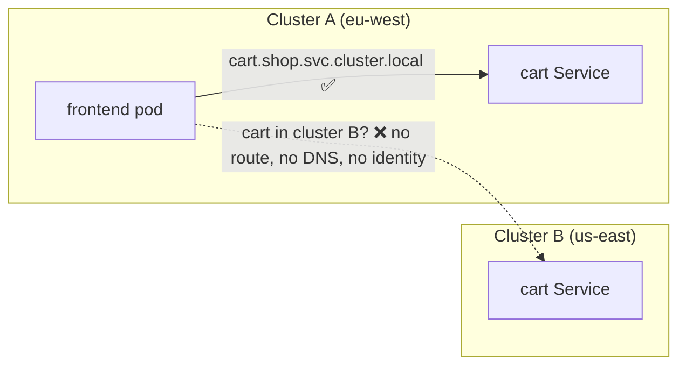
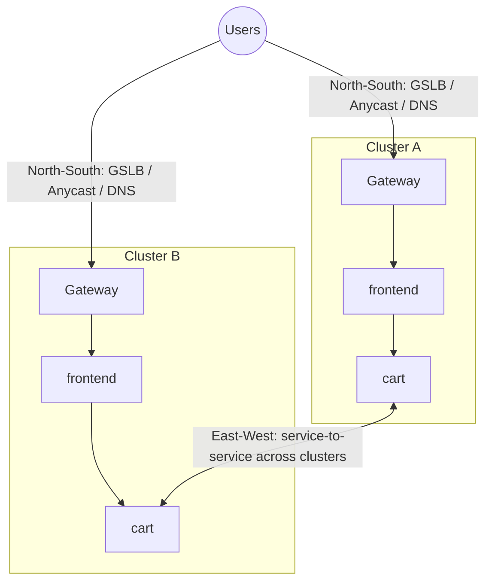
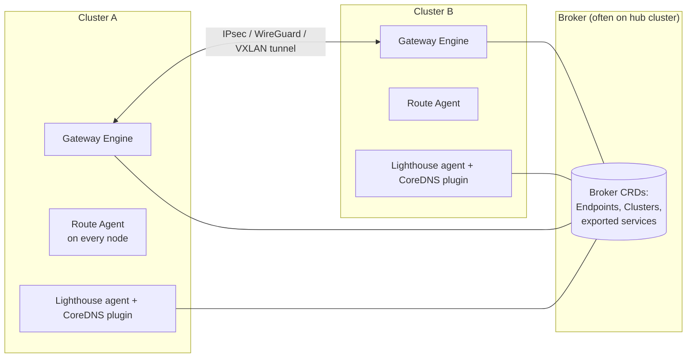
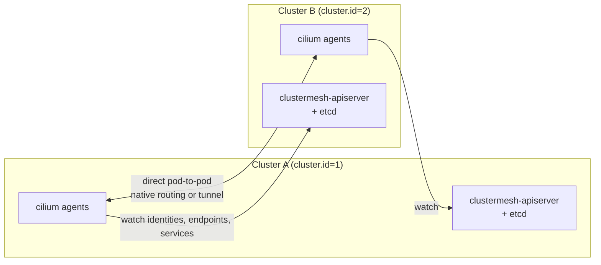
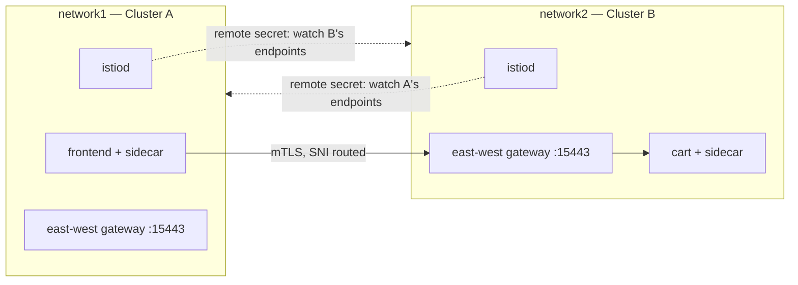
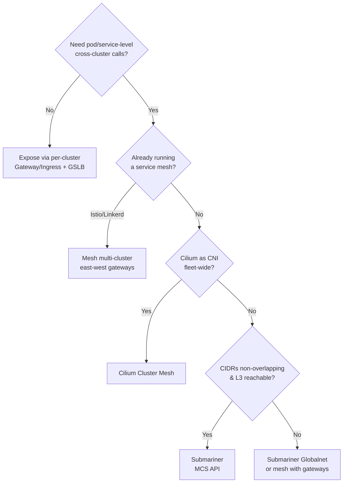

# Multi-Cluster Networking

## Learning Objectives
- Identify the networking problems that appear once workloads span clusters: addressing, discovery, connectivity, security, and traffic steering
- Plan non-overlapping IP address space for a fleet (and know the escape hatches when you can't)
- Use the **Multi-Cluster Services (MCS) API** (`ServiceExport` / `ServiceImport`) and `clusterset.local` DNS
- Connect clusters with **Submariner**, **Cilium Cluster Mesh**, and **Istio multi-cluster**
- Choose between flat networks, gateway-based meshes, and global load balancing for north-south traffic
- Troubleshoot cross-cluster connectivity systematically

## Prerequisites
- CNI basics ([CNI Overview](../03-networking-fundamentals/cni-overview.md))
- Service mesh concepts ([Service Mesh](../03-networking-fundamentals/service-mesh.md))
- Ingress and Gateway API ([Ingress Controllers](../03-networking-fundamentals/ingress-controllers.md))
- Network policies ([Network Policies](../03-networking-fundamentals/network-policies.md))
- Fleet concepts ([Cluster Federation](./cluster-federation.md))
- Tools: `kind`, `kubectl`, `helm`, `subctl`, `cilium` CLI, `istioctl`

---

## The Problem Space

Inside one cluster, Kubernetes gives you a flat pod network, stable Service VIPs, and `svc.cluster.local` DNS. None of this crosses cluster boundaries by default.



Five problems must be solved, and different tools solve different subsets:

| Problem | Question | Example solutions |
|---------|----------|-------------------|
| **Addressing** | Do pod/service CIDRs overlap? | IPAM planning, Submariner Globalnet, gateways that NAT |
| **Connectivity** | Is there an L3 path between clusters? | VPC peering/transit, tunnels (Submariner IPsec/WireGuard), Cilium Cluster Mesh, mesh east-west gateways |
| **Discovery** | How does a client find a service in another cluster? | MCS API + `clusterset.local`, Istio endpoint discovery, Cilium global services |
| **Security** | How do we authenticate and authorize cross-cluster calls? | mTLS with shared trust root (SPIFFE), identity-aware network policies |
| **Traffic management** | Local-first? Failover? Weighted? | Mesh locality load balancing, Cilium service affinity, GSLB/DNS |

---

## East-West vs North-South



- **North-south** (users → platform): global DNS / GSLB, anycast, cloud global load balancers, multi-cluster Gateway implementations. Covered in [Workload Distribution](./workload-distribution.md).
- **East-west** (service → service across clusters): the focus of this doc.

> **Design principle:** prefer architectures where east-west traffic *rarely* crosses clusters (e.g., cell-based designs where each cluster is self-sufficient). Cross-cluster calls add latency, cost (inter-region egress), and failure coupling. Use cross-cluster connectivity for failover, shared data services, and migration — not as the default call path.

---

## IP Address Planning for Fleets

The single most painful multi-cluster networking mistake is **overlapping CIDRs**. Most cloud and local defaults (e.g. `10.244.0.0/16` for kind, `10.96.0.0/12` for services) are identical across clusters.

### A fleet IPAM plan

```yaml
# fleet/ipam-plan.yaml — documentation-as-code, consumed by cluster templates
supernet: 10.0.0.0/8
allocations:
  # Each cluster gets a /16 for pods and a /20 for services from separate ranges
  prod-eu-1:   { pods: 10.20.0.0/16, services: 10.120.0.0/20, nodes: 172.20.0.0/20 }
  prod-eu-2:   { pods: 10.21.0.0/16, services: 10.120.16.0/20, nodes: 172.20.16.0/20 }
  prod-us-1:   { pods: 10.30.0.0/16, services: 10.130.0.0/20, nodes: 172.30.0.0/20 }
  prod-us-2:   { pods: 10.31.0.0/16, services: 10.130.16.0/20, nodes: 172.30.16.0/20 }
  staging-1:   { pods: 10.40.0.0/16, services: 10.140.0.0/20, nodes: 172.40.0.0/20 }
reserved:
  future-regions: 10.50.0.0/12
```

Feed these values into Cluster API `spec.clusterNetwork` (see [Cluster Federation](./cluster-federation.md)) or the Terraform modules in [`code/terraform-modules/networking/`](https://github.com/GitOpsHub/platform-engineering-on-kubernetes/tree/main/code/terraform-modules/).

### When CIDRs already overlap

| Option | How | Trade-off |
|--------|-----|-----------|
| Re-IP clusters | Rebuild with new CIDRs (CAPI makes this a migration, not surgery) | Disruptive but clean |
| Submariner **Globalnet** | Assigns a global virtual IP range per cluster and NATs | Extra hop, NAT complexity, some protocols suffer |
| Gateway-based mesh | Istio multi-network with east-west gateways; only gateway IPs must be routable | Requires a mesh; gateway is a hop and a capacity concern |
| L7 only | Expose services through ingress/API gateway per cluster | No pod-level connectivity; simplest |

---

## The Multi-Cluster Services (MCS) API

SIG Multicluster defined a small, implementation-neutral API ([KEP-1645](https://github.com/kubernetes/enhancements/tree/master/keps/sig-multicluster/1645-multi-cluster-services-api)) built on the **ClusterSet** and **namespace sameness** concepts:

- A **ClusterSet** is a group of clusters with a high degree of mutual trust.
- **Namespace sameness:** `shop` in cluster A and `shop` in cluster B are the same logical namespace, with the same owners.
- You **export** a Service with a `ServiceExport`; the implementation creates a **`ServiceImport`** in every cluster of the set.
- Consumers use `<service>.<namespace>.svc.clusterset.local`.

```yaml
# Exporting a service (applied in each cluster that hosts cart backends)
apiVersion: multicluster.x-k8s.io/v1alpha1
kind: ServiceExport
metadata:
  name: cart          # Must match the Service name
  namespace: shop
```

```yaml
# Created by the MCS implementation in consuming clusters — you don't write this
apiVersion: multicluster.x-k8s.io/v1alpha1
kind: ServiceImport
metadata:
  name: cart
  namespace: shop
spec:
  type: ClusterSetIP
  ports:
    - name: http
      protocol: TCP
      port: 8080
```

```bash
# From any pod in the ClusterSet:
curl http://cart.shop.svc.clusterset.local:8080/healthz
```

Implementations include **Submariner Lighthouse**, **GKE Multi-cluster Services**, **Cilium** (MCS-API support in recent releases), **Karmada** (multi-cluster service support), and others. The API being standard means your application manifests don't change when you swap implementations.

---

## Option 1: Submariner (flat L3 between clusters)

[Submariner](https://submariner.io/) (CNCF Sandbox) creates encrypted tunnels between clusters so pods and services can reach each other by IP, and implements the MCS API through its **Lighthouse** component.

### Architecture



- **Broker** — exchanges metadata (not traffic) between clusters
- **Gateway Engine** — one active gateway node per cluster terminates tunnels
- **Route Agent** — programs routes on every node toward the gateway
- **Lighthouse** — service discovery for `clusterset.local`
- **Globalnet** (optional) — handles overlapping CIDRs

### Deploying

```bash
# Broker on the hub cluster
subctl deploy-broker --kubeconfig hub.kubeconfig
# → writes broker-info.subm

# Join each cluster (label a node as gateway first, or let subctl prompt)
kubectl --kubeconfig cluster-a.kubeconfig label node cluster-a-worker submariner.io/gateway=true
subctl join broker-info.subm --kubeconfig cluster-a.kubeconfig --clusterid cluster-a

kubectl --kubeconfig cluster-b.kubeconfig label node cluster-b-worker submariner.io/gateway=true
subctl join broker-info.subm --kubeconfig cluster-b.kubeconfig --clusterid cluster-b

# Overlapping CIDRs? deploy the broker with --globalnet and join normally.

# Export a service from cluster B
subctl export service --kubeconfig cluster-b.kubeconfig --namespace shop cart

# Inspect and verify
subctl show all --kubeconfig cluster-a.kubeconfig
subctl diagnose all --kubeconfig cluster-a.kubeconfig
```

**Good fit:** you want plain L3 reachability and MCS DNS without adopting a service mesh, and you can control CIDR allocation. **Watch out for:** gateway node capacity, firewall rules for tunnel ports (UDP 4500 for IPsec NAT-T by default, 4800 for VXLAN intra-cluster), and MTU.

---

## Option 2: Cilium Cluster Mesh

If your fleet already standardizes on [Cilium](https://cilium.io/) as the CNI, **Cluster Mesh** connects clusters directly at the eBPF datapath layer: pod-to-pod routing, global services, and identity-aware network policy across clusters.



### Requirements
- Unique `cluster.name` and `cluster.id` (1–255 by default) per cluster
- Non-overlapping pod CIDRs
- Node-to-node IP reachability between clusters (for example VPC peering or a transit gateway)
- Same Cilium version range across clusters

```bash
# Install Cilium with a unique identity per cluster
helm install cilium cilium/cilium -n kube-system --kube-context kind-cluster-a \
  --set cluster.name=cluster-a --set cluster.id=1 \
  --set ipam.mode=kubernetes

helm install cilium cilium/cilium -n kube-system --kube-context kind-cluster-b \
  --set cluster.name=cluster-b --set cluster.id=2 \
  --set ipam.mode=kubernetes

# Share the CA so identities are trusted across clusters (copy cilium-ca secret from A to B),
# then enable and connect cluster mesh
cilium clustermesh enable --context kind-cluster-a --service-type NodePort
cilium clustermesh enable --context kind-cluster-b --service-type NodePort
cilium clustermesh connect --context kind-cluster-a --destination-context kind-cluster-b
cilium clustermesh status --context kind-cluster-a --wait
```

### Global services and affinity

```yaml
# Deploy the same Service (same name/namespace) in both clusters
apiVersion: v1
kind: Service
metadata:
  name: cart
  namespace: shop
  annotations:
    service.cilium.io/global: "true"       # Merge endpoints from all clusters
    service.cilium.io/affinity: "local"    # Prefer local endpoints; use remote only if none are healthy
spec:
  selector:
    app: cart
  ports:
    - port: 8080
```

| Annotation | Effect |
|------------|--------|
| `service.cilium.io/global: "true"` | Service load-balances across endpoints in all connected clusters |
| `service.cilium.io/shared: "false"` | This cluster consumes remote endpoints but doesn't share its own |
| `service.cilium.io/affinity: local\|remote\|none` | Endpoint preference — `local` gives automatic failover |

### Cross-cluster network policy

Because Cilium identities are cluster-aware, policies can select peers by cluster:

```yaml
# network-policy/cart-allow-frontend.yaml
apiVersion: cilium.io/v2
kind: CiliumNetworkPolicy
metadata:
  name: cart-allow-frontend
  namespace: shop
spec:
  endpointSelector:
    matchLabels:
      app: cart
  ingress:
    - fromEndpoints:
        - matchLabels:
            app: frontend
            io.cilium.k8s.policy.cluster: cluster-a   # Only frontends from cluster-a
```

---

## Option 3: Istio Multi-Cluster

A service mesh solves discovery, mTLS identity, and traffic management in one layer, and with **east-west gateways** it doesn't need a flat network.

### Deployment models

| Model | Control plane | Network | When |
|-------|---------------|---------|------|
| **Multi-primary, same network** | istiod in every cluster | Flat (pods routable) | Highest resilience; requires flat network |
| **Multi-primary, multi-network** | istiod in every cluster | Separate; east-west gateways | Most common in clouds with overlapping or private CIDRs |
| **Primary-remote** | istiod in primary only | Either | Fewer control planes to run; remote depends on primary |
| **External control plane** | istiod outside the data-plane clusters | Either | Managed-mesh offerings, strong separation |



### Multi-primary, multi-network setup (outline)

**Prerequisite:** a **shared root of trust**. Each cluster's istiod needs an intermediate CA signed by a common root (from your PKI, Vault, or cert-manager istio-csr) so that workload identities (`spiffe://cluster.local/ns/shop/sa/cart`) are mutually trusted.

```yaml
# istio/cluster-a.yaml — IstioOperator for cluster A
apiVersion: install.istio.io/v1alpha1
kind: IstioOperator
spec:
  values:
    global:
      meshID: mesh1              # Same mesh across clusters
      multiCluster:
        clusterName: cluster-a   # Unique per cluster
      network: network1          # Network this cluster's pods live on
```

```bash
# 1. Label the istio-system namespace with its network (before installing)
kubectl --context cluster-a label namespace istio-system topology.istio.io/network=network1
kubectl --context cluster-b label namespace istio-system topology.istio.io/network=network2

# 2. Install istiod in each cluster
istioctl install --context cluster-a -f istio/cluster-a.yaml
istioctl install --context cluster-b -f istio/cluster-b.yaml

# 3. Install east-west gateways (the Istio release ships a helper script under
#    samples/multicluster/gen-eastwest-gateway.sh) and expose services through them
samples/multicluster/gen-eastwest-gateway.sh --network network1 | \
  istioctl --context cluster-a install -y -f -
kubectl --context cluster-a apply -n istio-system -f samples/multicluster/expose-services.yaml
# (repeat for cluster-b with network2)

# 4. Exchange remote secrets so each istiod can discover the other cluster's endpoints
istioctl create-remote-secret --context cluster-b --name cluster-b | \
  kubectl apply --context cluster-a -f -
istioctl create-remote-secret --context cluster-a --name cluster-a | \
  kubectl apply --context cluster-b -f -

# 5. Verify
istioctl remote-clusters --context cluster-a
istioctl proxy-config endpoints deploy/frontend -n shop --context cluster-a | grep cart
```

The `expose-services.yaml` sample creates an Istio `Gateway` on port 15443 with `tls.mode: AUTO_PASSTHROUGH` for `*.local` hosts — mTLS traffic is routed by SNI without terminating TLS at the gateway.

> **Ambient mode:** Istio's sidecar-less ambient data plane reached GA for single-cluster use first; multi-cluster ambient support arrived later. Check the Istio release notes for your version before designing an ambient multi-cluster mesh.

### Locality-aware failover

By default Istio treats endpoints in all clusters equally. Enable locality load balancing so traffic stays in-region and fails over only when needed:

```yaml
# istio/cart-destinationrule.yaml
apiVersion: networking.istio.io/v1
kind: DestinationRule
metadata:
  name: cart
  namespace: shop
spec:
  host: cart.shop.svc.cluster.local
  trafficPolicy:
    loadBalancer:
      localityLbSetting:
        enabled: true
        failoverPriority:
          - topology.istio.io/network        # Prefer same network (cluster)
          - topology.kubernetes.io/region    # Then same region
    outlierDetection:                        # REQUIRED for locality failover to trigger
      consecutive5xxErrors: 3
      interval: 10s
      baseEjectionTime: 30s
```

Locality comes from node labels `topology.kubernetes.io/region` and `topology.kubernetes.io/zone`; make sure your clusters set them (cloud providers do; kind does not by default).

---

## Choosing an Approach



| Criteria | Submariner | Cilium Cluster Mesh | Istio multi-cluster | Linkerd multicluster |
|----------|-----------|---------------------|---------------------|----------------------|
| Layer | L3 + DNS | L3/L4 (+L7 via Cilium features) | L7 | L7 |
| CNI-agnostic | Mostly (check support matrix) | No (Cilium only) | Yes | Yes |
| Overlapping CIDRs | Globalnet | No | Yes (multi-network) | Yes (gateway mode) |
| mTLS identity | No (tunnel encryption only) | Optional (WireGuard / mutual auth) | Yes | Yes |
| MCS API | Yes (Lighthouse) | Yes (recent versions) | No (own discovery) | No (mirrored services) |
| Operational weight | Medium | Low if already on Cilium | High | Medium |

---

## Security Considerations

- **Trust domain design:** decide whether all clusters share one SPIFFE trust domain or use federation between trust domains. Sharing is simpler; separate domains limit blast radius.
- **Least connectivity:** connecting clusters at L3 lets *any* pod reach *any* pod unless policy prevents it. Apply default-deny NetworkPolicies in every cluster before enabling cross-cluster routing. See [Network Policies](../03-networking-fundamentals/network-policies.md) and the isolation examples in [Lab 07: Multi-Tenancy](../../labs/lab-07-multi-tenancy/).
- **Namespace sameness is a trust statement:** only include clusters in a ClusterSet when the same namespace truly has the same owner everywhere. Tenant namespaces created by the platform (`Tenant` CRD from [`code/tenant-operator/`](https://github.com/GitOpsHub/platform-engineering-on-kubernetes/tree/main/code/tenant-operator/)) should be named consistently fleet-wide.
- **Egress cost and data residency:** cross-region traffic costs money and may move regulated data across borders. Use policy to prevent regulated services from being exported.

---

## Hands-On Exercises

### Lab: Cilium Cluster Mesh between two kind clusters

**Prerequisites:** Docker, `kind`, `helm`, `cilium` CLI.

```bash
# 1. Two kind clusters with non-overlapping pod/service CIDRs and no default CNI
for i in 1 2; do
cat > kind-$i.yaml <<EOF
kind: Cluster
apiVersion: kind.x-k8s.io/v1alpha4
networking:
  disableDefaultCNI: true
  podSubnet: "10.$((i*10)).0.0/16"
  serviceSubnet: "10.$((i*10+100)).0.0/16"
nodes:
  - role: control-plane
  - role: worker
EOF
kind create cluster --name c$i --config kind-$i.yaml
done
# kind clusters share the "kind" Docker network, so node IPs are mutually reachable.

# 2. Install Cilium with unique cluster identities
helm repo add cilium https://helm.cilium.io && helm repo update
for i in 1 2; do
  helm install cilium cilium/cilium -n kube-system --kube-context kind-c$i \
    --set cluster.name=c$i --set cluster.id=$i --set ipam.mode=kubernetes
done

# 3. Share the CA from c1 to c2 (so mutual TLS between clustermesh components works)
kubectl --context kind-c2 -n kube-system delete secret cilium-ca --ignore-not-found
kubectl --context kind-c1 -n kube-system get secret cilium-ca -o yaml | \
  kubectl --context kind-c2 -n kube-system create -f -
kubectl --context kind-c2 -n kube-system rollout restart ds/cilium

# 4. Enable and connect
for i in 1 2; do cilium clustermesh enable --context kind-c$i --service-type NodePort; done
for i in 1 2; do cilium status --context kind-c$i --wait; done
cilium clustermesh connect --context kind-c1 --destination-context kind-c2
cilium clustermesh status --context kind-c1 --wait

# 5. Deploy an echo service in both clusters, each returning its cluster name
for i in 1 2; do
kubectl --context kind-c$i create ns shop
cat <<EOF | kubectl --context kind-c$i apply -n shop -f -
apiVersion: apps/v1
kind: Deployment
metadata: {name: echo}
spec:
  replicas: 1
  selector: {matchLabels: {app: echo}}
  template:
    metadata: {labels: {app: echo}}
    spec:
      containers:
        - name: echo
          image: hashicorp/http-echo:1.0
          args: ["-text=hello from c$i", "-listen=:8080"]
---
apiVersion: v1
kind: Service
metadata:
  name: echo
  annotations:
    service.cilium.io/global: "true"
spec:
  selector: {app: echo}
  ports: [{port: 8080}]
EOF
done

# 6. Call the global service from c1 — responses should come from both clusters
kubectl --context kind-c1 -n shop run client --rm -it --image=curlimages/curl --restart=Never -- \
  sh -c 'for i in $(seq 1 10); do curl -s echo:8080; done'
```

**Challenges:**
1. Add `service.cilium.io/affinity: "local"` to the Service in c1; confirm all responses come from c1. Then scale c1's echo to 0 and watch failover to c2.
2. Write a `CiliumNetworkPolicy` that allows only clients from `c1` to reach `echo` in `c2`.

**Cleanup:** `kind delete cluster --name c1 && kind delete cluster --name c2`

---

## Troubleshooting

Work up the stack: **L3 reachability → tunnel/mesh control plane → discovery/DNS → policy → application.**

| Symptom | Likely cause | Diagnose / Fix |
|---------|-------------|----------------|
| `clusterset.local` doesn't resolve | Lighthouse CoreDNS plugin not configured; `ServiceImport` missing | `kubectl get serviceimport -A`; check CoreDNS config forwards `clusterset.local`; `subctl diagnose all` |
| Submariner gateway connection `connecting` forever | UDP ports blocked; NAT traversal issue | Open UDP 4500/500 (IPsec) or WireGuard port between gateways; `subctl show connections` |
| Packets drop for large payloads only | MTU mismatch from tunnel encapsulation | Lower pod MTU / enable MSS clamping; test with `ping -M do -s 1400` |
| Cilium clustermesh `status` shows 0 remote nodes | clustermesh-apiserver unreachable or CA mismatch | `cilium clustermesh status`; check service type/LB reachability; ensure shared `cilium-ca` |
| Cross-cluster pod IPs unreachable with Cilium | Overlapping pod CIDRs or no node-to-node route | Re-plan CIDRs; verify routing between node subnets |
| Istio: remote endpoints missing in `proxy-config endpoints` | Remote secret missing/invalid; istiod RBAC on remote cluster | `istioctl remote-clusters`; re-create remote secret; check istiod logs |
| Istio: cross-network calls fail with TLS errors | No shared root CA | Issue intermediates from a common root; restart istiod and workloads |
| Locality failover never happens | Missing `outlierDetection`; nodes lack topology labels | Add outlier detection; label nodes with `topology.kubernetes.io/region/zone` |
| Works for some namespaces only | Namespace sameness violated (namespace missing or different labels) | Create namespaces consistently via GitOps / Tenant operator |

---

## Further Reading

### Official Documentation
- [Multi-Cluster Services API (KEP-1645)](https://github.com/kubernetes/enhancements/tree/master/keps/sig-multicluster/1645-multi-cluster-services-api)
- [SIG Multicluster](https://multicluster.sigs.k8s.io/)
- [Submariner documentation](https://submariner.io/)
- [Cilium Cluster Mesh](https://docs.cilium.io/en/stable/network/clustermesh/)
- [Istio multicluster installation](https://istio.io/latest/docs/setup/install/multicluster/)
- [Istio locality load balancing](https://istio.io/latest/docs/tasks/traffic-management/locality-load-balancing/)
- [Linkerd multi-cluster communication](https://linkerd.io/2/features/multicluster/)
- [Gateway API](https://gateway-api.sigs.k8s.io/)

---

## Next Steps

1. **Read**: [Multi-Cluster GitOps](./multi-cluster-gitops.md) — roll out networking config consistently across the fleet
2. **Read**: [Workload Distribution](./workload-distribution.md) — north-south traffic steering and failover
3. **Revisit**: [Service Mesh](../03-networking-fundamentals/service-mesh.md) for single-cluster mesh foundations
4. **Practice**: [Lab 07: Multi-Tenancy](../../labs/lab-07-multi-tenancy/) — network isolation that must hold before you connect clusters
