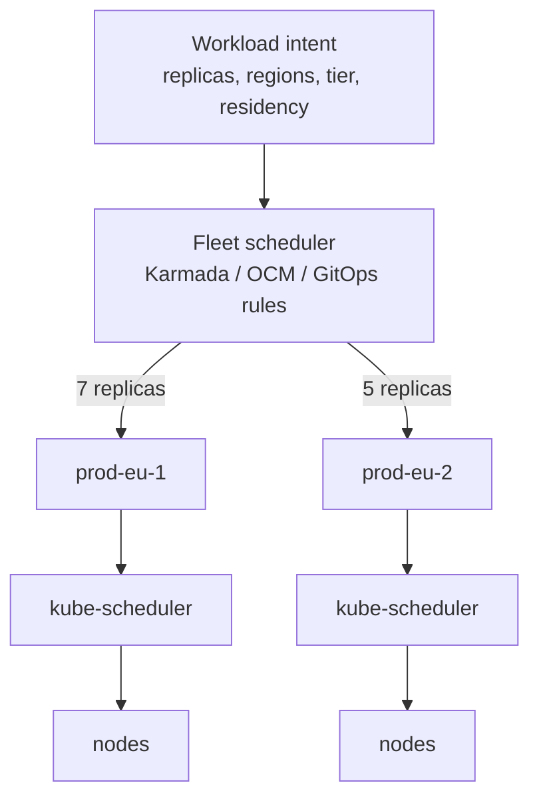
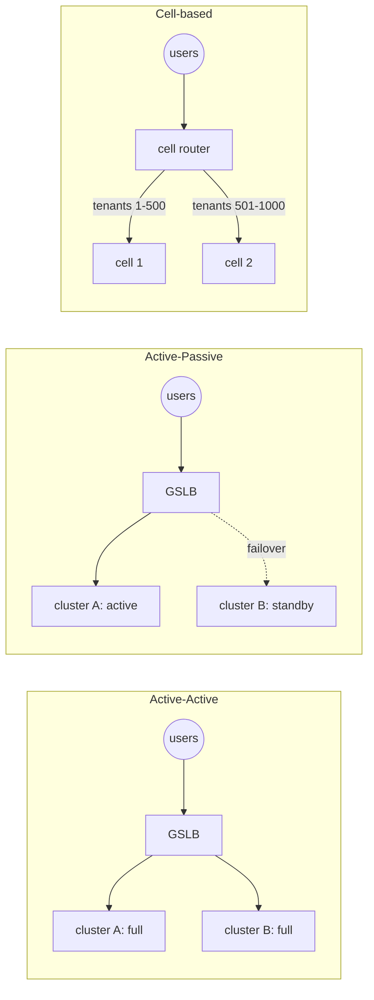
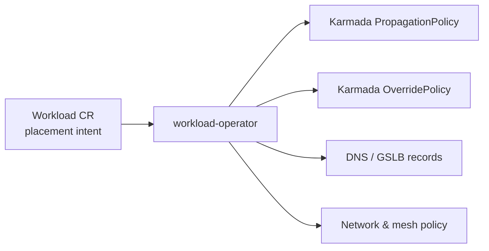
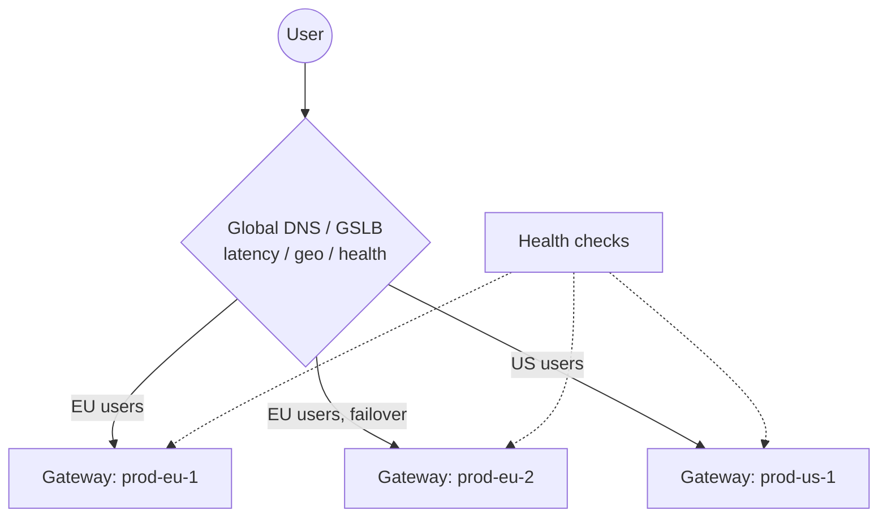

# Workload Distribution Across Clusters

## Learning Objectives
- Choose a distribution model: **pinned**, **replicated (active-active)**, **active-passive**, **sharded/cell-based**, or **scheduled (dynamic)**
- Express placement intent once — through a platform API — and translate it to Karmada, OCM, or GitOps
- Configure Karmada spread constraints, weighted replica division, and cluster failover
- Steer north-south traffic with DNS/GSLB and multi-cluster gateways
- Account for the hardest part of distribution: **state and data gravity**
- Build placement guardrails for compliance (data residency), cost, and capacity

## Prerequisites
- [Cluster Federation](./cluster-federation.md) — Karmada, OCM, fleet labels
- [Multi-Cluster Networking](./multi-cluster-networking.md) — east-west connectivity
- [Multi-Cluster GitOps](./multi-cluster-gitops.md) — fleet repository design
- Single-cluster scheduling ([Scheduling](../01-kubernetes-fundamentals/scheduling.md)) and capacity ([Capacity Planning](../11-reliability/capacity-planning.md))
- Disaster recovery basics ([Disaster Recovery](../11-reliability/disaster-recovery.md))

---

## Two-Level Scheduling

Multi-cluster scheduling is a **two-level** problem. The fleet scheduler decides *which cluster(s)* and *how many replicas each*; each cluster's kube-scheduler then decides *which node*.



The fleet scheduler works with coarser, staler information (cluster-level capacity summaries, labels, health) than kube-scheduler. Design for that: leave headroom, and let the per-cluster autoscalers (Cluster Autoscaler, Karpenter) absorb short-term variance.

---

## Distribution Models

| Model | Description | Good for | Watch out for |
|-------|-------------|----------|---------------|
| **Pinned** | App explicitly assigned to named cluster(s) | Most apps; simplest mental model | Manual failover; uneven utilization |
| **Replicated active-active** | Full copy in every selected cluster; traffic to all | Stateless, latency-sensitive, high availability | Each copy must handle failover load; data consistency |
| **Active-passive** | Primary runs; standby is scaled down or ready | Stateful apps, licensing limits | RTO depends on promotion automation; standby rot |
| **Divided (scheduled)** | Total replicas split across clusters by weight/capacity | Batch, elastic stateless services | Uneven per-cluster load; PDBs are per-cluster |
| **Sharded / cell-based** | Each cluster ("cell") serves a subset of users/tenants end-to-end | Very large scale, blast-radius isolation | Routing layer to map users → cells; cell rebalancing |



### Cell-based architecture in brief

A **cell** is a complete, independent copy of a service stack (often a whole cluster plus its data stores) serving a partition of traffic. Failures and bad deploys are contained to one cell. Cells pair naturally with [progressive fleet rollouts](./multi-cluster-gitops.md#progressive-rollouts-across-the-fleet): deploy to cell 1, bake, then the rest. AWS has written extensively on cell-based architecture (see Further Reading); the pattern is cloud-agnostic.

---

## Express Intent Once: a Platform-Level Placement API

Developers shouldn't write Karmada policies or ApplicationSet selectors. Let them declare *intent* in the platform's `Workload` API, and have the platform translate it. A sketch extending the repo's `Workload` CRD (see [`code/workload-operator/`](https://github.com/GitOpsHub/platform-engineering-on-kubernetes/tree/main/code/workload-operator/)):

```yaml
# tenants/payments/checkout-api.yaml
apiVersion: platform.mycompany.io/v1alpha1
kind: Workload
metadata:
  name: checkout-api
  namespace: payments
  labels:
    platform.mycompany.io/tenant: payments
spec:
  image: ghcr.io/mycompany/checkout-api:1.14.2
  replicas: 12
  placement:
    strategy: ActiveActive        # Pinned | ActiveActive | ActivePassive | Divided
    regions: [eu-west, eu-central]
    minClusters: 2
    dataResidency: eu             # Hard constraint, enforced by policy
    tier: general
  traffic:
    exposure: public
    hostname: checkout.mycompany.io
    failover: automatic
```

The workload operator (or a Crossplane composition / KRO-style composition) renders this into the fleet-level primitives:



Benefits:
- You can swap the underlying fleet scheduler without changing tenant manifests.
- Policy (residency, approved regions per tier) is validated against one schema.
- The platform can report placement status back on `Workload.status`.

A matching admission policy enforces residency at the intent level:

```yaml
# policies/workload-data-residency.yaml
apiVersion: admissionregistration.k8s.io/v1
kind: ValidatingAdmissionPolicy
metadata:
  name: workload-data-residency
spec:
  failurePolicy: Fail
  matchConstraints:
    resourceRules:
      - apiGroups: ["platform.mycompany.io"]
        apiVersions: ["v1alpha1"]
        operations: ["CREATE", "UPDATE"]
        resources: ["workloads"]
  validations:
    - expression: >
        !has(object.spec.placement.dataResidency) ||
        object.spec.placement.dataResidency != 'eu' ||
        object.spec.placement.regions.all(r, r.startsWith('eu-'))
      message: "Workloads with dataResidency=eu may only be placed in eu-* regions."
---
apiVersion: admissionregistration.k8s.io/v1
kind: ValidatingAdmissionPolicyBinding
metadata:
  name: workload-data-residency
spec:
  policyName: workload-data-residency
  validationActions: [Deny]
```

`ValidatingAdmissionPolicy` is GA (`admissionregistration.k8s.io/v1`) from Kubernetes 1.30; on 1.28–1.29 use `v1beta1` with the feature enabled, or Kyverno/Gatekeeper. See [Policy Engine](../12-security-compliance/policy-engine.md).

---

## Implementing Placement with Karmada

### Active-active: duplicate in each selected cluster

```yaml
# karmada/active-active.yaml
apiVersion: policy.karmada.io/v1alpha1
kind: PropagationPolicy
metadata:
  name: checkout-api
  namespace: payments
spec:
  resourceSelectors:
    - apiVersion: apps/v1
      kind: Deployment
      name: checkout-api
    - apiVersion: v1
      kind: Service
      name: checkout-api
  propagateDeps: true
  placement:
    clusterAffinity:
      labelSelector:
        matchExpressions:
          - key: platform.mycompany.io/region
            operator: In
            values: [eu-west, eu-central]
          - key: platform.mycompany.io/environment
            operator: In
            values: [production]
    replicaScheduling:
      replicaSchedulingType: Duplicated   # Every selected cluster runs spec.replicas
```

### Divided with static weights (e.g. 70/30 during a migration)

```yaml
    replicaScheduling:
      replicaSchedulingType: Divided
      replicaDivisionPreference: Weighted
      weightPreference:
        staticWeightList:
          - targetCluster:
              clusterNames: [prod-eu-new]
            weight: 3
          - targetCluster:
              clusterNames: [prod-eu-old]
            weight: 7
```

Shifting weights over time is a clean way to **migrate workloads between clusters** (e.g. during a cluster rebuild or cloud move): 0/100 → 30/70 → 70/30 → 100/0, with traffic following the replicas if both clusters sit behind the same global endpoint.

### Divided by available capacity

```yaml
    replicaScheduling:
      replicaSchedulingType: Divided
      replicaDivisionPreference: Weighted
      weightPreference:
        dynamicWeight: AvailableReplicas   # Uses member cluster resource summaries
```

Karmada estimates how many replicas fit per cluster from the cluster's resource summary; for more accurate estimates it offers an optional `karmada-scheduler-estimator` per member cluster that considers node-level fit.

### Spread across failure domains

```yaml
    spreadConstraints:
      - spreadByField: region
        minGroups: 2
        maxGroups: 2
      - spreadByField: cluster
        minGroups: 2
        maxGroups: 4
```

### Cluster failover

Karmada can evict and reschedule workloads when a member cluster becomes unhealthy. Cluster-level failover is controlled by feature gates on the Karmada controller manager (e.g. `Failover`), and taints applied to unhealthy `Cluster` objects. Application-level failover can be configured per policy:

```yaml
# karmada/failover.yaml (policy excerpt)
spec:
  failover:
    application:
      decisionConditions:
        tolerationSeconds: 120         # How long the app may be unhealthy before migrating
      purgeMode: Graciously            # Wait for the new replicas before removing old ones
      gracePeriodSeconds: 600
```

> **Verify against your Karmada version.** Failover fields and feature-gate defaults have changed across releases; read the Karmada failover docs for the version you deploy and test in a lab before relying on automatic failover in production.

**Be careful with automatic failover:** if a cluster becomes *partially* reachable (e.g. the control plane can't reach it, but it still serves traffic), automatic rescheduling can double-run workloads. For stateless services that's usually fine; for singletons (leader-elected controllers, consumers of a non-idempotent queue) it's dangerous.

---

## Implementing Placement without a Federation Scheduler

Many platforms skip Layer-3 schedulers entirely and implement placement in GitOps. The ApplicationSet cluster generator effectively *is* a static scheduler:

```yaml
# fleet/tenant-workloads-appset.yaml
apiVersion: argoproj.io/v1alpha1
kind: ApplicationSet
metadata:
  name: payments-checkout-api
  namespace: argocd
spec:
  goTemplate: true
  generators:
    - clusters:
        selector:
          matchExpressions:
            - key: platform.mycompany.io/region
              operator: In
              values: [eu-west, eu-central]
            - key: platform.mycompany.io/environment
              operator: In
              values: [production]
  template:
    metadata:
      name: 'checkout-api-{{.name}}'
    spec:
      project: tenant-payments
      source:
        repoURL: https://github.com/mycompany/payments-deploy
        targetRevision: main
        path: checkout-api/overlays/production
      destination:
        server: '{{.server}}'
        namespace: payments
      syncPolicy:
        automated: {prune: true, selfHeal: true}
```

| | GitOps-only placement | Federation scheduler (Karmada/OCM) |
|---|---|---|
| Replica splitting | Manual per overlay | Automatic |
| Reaction to cluster failure | Human changes labels/PR | Automatic (if enabled) |
| Auditability | Every placement change is a commit | Decisions made by controller; visible in bindings |
| Complexity | Low | Medium–High |
| Best for | Most service workloads | Elastic/batch, large fleets, dynamic capacity |

A pragmatic path: **start with GitOps placement; introduce a scheduler only for workloads that need dynamic behavior** (batch, AI/ML training jobs, burst capacity).

---

## North-South Traffic Steering

Placing replicas is half the job; users must reach the right cluster.



| Mechanism | How it works | Failover speed | Notes |
|-----------|--------------|----------------|-------|
| DNS-based GSLB (Route 53, Cloud DNS, NS1) | Health-checked records with latency/geo/weighted routing | Bounded by TTL + client caching | Most common; keep TTLs short (e.g. 30–60 s) |
| Anycast / global cloud LB | Single IP announced globally; provider routes to healthy backend | Fast | Cloud-specific; e.g. GKE multi-cluster Gateway |
| CDN / edge proxy | Edge routes to origins with health checks | Fast | Good for HTTP; adds an edge layer |
| Client-side / mesh | Mesh or client libraries pick endpoints | Fast | East-west primarily |

### Managing DNS from the cluster with ExternalDNS

ExternalDNS can publish each cluster's Gateway with routing-policy annotations (provider-specific). Example for AWS Route 53 weighted records using Gateway API `HTTPRoute`:

```yaml
# per-cluster overlay: gateway/httproute.yaml (rendered with CLUSTER_NAME per cluster)
apiVersion: gateway.networking.k8s.io/v1
kind: HTTPRoute
metadata:
  name: checkout-api
  namespace: payments
  annotations:
    external-dns.alpha.kubernetes.io/set-identifier: ${CLUSTER_NAME}   # Unique per cluster
    external-dns.alpha.kubernetes.io/aws-weight: "100"
    external-dns.alpha.kubernetes.io/ttl: "60"
spec:
  parentRefs:
    - name: public-gateway
      namespace: gateway-system
  hostnames:
    - checkout.mycompany.io
  rules:
    - backendRefs:
        - name: checkout-api
          port: 8080
```

Each cluster's ExternalDNS must use a distinct `--txt-owner-id` so they don't fight over the same record. Pair records with provider health checks so a failed cluster is withdrawn automatically.

### Multi-cluster Gateway implementations

Gateway API (`gateway.networking.k8s.io/v1`) defines single-cluster semantics; several implementations extend it across clusters — for example GKE's multi-cluster Gateway classes (`gke-l7-global-external-managed-mc`) that route to `ServiceImport` backends from the MCS API, and mesh-based implementations. These are implementation-specific; check your provider's documentation.

---

## State and Data Gravity

Stateless services are easy to distribute. Data is not.

| Data pattern | Distribution implication |
|--------------|------------------------|
| Single-region primary DB | App can be active-active, but writes cross regions → latency; region loss = write outage |
| Read replicas per region | Active-active reads; writes routed to primary region |
| Multi-region database (e.g. CockroachDB, Spanner, YugabyteDB, Cassandra) | True active-active possible; consistency/latency trade-offs |
| Per-cell databases | Cell-based scaling; cross-cell queries need aggregation |
| Object storage with replication | Async; RPO > 0 |

Rules of thumb:
1. **Place compute where the data is**, not the other way around. Model data location as a placement constraint.
2. **Distinguish "can run anywhere" from "should run near X."** Label workloads that are latency-coupled to a data store and co-locate them.
3. **Rehearse stateful failover.** Velero backups and database replication must be tested; see [Disaster Recovery](../11-reliability/disaster-recovery.md).
4. **Avoid automatic failover for stateful singletons** unless split-brain is impossible by design (fencing, consensus-based storage).

---

## Capacity, Cost, and Fairness

- **N+1 at the cluster level:** in active-active across N clusters, each must absorb `1/(N-1)` extra load on a cluster loss. Two clusters → each must handle 100% of traffic.
- **Fleet-level quotas:** Karmada's `FederatedResourceQuota` or platform-level quota on the `Tenant` CRD ([`code/tenant-operator/`](https://github.com/GitOpsHub/platform-engineering-on-kubernetes/tree/main/code/tenant-operator/)) prevent a single tenant from consuming fleet capacity.
- **Cost-aware placement:** label clusters with cost tiers (spot-heavy, on-demand, reserved) and let batch workloads prefer cheap tiers.
- **GPU and specialty hardware:** keep a separate `tier: gpu` cluster set; schedule ML jobs there via placement rules. Queueing systems such as Kueue (with its MultiKueue feature for dispatching jobs to worker clusters) are increasingly used for multi-cluster batch.

---

## Hands-On Exercises

### Lab: Migrate a workload between clusters by shifting weights, then simulate failover

**Prerequisites:** the Karmada environment from the [Cluster Federation lab](./cluster-federation.md#hands-on-exercises) (members `member-a`, `member-b`).

```bash
export KARMADA=/etc/karmada/karmada-apiserver.config

# 1. Start with everything on member-a
kubectl --kubeconfig $KARMADA create deployment web --image=nginx:1.27 --replicas=6
cat > web-pp.yaml <<EOF
apiVersion: policy.karmada.io/v1alpha1
kind: PropagationPolicy
metadata:
  name: web
spec:
  resourceSelectors:
    - {apiVersion: apps/v1, kind: Deployment, name: web}
  placement:
    clusterAffinity:
      clusterNames: [member-a, member-b]
    replicaScheduling:
      replicaSchedulingType: Divided
      replicaDivisionPreference: Weighted
      weightPreference:
        staticWeightList:
          - {targetCluster: {clusterNames: [member-a]}, weight: 1}
          - {targetCluster: {clusterNames: [member-b]}, weight: 0}
EOF
kubectl --kubeconfig $KARMADA apply -f web-pp.yaml

# 2. Shift 50/50, then 0/100 — watch replicas move
sed -i.bak 's/weight: 0/weight: 1/' web-pp.yaml && kubectl --kubeconfig $KARMADA apply -f web-pp.yaml
watch -n2 "kubectl --kubeconfig member-a.kubeconfig get deploy web; kubectl --kubeconfig member-b.kubeconfig get deploy web"

# 3. Inspect the scheduling decision
kubectl --kubeconfig $KARMADA get resourcebinding web-deployment -o jsonpath='{.spec.clusters}'; echo

# 4. Simulate cluster failure: stop member-b's control-plane container (CAPD names containers after the cluster)
docker ps --format '{{.Names}}' | grep member-b
docker stop <member-b-control-plane-container>
kubectl --kubeconfig $KARMADA get clusters -w     # member-b should become NotReady
```

**Observe and discuss:**
1. What happened to the replicas assigned to `member-b`? Does it depend on whether cluster failover is enabled in your Karmada version?
2. If the workload were exposed by DNS GSLB, what would users experience during the TTL window?
3. Rewrite the scenario as GitOps-only placement: what manual steps would replace step 2?

**Cleanup:** `docker start <container>`; `kubectl --kubeconfig $KARMADA delete deploy web; kubectl --kubeconfig $KARMADA delete pp web`

> The `weight: 0` entry is used here for illustration; if your Karmada version rejects zero weights, remove the cluster from `staticWeightList` instead.

---

## Troubleshooting

| Symptom | Likely cause | Fix |
|---------|-------------|-----|
| Replicas don't split as weights suggest | Rounding with small replica counts; `dynamicWeight` overriding expectations | Use replica counts divisible by total weight; inspect `ResourceBinding` |
| Workload "scheduled" but pods Pending in a member | Fleet scheduler's capacity view is stale/coarse | Enable scheduler estimator; keep headroom; check member autoscaler |
| After cluster failure, workload ran twice | Partition: member still alive but unreachable from control plane | Use `purgeMode: Graciously`/conservative failover; avoid auto-failover for singletons |
| GSLB keeps sending traffic to a dead cluster | Health check targets wrong endpoint or TTL too long | Health-check the app path through the Gateway; lower TTL |
| ExternalDNS clusters overwrite each other's records | Same `--txt-owner-id` or missing `set-identifier` | Unique owner ID and set identifier per cluster |
| PodDisruptionBudget violated during migration | PDBs are per-cluster; fleet scheduler moves replicas regardless | Shift weights gradually; ensure each cluster's PDB is satisfiable on its own |
| Latency spike after placement change | Compute moved away from its data | Encode data locality as placement constraints |
| Residency violation detected in audit | Placement rendered outside policy (manual override) | Enforce at both intent (`Workload`) and rendered level (Karmada policy / cluster labels) |

---

## Further Reading

### Official Documentation
- [Karmada: Resource propagating and scheduling](https://karmada.io/docs/userguide/scheduling/resource-propagating)
- [Karmada: Failover overview](https://karmada.io/docs/userguide/failover/failover-overview)
- [Open Cluster Management: Placement](https://open-cluster-management.io/docs/concepts/content-placement/placement/)
- [ExternalDNS](https://kubernetes-sigs.github.io/external-dns/)
- [Gateway API](https://gateway-api.sigs.k8s.io/)
- [Kueue MultiKueue](https://kueue.sigs.k8s.io/docs/concepts/multikueue/)

### Articles
- AWS Well-Architected — [Reducing the Scope of Impact with Cell-Based Architecture](https://docs.aws.amazon.com/wellarchitected/latest/reducing-scope-of-impact-with-cell-based-architecture/reducing-scope-of-impact-with-cell-based-architecture.html)
- [Kubernetes ValidatingAdmissionPolicy](https://kubernetes.io/docs/reference/access-authn-authz/validating-admission-policy/)

---

## Next Steps

1. **Read**: [Disaster Recovery](../11-reliability/disaster-recovery.md) — backup and restore strategies that underpin failover
2. **Read**: [Platform Maturity Model](../14-platform-evolution/maturity-model.md) — where multi-cluster fits in platform evolution
3. **Explore**: [Netflix case study](../15-case-studies/netflix.md) — regional failover at scale
4. **Practice**: [Lab 08: Platform Upgrade](../../labs/lab-08-platform-upgrade/) — use weight shifting for blue-green cluster upgrades
