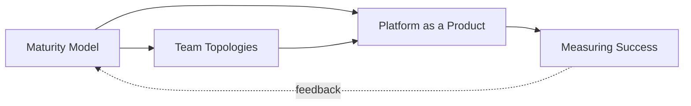
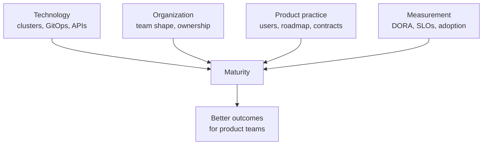

# 14 - Platform Evolution

How a Kubernetes platform grows from a cluster run by one person into a product that many teams depend on: how far it has matured, how the teams around it are shaped, how it is run as a product, and how to know whether it is working.

## Reading Order

| # | Document | Summary |
|---|----------|---------|
| 1 | [Maturity Model](./maturity-model.md) | The CNCF platform maturity model (five aspects, four levels), a Kubernetes capability matrix, self-assessment, and how maturity stalls |
| 2 | [Team Topologies](./team-topologies.md) | Stream-aligned, platform, enabling and complicated-subsystem teams; collaboration, X-as-a-Service and facilitating modes; cognitive load; team anti-patterns |
| 3 | [Platform as a Product](./platform-product.md) | Internal customers and personas, user research, intake and prioritization, Now/Next/Later roadmaps, service contracts, deprecation |
| 4 | [Measuring Success](./measuring-success.md) | DORA metrics with precise definitions, platform SLOs, the SPACE framework, adoption metrics, and how to collect them without distorting behavior |

Read the maturity model first, because it gives the vocabulary the other documents use. Team Topologies and Platform as a Product describe how the organization is arranged and run. Measuring Success describes how you find out whether the arrangement is working, and feeds back into the maturity assessment.

## The Core Idea

A platform is not finished when the clusters are running. It matures along several dimensions at once: funding, adoption, interfaces, operations and measurement. The organization around the platform (who owns what, how requests flow, how success is judged) has to mature with it. Technology investments alone plateau quickly.

## Prerequisites

- [07 - Internal Developer Platform](../07-internal-developer-platform/README.md), especially [Platform Capabilities](../07-internal-developer-platform/platform-capabilities.md)
- [11 - Reliability](../11-reliability/README.md), for SLOs and error budgets
- [13 - Multi-Cluster](../13-multi-cluster/README.md), for the scale at which these concerns become acute

Familiarity with the rest of the repository helps but is not required; each document links to the sections it depends on.

## Where This Leads

- Next section: [15 - Case Studies](../15-case-studies/README.md)
- Case studies of real organizations: [15 - Case Studies](../15-case-studies/README.md)
- Labs: [Lab 07: Multi-Tenancy](../../labs/lab-07-multi-tenancy/), [Lab 08: Platform Upgrade](../../labs/lab-08-platform-upgrade/)
