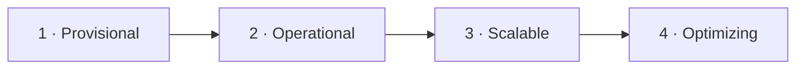
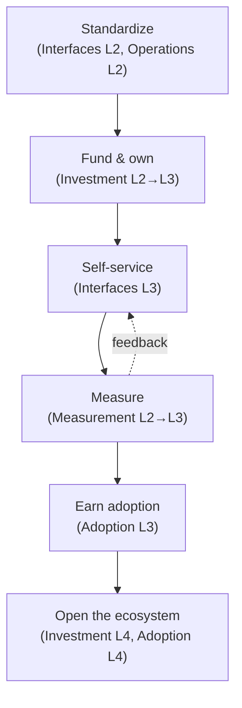

# Platform Maturity Model

## Learning Objectives
- Explain what a platform maturity model is for — and what it is *not* for
- Apply the **CNCF Platform Engineering Maturity Model** (five aspects × four levels) to your own organization
- Map maturity to concrete Kubernetes platform capabilities (clusters, delivery, tenancy, observability, security)
- Run a structured self-assessment and turn the gaps into a sequenced roadmap
- Recognize maturity anti-patterns such as "level-chasing" and premature optimization

## Prerequisites
- Familiarity with internal developer platforms ([Platform Capabilities](../07-internal-developer-platform/platform-capabilities.md))
- Awareness of the platform building blocks covered in sections 04–13 of this repo
- Recommended companion reading: [Platform as a Product](./platform-product.md), [Team Topologies](./team-topologies.md)

---

## Why a Maturity Model?

Platform teams face a constant prioritization problem: there is always more to build than capacity allows. A maturity model gives you:

- **A shared vocabulary** — "we're Operational on interfaces but Provisional on measurement" is more useful than "the platform is kind of OK".
- **A diagnostic** — identifying the aspect that holds everything else back (often *measurement* or *adoption*, not technology).
- **A roadmap scaffold** — sequencing investments so you don't build a self-service portal before you have standardized what it should provision.
- **A conversation with leadership** — explaining why the next investment matters in terms they recognize.

What it is **not**:
- Not a certification or a target to "reach level 4" everywhere. Many organizations should deliberately stay at level 2 or 3 for some aspects.
- Not a ranking of teams. Using maturity scores to compare or punish teams destroys honest self-assessment.
- Not a substitute for talking to your users.

---

## The CNCF Platform Engineering Maturity Model

The CNCF TAG App Delivery (Platforms working group) published a **Platform Engineering Maturity Model** as a companion to its [Platforms White Paper](https://tag-app-delivery.cncf.io/whitepapers/platforms/). It describes **five aspects**, each at **four levels**.



| Aspect | 1 · Provisional | 2 · Operational | 3 · Scalable | 4 · Optimizing |
|--------|----------------|-----------------|--------------|----------------|
| **Investment** — how staff and funds are allocated | Voluntary or temporary | Dedicated team | As product | Enabled ecosystem |
| **Adoption** — why and how users discover and use the platform | Erratic | Extrinsic push | Intrinsic pull | Participatory |
| **Interfaces** — how users interact with platform capabilities | Custom processes | Standard tooling | Self-service solutions | Integrated services |
| **Operations** — how capabilities are planned, run, and maintained | By request | Centrally tracked | Centrally enabled | Managed services |
| **Measurement** — how feedback is gathered and used | Ad hoc | Consistent collection | Insights | Quantitative and qualitative |

> The level names above follow the CNCF model; the descriptions below are a summary and Kubernetes-focused interpretation. Read the [original model](https://tag-app-delivery.cncf.io/whitepapers/platform-eng-maturity-model/) for the authoritative text.

### Aspect 1: Investment

| Level | What it looks like |
|-------|-------------------|
| Provisional | Platform work happens "on the side" by enthusiastic engineers; a shared Helm chart someone maintains in their spare time |
| Operational | A funded platform team exists, mostly measured on keeping infrastructure running |
| Scalable | The platform is funded and managed as a product, with a product manager, roadmap, and user research |
| Optimizing | The platform enables an ecosystem: other teams contribute capabilities through well-defined extension points (e.g. Crossplane compositions, Backstage plugins, Kyverno policy libraries) |

### Aspect 2: Adoption

| Level | What it looks like |
|-------|-------------------|
| Erratic | Some teams use the shared cluster; others run their own; no one is sure who uses what |
| Extrinsic push | Usage is mandated ("all new services must deploy to the platform") |
| Intrinsic pull | Teams choose the platform because it's the easiest path — the golden path wins on merit |
| Participatory | Users contribute back: templates, docs, plugins, policies |

> **Mandates aren't bad** — Extrinsic push is a valid phase, especially for security or compliance. But a platform that only grows by mandate is a warning sign that it isn't solving users' problems.

### Aspect 3: Interfaces

| Level | What it looks like on Kubernetes |
|-------|----------------------------------|
| Custom processes | File a ticket; a platform engineer runs `kubectl` or Terraform for you |
| Standard tooling | Documented, standard ways: shared Helm charts, a GitOps repo structure, a runbook |
| Self-service solutions | Users provision themselves through APIs, CLIs, or portals — e.g. creating a `Tenant` or `Environment` CR, or a Backstage software template |
| Integrated services | Capabilities compose seamlessly: creating a `Workload` provisions its database, secrets, DNS, dashboards, and SLOs automatically |

### Aspect 4: Operations

| Level | What it looks like |
|-------|-------------------|
| By request | Each capability is set up uniquely when someone asks |
| Centrally tracked | Capabilities are inventoried; upgrades tracked in a spreadsheet or tickets |
| Centrally enabled | The platform team provides standardized, automated lifecycle (upgrades, patching) for capabilities |
| Managed services | Capabilities are offered as fully managed services with SLOs; users don't think about operations |

### Aspect 5: Measurement

| Level | What it looks like |
|-------|-------------------|
| Ad hoc | Anecdotes, loudest-voice feedback |
| Consistent collection | Regular surveys, ticket metrics, adoption counts |
| Insights | Data is analyzed to drive roadmap decisions; DORA metrics per team |
| Quantitative and qualitative | Mixed-method measurement (telemetry + surveys + interviews) tied to business outcomes |

See [Measuring Success](./measuring-success.md) for concrete metrics at each level.

---

## Kubernetes Capability Maturity

The CNCF model is deliberately technology-neutral. Platform teams also need a capability-level view of their Kubernetes estate. The following matrix is this repo's interpretation — use it alongside, not instead of, the CNCF aspects.

| Capability | Level 1 | Level 2 | Level 3 | Level 4 |
|-----------|---------|---------|---------|---------|
| **Cluster lifecycle** | Hand-built clusters | Terraform/IaC per cluster | Cluster API / ClusterClass, fleet labels | Clusters provisioned on demand via platform API; automated fleet upgrades in waves |
| **Delivery** | `kubectl apply` from laptops / CI pushes | GitOps per cluster | ApplicationSets, progressive delivery | Fleet-wide progressive rollouts gated on SLOs |
| **Tenancy** | Shared namespaces, ad hoc RBAC | Namespace-per-team with quotas | `Tenant` CRD automates namespaces, RBAC, quotas, network policy | Tenancy spans clusters; cost attribution per tenant |
| **Environments** | Long-lived, hand-managed | Templated (Helm/Kustomize) | Self-service `Environment` CR, ephemeral preview envs | Environments composed automatically per PR, with data seeding |
| **Secrets** | Secrets in Git or CI variables | Sealed Secrets / SOPS | External Secrets Operator + vault | Dynamic, short-lived credentials; automated rotation |
| **Observability** | Per-team tools | Shared Prometheus/Grafana | Logs/metrics/traces with tenant isolation | SLOs and dashboards generated per workload |
| **Policy & security** | Reviews by hand | Admission policies in audit mode | Enforced policies, signed images | Policy-as-code with exceptions workflow, continuous compliance evidence |
| **Developer portal** | Wiki pages | Service catalog | Software templates, TechDocs | Portal as the integrated front door with scorecards |

Cross-references: [Cluster Federation](../13-multi-cluster/cluster-federation.md), [Multi-Cluster GitOps](../13-multi-cluster/multi-cluster-gitops.md), [Lab 07: Multi-Tenancy](../../labs/lab-07-multi-tenancy/), [`code/tenant-operator/`](https://github.com/GitOpsHub/platform-engineering-on-kubernetes/tree/main/code/tenant-operator/), [`code/environment-operator/`](https://github.com/GitOpsHub/platform-engineering-on-kubernetes/tree/main/code/environment-operator/), [External Secrets](../06-secrets-management/external-secrets.md), [Policy Engine](../12-security-compliance/policy-engine.md), [Backstage](../07-internal-developer-platform/backstage.md).

---

## How Maturity Progresses (and Why It Stalls)

Maturity aspects are interdependent. A typical healthy progression:



| Common stall | Symptom | Unblocker |
|--------------|---------|-----------|
| Self-service before standardization | Portal templates generate 15 slightly different deployment styles | Standardize the golden path first, then automate it |
| Technology ahead of measurement | Lots of capabilities, no idea which ones matter | Instrument adoption and run a developer survey |
| Mandate plateau | Adoption flat after the mandate; shadow platforms appear | User research; fix top friction points; product management |
| Ticket-driven operations at scale | Platform team is an ops queue | Turn top-10 ticket types into self-service APIs |
| Hero dependency | One engineer knows how clusters are upgraded | Codify (ClusterClass, runbooks-as-code); pair and rotate |

---

## Running a Self-Assessment

### Step 1: Gather the Right People

Include platform engineers, a few *user* teams (stream-aligned teams of different sizes and tenure), security/compliance, and an engineering leader. A platform team assessing itself alone will overrate interfaces and underrate adoption.

### Step 2: Score Each Aspect with Evidence

Use a scorecard. Require **evidence** for each score — a link to a dashboard, survey, or repo.

```yaml
# assessments/2026-q4-platform-maturity.yaml
assessment:
  date: 2026-10-15
  participants: [platform-team, payments-team, search-team, security, vp-eng]
aspects:
  investment:
    level: 2
    evidence:
      - "Platform team of 6, funded as cost center; no product manager"
    target_next_2q: 3
  adoption:
    level: 2
    evidence:
      - "62% of services on platform (catalog export, 2026-10-01)"
      - "Usage mandated for new services since 2025"
    target_next_2q: 2
  interfaces:
    level: 3
    evidence:
      - "Tenant + Environment CRDs self-service via Backstage templates"
      - "Databases still via ticket (median 3 days)"
    target_next_2q: 3
  operations:
    level: 2
    evidence:
      - "Cluster upgrades tracked in Jira; manual wave coordination"
    target_next_2q: 3
  measurement:
    level: 1
    evidence:
      - "No DORA metrics; last developer survey 2024"
    target_next_2q: 2
capabilities:
  cluster_lifecycle: 2
  delivery: 3
  tenancy: 3
  environments: 2
  secrets: 3
  observability: 2
  policy_security: 2
  developer_portal: 3
```

### Step 3: Visualize

A radar chart of the five aspects (current vs. target) is the most effective single artifact for leadership. Mermaid doesn't render radar charts in every viewer; a quick table works anywhere:

| Aspect | Current | Target (2Q) | Gap |
|--------|---------|-------------|-----|
| Investment | 2 | 3 | ▲1 |
| Adoption | 2 | 2 | — |
| Interfaces | 3 | 3 | — |
| Operations | 2 | 3 | ▲1 |
| Measurement | 1 | 2 | ▲1 |

### Step 4: Find the Constraint

Ask: *which single gap, if closed, unlocks the most?* In the example above, **Measurement L1** is the constraint — without data, the team can't justify product investment (Investment L3) or prioritize which operations to automate (Operations L3).

### Step 5: Turn Gaps into a Roadmap

| Gap | Initiative | Outcome metric | Quarter |
|-----|-----------|----------------|---------|
| Measurement 1→2 | Instrument deployment events; quarterly DevEx survey | DORA baseline published; survey response rate > 40% | Q1 |
| Operations 2→3 | Move clusters to ClusterClass; wave-based upgrades via ApplicationSet RollingSync | Upgrade lead time from weeks to days; zero manual steps | Q1–Q2 |
| Interfaces (DB) | Crossplane composition for Postgres exposed via `Workload` | DB provisioning median < 15 min | Q2 |
| Investment 2→3 | Hire/assign platform product manager; publish roadmap | Roadmap reviewed monthly with users | Q2 |

Re-assess every 6 months. Track the trend, not the absolute number.

---

## Maturity Anti-Patterns

| Anti-pattern | Why it hurts | Instead |
|--------------|-------------|---------|
| **Level-chasing** | Optimizing for the score, not outcomes | Tie every target to a user or business outcome |
| **Uniform targets** | Not every aspect needs level 4; "Managed services" for a 3-team startup is overkill | Choose targets based on scale and strategy |
| **Big-bang platform** | 18 months building a level-4 platform before any user touches it | Thinnest Viable Platform first ([Team Topologies](./team-topologies.md)) |
| **Copying a famous company** | Netflix/Spotify built for their scale, culture, and constraints | Learn principles from [case studies](../15-case-studies/README.md), not org charts |
| **Self-assessment theatre** | Scores inflated to look good | Require evidence; include users; make it safe to score low |
| **Ignoring regression** | Maturity can drop (team attrition, acquisitions, tool sprawl) | Re-assess regularly; track trends |

---

## Hands-On Exercises

### Exercise 1: Assess Your (or a Sample) Platform

**Goal:** produce an evidence-based scorecard and a gap table that points at one constraint.

**Time:** 60–90 minutes. **Materials:** the scorecard template above, a whiteboard or doc.

1. Copy the scorecard YAML into `assessments/<date>-platform-maturity.yaml` in your own repo.
2. For each of the five aspects, write one sentence of evidence per level you believe you've reached. If you can't find evidence, you haven't reached it.
3. Score the eight Kubernetes capabilities using the capability matrix.
4. Use the script below to produce a gap table.
5. Pick **one constraint** and write a one-paragraph proposal: initiative, outcome metric, owner, timeframe.

```bash
#!/usr/bin/env bash
# scripts/maturity-gaps.sh — print a gap table from a maturity scorecard
# Requires: yq v4 (https://github.com/mikefarah/yq)
set -euo pipefail
FILE="${1:?usage: maturity-gaps.sh <scorecard.yaml>}"

printf "%-14s %-8s %-8s %-4s\n" "ASPECT" "CURRENT" "TARGET" "GAP"
for aspect in investment adoption interfaces operations measurement; do
  cur=$(yq ".aspects.${aspect}.level" "$FILE")
  tgt=$(yq ".aspects.${aspect}.target_next_2q" "$FILE")
  printf "%-14s %-8s %-8s %-4s\n" "$aspect" "$cur" "$tgt" "$((tgt - cur))"
done
```

```bash
chmod +x scripts/maturity-gaps.sh
./scripts/maturity-gaps.sh assessments/2026-q4-platform-maturity.yaml
```

Expected output: a five-row table with one row per aspect. The values below are illustrative and
depend on your scorecard.

```text
ASPECT         CURRENT  TARGET   GAP
investment     2        3        1
adoption       2        3        1
interfaces     1        2        1
operations     2        3        1
measurement    1        2        1
```

**Check:**

- Every row has a numeric `CURRENT` and `TARGET`.
- No cell reads `null`. If `yq` prints `null`, the key name in your scorecard does not match the
  script (`level`, `target_next_2q`), so fix the YAML before you continue.
- Your one-paragraph proposal names an initiative, an outcome metric, an owner and a timeframe.

**If you don't have a real platform to assess**, use the composite organization described in [Generic Enterprise](../15-case-studies/generic-enterprise.md) and score it from the narrative.

**Discussion questions:**
- Which aspect did user teams score differently from the platform team? Why?
- Which capability is at level 3 but rarely used? What does that tell you about adoption?
- What would you *not* invest in for the next two quarters?

---

## Troubleshooting

Common problems when using maturity models in practice:

| Problem | Cause | Remedy |
|---------|-------|--------|
| Scores vary wildly between participants | Ambiguous level definitions | Agree on evidence examples per level before scoring |
| Leadership asks "why aren't we level 4?" | Model treated as a grading scheme | Present target levels as strategic choices with rationale |
| Assessment produces a 40-item backlog | No prioritization | Identify one constraint per cycle; time-box initiatives |
| User teams don't show up | Assessment seen as platform-team navel-gazing | Frame it as "help us decide what to build for you"; keep it short |
| Re-assessment shows no movement | Initiatives not tied to the gaps, or capacity consumed by toil | Track toil explicitly; protect roadmap capacity |

---

## Further Reading

### Primary Sources
- CNCF TAG App Delivery — [Platforms White Paper](https://tag-app-delivery.cncf.io/whitepapers/platforms/)
- CNCF TAG App Delivery — [Platform Engineering Maturity Model](https://tag-app-delivery.cncf.io/whitepapers/platform-eng-maturity-model/)
- Matthew Skelton & Manuel Pais — *Team Topologies* (IT Revolution, 2019)
- Nicole Forsgren, Jez Humble, Gene Kim — *Accelerate* (IT Revolution, 2018)

### Related in This Repo
- [Platform Capabilities](../07-internal-developer-platform/platform-capabilities.md)
- [Developer Experience](../08-self-service/developer-experience.md)

---

## Next Steps

1. **Read**: [Team Topologies](./team-topologies.md) — the organizational structures behind each maturity level
2. **Read**: [Platform as a Product](./platform-product.md) — moving Investment and Adoption from level 2 to 3
3. **Read**: [Measuring Success](./measuring-success.md) — the metrics that move Measurement up the scale
4. **Practice**: [Lab 08: Platform Upgrade](../../labs/lab-08-platform-upgrade/) — a concrete step from Operations L2 to L3
