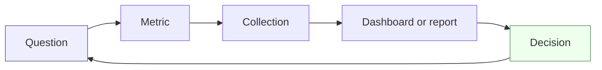
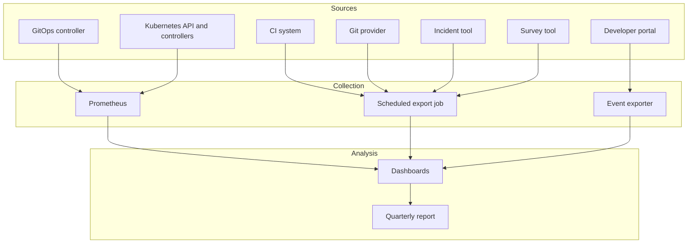

# Measuring Success

## Learning Objectives
- Define the DORA metrics (deployment frequency, lead time for changes, change failure rate, time to restore service) precisely enough to measure them from Git, CI and incident data
- Explain why reliability was added as a fifth capability signal in DORA's research, and how to measure it
- Apply the SPACE framework to avoid measuring developer productivity through a single number
- Define platform adoption and experience metrics (golden path usage, time to first deploy, self-service ratio, support load, platform SLO attainment)
- Collect these metrics from Kubernetes and GitOps systems without building a surveillance tool
- Avoid Goodhart's law traps and the misuse of metrics for individual performance evaluation

## Prerequisites
- Familiarity with the platform maturity model ([Maturity Model](./maturity-model.md))
- Basic Prometheus and PromQL ([Metrics Stack](../10-observability/metrics-stack.md))
- Understanding of SLOs and error budgets ([SLOs and SLIs](../11-reliability/slos-slis.md))
- Familiarity with GitOps delivery ([GitOps Principles](../05-gitops/gitops-principles.md))
- Recommended companion reading: [Platform as a Product](./platform-product.md), [Team Topologies](./team-topologies.md)

---

## Why Measure a Platform?

A platform team that cannot show its effect will eventually be asked to justify its existence, and will answer with anecdotes. Measurement serves three purposes:

1. **Decide**: which capability to build next, which to retire, which to fix first
2. **Demonstrate**: to leadership and users, what the platform changed
3. **Diagnose**: where the friction is, before users complain loudly

It also has a risk. Measurement changes behavior. If you measure the wrong thing, teams will optimize for it. The rest of this document is shaped by that tension.



Start with the question, not the metric. Examples of good questions:
- Are stream-aligned teams getting changes to production faster than last year?
- Is the platform making things more reliable, or only faster?
- Which self-service capability is used, and which is ignored?
- Where do platform engineers spend time that users would not notice if it stopped?

---

## Layer 1: Delivery Performance (DORA)

The DevOps Research and Assessment (DORA) programme, now part of Google Cloud, has published multi-year research on software delivery performance, summarized in *Accelerate* (Forsgren, Humble, Kim; IT Revolution, 2018). The **four key metrics** are:

| Metric | Definition | Primary data source |
|--------|-----------|---------------------|
| **Deployment frequency** | How often a service is successfully deployed to production | Argo CD / Flux sync events, or CI deploy jobs |
| **Lead time for changes** | Time from a commit being made to it running in production | Git commit timestamp and production deploy timestamp |
| **Change failure rate** | Proportion of deployments that cause a degradation requiring remediation (rollback, hotfix, incident) | Deploy records joined to incident or rollback records |
| **Time to restore service** | How long it takes to recover from a production failure | Incident start and resolution timestamps |

DORA's later reports added **reliability** as a capability measured through operational performance (for example, meeting SLO targets). Treat reliability as a companion measure to the four keys, not a replacement. A team that deploys fast by sacrificing reliability is not performing well.

### Defining Each Metric Precisely

Ambiguous definitions produce meaningless dashboards. Write the definition once, in a document everyone can read.

```yaml
# metrics/definitions/dora.yaml  (store in your own repo)
deployment_frequency:
  unit: deployments per service per day
  counts: successful sync of an Argo CD Application or Flux Kustomization to a production environment
  excludes: dry runs, sync failures, preview environments, rollbacks counted separately
  grouping: by service (Workload name) and by team (owner label)
lead_time_for_changes:
  unit: hours (median and p90)
  starts: commit timestamp of the first commit in the change set (merge base to merge commit)
  ends: successful production sync containing the commit
  notes: for squash-merge workflows, use the PR's first commit timestamp
change_failure_rate:
  unit: percent of production deployments
  failure_means: deployment followed within 60 minutes by a rollback, hotfix, or incident tagged to the service
  notes: state the window explicitly; 60 minutes is a starting point
time_to_restore:
  unit: minutes (median)
  starts: incident opened or first SLO alert firing, whichever is earlier
  ends: SLO burn rate returns to normal or incident marked resolved
  notes: measure from the incident record; do not infer from deploy timestamps alone
```

### Classifying Performance

DORA publishes performance bands (commonly labelled elite, high, medium and low) derived from the research population. The bands have changed between reports, and their thresholds are specific to that dataset. **Do not hard-code thresholds from a blog post into your dashboard as targets.** Use the bands as a conversation starter, and compare your own trend over time.

### Measuring DORA on a Kubernetes Platform

The GitOps controller is a natural source of deployment events. Argo CD exposes application state as Prometheus metrics; Flux emits reconciliation conditions. A basic deployment-frequency query for Argo CD (metric names as exposed by Argo CD; verify against your version):

```promql
# Successful syncs to production per service over the last 7 days
sum by (name) (
  increase(argocd_app_sync_total{
    phase="Succeeded",
    dest_server="https://kubernetes.default.svc",
    project="prod"
  }[7d])
)
```

For Flux, the controller's reconciliation condition gauge can be used to detect healthy transitions:

```promql
# Kustomizations that are currently ready, by namespace
gotk_reconcile_condition{type="Ready", status="True", kind="Kustomization"}
```

Be cautious with deployment counts from a GitOps controller. A sync that re-applies identical manifests is not a deployment in the DORA sense. Count changes to the desired revision, not reconciliation loops.

Lead time and change failure rate usually require joining data sources: Git (commits and merges), CI (builds and artifacts), the GitOps controller (sync events), and the incident tool. This is the hard part, and it is where most DORA programmes stall. Start with deployment frequency and time to restore, which are cheaper to measure, and add the rest when the join is reliable.

---

## Layer 2: Reliability

Reliability measures whether the platform and the services on it meet their promises. For a platform team, two kinds of reliability matter:

1. **Platform reliability**: are the platform's own APIs, controllers and clusters meeting their service contract?
2. **Workload reliability**: are the services delivered through the platform meeting their SLOs?

### Platform SLOs

Each platform capability should have SLIs and SLOs, as described in [SLOs and SLIs](../11-reliability/slos-slis.md). Examples:

| Capability | SLI | Example SLO |
|------------|-----|-------------|
| Tenant API | Proportion of admission requests that succeed without error | 99.5% over 30 days |
| Tenant provisioning | Proportion of Tenants reaching `Ready` within 5 minutes | 95% over 30 days |
| GitOps delivery | Proportion of desired revisions applied within 10 minutes of merge | 99% over 30 days |
| Developer portal | Proportion of requests returning in under 1 second | 99% over 30 days |
| Golden path template run | Proportion of template executions that complete without platform error | 98% over 30 days |

Errors caused by application configuration should not count against platform SLOs. Define that boundary in the service contract ([Platform as a Product](./platform-product.md#service-contracts)).

### Reconciliation Health

Controller-based platforms should measure reconciliation directly. The controller-runtime library exposes metrics such as `controller_runtime_reconcile_errors_total` and `controller_runtime_reconcile_time_seconds`. For the platform's own CRDs (`Tenant`, `Environment`, `Workload` under `platform.mycompany.io/v1alpha1`), define domain metrics:

```promql
# p95 time from Tenant creation to Ready (histogram emitted by tenant-operator, illustrative name)
histogram_quantile(
  0.95,
  sum by (le) (rate(platform_tenant_ready_duration_seconds_bucket[30d]))
)
```

Name these metrics as part of the platform's contract, and document them. An unnamed metric is not an SLI.

---

## Layer 3: Developer Experience (SPACE)

The SPACE framework, proposed by Nicole Forsgren, Margaret-Anne Storey, Chandra Maddila, Thomas Zimmermann, Brian Houck and Jenna Butler in ACM Queue (2021), argues that developer productivity has multiple dimensions that cannot be captured by a single metric, and that activity measures like commit counts are easily gamed and easily misread.

| Dimension | Question | Example signals |
|-----------|----------|-----------------|
| **S**atisfaction and well-being | Do developers feel good about their work and tools? | Quarterly survey: "I can get my service to production without help" |
| **P**erformance | Are outcomes good? | Change failure rate, SLO attainment, defect escape rate |
| **A**ctivity | What is being done? | Deployments, PRs, template runs (use with care) |
| **C**ommunication and collaboration | How well do people work together? | Review wait time, cross-team PR reviews, handoff counts |
| **E**fficiency and flow | Can people do their work without interruption? | Time to first deploy, wait time on provisioning, interruptions per day |

**Use at least three dimensions.** A platform that improves Activity while Satisfaction falls has not succeeded.

### Developer Experience Survey

A short, regular survey is the cheapest, most informative measurement a platform team can run. Keep it under ten minutes. Ask about tasks, not feelings about tools in the abstract.

```yaml
# surveys/dev-experience-q4.yaml  (illustrative; adapt to your survey tool)
survey: developer-platform-experience
frequency: quarterly
audience: all engineers in stream-aligned teams
anonymity: aggregated results with minimum group size of five
questions:
  - id: deploy_confidence
    text: "I can deploy my service to production with confidence."
    scale: 5-point agreement
  - id: time_to_first_deploy
    text: "How long did it take you to get your most recent new service to production?"
    options: [under 1 day, 1–3 days, 1 week, longer than 1 week, not applicable]
  - id: blocked_on_platform
    text: "In the last month, how many times were you blocked waiting on a platform team?"
    options: [0, 1–2, 3–5, more than 5]
  - id: debug_self_serve
    text: "I can diagnose a failing service without asking for help."
    scale: 5-point agreement
  - id: docs_findable
    text: "I can find the documentation I need within five minutes."
    scale: 5-point agreement
  - id: biggest_friction
    text: "What is the single biggest thing slowing you down?"
    type: free text
```

Report the distribution, not only the average. Two teams can have the same mean and very different experiences.

---

## Layer 4: Platform Adoption and Usage

Adoption metrics answer: *Is the platform actually being used, by whom, and for what?* They are the Adoption and Interfaces aspects of the [Maturity Model](./maturity-model.md) made concrete.

### Core Adoption Metrics

| Metric | Definition | Why it matters | Caution |
|--------|-----------|----------------|---------|
| **Golden path share** | Percentage of production services deployed through the standard path (for example, a `Workload` resource) | Shows whether the paved road is the road | A high share can hide services that are "on the path" but suffering |
| **Time to first deploy** | Time from a new service's repository creation to its first production deploy | Strong proxy for the friction of the whole platform | Hard to measure cleanly; define the start and end events |
| **Self-service ratio** | Requests fulfilled without a platform engineer, divided by all requests | Shows progress from ops queue to product | Needs a consistent definition of "request" |
| **Support load** | Platform support requests per week, per 10 active users | Shows where documentation and interfaces fail | Trend matters more than the absolute number |
| **Template usage** | Number of new services created from each template, and retention of those services | Shows which golden paths are valued | Usage without retention may mean the template is required but unpleasant |
| **Feature adoption** | Percentage of tenants using each capability (quotas, previews, database claims) | Identifies unused capabilities worth retiring or fixing | Mandatory features will show high adoption that tells you nothing |
| **Shadow tooling count** | Known tools or pipelines used outside the platform | Signals friction and missing capabilities | Hard to count; use a survey question instead of trying to detect |

### Adoption Signals from the Cluster

Usage can be inferred from the cluster itself. Count tenants, environments and workloads by owner:

```promql
# Number of Workload objects per tenant (assumes kube-state-metrics custom resource state configuration)
sum by (tenant) (
  kube_customresource_info{customresource_kind="Workload"}
)
```

Custom resource metrics require configuring kube-state-metrics for the platform's CRDs. The exact label names depend on that configuration; verify them in your environment before building dashboards on top.

For golden path share, compare the number of production `Workload` objects with the number of production Deployments and StatefulSets not owned by a `Workload`:

```promql
# Deployments in prod that are NOT managed by the platform (label absent)
count(
  kube_deployment_labels{namespace=~".*-prod"}
  unless on (namespace, deployment)
  kube_deployment_labels{label_platform_mycompany_io_managed_by="workload-operator"}
)
```

The label name `platform.mycompany.io/managed-by` is a convention used in this repo; if you adopt it, ensure the controller sets it consistently.

### Measuring Time to First Deploy

Time to first deploy is one of the most useful and most difficult metrics. Define two events:

- **Start**: the repository is created from a template, or the first `Workload` is requested (whichever the platform records)
- **End**: the first successful production sync of that workload

Record both as annotations or events in the platform's own data store, not in an ad hoc spreadsheet. The Tenant and Workload controllers are natural places to emit these events. Example Kubernetes event:

```yaml
apiVersion: v1
kind: Event
metadata:
  name: checkout-api.first-prod-deploy
  namespace: payments-prod
type: Normal
reason: FirstProductionDeploy
message: "Workload checkout-api reached Ready in production"
involvedObject:
  apiVersion: platform.mycompany.io/v1alpha1
  kind: Workload
  name: checkout-api
  namespace: payments-prod
```

Events expire after a short retention period by default. Export them to your metrics or data store if you need longer history.

---

## Layer 5: Cost and Efficiency

Platform value is partly the cost it avoids and the cost it makes visible. Measure:
- Cluster utilization (requests and limits versus allocatable capacity)
- Cost per tenant and per workload, using labels and allocation tooling ([Capacity Planning](../11-reliability/capacity-planning.md))
- Idle resources: namespaces with quota and no running workloads for N days
- Platform team time by category: features, health, support, incidents

Avoid presenting cost reduction as the only success metric for a platform. Cheap infrastructure that developers cannot use productively is not a success.

---

## How to Collect Metrics

### Principles

1. **Collect from systems of record**, not from people's memory or self-reports, wherever possible
2. **Minimize personal data.** Measure teams and services, not individuals. Aggregate survey responses with a minimum group size
3. **Make definitions public.** Every metric has a definition, an owner and a data source
4. **Store history.** A metric without a trend is a snapshot
5. **Automate the boring parts.** Manual spreadsheets decay

### Collection Architecture



- **Prometheus** handles cluster-native signals: sync results, reconciliation health, platform API latency, resource utilization
- **Scheduled export jobs** handle systems that are not metric-native: Git history for lead time, incident records for MTTR, survey responses
- **Event exporters** capture platform-specific lifecycle events such as first deploy

### Example: Nightly DORA Export

A small scheduled job can join commit, deploy and incident data into a daily summary. The sketch below is intentionally simple; it runs as a Kubernetes CronJob and writes to a metrics endpoint or a data table. Adapt the data sources to your tools.

```yaml
apiVersion: batch/v1
kind: CronJob
metadata:
  name: dora-export
  namespace: platform-metrics
spec:
  schedule: "15 2 * * *"       # 02:15 daily
  concurrencyPolicy: Forbid
  jobTemplate:
    spec:
      backoffLimit: 2
      template:
        spec:
          serviceAccountName: dora-export
          restartPolicy: Never
          containers:
            - name: export
              image: registry.mycompany.io/platform/dora-export:0.3.0
              env:
                - name: WINDOW_DAYS
                  value: "30"
                - name: OUTPUT
                  value: "pushgateway"
                - name: PUSHGATEWAY_URL
                  value: "http://pushgateway.monitoring.svc:9091"
              resources:
                requests:
                  cpu: 50m
                  memory: 128Mi
                limits:
                  memory: 256Mi
```

Keep the export's source credentials read-only, scoped to the minimum needed, and stored with the same care as any other secret ([External Secrets](../06-secrets-management/external-secrets.md)).

### Example Dashboard Layout

| Panel | Metric | Audience |
|-------|--------|----------|
| Deployment frequency (per team, 30-day trend) | DORA export | Engineering leadership |
| Change failure rate (per team) | DORA export | Teams, platform |
| Time to restore (median, p90) | Incident export | Teams, platform |
| Platform SLO attainment | Prometheus | Platform on-call |
| Tenant provisioning p95 | Prometheus (domain histogram) | Platform team |
| Golden path share | kube-state-metrics | Platform leadership |
| Time to first deploy | Event export | Platform product owner |
| Support requests per week | Ticket export | Platform product owner |
| DevEx survey results | Survey export | Everyone |

Put the platform SLO panels and the DORA panels on separate dashboards. They have different audiences and different review cadences.

---

## Using Metrics Without Distorting Them

### Goodhart's Law

*"When a measure becomes a target, it ceases to be a good measure."* Teams that are measured on deployment frequency will deploy trivially small changes. Teams measured on change failure rate will avoid deploying at all. Teams measured on self-service ratio may close tickets without solving the problem.

Mitigations:
- Pair every speed metric with a stability metric
- Use metrics to ask questions, not to rank teams
- Review the metric's behavior after changes ("what did people do to move it?")
- Rotate or revise metrics that have been saturated

### Do Not Use DORA for Individual Evaluation

DORA metrics describe a system: the team, its pipeline, its platform. They are not designed to evaluate individuals, and using them that way destroys the honesty of the data. Keep the granularity at team or service level.

### Publish Baselines Before Targets

When you introduce a new metric, measure for at least one full cycle before setting a target. A target set on a single noisy week becomes a source of gaming.

### Pair Metrics with Narrative

Every quarterly report should include:
- The metric trend
- One or two concrete examples of what caused the change
- What the platform did in response
- What the team does not yet know

A number without an explanation invites the wrong conclusion.

---

## Anti-Patterns

| Anti-pattern | Symptom | Remedy |
|--------------|---------|--------|
| **Vanity dashboard** | Many panels, no decisions attributed to them | Require each panel to name the decision it informs; remove the rest |
| **Single-metric optimization** | Deployment count rises while incidents rise too | Pair speed and stability; add SPACE dimensions |
| **Surveillance** | Metrics attributed to individuals; engineers self-censor | Aggregate to team or service; set minimum group sizes |
| **Measure everything, act on nothing** | Data collected but no roadmap changes | Connect each review to a roadmap decision; track decisions made from data |
| **Spreadsheet metrics** | Manually updated numbers that drift and disappear | Automate collection; store history in a system of record |
| **Unversioned definitions** | "Lead time" means three different things across three teams | Keep the definitions file in version control; change definitions with a changelog |
| **Metrics as a weapon** | Teams are compared and penalized using platform dashboards | Make the platform the audience for platform metrics; keep team comparison out of the review |

---

## Hands-On Exercises

### Exercise: Build a minimum viable metrics set

**Time:** two to three hours. **Materials:** a Kubernetes cluster with Prometheus (Lab 06 provides one; see [Lab 06: Observability Stack](../../labs/lab-06-observability-stack/)), a GitOps controller, a document for definitions.

1. **Define.** Write the four DORA metrics in the definitions format above, for one team and one service. Be explicit about start and end events.
2. **Collect deployment frequency.** Deploy a sample workload with Argo CD or Flux, make three changes, and verify the sync metric increments. Record the query you used.
3. **Collect platform reliability.** Pick one platform capability and write an SLI and SLO. Implement the SLI as a PromQL expression against an existing metric, or record a gap if no metric exists.
4. **Survey.** Write the five-question version of the survey above. Run it with at least three colleagues (or your study group) and report the distribution.
5. **Adoption.** Count the workloads in your sample cluster that were created through the platform versus applied directly. Explain how you distinguished them.
6. **Decide.** Write a paragraph stating one decision your data supports and one it does not.

**Discussion questions:**
- Which of the four DORA metrics would be hardest to collect in your organization? Why?
- What is the cheapest proxy for time to first deploy you could collect this week?
- If deployment frequency doubled next quarter, what would you check before celebrating?
- Which metric in this document would you be most uncomfortable seeing on an executive dashboard, and why?

---

## Troubleshooting

| Problem | Likely cause | Remedy |
|---------|--------------|--------|
| Deployment frequency is suspiciously high | Reconciliation loops counted as deployments | Count changes to the desired revision, not sync attempts; filter `phase` and revision changes |
| Lead time is implausibly short | Measuring from merge, not first commit | Use the first commit timestamp in the change set; document the definition |
| Change failure rate is zero | No link between deploys and incidents, or incidents not tagged | Tag incidents with the service; add a rollback-detection rule for Argo CD or Flux sync reverts |
| Metric disappears after an upgrade | Controller renamed or relabelled its metrics | Pin metric names in definitions; add a canary alert on expected series being present |
| Custom resource metrics are missing | kube-state-metrics not configured for the CRD | Add the CRD to the custom resource state configuration; verify with a simple query |
| Survey response rate is low | Survey too long, unclear purpose, or no visible follow-up | Shorten to five questions; publish the results and one action taken |
| Teams game the adoption metric | Metric is a target, not a signal | Switch to retention or outcome metrics; review what changed |
| Dashboards disagree | Different definitions or time windows | Consolidate into one definitions file; state the window on every panel |

---

## Further Reading

### Primary sources
- Nicole Forsgren, Jez Humble, Gene Kim — *Accelerate: The Science of Lean Software and DevOps* (IT Revolution, 2018)
- DORA — [dora.dev](https://dora.dev/) — research reports and metric definitions
- Nicole Forsgren, Margaret-Anne Storey, Chandra Maddila, Thomas Zimmermann, Brian Houck, Jenna Butler — *The SPACE of Developer Productivity*, ACM Queue (2021)
- Betsy Beyer, Chris Jones, Jennifer Petoff, Niall Richard Murphy (eds.) — *Site Reliability Engineering* (O'Reilly, 2016), chapters on SLOs — [sre.google/books](https://sre.google/books/)
- CNCF TAG App Delivery — [Platforms White Paper](https://tag-app-delivery.cncf.io/whitepapers/platforms/)
- CNCF TAG App Delivery — [Platform Engineering Maturity Model](https://tag-app-delivery.cncf.io/whitepapers/platform-eng-maturity-model/)

### Related in this repo
- [Maturity Model](./maturity-model.md)
- [SLOs and SLIs](../11-reliability/slos-slis.md)
- [Alerting](../10-observability/alerting.md)
- [Developer Experience](../08-self-service/developer-experience.md)
- [Lab 06: Observability Stack](../../labs/lab-06-observability-stack/)

---

## Next Steps

1. **Read**: [Platform as a Product](./platform-product.md) — how the measurements feed roadmap decisions
2. **Read**: [Case Studies](../15-case-studies/README.md) — how companies have talked publicly about measuring their platforms
3. **Practice**: complete the hands-on exercise and share the definitions file with one team
4. **Practice**: [Lab 08: Platform Upgrade](../../labs/lab-08-platform-upgrade/) — measure the effect of an upgrade on DORA and platform SLOs
