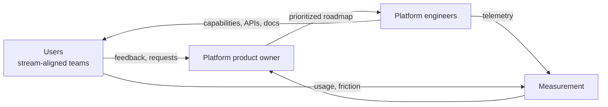
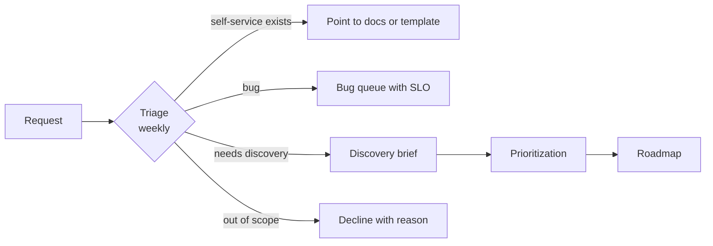

# Platform as a Product

## Learning Objectives
- Explain what it means to treat an internal platform as a product, and what changes when you do
- Identify internal customers, their personas and their jobs-to-be-done
- Apply product management practices (discovery, prioritization, intake, roadmaps) to platform work
- Write a platform roadmap that is honest about trade-offs and reviewable by users
- Define a platform service contract: SLOs, support boundaries, deprecation policy and documentation standards
- Recognize product anti-patterns: the feature factory, the internal monopoly, and the roadmap nobody reads

## Prerequisites
- Understanding of platform capabilities and interfaces ([Platform Capabilities](../07-internal-developer-platform/platform-capabilities.md))
- Familiarity with team structures ([Team Topologies](./team-topologies.md))
- Basic SLO vocabulary ([SLOs and SLIs](../11-reliability/slos-slis.md))
- Recommended companion reading: [Maturity Model](./maturity-model.md), [Measuring Success](./measuring-success.md)

---

## What "Platform as a Product" Means

The phrase has been used widely since Evan Bottcher's 2018 article *What I Talk About When I Talk About Platforms* on Martin Fowler's site, and it appears throughout the CNCF Platforms White Paper. The core idea is simple:

> A platform is a set of capabilities that other teams use to deliver value. If those teams have a choice, the platform must earn their use. Treating it as a product means the platform team takes responsibility for that choice being worth making.

In practice, "product thinking" changes five things:

| Question | Project mindset | Product mindset |
|----------|-----------------|-----------------|
| Who is it for? | "The cluster" or "the infrastructure" | Named internal customers with jobs to be done |
| How is success judged? | Delivered on time, within budget | Users adopt it, get value, and need less help over time |
| What gets built next? | Whatever was requested loudest | Whatever most reduces friction for the highest-value users, with evidence |
| When is it done? | When the project ends | Never; it is operated, measured and improved |
| Who owns the quality? | The engineers who built it | The product owner, with engineers, accountable for outcomes |

A platform built as a project is handed over at launch and decays. A platform built as a product has a continuous owner.



---

## Internal Customers

### Identify Who Uses the Platform

Start by naming the customers. An internal platform usually has more than one kind:

| Customer type | Example | Primary jobs-to-be-done |
|---------------|---------|-------------------------|
| Application developers | Engineers in stream-aligned teams | Deploy a service, debug a failing pod, see logs, roll back |
| Team leads and engineering managers | Owners of several services | Understand cost, reliability and ownership across their teams |
| Security and compliance | Auditors, security engineers | Prove that policies are enforced; respond to vulnerabilities |
| Data and ML teams | Pipeline and model owners | Run batch jobs, GPUs, data stores with specific resource profiles |
| Other platform teams | Observability or networking platform owners | Integrate their capability into the common platform |
| Finance | Cost analysts | Attribute spend to teams and products |

Not all customers are equal. Usually one or two groups generate most of the value. Begin there.

### Personas

A persona is a short, evidence-based description of a type of user. Keep them few (three to five), and base them on interviews, not imagination.

```yaml
# docs/personas/service-developer.yaml  (store in your own repo)
persona: Service developer
share_of_users: ~70%            # estimate from catalog ownership data; state the source
context:
  - Works in a stream-aligned team of 6–8 engineers
  - Deploys several times per week
  - Has Kubernetes exposure but does not want to become a Kubernetes expert
jobs:
  - Ship a change to production with confidence
  - Find out why a service is failing without paging the platform team
  - Add a database without learning how it is provisioned
pains:
  - Two different ways to add secrets depending on the cluster
  - Unclear which dashboard is authoritative
  - Waiting days for a namespace quota increase
success_looks_like:
  - Deploy from merge to production in under 30 minutes without a ticket
  - Can diagnose a crash loop from the portal in under five minutes
```

Note the `share_of_users` field: it encourages you to estimate who you are optimizing for, and to say how confident you are.

### User Research

Platform teams can run user research like any product team:

- **Interviews**: 30-minute conversations with engineers from several teams, focused on last week's real work, not hypothetical features. Ask them to walk you through their last deployment.
- **Journey mapping**: map the steps of a common task (for example, "add a new public endpoint"), with time spent and the people involved at each step. Count the handoffs.
- **Support analysis**: categorize the last 200 tickets or chat messages. Each category is a candidate for self-service, documentation or a bug fix.
- **Usage data**: which APIs are called, which templates are used, which documentation pages are read. Usage is a signal, not a verdict.
- **Surveys**: short, periodic, and tied to specific tasks. The DevEx survey approach is covered in [Measuring Success](./measuring-success.md).

Do not confuse *requests* with *needs*. "We need a faster Jenkins" often means "our deployments take too long". Ask "what were you trying to do?" until the underlying need is clear.

---

## Discovery, Intake and Prioritization

### Discovery

Discovery answers: *is this problem worth solving, and what is the smallest useful solution?* For platform work, a discovery artifact is usually a one-page brief:

```markdown
## Problem brief: Database provisioning takes 3 days

**Who is affected:** service developers in 9 stream-aligned teams (count from catalog)
**Evidence:** median ticket age 3 days (ticket export, Q3); 14 tickets in the last month
**Current workaround:** teams ask in chat; a platform engineer runs Terraform by hand
**Impact:** delays feature launches; teams hold unplanned capacity for this
**Hypothesis:** a self-service database claim with sane defaults removes most of the wait
**Smallest test:** a Crossplane claim for Postgres with two sizes, used by two pilot teams for one sprint
**Success measure:** median provisioning time under 15 minutes for pilot teams
**Not in scope:** non-Postgres engines, cross-region replicas, data migration
```

### Intake

Intake is how requests enter the platform team. A good intake process:
- Gives one front door (a form, a portal entry, a labelled issue queue)
- Asks for the problem, not the solution
- Has a visible triage cadence (weekly is common)
- Tells requesters the outcome, including "no, and here is why"



### Prioritization

Use an explicit framework and record it. Common choices:

- **RICE** (Reach, Impact, Confidence, Effort): useful when you have usage data
- **Cost of delay**: useful when a late feature has a measurable cost (for example, every week without self-service DB costs 12 engineer-days)
- **Opportunity scoring** from user research: pick the job with high importance and low satisfaction

Whatever you use, publish the scores or the criteria. A prioritization nobody can see becomes politics.

Keep at least one slot for **platform health** work: upgrades, security patches, technical debt. If the platform only ever ships features, its operational risk compounds until an incident forces the issue. A common allocation is roughly 20–30% to health work, reviewed each quarter, but the right number depends on your estate.

---

## Roadmaps

### Roadmaps Are Commitments to Learning, Not Dates

A platform roadmap should show direction and confidence, not a promise of dates for everything. A widely used format is **Now / Next / Later**:

| Horizon | Meaning | Confidence |
|---------|---------|------------|
| **Now** | In progress, with an owner and a target outcome | High |
| **Next** | Discovered and prioritized; will start when a Now item finishes | Medium |
| **Later** | Themes and hypotheses; no commitment | Low |

Each item has an outcome statement, not an output:

| Output (weak) | Outcome (strong) |
|---------------|------------------|
| Build a Backstage template for Go services | New Go services reach production in under two days without a platform engineer |
| Upgrade clusters to 1.31 | Zero unplanned downtime during the upgrade; all clusters within two minor versions of latest |
| Add OPA policies | Policy violations at admission reduced by 80% for pilot teams; exceptions workflow in place |

### Example Roadmap

```markdown
# Developer Platform Roadmap — Q1 (draft for review)

## Now
- **Self-service Postgres via Workload trait** (owner: platform-data team)
  - Outcome: median provisioning under 15 minutes for pilot teams
  - Status: pilot with payments and search; 2 of 5 milestones done
- **Cluster upgrade automation in waves** (owner: platform-ops team)
  - Outcome: upgrades run without manual steps across the non-prod fleet
  - Status: non-prod done; prod wave 1 scheduled

## Next
- **Environment previews for pull requests** — discovered from three teams' requests
- **Dashboard defaults per Workload** — depends on the observability contract

## Later
- Multi-region tenant placement — hypothesis; waiting on the second region decision
- Cost attribution per tenant — blocked on finance taxonomy

## Not doing this quarter
- Replacing the CI system. Reason: no evidence it is the top constraint; revisit in Q3 with DORA data.
```

Note the explicit **Not doing this quarter** section. Users trust a roadmap more when it says what is not happening and why.

### Reviewing the Roadmap

- Publish the roadmap where users read: the developer portal, a wiki page, or a repository README
- Hold a monthly roadmap review with user representatives, with time for questions
- Re-plan quarterly; expect to change items, and say so when you do
- Track what shipped against what was promised, and report that too

---

## Service Contracts

A platform capability should come with a **service contract**: a written statement of what the platform promises to users, and what it does not. Without one, every incident becomes a negotiation.

A service contract covers:

| Element | Example |
|---------|---------|
| **Scope** | Provides: namespaces, quotas, GitOps delivery, default dashboards. Does not provide: application-level alerts. |
| **Availability target** | Control-plane API for `Tenant` requests: 99.5% monthly. Application traffic is the application's SLO. |
| **Support hours and channel** | Business hours chat; 24/7 for production incidents via the platform on-call rotation |
| **Request turnaround** | Self-service: immediate. Non-self-service requests: triaged within two business days |
| **Change policy** | Breaking API changes require a deprecation window of two minor releases and a migration guide |
| **Deprecation policy** | Deprecated features are announced in the portal and changelog; removal after the window, with a migration tool where practical |
| **Documentation standard** | Every capability has a reference page, a getting-started guide and a troubleshooting section |
| **Feedback path** | Issue queue plus quarterly survey plus monthly roadmap review |

### Example: Tenant Service Contract (Excerpt)

```yaml
# platform-contracts/tenant.yaml
capability: Tenant
api: platform.mycompany.io/v1alpha1
owner: developer-platform
slo:
  availability: 99.5%           # control-plane API, monthly, measured at the admission webhook
  provisioning_latency_p95: 5m  # time from Tenant creation to namespaces and RBAC ready
scope:
  provides:
    - Namespaces per environment
    - ResourceQuota and LimitRange defaults
    - RBAC bindings for the owner group
    - Default NetworkPolicy (deny-all ingress, allow same-namespace)
    - Argo CD AppProject
  does_not_provide:
    - Application-level alerts
    - Capacity beyond the tenant's approved quota
change_policy:
  breaking_changes: two minor releases notice; migration guide required
support:
  channel: "#developer-platform"
  hours: business hours; 24/7 for production incidents via on-call
```

The contract is only useful if it is reviewed. Put it in the repository next to the code, and review it with users when it changes.

---

## Self-Service Is a Product Feature, Not Just an Automation Goal

Self-service is often presented as "automate all the tickets". Product thinking adds that self-service must be **discoverable**, **safe**, and **understandable when it fails**.

| Property | What it means for a Kubernetes platform |
|----------|------------------------------------------|
| Discoverable | A user can find the right template, CRD or doc from the portal in under a minute |
| Safe by default | Quotas, policies and network defaults protect other tenants without extra configuration |
| Explainable | When a `Workload` is not ready, its status conditions say why, in plain language |
| Reversible | Rollback is a Git revert or a previous version selection, not a platform engineer intervention |
| Auditable | Every change is traceable to a person and a reason |

The [Backstage](../07-internal-developer-platform/backstage.md) and [Port](../07-internal-developer-platform/port.md) documents cover portal options; the [Platform API](../09-platform-apis/platform-api-design.md) section covers the CRD design that makes self-service reliable.

### Surfacing Status

Users should not need `kubectl describe` to understand a failing request. Use status conditions with stable reasons:

```yaml
status:
  conditions:
    - type: Ready
      status: "False"
      reason: QuotaExceeded
      message: "requested 4 CPU; tenant payments has 1 CPU remaining in environment prod"
      lastTransitionTime: "2026-10-20T09:14:00Z"
    - type: NamespacesProvisioned
      status: "True"
      reason: Provisioned
```

The message is written for the user, and the reason is stable enough to be used in dashboards and runbooks.

---

## Operating a Platform as a Product

### Ownership and On-Call

A platform product needs an on-call rotation that is sized to its operational load and has the authority to change the platform. The [Reliability](../11-reliability/README.md) section covers incident practice; the product angle is that platform on-call should drive backlog priority. If the same alert pages the rotation every week, that alert becomes a roadmap item.

### Deprecation

Platforms accumulate old paths. Deprecation is a product activity:

1. Announce the deprecation with a date and a reason
2. Provide the replacement and a migration guide
3. Measure remaining usage weekly
4. Contact remaining users directly, with help
5. Remove only when usage is zero or an exception is agreed

Keep old paths working during the window. A deprecation that breaks production on a Friday will be remembered for years.

### Economics

Internal platforms have costs and, often, no price. Make the economics visible:
- Show cost per tenant or per workload where possible ([Capacity Planning](../11-reliability/capacity-planning.md))
- Track platform team capacity by category: features, health, support, incidents
- Compare the cost of building a capability with the cost of teams building their own

A platform that is free to use and invisible in cost will be used whether or not it is good. Visibility makes the value conversation honest in both directions.

### The Build-or-Buy Decision

A product mindset asks whether a capability should be built at all. For each candidate, consider:
- Is there a mature open-source project that meets 80% of the need? (Argo CD, Crossplane, Backstage, External Secrets are examples in this repo)
- Is this differentiating for the business, or is it plumbing?
- What is the total cost of ownership, including upgrades and on-call?

Build what differentiates, adopt what is commodity, and document the reasons either way. [GitOps Tool Comparison](../04-infrastructure-as-code/gitops-tool-comparison.md) shows one such decision made explicit.

---

## Product Anti-Patterns

| Anti-pattern | Symptom | Remedy |
|--------------|---------|--------|
| **Feature factory** | Roadmap is a list of requests with no outcomes; shipped features are not used | Require an outcome and a measure for each roadmap item; check usage after launch |
| **Internal monopoly without service** | Users must use the platform but it is slow, opaque and unsupported | Publish a service contract; measure request turnaround; invest in support |
| **Roadmap nobody reads** | Roadmap lives in a planning tool; users learn of changes from incidents | Publish where users are; review monthly with them |
| **Platform as a side project** | Product owner is a rotating engineer with no time allocated | Give the role a real allocation; separate product and engineering leads if scale requires |
| **Designing for the loudest team** | One large team's needs dominate the roadmap | Use persona weighting and usage data; keep a small slot for other customers |
| **Gold-plated internal tooling** | Beautiful portal, but three templates | Ship the thinnest useful version; grow from usage |
| **Mandatory without value** | Adoption driven by policy, with no investment in user experience | Treat mandates as a time-limited tool; fix the top friction points |

---

## Hands-On Exercise

### Exercise: Write a one-quarter product plan for your platform

**Time:** 90–120 minutes. **Materials:** the Workload and Tenant examples above, a sample of recent support requests (real or composite), a document editor.

1. **Customers.** Write two personas using the YAML format above. Estimate the share of users for each and note your evidence.
2. **Evidence.** Categorize at least twenty support requests (use the composite list in [Generic Enterprise](../15-case-studies/generic-enterprise.md) if you lack real data). Count each category.
3. **Discovery.** Choose the largest category and write a problem brief using the template above.
4. **Prioritization.** Score three candidate initiatives with RICE. Show the scores and the inputs.
5. **Roadmap.** Produce a Now / Next / Later roadmap with outcome statements. Include one "not doing this quarter" entry.
6. **Contract.** Draft a service contract for one capability with scope, SLO, support and deprecation policy.

Review with a sample user (a colleague who does not work on the platform). Ask them three questions:
- What would you stop asking us for if this roadmap shipped?
- What would you be surprised to see us do?
- What is missing that you expected to see?

Record their answers and revise the roadmap once.

**Discussion questions:**
- Which of your roadmap items would you still do if the users did not ask for them? Should you?
- Who would notice first if the platform's on-call rotation were removed?
- Which capability has the largest gap between its service contract and what users actually experience?

---

## Troubleshooting

| Problem | Cause | Remedy |
|---------|-------|--------|
| Users do not trust the roadmap | Dates were promised and missed; no change log | Switch to Now/Next/Later; publish a monthly changelog of what changed and why |
| Every request is urgent | No intake process or triage cadence | Introduce a single front door and a weekly triage |
| Adoption stalls after launch | Self-service path is not discoverable or is slower than the old one | Measure time-to-first-deploy; fix the slowest step; add the path to docs and templates |
| Product owner spends all time on support | No support boundary; support work not visible | Publish the service contract; track support as a category of work with a budget |
| Engineers resist product process | Process feels like bureaucracy | Keep the artifacts small (one-page briefs, one roadmap); show how decisions were made faster |
| Platform roadmap ignores health work | Feature pressure dominates | Reserve an explicit allocation for health; show the cost of skipped upgrades in the roadmap |
| Deprecated feature still used by many teams | Deprecation announced but not enforced or supported | Measure usage weekly; contact users; provide migration help before the removal date |

---

## Further Reading

### Primary sources
- Evan Bottcher — *What I Talk About When I Talk About Platforms* (martinfowler.com)
- CNCF TAG App Delivery — [Platforms White Paper](https://tag-app-delivery.cncf.io/whitepapers/platforms/)
- CNCF TAG App Delivery — [Platform Engineering Maturity Model](https://tag-app-delivery.cncf.io/whitepapers/platform-eng-maturity-model/)
- Matthew Skelton & Manuel Pais — *Team Topologies* (IT Revolution, 2019)
- Marty Cagan — *Inspired* and *Empowered* (Wiley) — product discovery and product team practice

### Related in this repo
- [Platform Capabilities](../07-internal-developer-platform/platform-capabilities.md)
- [Developer Experience](../08-self-service/developer-experience.md)
- [Measuring Success](./measuring-success.md)
- [Team Topologies](./team-topologies.md)

---

## Next Steps

1. **Read**: [Measuring Success](./measuring-success.md) — the evidence that should feed prioritization
2. **Practice**: write the product plan from the exercise above and review it with one user
3. **Read**: [Case Studies](../15-case-studies/README.md) — how large organizations structured product ownership for their platforms
4. **Practice**: [Lab 04: Service Catalog](../../labs/lab-04-service-catalog/) — turn one roadmap item into a self-service template
