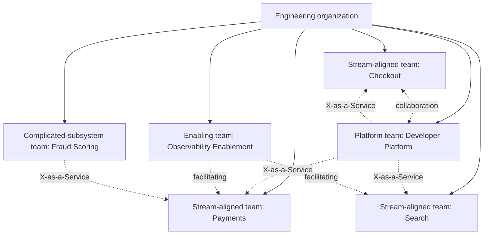
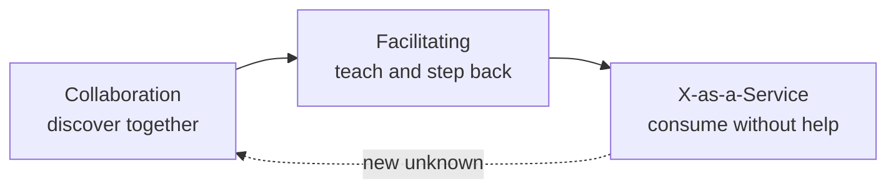
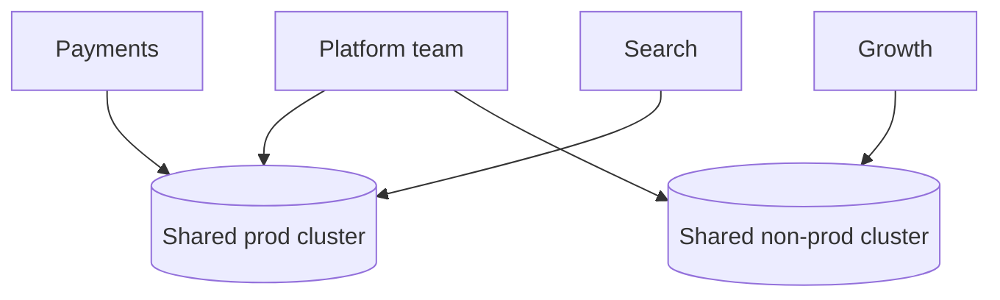
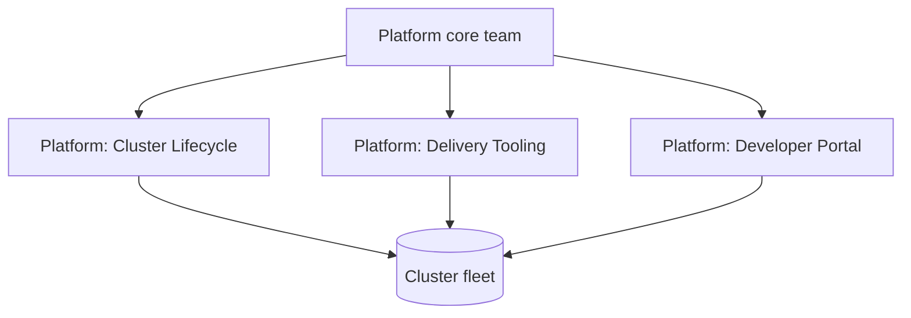
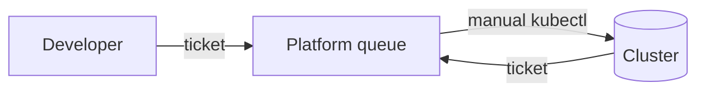

# Team Topologies

## Learning Objectives
- Explain why team structure is a platform engineering concern, not an HR detail
- Describe the four fundamental team types in *Team Topologies*: stream-aligned, platform, enabling, and complicated-subsystem
- Describe the three interaction modes (collaboration, X-as-a-Service, facilitating) and when each applies
- Use cognitive load as a design constraint when deciding what a platform team should own
- Map a real Kubernetes platform onto team types and interaction modes, and spot the common misalignments
- Recognize anti-patterns such as the "platform team as ops queue" and the "renamed ops team"

## Prerequisites
- Understanding of what an internal developer platform provides ([Platform Capabilities](../07-internal-developer-platform/platform-capabilities.md))
- Basic familiarity with GitOps and multi-tenancy concepts ([GitOps Principles](../05-gitops/gitops-principles.md), [Lab 07: Multi-Tenancy](../../labs/lab-07-multi-tenancy/))
- Recommended companion reading: [Maturity Model](./maturity-model.md), [Platform as a Product](./platform-product.md)

---

## Why Team Structure Matters for a Platform

A Kubernetes platform is not only a set of clusters, controllers and pipelines. It is also a boundary between teams: who builds, who operates, who decides, and who gets paged. Architecture tends to mirror communication structures. If the team that owns the database cannot talk to the team that owns the service, the database schema will reflect that gap, and so will the Kubernetes objects that wrap it.

Platform teams often fail not because the technology is wrong, but because the team shape is wrong:

- The platform team is staffed like a help desk, so every request becomes a ticket.
- Application teams are asked to "own their services" but are given no paved road, so every team reinvents CI, secrets, ingress and dashboards.
- Specialists (security, data, networking) are embedded in one stream and become bottlenecks for the rest.

*Team Topologies* by Matthew Skelton and Manuel Pais (IT Revolution, 2019) gives a vocabulary for these shapes. This document applies that vocabulary to platform engineering.



---

## The Four Fundamental Team Types

Team Topologies deliberately uses a small set of team types. Every team in the organization should fit one of them. If a team does not fit, that is a signal worth investigating, not something to paper over with a new label.

| Team type | Purpose | Typical size | Owns | Does not own |
|-----------|---------|--------------|------|--------------|
| **Stream-aligned** | Delivers a continuous flow of value aligned to one business capability or user journey | 5–9 people | Application code, service-level operations, feature delivery | Cluster internals, shared infrastructure |
| **Platform** | Provides internal services that reduce the cognitive load of stream-aligned teams | 5–12 people (scales with the number of users) | Self-service APIs, golden paths, shared clusters, paved-road components | Business features, application-specific logic |
| **Enabling** | Helps other teams acquire a missing capability, then steps away | Small, rotating | Research, coaching, enablement material, temporary embedded support | Long-term ownership of anything |
| **Complicated-subsystem** | Owns a part of the system that requires deep specialist knowledge | 3–8 people | A subsystem where specialist knowledge is genuinely required (ML ranking, video transcoding, cryptography, a licensed engine) | The end-user product as a whole |

The definitions matter more than the names. A team is stream-aligned because of *what it delivers* (a flow of value to a user journey), not because it has a particular job title. A team is a platform team because its *users are other teams*, and its success is measured by how much those teams can do without asking it for help.

### Stream-Aligned Teams

A stream-aligned team is the primary unit of value delivery. It is aligned to a stream of work: a product area, a user journey, or a business capability such as "card payments" or "search ranking".

Characteristics:
- Owns the code, the release, and the on-call rotation for its services
- Has the context to make product decisions without a round trip
- Consumes platform services rather than building its own
- Should be able to ship without coordinating with other stream-aligned teams for routine changes

In Kubernetes terms, a stream-aligned team typically:
- Creates a `Workload` (see [Platform Capabilities](../07-internal-developer-platform/platform-capabilities.md)) to describe a service, and lets the platform translate it into Deployments, Services, secrets and dashboards
- Owns a `Tenant` namespace grouping, with quotas and RBAC bindings given by the platform
- Writes application-level alerts and SLOs (see [SLOs and SLIs](../11-reliability/slos-slis.md))

```yaml
# A stream-aligned team asks for a workload; it does not write cluster plumbing.
apiVersion: platform.mycompany.io/v1alpha1
kind: Workload
metadata:
  name: checkout-api
  namespace: payments-prod
  labels:
    platform.mycompany.io/tenant: payments
spec:
  owner: team-payments
  image: registry.mycompany.io/payments/checkout-api:1.14.2
  replicas:
    min: 3
    max: 30
  ports:
    - name: http
      containerPort: 8080
  traits:
    ingress:
      host: checkout.payments.mycompany.io
    database:
      engine: postgres
      size: small
    slo:
      availability: "99.9"
```

The stream-aligned team does not know, and does not need to know, which node pool the pods land on or which Crossplane composition provisioned the database.

### Platform Teams

A platform team exists to reduce the cognitive load of stream-aligned teams. Its product is a set of capabilities consumed through well-defined interfaces. Its customers are internal.

Characteristics:
- Treats the platform as a product with users, a roadmap and feedback loops ([Platform as a Product](./platform-product.md))
- Provides self-service APIs and golden paths rather than manual services
- Measures success by the productivity and autonomy of its users, not by the number of tickets it closes
- Is explicit about what it does not provide

What a platform team typically owns in a Kubernetes estate:

| Area | Examples in this repo |
|------|-----------------------|
| Cluster lifecycle | Cluster provisioning via [Terraform modules](../../code/terraform-modules/) and [Cluster API](../13-multi-cluster/cluster-federation.md) |
| Delivery | GitOps bootstrapping and tenant AppProjects ([Lab 02](../../labs/lab-02-gitops-bootstrap/)) |
| Tenancy | [`tenant-operator`](../../code/tenant-operator/) and [Lab 07](../../labs/lab-07-multi-tenancy/) |
| Environments | [`environment-operator`](../../code/environment-operator/) |
| Policy | Admission policies via the [Policy Engine](../12-security-compliance/policy-engine.md) |
| Developer portal | [Backstage](../07-internal-developer-platform/backstage.md) templates and catalog |

A platform team does **not** own the business logic of a checkout flow, the schema of a payments ledger, or the decision of which feature ships next. Those belong to stream-aligned teams. When platform teams start owning application logic, they quietly become a bottleneck for every product.

### Enabling Teams

An enabling team helps other teams acquire a capability they are missing: service mesh adoption, chaos engineering practice, security hardening, or observability instrumentation. The defining trait is that an enabling team *works itself out of a job*. It embeds for a period, transfers knowledge, and then moves on.

Enabling teams are the right answer when:
- A capability is needed by many teams but not yet understood well
- The knowledge is specialist and scarce (e.g. eBPF, distributed tracing design, threat modeling)
- Teams need coaching rather than a service

Enabling teams are the wrong answer when the capability is needed permanently. A permanent need should be turned into a platform capability, owned by a platform team, consumed as a service.

Example: an observability enabling team spends a quarter with three stream-aligned teams, teaching them to write meaningful SLIs and to structure logs. Once those teams are self-sufficient, the enabling team moves to the next gap, and the reusable parts (dashboard templates, alert rules, a Prometheus recording-rule library) are handed to the platform team to maintain.

### Complicated-Subsystem Teams

A complicated-subsystem team owns a part of the system where the required knowledge is so specialized that it would be unreasonable to expect a stream-aligned team to hold it. Examples include a fraud-scoring model, a video encoding pipeline, a cryptographic signing service, or a proprietary search ranking engine.

Use this type sparingly. Many things that look complicated are merely *unfamiliar*, and they become easier once a platform capability exists. A useful test: could a reasonably skilled engineer learn this subsystem in a few weeks with good documentation? If so, it is not complicated-subsystem territory.

In a Kubernetes context, a complicated subsystem often runs on dedicated nodes or clusters, with its own release cadence and tuned resource profile. The platform team provides the cluster; the complicated-subsystem team owns what runs on it. The [Workload Distribution](../13-multi-cluster/workload-distribution.md) document discusses placement for this kind of workload.

---

## Interaction Modes

Team types describe *who* does what. Interaction modes describe *how* two teams work together, and for how long. Teams should use an explicit mode with each other and revisit it as conditions change.

| Mode | Description | Duration | Healthy when | Unhealthy when |
|------|-------------|----------|--------------|----------------|
| **Collaboration** | Two teams work closely together on a shared problem with shared goals | Time-boxed | Discovering a new capability; building something neither team knows yet | Left open-ended; becomes permanent co-ownership with unclear accountability |
| **X-as-a-Service** | One team consumes another's capability with minimal interaction | Ongoing | The API is documented, self-service and reliable | Consumers still need constant help; the "service" is a ticket queue |
| **Facilitating** | One team helps another learn or adopt something | Time-boxed | Knowledge is transferred and the helped team becomes independent | The facilitator quietly takes over the work |



The most common platform failure is staying in **collaboration** mode indefinitely. A platform team and a stream-aligned team pair on a new deployment pattern, and fifteen months later the platform team still joins every release. The fix is to make the transition to X-as-a-Service an explicit goal, with a date and a documented interface.

### Choosing the Mode

Ask two questions:
1. **Is the capability well understood?** If no, start with collaboration.
2. **Will many teams need it, and will it be stable?** If yes, move to X-as-a-Service. If it is needed by a few teams for a short period, use facilitating.

---

## Cognitive Load as the Design Constraint

Team Topologies argues that the main constraint on a team is **cognitive load**: how much a team has to know, remember and decide to do its job. Every team has a finite budget. A stream-aligned team that must understand Kubernetes networking, certificate rotation, Helm chart internals, and cloud IAM will have less budget left for the product.

The book distinguishes:
- **Intrinsic load**: the inherent difficulty of the problem (e.g. distributed consistency)
- **Extraneous load**: difficulty caused by tools, processes and waiting (e.g. figuring out how to get a certificate issued)
- **Germane load**: effort that builds lasting capability

A platform team's job is to remove extraneous load so that stream-aligned teams spend their budget on intrinsic and germane load.

### Applying the Idea to Kubernetes

Consider what a stream-aligned team has to know to deploy a service that needs a database, a public TLS endpoint and a dashboard:

| Without a platform | With a platform |
|--------------------|-----------------|
| Pick an ingress controller and configure cert-manager | Declare `ingress.host`; platform handles TLS |
| Write a Deployment, Service, HPA, PDB, NetworkPolicy | Declare replicas and ports; platform generates the rest |
| Provision RDS or CloudSQL, manage credentials, rotate them | Declare `database.engine`; platform provisions and injects secrets via [External Secrets](../06-secrets-management/external-secrets.md) |
| Build Grafana dashboards and alerts from scratch | Platform default dashboards; team adds business SLOs |
| Understand the cluster's RBAC model and quota system | Tenant is assigned; quotas are visible in the portal |

The stream-aligned team still needs to understand its service, its SLOs and its failure modes. It no longer needs to understand the plumbing.

### The Thinnest Viable Platform

*Team Topologies* describes the **Thinnest Viable Platform** (TVP): the smallest set of platform capabilities that lets stream-aligned teams work without needing to build their own. A TVP is deliberately minimal. It is an answer to "what must we provide now?" rather than "what might we need in five years?"

A TVP for a Kubernetes platform might be:
1. One or more clusters with a known upgrade policy
2. GitOps delivery with a standard repository layout
3. A single documented way to deploy a service (a golden path)
4. Secrets injection that does not put secrets in Git
5. Default metrics, logs and an alert route
6. A way to request a new namespace and quota

Everything else (multi-cluster placement, custom operators, a full developer portal) waits until stream-aligned teams ask for it, with evidence.

---

## Team Shape Patterns on Kubernetes

The following patterns describe how the team types map to Kubernetes ownership boundaries. They are starting points, not prescriptions.

### Pattern A: Single Platform Team, Shared Clusters



- **When it fits:** fewer than roughly 8 stream-aligned teams, one region, moderate compliance needs
- **Risks:** a single team becomes the constraint; noisy-neighbour problems fall on the platform team
- **Mitigations:** strong tenancy (quotas, network policy, priority classes); clear escalation paths

### Pattern B: Platform Team with Cluster Ownership per Domain



- **When it fits:** a larger estate where a single team cannot hold the full context
- **Risks:** split platform teams that all want to own the same cluster
- **Mitigations:** one team owns the cluster contract (the `Tenant` and `Environment` APIs); the others are customers of it

### Pattern C: Platform Teams with Embedded Complicated-Subsystem Owners

Used when a subsystem (say, an ML inference fleet with GPU node pools) has its own specialist team, but the platform team provides the underlying cluster, scheduling and observability. The specialist team consumes platform APIs for everything except the subsystem itself.

### Anti-Pattern: The Platform Team as an Ops Queue



Symptoms:
- Platform team members spend most of their time on request tickets
- No roadmap; the backlog is the list of tickets
- Stream-aligned teams avoid the platform and build shadow tooling

Remedy: pick the top ten ticket types, turn each into a self-service API (Tenant, Environment, Workload, a database claim), and put the old ticket queue into maintenance mode with a published end date.

### Anti-Pattern: The Renamed Ops Team

The team is renamed "Platform" but keeps the same members, the same responsibilities, and the same on-call for production incidents across every application. Nothing about how work flows has changed. The fix is not a rename; it is to move ownership of application-level operations back to stream-aligned teams and give them the tooling to do it.

### Anti-Pattern: Too Many Platform Teams

A large organization creates a platform team for every infrastructure concern: a Kubernetes team, a CI team, a monitoring team, a secrets team, a portal team. Stream-aligned teams now face five platform teams, each with its own intake process, and the cognitive load goes up rather than down. Consolidate into a platform *group* with a single front door and a shared product owner.

### Anti-Pattern: Enabling Teams That Never Leave

An enabling team has been "helping" three teams with service mesh for two years. The stream-aligned teams have no ownership of their mesh configuration. Put an exit date on the engagement, document the result, and hand the reusable parts to a platform team.

---

## Designing Interfaces Between Teams

Team Topologies stresses that the *interface* between teams is where most of the cost lives. For platform teams, the interface is an API, a documentation set, a support model and a set of service expectations.

A good platform interface:
- **Is self-describing**: a team can understand what it can request without reading the platform's source code
- **Has defaults**: most users should never set the advanced fields
- **Fails clearly**: errors say what is wrong and how to fix it, and point to a runbook
- **Has an explicit support boundary**: which failures the platform handles, and which belong to the application team
- **Is versioned**: changes follow an API deprecation policy, which is why this repo uses `v1alpha1` for the Platform CRDs until the schema stabilizes

### Example Support Boundary

| Failure | Owner | Notes |
|---------|-------|-------|
| Node pool out of capacity | Platform | Alert routes to platform on-call; autoscaler config is platform-owned |
| Pod crash-looping due to application bug | Stream-aligned | Platform dashboard shows restart count; runbook links to app logs |
| Database failover | Platform (infra), stream-aligned (application retry logic) | Shared responsibility, documented in the service contract |
| Quota exceeded for a namespace | Platform reviews, stream-aligned requests increase | Self-service request via `Tenant` update, with approval policy |
| Image has a critical CVE | Stream-aligned (rebuild), platform (block at admission if policy requires) | Supply chain controls described in [Supply Chain](../12-security-compliance/supply-chain.md) |

Write this table down for your platform. Ambiguity about support boundaries is one of the most common sources of friction between teams.

---

## Team Topologies and the Maturity Model

Team shape and maturity are linked. The [Maturity Model](./maturity-model.md) "Investment" aspect asks whether the platform is funded and staffed as a dedicated team (level 2) or as a product (level 3). Team topology is how that investment becomes concrete.

| Maturity | Typical topology |
|----------|------------------|
| Provisional | Platform work done by volunteers from stream-aligned teams; no dedicated platform team |
| Operational | One dedicated platform team, often doing ops work; enabling teams appear ad hoc |
| Scalable | Platform team with a product owner; stream-aligned teams consume X-as-a-Service |
| Optimizing | Multiple platform teams behind one platform group; complicated-subsystem teams plug in through platform APIs |

Moving from Operational to Scalable usually means changing the *interaction mode* with stream-aligned teams from ticket-driven to X-as-a-Service. That is a team-design change, and it will not happen through tooling alone.

---

## Hands-On Exercise

### Exercise: Map your organization

**Time:** 60–90 minutes. **Materials:** a list of current teams and their recent work, a whiteboard or a diagram tool, the Workload example above.

1. List every team in your engineering area (or in the composite organization described in [Generic Enterprise](../15-case-studies/generic-enterprise.md) if you have no real one).
2. Classify each team as stream-aligned, platform, enabling, complicated-subsystem, or *unclear*. Write one sentence of justification for each. Count the unclear ones.
3. For each pair of teams that interact weekly, name the current interaction mode and the intended mode.
4. Pick the platform team (or the team doing platform work). List its ten most frequent requests from the last quarter. Mark each as "could be self-service", "needs a new capability", or "is actually an application concern".
5. Write the support boundary table for one platform capability (for example, databases or ingress).

Tie your output to the [Platform Capabilities](../07-internal-developer-platform/platform-capabilities.md) document: every "could be self-service" item should map to a capability and an interface.

Save the mapping as `docs/team-map.md` in your own working repo, not in this one.

**Discussion questions:**
- Which team is doing the most unplanned work? Who asked them to do it?
- Is there a stream-aligned team that is secretly doing platform work?
- Which enabling engagement has run longer than it should?
- If you removed the platform team tomorrow, which stream-aligned team would notice first, and what would they stop being able to do?

---

## Troubleshooting

| Problem | Likely cause | Remedy |
|---------|--------------|--------|
| Platform team's backlog is entirely tickets | Platform team is an ops queue (see anti-patterns) | Top-ten ticket analysis; convert to self-service; publish end date for manual path |
| Stream-aligned teams build their own CI/CD | Golden path is slow, missing, or undocumented | Interview the teams; fix the top friction; make the golden path the fastest route |
| Two platform teams keep fighting over the same cluster | Unclear ownership of the cluster contract | Name one owner for the API; the other team becomes a customer |
| An enabling team has been embedded for a year | No exit criteria | Define "done" in writing; set a review date; hand over reusable assets |
| Complicated-subsystem team is a bottleneck for releases | Subsystem is not complicated, it is unfamiliar, or its interface is poorly designed | Re-examine the classification; invest in its API and documentation |
| Teams disagree on who is on call for a shared component | Support boundary not written down | Publish a support boundary table and review it quarterly |
| Team boundaries change every reorg and nothing is stable | Teams aligned to projects, not flows of value | Re-align around user journeys or business capabilities; keep platform team boundaries stable longer than product teams |

---

## Further Reading

### Primary sources
- Matthew Skelton & Manuel Pais — *Team Topologies: Organizing Business and Technology Teams for Fast Flow* (IT Revolution, 2019). Companion site: [teamtopologies.com](https://teamtopologies.com/)
- Matthew Skelton & Manuel Pais — the Thinnest Viable Platform concept is introduced in the book's platform chapter; the authors' articles and talks are collected at [teamtopologies.com](https://teamtopologies.com/)
- CNCF TAG App Delivery — [Platforms White Paper](https://tag-app-delivery.cncf.io/whitepapers/platforms/)

### Related in this repo
- [Maturity Model](./maturity-model.md)
- [Platform as a Product](./platform-product.md)
- [Measuring Success](./measuring-success.md)
- [Platform Capabilities](../07-internal-developer-platform/platform-capabilities.md)
- [Case Studies](../15-case-studies/README.md)

---

## Next Steps

1. **Read**: [Platform as a Product](./platform-product.md) — how a platform team should plan, prioritize and measure its work
2. **Read**: [Measuring Success](./measuring-success.md) — how to know whether the team shape is working
3. **Practice**: run the exercise above with a real or composite team map, then revisit it in one quarter
4. **Read**: [Case Studies](../15-case-studies/README.md) — how real organizations arranged teams around their platforms, and what they chose not to copy
