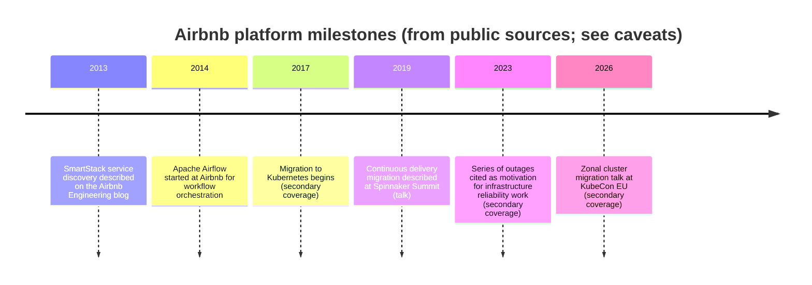
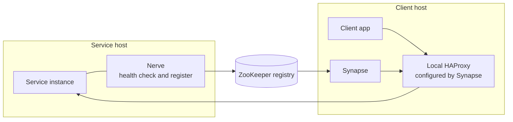

# Case Study: Airbnb

## Learning Objectives
- Describe the broad arc of Airbnb's service platform: from a large Rails monolith, through service-oriented architecture, to Kubernetes-based infrastructure and continuous delivery
- Explain Airbnb's publicly described early service-discovery work (SmartStack) and why it mattered before Kubernetes-native discovery existed
- Identify the migration patterns Airbnb has described publicly, including incremental cutover and zonal cluster migration
- Separate documented facts from analysis, and recognize where the public record is secondary or incomplete
- Apply the migration lessons to planning a Kubernetes migration of a legacy estate

## Prerequisites
- Kubernetes fundamentals ([Kubernetes Architecture](../01-kubernetes-fundamentals/kubernetes-architecture.md))
- Service discovery and ingress basics ([Ingress Controllers](../03-networking-fundamentals/ingress-controllers.md))
- Continuous delivery concepts ([GitOps Principles](../05-gitops/gitops-principles.md))
- Read the [Case Studies overview](./README.md) for how this document treats public sources

> **How to read this document.** **Documented** sections summarize Airbnb's engineering blog posts, open-source projects, and conference talks. Several Kubernetes-specific details come from talk titles and secondary write-ups rather than full engineering posts, and this document labels them as such. **Analysis** sections are this repository's interpretation. No numbers are given here unless the source is explicit. Source links are in [Further Reading](#further-reading).

---

## Context

Airbnb began as a Ruby on Rails web application. Like many companies that grew quickly on a single codebase, it later faced the costs of a monolith at scale: slow builds, shared deploy risk, unclear ownership, and difficulty scaling teams working in one repository. Its platform story is therefore mostly a story about *decomposition* and *operating the decomposed system*.

> **Caveat.** The Kubernetes timeline in particular depends on talks and secondary coverage. Treat the years as approximate and confirm against the primary talks before citing them.

---

## Documented: From Monolith to Services

**Documented.** Airbnb has written publicly about moving from a Rails monolith toward a service-oriented architecture. Its engineering posts and talks describe the work of identifying service boundaries, building shared infrastructure for services, and managing the transition period when both monolith and services run side by side.

Two themes recur in the public material:

1. **Shared infrastructure for services.** Each new service needs discovery, configuration, deployment, observability and ownership. Doing this by hand per service does not scale.
2. **Incremental migration.** The company did not stop feature work to rewrite the system. It moved traffic and responsibilities in steps, which is the only realistic way to migrate a large estate.

**Analysis.** The monolith-to-services transition creates the platform need. Before services, a deployment platform serves one application. After services, it serves dozens of applications with different owners, runtimes and dependencies. Many organizations that migrate to Kubernetes are, in effect, completing this transition at the infrastructure layer as well. See [Team Topologies](../14-platform-evolution/team-topologies.md) for the ownership boundaries that make the transition workable.

---

## Documented: SmartStack Service Discovery

**Documented.** In 2013, Airbnb's engineering team described **SmartStack**, a service discovery and load-balancing system for services running on AWS EC2. SmartStack has two main components:

| Component | Role (as described publicly) |
|-----------|------------------------------|
| **Nerve** | Runs alongside each service instance, performs health checks, and registers healthy instances in a registry (ZooKeeper in the original design) |
| **Synapse** | Runs on each client host, watches the registry, and configures a local HAProxy instance so that clients talk to services over a local port |

Clients connect to `localhost`, and the local proxy handles routing, retries and health-aware balancing. The design gave Airbnb a consistent way to discover services without every client implementing discovery logic.

### Why It Matters for Kubernetes Readers

Kubernetes provides service discovery natively through Services, EndpointSlices and DNS. SmartStack solved the same problem before that was available on AWS for their workloads. The concepts still apply:

| SmartStack concept | Kubernetes equivalent |
|--------------------|-----------------------|
| Nerve health check and registration | Readiness probes and EndpointSlice membership |
| Registry (ZooKeeper) | etcd via the API server |
| Synapse-configured local proxy | kube-proxy, or a sidecar or node-local proxy in a service mesh |
| Client using a local port | Client using a Service DNS name |

**Analysis.** The lesson is not that Kubernetes repeats SmartStack. It is that the discovery contract (health-gated membership, consistent naming, client-side routing decisions) must be defined by the platform, whatever the implementation. Compare [Network Policies](../03-networking-fundamentals/network-policies.md) and [Service Mesh](../03-networking-fundamentals/service-mesh.md) for how this contract is enforced on Kubernetes.

---

## Documented: Workflow Orchestration with Airflow

**Documented.** Airbnb created Apache Airflow, a platform for authoring, scheduling and monitoring workflows as code. It was started at Airbnb in 2014 and later became an Apache Software Foundation project. Airflow is a data-platform tool rather than a service-platform tool, but it is relevant to platform engineering for two reasons:

- It shows the value of a *workflow as code* model, where pipelines are versioned and reviewed like application code
- It is a common workload on Kubernetes (via executors that run tasks in pods), which makes it a useful case for the [Capacity Planning](../11-reliability/capacity-planning.md) and scheduling discussions

---

## Documented and Secondary: Continuous Delivery Migration

**Documented (talk).** At Spinnaker Summit 2019, an Airbnb engineer presented on scaling a migration to continuous delivery, moving services from older deployment practices toward a standardized pipeline model built on Spinnaker. The talk described the migration as incremental and team-by-team, with a long coexistence period.

**Analysis.** A delivery migration is a platform migration in its own right. The hard parts are not the tool, but the inventory of existing pipelines, the owners who must agree to move, and the rollback path if a team's pipeline is not yet equivalent. Compare with [Argo CD Deep Dive](../05-gitops/argocd-deep-dive.md) and [Spinnaker in the Netflix case study](./netflix.md#documented-spinnaker) for the delivery-tool choices in this space.

---

## Documented and Secondary: Kubernetes Adoption and Migration

**Documented (secondary).** Coverage of Airbnb's infrastructure work describes a move toward Kubernetes beginning around 2017. Secondary write-ups also describe Airbnb's use of templated YAML and configuration stored in Git to simplify deployments, a theme that appears in talks by its engineers. The specific system names, scope and sequencing should be verified against Airbnb's own posts and talks.

### Zonal Cluster Migration (Most Recent Public Talk)

**Documented (talk title and secondary summary).** A KubeCon EU 2026 talk by an Airbnb cloud infrastructure engineer, titled "1000 Services, 1 Year, 0 Downtime", is reported to describe moving more than 1,000 production services from regional Kubernetes clusters to zonal clusters over a year without downtime. Secondary coverage cites the talk's themes: rollout automation, capacity planning, and cross-team coordination, with the work motivated by a series of major outages in 2023.

Because this talk is recent and the summary is secondary, use it as a pattern to examine rather than as a verified account. Watch the recording when available and confirm the details.

**Analysis.** Whatever the exact figures, the migration pattern is instructive and independent of Airbnb's specifics:

- **Regional to zonal clusters** trades a single large failure domain for smaller ones. It improves blast-radius control but multiplies the number of clusters an operator must manage. See [Cluster Federation](../13-multi-cluster/cluster-federation.md) and [Workload Distribution](../13-multi-cluster/workload-distribution.md).
- **Zero-downtime cutover at scale** depends on automation for moving workloads, observable rollout health, and a rollback that does not require a platform engineer.
- **Capacity planning** becomes harder when workloads are split across more clusters, because headroom is per cluster. See [Capacity Planning](../11-reliability/capacity-planning.md).

---

## Transferable Lessons (Analysis)

1. **Decompose with infrastructure in mind.** A monolith-to-services transition creates a platform need. Plan the shared infrastructure before the tenth service arrives.
2. **Make discovery a contract.** Whether through SmartStack-style registration or Kubernetes Services, the platform must define health-gated membership and naming, and enforce it.
3. **Migrate incrementally, team by team.** Coexistence is the normal state during a migration. Build the cutover mechanism and the rollback mechanism first.
4. **Workflows as code.** Versioned, reviewed pipelines (Airflow DAGs, Spinnaker pipeline definitions, Git-driven manifests) make ownership visible.
5. **Plan topology changes like product changes.** Moving from regional to zonal clusters changes operations, capacity and cost; treat it as a program with communication, not a technical swap.

## What Does Not Transfer (Analysis)

- **Specific internal tools.** SmartStack and its ZooKeeper dependency were built for a pre-Kubernetes world. Use the ideas, not the components.
- **Migration timelines.** A year-long migration of over a thousand services reflects Airbnb's scale and organization. A smaller estate should expect a shorter, more batched program, but the same sequencing logic applies.
- **Ownership details.** Airbnb's internal team boundaries are not described in enough detail publicly to copy. Derive your own from [Team Topologies](../14-platform-evolution/team-topologies.md).

---

## Planning a Legacy-to-Kubernetes Migration (Analysis)

| Phase | Activities | Exit criterion |
|-------|-----------|----------------|
| 1. Inventory | List services, owners, runtimes, dependencies, deployment methods | Every service has an owner and a deployment method recorded |
| 2. Contract | Define the workload contract (`Workload` CRD or equivalent), health checks, naming, observability defaults | One pilot service runs on the contract |
| 3. Pilot | Migrate one or two low-risk services end to end | Pilot services meet their SLOs for a full cycle |
| 4. Tooling | Automate the cutover and rollback; add progressive delivery gates | Cutover of a test service requires no manual steps |
| 5. Batches | Migrate by team or by dependency group, with an explicit calendar | Batch completion reviewed against SLOs and incidents |
| 6. Decommission | Remove old deployment paths and discovery components | No traffic or deploy events on old paths for a defined period |

The inventory phase is consistently the most underestimated. Use the [Service Catalog](../08-self-service/service-catalog.md) to make it visible.

---

## Hands-On Exercise

### Exercise: Plan a batch migration

**Time:** 90 minutes. **Materials:** the composite organization in [Generic Enterprise](./generic-enterprise.md), the workload contract example in [Team Topologies](../14-platform-evolution/team-topologies.md).

1. Using the composite inventory, group services by team and by dependency. Identify three dependency clusters that must move together.
2. For the first batch, write the cutover steps: traffic shift, health checks, rollback trigger and rollback steps.
3. Define the exit criteria for the batch using SLO attainment and incident count from [Measuring Success](../14-platform-evolution/measuring-success.md).
4. Decide the discovery strategy during coexistence: which names resolve to the old system, which to the new, and who owns the mapping.
5. Write a one-paragraph risk statement for the batch and the mitigation for the top risk.

**Discussion questions:**
- What would you do if a batch's rollback path is slower than its cutover?
- Which services should not be in the first batch, and why?
- How would you report progress to leadership without a percentage that hides risk?

---

## Troubleshooting

| Problem | Cause | Remedy |
|---------|-------|--------|
| Migration stalls at the same percentage for months | Remaining services are the hard ones (stateful, unowned, or with unknown dependencies) | Triage the remainder by owner and dependency; assign an explicit owner or retire the service |
| Two discovery systems return different answers | Coexistence without a defined mapping | Define the authoritative source per name during coexistence; alert on divergence |
| Zonal clusters run out of headroom | Capacity was planned for the regional cluster, not per zone | Recompute headroom per zone; add autoscaling and set pod disruption budgets |
| Teams keep old pipelines running | No deadline or no migration path | Set a decommission date; provide a migration tool or template |
| Cutover causes an outage | Health checks do not reflect readiness | Tighten readiness probes; add a canary stage before full cutover |

---

## Further Reading

### Primary sources (verify before citing)
- Airbnb Engineering blog — [airbnb.tech](https://airbnb.tech/) — search for SmartStack, Airflow, Kubernetes and service migration posts
- SmartStack — Airbnb Engineering post on service discovery (2013); search "SmartStack service discovery in the cloud" on the Airbnb Engineering blog
- Apache Airflow — [airflow.apache.org](https://airflow.apache.org/) — project documentation and history
- Spinnaker Summit 2019 — talk on scaling a migration to continuous delivery at Airbnb (search the Spinnaker Summit 2019 recordings)
- KubeCon EU 2026 — talk "1000 Services, 1 Year, 0 Downtime" (recording and slides, when published; confirm details there)
- InfoQ — talk page on Airbnb's Kubernetes services — [infoq.com](https://infoq.com/presentations/airbnb-kubernetes-services) (verify date and content)

### Secondary and analysis
- Altoros — blog coverage of Airbnb's multi-cluster Kubernetes work (search "Airbnb multicluster Kubernetes" on altoros.com). Secondary; its headline figures are unverified until checked against Airbnb's own material, so this document does not repeat them.
- Rootly — KubeCon EU 26 SRE track overview — [rootly.com](https://rootly.com/blog/the-unofficial-kubecon-eu-26-sre-track) (secondary)

### Related in this repo
- [Case Studies overview](./README.md)
- [Netflix](./netflix.md), [Spotify](./spotify.md), [Generic Enterprise](./generic-enterprise.md)
- [Multi-Cluster GitOps](../13-multi-cluster/multi-cluster-gitops.md)
- [Disaster Recovery](../11-reliability/disaster-recovery.md)

---

## Next Steps

1. **Read**: [Generic Enterprise](./generic-enterprise.md) — apply the migration phases to a composite organization
2. **Read**: [Workload Distribution](../13-multi-cluster/workload-distribution.md) — placement decisions for zonal and regional clusters
3. **Practice**: run the batch migration exercise above on the composite inventory
4. **Practice**: [Lab 08: Platform Upgrade](../../labs/lab-08-platform-upgrade/) — rehearse a cutover with a rollback path
