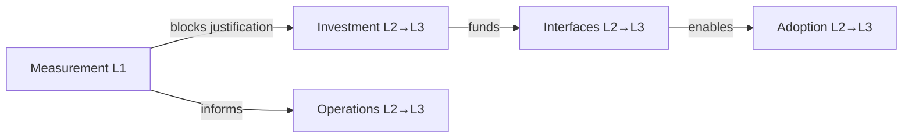
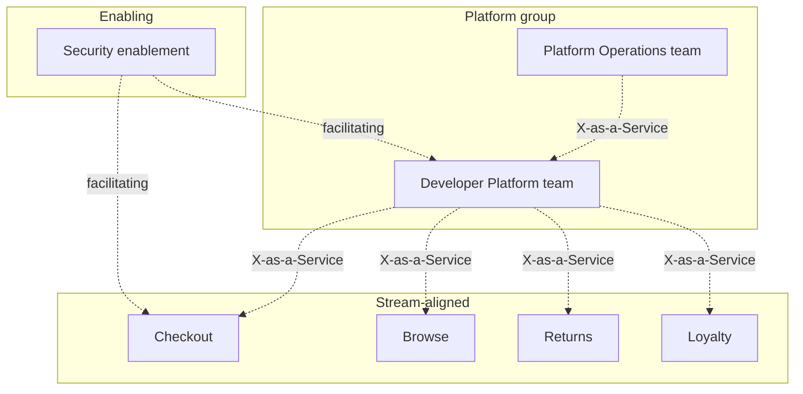

# Case Study: A Generic Enterprise (Composite)

> **This is a composite, not a real company.** "Meridian Retail" is a fictional organization assembled from patterns that recur in public engineering talks, industry reports and common platform-team experience. It does not describe any specific employer, and no figure in it is a measured result from a real organization. Its numbers are illustrative and exist so that exercises have something to work with. Do not cite it as evidence about any company.

## Learning Objectives
- Work through a realistic platform modernization using a composite organization, from inventory to roadmap
- Score the organization against the CNCF maturity model and identify the constraint that limits progress
- Design a platform team structure and a service contract appropriate for a mid-sized enterprise
- Sequence migration and self-service work so that each step unlocks the next
- Recognize enterprise-specific constraints: compliance, legacy systems, procurement and shared-service politics

## Prerequisites
- [Maturity Model](../14-platform-evolution/maturity-model.md) and [Team Topologies](../14-platform-evolution/team-topologies.md)
- [Platform as a Product](../14-platform-evolution/platform-product.md) and [Measuring Success](../14-platform-evolution/measuring-success.md)
- Kubernetes fundamentals and GitOps basics ([GitOps Principles](../05-gitops/gitops-principles.md))
- Read the [Case Studies overview](./README.md)

> **How to read this document.** The narrative, numbers and decisions are invented but plausible. The **Patterns** and **Analysis** sections generalize from common practice and are this repository's interpretation. Each exercise asks you to replace the composite with your own organization.

---

## The Composite Organization

**Meridian Retail (composite, fictional)** sells products through a website, mobile apps and a network of stores. It has about 220 engineers across 22 teams. Most of its systems were built over fifteen years; some are still on virtual machines managed by hand, and a growing share runs on Kubernetes.

### Profile

| Attribute | Illustrative state |
|-----------|-------------------|
| Engineering organization | 22 product teams, 3 shared-service groups (infrastructure, security, data) |
| Team types (today) | Mostly project-aligned, a few stream-aligned, one overloaded infrastructure team acting as the platform |
| Clusters | 4 Kubernetes clusters: 2 production (one per region), 1 staging, 1 shared dev; provisioned with scripts and partly by hand |
| Delivery | Mixed: Jenkins pipelines for some teams, shell scripts for others, Helm charts copied between repositories |
| Secrets | Some in CI variables, some in Kubernetes Secrets committed in sealed form, some in a legacy vault |
| Observability | Per-team dashboards; a central monitoring team runs a Prometheus instance and a logging stack |
| Compliance | Payment-card and data-privacy obligations; quarterly audits; policies written as documents |
| Onboarding a new service | About three weeks, mostly waiting for tickets (namespace, DNS, database, certificates, dashboards) |

### Pain Points Reported by Teams

These are composite quotes, representative of common interview findings:

- "I need a namespace and a database. Each is a ticket, and each ticket waits for a different person."
- "Our Helm chart is a copy of someone else's from two years ago. Nobody knows what changed."
- "Security asks for evidence every quarter. We rebuild it by hand from screenshots."
- "The platform team is the only group that can upgrade the clusters, and they are always busy."
- "When something breaks in production, we don't know who owns the shared ingress."

---

## Step 1: Inventory

The first deliverable is an inventory, because nothing else is credible without it. The composite team collected service data from three sources: the source-control host (repositories and owners), the CI system (pipelines), and the cluster (running workloads). Results were reconciled by a short workshop with team leads.

| Category | Count (illustrative) | Notes |
|----------|---------------------|-------|
| Services in total | 140 | Includes some batch jobs and two desktop tools |
| On Kubernetes | 58 | Mostly stateless web and API services |
| On virtual machines | 61 | Mostly older commerce and inventory systems |
| Serverless or managed PaaS | 21 | Mostly data pipelines and a few front-end functions |
| With a recorded owner | 117 | 23 services had no owner after reconciliation |
| With a known deployment method | 102 | 38 deployed by hand or by unversioned scripts |

The inventory exposed three facts the team had not expected:
1. Nearly a sixth of services had no owner, and most of those were on virtual machines.
2. The most-used internal Helm chart had been forked eleven times.
3. Two teams were running their own Argo CD instances against the same cluster, and nobody had noticed.

**Analysis.** An inventory is itself a platform capability. The [Service Catalog](../08-self-service/service-catalog.md) pattern makes it durable: every service gets an owner, a lifecycle and a deployment method as part of normal work, not as a one-off audit.

---

## Step 2: Maturity Assessment

The composite organization ran a self-assessment using the [CNCF maturity model](../14-platform-evolution/maturity-model.md), with participants from five platform-adjacent teams and two product teams. Scores below are illustrative and reflect the assessment's conclusions, not measurements.

| Aspect | Level | Evidence (composite) |
|--------|-------|----------------------|
| **Investment** | 2 (Operational) | A platform team of five, funded as an infrastructure cost center; no product owner |
| **Adoption** | 2 (Extrinsic push) | New services are required to use the Kubernetes cluster, but the path is slow and undocumented |
| **Interfaces** | 1–2 (Custom processes to Standard tooling) | Helm charts copied between repositories; ticket-based requests for namespaces and databases |
| **Operations** | 2 (Centrally tracked) | Cluster upgrades tracked in a spreadsheet; manual steps per cluster |
| **Measurement** | 1 (Ad hoc) | No deployment frequency or restore-time data; quarterly audit evidence assembled by hand |

**The constraint.** The assessment team asked which single gap, if closed, unlocks the most. The answer was **Measurement**. Without deployment and restore data, leadership could not justify product investment, and the platform team could not show that a self-service path was faster. The team also noted that Investment at level 2 was the immediate limit on hiring, and that Interfaces could not reach level 3 until the golden path existed.



**Analysis.** Assessing the constraint first, rather than picking the most visible problem (the ticket queue), is the single most useful habit in this exercise. The visible problem is usually a symptom of a missing measurement or an unfunded team.

---

## Step 3: Team Structure

The existing team map (illustrative) had three kinds of unit:

| Unit today | Actual type | Problem |
|------------|-------------|---------|
| Five "project" teams for storefront, checkout, returns and loyalty | Stream-aligned | Working on overlapping features; no single owner for the checkout journey |
| Infrastructure team of nine | Mixed platform and ops | Half its time is tickets; half is cluster work; no roadmap |
| Monitoring team of four | Platform-adjacent | Runs Prometheus for everyone; no defined service contract |
| Security team of six | Enabling in practice | Reviews every change by hand; becomes a bottleneck |

### Target Shape

The composite organization chose a target shape over eighteen months:

- **Platform group** with two teams: *Developer Platform* (tenancy, delivery, the portal and golden paths) and *Platform Operations* (cluster lifecycle, upgrades, observability backends). Both have a product owner.
- **Security becomes enabling** for policy design, and hands policy enforcement to the platform through admission controls. Security retains an approval role for exceptions.
- **Monitoring folds into the platform group** as an observability capability, with a service contract.
- **Stream-aligned teams** are regrouped around customer journeys (checkout, browse, returns, loyalty), with ownership of their workloads.



**Analysis.** The shape matters more than the names. The key moves are: give the platform a product owner, separate the platform's own operations from its customer-facing work (so that upgrade work is not starved by tickets), and convert security from reviewer to enabler.

---

## Step 4: The Platform Contract

The platform team defined three resources under `platform.mycompany.io/v1alpha1`. Their schemas are kept deliberately small for the first release.

### Tenant

```yaml
apiVersion: platform.mycompany.io/v1alpha1
kind: Tenant
metadata:
  name: checkout
  labels:
    platform.mycompany.io/cost-center: cc-2210
spec:
  owner: team-checkout
  contact: checkout-team@meridian.example
  quota:
    cpu: "30"
    memory: 60Gi
    storage: 300Gi
  environments: [dev, staging, prod]
  policy:
    podSecurity: restricted
    networkIsolation: default-deny
```

### Environment

```yaml
apiVersion: platform.mycompany.io/v1alpha1
kind: Environment
metadata:
  name: checkout-staging
  namespace: checkout
spec:
  tier: staging
  clusterRef: shared-nonprod-1
  promotionFrom: checkout-dev
  autoSync: true
```

### Workload

```yaml
apiVersion: platform.mycompany.io/v1alpha1
kind: Workload
metadata:
  name: cart-service
  namespace: checkout-prod
spec:
  owner: team-checkout
  image: registry.meridian.example/checkout/cart-service:2.7.0
  replicas: { min: 4, max: 20 }
  ports:
    - name: http
      containerPort: 8080
  traits:
    ingress:
      host: cart.meridian.example
    database:
      engine: postgres
      size: medium
    slo:
      availability: "99.9"
```

The service contract for `Tenant` (excerpt): the platform guarantees namespaces, default-deny networking, quotas, and an AppProject within a stated time after creation. It does not guarantee application-level alerts, which belong to the owning team. The full contract structure is in [Platform as a Product](../14-platform-evolution/platform-product.md#service-contracts).

**Analysis.** Each resource hides a set of decisions the stream-aligned team no longer makes, which is the point. The contract becomes the boundary across which the platform team's responsibilities end and the owning team's begin.

---

## Step 5: Migration Sequence

The composite organization sequenced work so that each step unlocked the next, and so that the first visible results arrived within a quarter.

| Quarter | Work | Unlocks | Exit criterion |
|---------|------|---------|----------------|
| **Q1** | Inventory and ownership; DORA-style deployment and restore events from GitOps and incident tooling; monthly roadmap review | Measurement L2; a defensible investment case | Dashboard live; every service has an owner |
| **Q1** | One cluster rebuilt from code with a documented upgrade procedure | Operations L3 for one cluster | Upgrade executed twice with a runbook and no manual edits |
| **Q2** | Golden path for the most common service type (Helm chart plus `Workload`); catalog entry and TechDocs | Interfaces L3 for new services | Three pilot teams ship to production through it |
| **Q2** | Tenant API replaces namespace tickets; quota self-service with approval policy | Tenancy self-service | Namespace requests fulfilled without a platform engineer |
| **Q3** | Admission policies in audit mode, then enforce; exceptions workflow with security | Policy and security L3 | Policy violations fall to an agreed threshold before enforcement |
| **Q3–Q4** | Batch migration of VM-hosted services that have owners, by dependency group | Adoption L3 | Batches meet SLOs; no unowned services remain on VMs without a retirement plan |
| **Q4** | Platform roadmap reviewed with users; second platform team scoped | Investment L3 | Roadmap reviewed with at least six user teams |

Two decisions shaped this sequence:

1. **Measurement first, even though it looked least urgent.** Leadership would not fund a product team without evidence, and the team had no evidence.
2. **Do not build the portal before the golden path.** The portal was deferred until the path existed and had three users. See [Backstage](../07-internal-developer-platform/backstage.md) for the portal decision.

---

## Step 6: Compliance Without Ceremony

Compliance was a major constraint. The composite organization had quarterly audits and assembled evidence by hand. The change was to make evidence a by-product of the platform:

| Requirement (illustrative) | Platform mechanism | Evidence produced |
|----------------------------|--------------------|-------------------|
| Only approved images run in production | Admission policy requiring signed images | Admission audit log; signature verification records |
| Access to production is least privilege | RBAC generated from `Tenant` owners; no standing cluster-admin | RBAC bindings in Git; access review export |
| Changes are reviewed and traceable | GitOps with pull request approvals | Git history; approval records |
| Secrets are not stored in Git | External secrets from the vault; no plaintext in repositories | Secret store audit log |
| Vulnerabilities are tracked | Scanning in CI; findings linked to workloads | Scan reports keyed by image digest |

Relevant sections: [Policy Engine](../12-security-compliance/policy-engine.md), [Supply Chain](../12-security-compliance/supply-chain.md), [Compliance](../12-security-compliance/compliance.md), [External Secrets](../06-secrets-management/external-secrets.md).

**Analysis.** The most important change is not technical. Auditors accepted evidence generated continuously from systems of record, provided the controls were described in writing and the exceptions process was visible. The platform's role is to make the control the default path.

---

## Step 7: Shared Services and Politics

Enterprise platforms run into organizational friction that technical design does not solve. The composite organization encountered three:

- **Procurement cycles.** A chosen commercial portal took months to approve. The team used an open-source portal for the pilot and deferred the commercial decision until usage was measured.
- **Shared-service ownership.** The shared ingress was owned by the infrastructure group, but its configuration was edited by product teams via tickets. The platform team took over the configuration interface and left the operational ownership with the infrastructure group, with a written boundary.
- **Mandates without support.** Leadership mandated the platform for all new services. Adoption rose quickly, then stalled, because the path was not ready. The team treated the mandate as a time-limited tool and used the stall to prioritize pain points.

**Analysis.** A platform in an enterprise is always a negotiation between the platform's product logic and the organization's existing commitments. The useful response is a written service contract, a visible roadmap, and a standing forum (a monthly review) where the negotiation can happen in public.

---

## Patterns (Analysis)

These patterns recur in enterprise platform work. They are generalizations, not findings from any study.

| Pattern | When it appears | What helped |
|---------|-----------------|-------------|
| **Inventory before roadmap** | Almost always | Ownership and deployment method recorded for every service |
| **Measurement as the constraint** | Organizations without delivery data | Start with deployment and restore events; add the rest later |
| **Platform team split** | When one team has both tickets and cluster work | Separate customer-facing work from platform operations |
| **Security as enabler** | When security reviews are the bottleneck | Policies as code; exceptions with a written process |
| **Path before portal** | When a portal is proposed first | Build the golden path; add the portal once it has users |
| **Migrate by owner and dependency** | Legacy estates with unclear ownership | Batches with explicit owners; retire unowned services |

---

## Risks and Mitigations (Analysis)

| Risk | Likelihood (judgment) | Mitigation |
|------|----------------------|------------|
| Golden path is slower than the old path | Medium | Measure time to first deploy; fix the slowest step before expanding |
| Platform team capacity consumed by tickets | High | Ticket analysis; self-service for top categories; visible support budget |
| Policy enforcement blocks releases | Medium | Audit mode first; exception workflow; thresholds agreed before enforcement |
| Key person dependency on cluster upgrades | High | Codify the upgrade procedure; pair and rotate; runbook drills |
| Migration stalls at the hard remainder | High | Triage the remainder by owner; set retirement dates for unowned services |
| Metrics used to rank teams | Medium | Team-level only; written use policy; review dashboards with the platform as the audience |

---

## Hands-On Exercises

### Exercise 1: Run the Assessment on Your Own Organization

**Goal:** repeat the Meridian modernization analysis for your own organization and finish with a
sequenced plan that outsiders have reviewed.

**Time:** half a day with a small group. **Materials:** this document, the [Maturity Model](../14-platform-evolution/maturity-model.md) scorecard, an inventory export from your source control and CI system (or the composite numbers above if you have none).

1. **Inventory.** Build a table of services with owner, runtime, deployment method and lifecycle. Count the gaps. If you use the composite, note that its numbers are illustrative and build your own table from the narrative.
2. **Score.** Score the five aspects with evidence, using the composite table as a format example.
3. **Constraint.** Identify the single gap that unlocks the most. Justify it in two sentences.
4. **Team map.** Classify each team as stream-aligned, platform, enabling, complicated-subsystem or unclear. Propose one structural change.
5. **Contract.** Write a `Tenant` or `Workload` spec for one real service, and list what the platform does and does not guarantee.
6. **Sequence.** Produce a four-quarter plan with one exit criterion per item. Put measurement first unless you have a strong reason not to.
7. **Review.** Show the plan to two people who do not work on the platform and record the three questions they ask.

Expected output: an inventory table, a five-aspect scorecard with evidence, a one-constraint
statement, a team map, one contract spec, a four-quarter plan and the reviewers' questions.

**Check:**

- Every inventory row has an owner, runtime, deployment method and lifecycle, or is counted as a gap.
- Each aspect score cites evidence, and the constraint is justified in two sentences.
- Every plan item has one exit criterion, and measurement comes first or you wrote down why not.
- You recorded the three questions each of the two reviewers asked.

**Discussion questions:**
- Which score would your leadership dispute most? What evidence would settle it?
- Where would your organization's procurement or compliance process change the sequence?
- Which team would you expect to resist the change most, and what would make them an ally?

---

## Troubleshooting

| Problem | Cause | Remedy |
|---------|-------|--------|
| Assessment produces disagreement | Scoring criteria are ambiguous | Agree evidence examples for each level before scoring |
| Inventory is incomplete | Services live outside the tools you queried | Add a discovery step: cluster scan, cloud account scan, asking team leads directly |
| Roadmap is ignored | Not published where users read it | Publish in the portal or repository; review monthly |
| Pilot succeeds, expansion fails | Pilot teams had unusual support | Measure expansion teams separately; reduce the support you give pilots to match what others will receive |
| Compliance team rejects automated evidence | Controls not described in writing | Map each control to a mechanism and a record; have compliance review the mapping |

---

## Further Reading

- CNCF TAG App Delivery — [Platforms White Paper](https://tag-app-delivery.cncf.io/whitepapers/platforms/)
- CNCF TAG App Delivery — [Platform Engineering Maturity Model](https://tag-app-delivery.cncf.io/whitepapers/platform-eng-maturity-model/)
- Matthew Skelton & Manuel Pais — *Team Topologies* (IT Revolution, 2019)
- Nicole Forsgren, Jez Humble, Gene Kim — *Accelerate* (IT Revolution, 2018)
- DORA — [dora.dev](https://dora.dev/)

### Related in This Repo
- [Maturity Model](../14-platform-evolution/maturity-model.md), [Team Topologies](../14-platform-evolution/team-topologies.md), [Platform as a Product](../14-platform-evolution/platform-product.md), [Measuring Success](../14-platform-evolution/measuring-success.md)
- [Netflix](./netflix.md), [Spotify](./spotify.md), [Airbnb](./airbnb.md)
- [Lab 07: Multi-Tenancy](../../labs/lab-07-multi-tenancy/), [Lab 08: Platform Upgrade](../../labs/lab-08-platform-upgrade/)

---

## Next Steps

1. **Read**: [Case Studies overview](./README.md) — compare the composite with the three real organizations
2. **Practice**: run the assessment exercise on your own organization, or on a team you know well
3. **Practice**: [Lab 07: Multi-Tenancy](../../labs/lab-07-multi-tenancy/) — implement the `Tenant` contract from this document
4. **Practice**: [Lab 08: Platform Upgrade](../../labs/lab-08-platform-upgrade/) — rehearse the cluster upgrade procedure from Step 5
