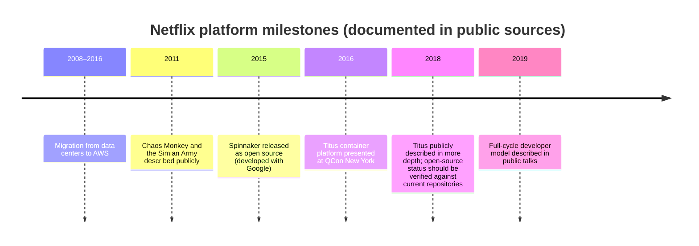

# Case Study: Netflix

## Learning Objectives
- Describe how Netflix's platform engineering evolved from a cloud-native microservices estate on AWS to a container platform (Titus) and a delivery platform (Spinnaker)
- Explain the "operate what you build" (full-cycle developer) model and the role of the "paved road"
- Identify which of Netflix's ideas transfer to a Kubernetes platform, and which depend on Netflix's scale and culture
- Distinguish documented facts from analysis when reading public engineering material about a company
- Apply the lessons to your own platform roadmap, with explicit caveats

## Prerequisites
- Platform concepts from [Platform Capabilities](../07-internal-developer-platform/platform-capabilities.md)
- Multi-tenancy and scheduling basics ([Scheduling](../01-kubernetes-fundamentals/scheduling.md))
- Continuous delivery concepts ([GitOps Principles](../05-gitops/gitops-principles.md))
- Read the [Case Studies overview](./README.md) for how this document is organized and how to treat public sources

> **How to read this document.** Sections marked **Documented** summarize what Netflix has described publicly in its engineering blog, conference talks, or open-source projects. Sections marked **Analysis** are this repository's interpretation and are not claims Netflix has made. Source links appear in [Further Reading](#further-reading). Where the public record is thin or secondary, this document says so.

---

## Context

Netflix is a streaming company whose platform serves a very large, globally distributed audience, and whose engineering organization has historically been known for building its own infrastructure and open-sourcing parts of it. Its platform story is long, and most of the widely cited material describes the years from the mid-2010s onward.

Two features of that context matter for everything below:

1. **Scale and independence.** Netflix runs on AWS and built many of its own control systems because, at the time, the available tools did not fit its needs.
2. **A culture of ownership.** Engineering teams have been expected to build, deploy and operate what they own. This is documented in its engineering material and is a precondition for much of the platform design.

> **Caveat on the timeline.** The dates above reflect public talks and announcements as widely reported. Confirm dates against the primary sources listed in [Further Reading](#further-reading) before reusing them.

---

## Documented: The Cloud Migration and Cloud-Native Architecture

**Documented.** Netflix moved its service estate from its own data centers to AWS over several years, and then restructured its applications into many independently deployed services. Netflix described this in a long series of engineering posts and talks, and many of its internal libraries were open-sourced under the Netflix OSS umbrella. Projects frequently cited from that period include:

| Project | Role (as publicly described) |
|---------|------------------------------|
| **Eureka** | Service discovery registry for client-side load balancing |
| **Zuul** | Edge gateway for routing and filtering traffic |
| **Hystrix** | Latency and fault tolerance library implementing circuit breakers and bulkheads |
| **Ribbon** | Client-side load balancing |
| **Atlas** | In-memory dimensional metrics system |
| **Chaos Monkey** | Randomly terminates instances to test resilience (part of the Simian Army) |

These tools addressed problems of the time: no managed service mesh, no managed Kubernetes on AWS, and limited managed observability. Several of them are now superseded by ecosystem projects (for example, service mesh and Kubernetes-native ingress). That is an expected outcome for infrastructure built at a time when the ecosystem did not yet offer equivalents.

### Chaos Engineering as a Platform Feature

**Documented.** Netflix's Chaos Monkey (described publicly in 2011) became an early reference for deliberate failure injection in production. Later work included more targeted failure tooling and a broader chaos practice. The idea was that resilience should be verified by experiment, not assumed.

**Analysis.** The transferable lesson is that resilience becomes a platform property only when failure injection is a standard, supported capability rather than a team's private experiment. Compare this with the discussion in [Chaos Engineering](../11-reliability/chaos-engineering.md) and the platform-level SLOs in [SLOs and SLIs](../11-reliability/slos-slis.md).

---

## Documented: Spinnaker

**Documented.** Spinnaker is a multi-cloud continuous delivery platform. Netflix announced it and released it as open source in 2015, developed with Google, and it later moved under the Continuous Delivery Foundation. Spinnaker models delivery as **pipelines** with stages (deploy, bake an image, run tests, check a canary, manually approve) and supports **canary analysis** through a separate analysis service.

Key design choices publicly described by the Spinnaker project:

- **Cloud abstraction.** Spinnaker separates the pipeline model from the cloud provider, with providers for AWS, Google Cloud, Azure, Kubernetes and others.
- **Application-centric model.** Applications, clusters and server groups are first-class concepts, which matched the way Netflix described its deployment units at the time.
- **Canary analysis.** Deployments compare metrics from a canary against a baseline before promoting.

### Spinnaker and Kubernetes

Spinnaker has a Kubernetes provider, and Argo Rollouts, Flagger and Argo CD now cover much of the same ground in the Kubernetes ecosystem. For a Kubernetes-first platform, the comparison is:

| Concern | Spinnaker (Kubernetes provider) | Argo CD + Argo Rollouts | Flux + Flagger |
|---------|---------------------------------|-------------------------|----------------|
| Pipeline model | Rich, UI-driven pipelines | Git-driven reconciliation; pipelines in CI | Git-driven; progressive delivery via Flagger |
| Progressive delivery | Canary analysis in pipeline stages | Rollout CRD with analysis templates | Canary CRD with metrics analysis |
| Source of truth | Pipeline definitions (often stored as code) | Git manifests | Git manifests |
| Operational footprint | Multiple services | Fewer moving parts | Fewer moving parts |

See [GitOps Tool Comparison](../04-infrastructure-as-code/gitops-tool-comparison.md) and [Argo CD Deep Dive](../05-gitops/argocd-deep-dive.md) for the detailed trade-offs.

**Analysis.** Spinnaker shows that delivery pipelines can be a platform product with a UI, templates and guardrails. The trade-off is that pipeline state lives outside Git unless the team deliberately adopts pipeline-as-code, which makes the audit trail and the GitOps principle harder to satisfy. Teams choosing a Kubernetes-first delivery model often favor Git as the single source of truth, which is why this repo's [GitOps principles](../05-gitops/gitops-principles.md) lead with it.

---

## Documented: Titus

**Documented.** Titus is Netflix's container management platform. Netflix described it publicly in talks (including QCon New York 2016) and in later engineering material. As described publicly, Titus:

- Was built as a framework on top of **Apache Mesos**, which handled machine resource management while Netflix implemented scheduling and container execution. Netflix's stated reason was that Mesos let the company control the parts it considered important.
- Ran containers on **AWS EC2** instances.
- Supported a broad workload range, including video streaming services, recommendations, machine learning, big data processing, content encoding and internal tools.
- Was presented in more depth in 2018, with open-source status described in secondary coverage of that announcement. Confirm current status against Netflix's repositories before relying on it.

The scheduler and autoscaling constraints of the time mattered. A Netflix engineer described at QCon New York 2016 that available Mesos schedulers had limited features at the time, and that the team needed control over scheduling and cluster autoscaling.

### Why Titus Matters for Kubernetes Platform Teams

**Analysis.** Titus is a useful case because it shows a platform team building its own control plane because the ecosystem was not yet suitable. The question a Kubernetes platform team should ask is not "should we build our own scheduler?" (almost always no) but "which parts of the workload contract are specific to us?" For Netflix, scheduling policy and integration with its AWS estate were specific. For most organizations, workload contracts, tenancy and placement policy are the specific parts, and the scheduler is Kubernetes.

Map the concepts:

| Titus concern (as described publicly) | Kubernetes equivalent in this repo |
|----------------------------------------|-------------------------------------|
| Job or container placement | Scheduler and node pools; see [Scheduling](../01-kubernetes-fundamentals/scheduling.md) |
| Container runtime and images | See [Container Runtimes](../02-container-runtime/container-runtimes.md) |
| Workload definition | `Workload` CRD: `platform.mycompany.io/v1alpha1` |
| Tenancy and quotas | `Tenant` CRD and [Lab 07](../../labs/lab-07-multi-tenancy/) |
| Environment and promotion | `Environment` CRD |
| Multi-cluster placement | [Workload Distribution](../13-multi-cluster/workload-distribution.md) |

---

## Documented: Full-Cycle Developers ("Operate What You Build")

**Documented.** Netflix engineering material and talks from around 2019 describe a model in which product engineering teams own the operation of their services: they deploy, monitor, respond to incidents and improve their systems, with platform tooling, training and management support. A Netflix engineer's talk at QCon San Francisco (reported by InfoQ in 2019) described this as "operate what you build". The approach removes dedicated operations and separate testing teams from the delivery path in the teams described.

The model depends on three things that are documented as supporting it:

1. **Tooling that reduces operational toil**, including deployment pipelines, monitoring defaults and runbooks
2. **Training** so that engineers can operate their services competently
3. **Management support** that allows operational work to count as legitimate engineering work

**Analysis.** "Full cycle" ownership is a team-topology decision as much as a tooling decision. In the terms of [Team Topologies](../14-platform-evolution/team-topologies.md), it is a model in which stream-aligned teams carry more operational responsibility than in a classic ops-team model, which is only viable if the platform reduces their cognitive load. Without that, "you build it, you run it" becomes an unfunded requirement for every team.

---

## Documented: The Paved Road

**Documented and secondary.** Netflix uses the term **paved road** for the frameworks, platforms, applications and tools it builds and supports so that engineers can work efficiently. Netflix job postings and engineering staff describe it as the supported path for common work, such as building and shipping applications, with security and operational concerns handled by default. Public discussions of the concept (podcasts and articles, including interviews with former Netflix engineering and security leaders) present paved roads as shared tooling for common problems, with the path designed so that doing the right thing is the easy thing.

**Analysis.** The paved road is the same idea as a golden path, expressed in Netflix's vocabulary. The useful distinction is that a paved road is *optional but attractive*: teams are not forced onto it, but the platform is designed so that leaving it is costly. This is the **intrinsic pull** level of the [Maturity Model](../14-platform-evolution/maturity-model.md) (Adoption aspect), rather than the extrinsic push that mandates usage.

Key properties to copy:
- The paved road is maintained by a team with a clear product responsibility
- Supported options are fewer and better maintained than unsupported ones
- Exceptions are possible, and they carry an explicit cost

Key properties not to copy without scale:
- A large internal framework team may be justified at Netflix's size but not at a 200-engineer company
- Building proprietary frameworks increases the cost of hiring and onboarding; a smaller organization should prefer open standards

---

## Documented: Experimentation and Delivery Safety

**Documented.** Netflix has described publicly its use of canary analysis, automated rollback and progressive rollouts, often built on Spinnaker-based pipelines and internal metrics systems. The goal is to reduce the blast radius of a bad change and to make rollback fast.

**Analysis.** For a Kubernetes platform, the equivalent pattern is progressive delivery with metric-based analysis gates. The [Measuring Success](../14-platform-evolution/measuring-success.md) document describes the DORA change failure rate and time to restore metrics that tell you whether such mechanisms are working. Netflix's emphasis on fast recovery is consistent with DORA's findings that restore time is a stronger lever than preventing every failure.

---

## Transferable Lessons (Analysis)

These are interpretations of the documented material. They are not Netflix's own statements.

1. **Build control points, buy commodity.** Netflix built where its needs were unusual (scheduling, delivery policy) and adopted or open-sourced elsewhere. A Kubernetes platform should decide explicitly which layer is its differentiator.
2. **Operate what you build, but fund the operation.** Ownership without tooling and training produces burnout. The platform must reduce toil for the owning team.
3. **Make the paved road the easiest road.** Adoption comes from convenience and quality, not from policy alone.
4. **Resilience is a feature you test.** Failure injection and canaries are platform capabilities, not one-off projects.
5. **Open-sourcing is a strategic choice.** Netflix's contributions raised its profile and attracted contributors; they also created maintenance obligations. Consider contribution as part of platform strategy, not an afterthought.

## What Does Not Transfer (Analysis)

- **Scale-specific infrastructure.** A team of six supporting a few clusters does not need a custom scheduler, a custom service mesh or a custom metrics system.
- **Culture and hiring.** The full-cycle model presumes senior engineers with broad skills and a tolerance for ownership. Staffing and career design must match.
- **Timing.** Netflix's tools were built when the ecosystem was immature. Today, Kubernetes, Argo CD, Crossplane, OpenTelemetry and others provide many of the same building blocks as open standards. Adopt those before building your own.

---

## Mapping Netflix's Ideas onto This Repository

| Netflix idea (documented) | Where it appears in this repo |
|---------------------------|-------------------------------|
| Delivery pipelines with canary analysis | [Argo CD Deep Dive](../05-gitops/argocd-deep-dive.md), [Policy Engine](../12-security-compliance/policy-engine.md) for gates |
| Resilience by failure injection | [Chaos Engineering](../11-reliability/chaos-engineering.md) |
| Paved road | [Platform Capabilities](../07-internal-developer-platform/platform-capabilities.md), [Backstage](../07-internal-developer-platform/backstage.md) |
| Operate what you build | [Team Topologies](../14-platform-evolution/team-topologies.md) |
| Titus-style workload contract | `Workload` CRD in [`code/workload-operator/`](../../code/workload-operator/) |

---

## Hands-On Exercise

### Exercise: Write a "paved road" comparison for one service

**Time:** 60 minutes. **Materials:** the `Workload` example in [Team Topologies](../14-platform-evolution/team-topologies.md), a service you know (real or hypothetical).

1. List the operational tasks a team does for this service today: deployment, rollback, secret rotation, dashboards, alerts, capacity changes.
2. For each task, mark whether it is on the paved road (performed by platform tooling), off the road (performed by hand or by a team script), or missing.
3. Estimate the cognitive load for each off-road task in terms of what the owning team must learn.
4. Choose one off-road task and write a proposal to move it onto the paved road: the interface, the default, the escape hatch, and the owner.
5. State one way in which the Netflix model would not fit your organization, with reasons.

**Discussion questions:**
- What would make an engineer choose the off-road path even when a paved road exists?
- If your platform team were asked to build a progressive delivery system, what would you buy and what would you build?
- How would you know that full-cycle ownership is working without measuring individuals?

---

## Troubleshooting

When studying public case studies, these are common pitfalls:

| Problem | Cause | Remedy |
|---------|-------|--------|
| Copying an architecture diagram from a talk | Diagrams show a point in time and omit organizational context | Read the surrounding narrative; check the date |
| Assuming a tool is still maintained | Projects change status and owners | Check the project's current repository and governance |
| Treating a single talk as company policy | Teams differ within large companies | Look for multiple sources and note their dates |
| Mistaking a blog-era claim for a current fact | Public material is often years old | Verify against the most recent primary source |

---

## Further Reading

### Primary sources (verify before citing)
- Netflix Technology Blog — [netflixtechblog.com](https://netflixtechblog.com/) — index of engineering posts on cloud, delivery, resilience and platform topics
- Netflix Technology Blog — posts on Titus and container management (search the blog for "Titus")
- Netflix OSS — [netflix.github.io](https://netflix.github.io/) — catalog of open-source projects such as Eureka, Zuul, Hystrix and Chaos Monkey
- Spinnaker — [spinnaker.io](https://spinnaker.io/) — project documentation and architecture
- Continuous Delivery Foundation — [cd.foundation](https://cd.foundation/) — Spinnaker's governance home
- Greg Burrell, QCon San Francisco talk on full-cycle developers (reported by InfoQ, 2019) — [InfoQ coverage](https://www.infoq.com/news/2019/01/full-cycle-dev-netflix)
- QCon New York 2016 — presentation "Scheduling a Fuller House: Container Management at Netflix" — [qconnewyork.com](https://qconnewyork.com/ny2016/presentation/scheduling-fuller-house)
- InfoQ, 2018 — coverage of the Titus container platform — [infoq.com](https://www.infoq.com/news/2018/04/titus-container-platform/)
- Netflix Chaos Monkey — described in the Netflix Technology Blog (2011 era) and in the Simian Army material; search the blog for "Chaos Monkey"

### Secondary and analysis
- Public podcast and article coverage of Netflix's paved road (search for "paved road" with "Netflix"; the material is mostly secondary and dated, so treat it as context rather than current policy)
- Titus and Mesos background: [sdxcentral.com coverage of Netflix's Mesos use (2016)](https://www.sdxcentral.com/articles/news/netflix-desribes-use-apache-mesos/2016/08/)

### Related in this repo
- [Case Studies overview](./README.md)
- [Spotify](./spotify.md), [Airbnb](./airbnb.md), [Generic Enterprise](./generic-enterprise.md)
- [Team Topologies](../14-platform-evolution/team-topologies.md)
- [Maturity Model](../14-platform-evolution/maturity-model.md)

---

## Next Steps

1. **Read**: [Spotify](./spotify.md) — a different answer to the same question: how to make a platform a product that teams adopt
2. **Read**: [Generic Enterprise](./generic-enterprise.md) — a composite organization to apply these lessons to
3. **Practice**: run the paved-road exercise above for one real service
4. **Read**: [Measuring Success](../14-platform-evolution/measuring-success.md) — how to know if your paved road is working
