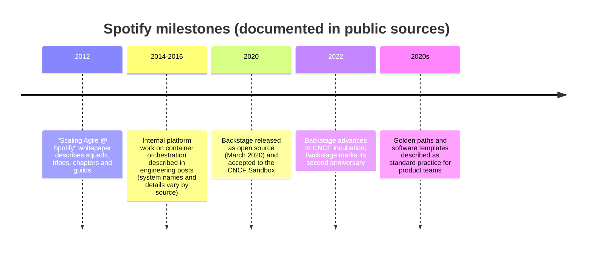

# Case Study: Spotify

## Learning Objectives
- Describe the organizational model Spotify published in 2012 (squads, tribes, chapters, guilds) and explain why it is often misread as a prescription
- Trace how Spotify's developer tooling problem led to Backstage, and how Backstage was open-sourced and donated to the CNCF
- Explain Spotify's "golden path" approach to reducing ecosystem fragmentation through software templates and documentation
- Separate documented facts from analysis when evaluating Spotify as a model for a platform team
- Apply the lessons to choosing and sequencing a developer portal in your own organization

## Prerequisites
- Developer portal concepts ([Backstage](../07-internal-developer-platform/backstage.md), [Platform Capabilities](../07-internal-developer-platform/platform-capabilities.md))
- Team structures ([Team Topologies](../14-platform-evolution/team-topologies.md))
- Software templates and scaffolding ([Scaffolding](../08-self-service/scaffolding.md))
- Read the [Case Studies overview](./README.md) for how this document treats public sources

> **How to read this document.** **Documented** sections summarize Spotify's own public material (engineering blog, the Backstage project and its documentation, and a 2012 organizational whitepaper) or well-reported secondary coverage. **Analysis** sections are this repository's interpretation. Spotify does not publish a current, complete account of its internal platform, and this document does not pretend otherwise. Source links appear in [Further Reading](#further-reading).

---

## Context

Spotify is a music streaming service that grew from a small engineering team into a large organization with many product teams. Its public engineering material is notable for two reasons: an early and widely read description of how it organized teams, and the later open-sourcing of Backstage, a developer portal that now has a large community of adopters.

The two are connected. The organizational model was designed to keep teams autonomous. Autonomy, in turn, multiplied the number of tools, frameworks and pipelines in use, which made it harder for engineers to move between teams and for the company to support them all. Backstage was built to address that fragmentation.



> **Caveat.** Dates in the timeline come from Spotify's and the CNCF's own communications and from reputable secondary coverage. Confirm exact dates against the primary sources in [Further Reading](#further-reading) before reusing them in a presentation.

---

## Documented: The Squad Model (and Why It Is Misread)

**Documented.** In 2012, Henrik Kniberg and Anders Ivarsson published a whitepaper describing how Spotify organized its engineering work, commonly called "Scaling Agile @ Spotify with Tribes, Squads, Chapters & Guilds". The vocabulary it introduced:

| Term | Meaning as described in the paper |
|------|-----------------------------------|
| **Squad** | A small, cross-functional, autonomous team owning a product area, roughly equivalent to a stream-aligned team |
| **Tribe** | A collection of squads working in related areas, with shared goals |
| **Chapter** | A group of people with the same skill who work together within squads (for example, all backend engineers in a tribe) and manage each other's craft |
| **Guild** | A community of interest spanning the organization, sharing practices (for example, a testing guild) |

The paper was a snapshot of how one organization worked at one time, and the authors stated the model was evolving. Kniberg has since said publicly that the model was a description of Spotify's situation, not a template to adopt. Many organizations adopted the vocabulary without the context, producing "squad" structures with no clear product ownership, no platform, and no interaction modes between teams.

**Analysis.** The squad model is most useful as an example of autonomy with alignment: teams have real ownership, and chapters and guilds handle cross-team consistency. The part that is often missing in copies is the platform. In Team Topologies terms, autonomous stream-aligned teams need a platform that reduces their cognitive load; without it, every squad reinvents CI, deployment and observability. Spotify's later investment in Backstage can be read as the platform answer to exactly that problem. Compare with the discussion in [Team Topologies](../14-platform-evolution/team-topologies.md), especially the anti-pattern of renaming an ops team without changing its interaction modes.

---

## Documented: The Fragmentation Problem

**Documented.** Spotify's engineering posts and the Backstage documentation describe a common problem in autonomous engineering organizations: as teams make their own choices about frameworks, build systems, CI/CD configuration and documentation, the ecosystem fragments. Engineers who move between teams must relearn tooling. Central teams cannot upgrade, secure or observe services consistently. New services take a long time to reach a minimal production-ready state.

Spotify's response, described in its engineering material, was to make the supported way of building something easy to find and easy to adopt, while still allowing teams to choose other paths when they had good reasons.

---

## Documented: Backstage

**Documented.** Backstage is an open platform for building developer portals. It was built at Spotify and released as open-source software on March 16, 2020 under the Apache 2.0 license. Spotify donated it to the Cloud Native Computing Foundation: Backstage was accepted to the CNCF Sandbox in 2020, and the CNCF's Technical Oversight Committee later voted to advance it to Incubation, a step the project marked on its second anniversary in March 2022.

Its core components, as described in the project documentation:

| Component | Purpose |
|-----------|---------|
| **Software Catalog** | A registry of components, APIs, resources, systems, domains and teams, described by YAML entity files kept alongside the code |
| **Software Templates (Scaffolder)** | Multi-step workflows that create new components from templates, configured with forms and actions |
| **TechDocs** | Documentation written in Markdown (MkDocs-based), built and rendered inside the portal, close to the code |
| **Plugin system** | Frontend and backend plugins that integrate tools such as CI systems, Kubernetes, cloud consoles and incident tools |
| **Search** | Cross-catalog and documentation search |

A minimal catalog entity, as used by the project:

```yaml
# catalog-info.yaml, stored in a service's repository
apiVersion: backstage.io/v1alpha1
kind: Component
metadata:
  name: checkout-api
  description: Checkout API for card payments
  annotations:
    backstage.io/kubernetes-label-selector: "app.kubernetes.io/name=checkout-api"
spec:
  type: service
  lifecycle: production
  owner: team-payments
  system: checkout
```

The Kubernetes plugin uses the annotation to show live workload status for the entity. This is the same integration pattern used in [Backstage](../07-internal-developer-platform/backstage.md) in this repo.

### Why Open Source?

**Documented.** Spotify's public material describes wanting Backstage to become an industry standard rather than a proprietary portal, and the CNCF donation followed that goal. The open-source project has since been adopted widely, with many companies publishing their own plugins and case studies.

**Analysis.** Open-sourcing a platform component has three effects worth understanding:
1. It creates external contributors and a plugin ecosystem, which reduces the cost of building integrations
2. It forces the core to be generic, which can make adopting it require more customization than an internal tool would
3. It shifts maintenance decisions to a governed project, so organizations adopting it must track upgrades and plugin compatibility

---

## Documented: Golden Paths

**Documented.** Spotify describes a **Golden Path** as the opinionated, supported way to build something. Golden paths are documented with a tutorial and are maintained by the teams responsible for them. They cover multiple disciplines: backend, client, data engineering, data science, machine learning and web, with later additions. Golden paths are implemented as Backstage software templates, hosted in the company's internal source control, and reviewed by domain experts.

A golden path typically includes:

- A **software template** that creates a repository with the standard structure, CI configuration and documentation skeleton
- **TechDocs** explaining the goal, the background, the implementation and the dos and don'ts
- **Catalog entries** that register the new component with its owner, lifecycle and system
- **Preconfigured tooling** (linting, testing, deployment pipeline, observability defaults)

Spotify's onboarding material describes templates as reducing the time from nothing to a working "Hello World" to a few clicks. Secondary commentary also notes the limitation: templates focus on creation, so day-two operations (upgrades, deprecations, drift) need their own mechanisms. That observation matches the platform-engineering concern in [Scaffolding](../08-self-service/scaffolding.md) and [Service Catalog](../08-self-service/service-catalog.md).

```yaml
# Simplified software template (Backstage Scaffolder, illustrative)
apiVersion: scaffolder.backstage.io/v1beta3
kind: Template
metadata:
  name: go-service-golden-path
  title: Go service (golden path)
  description: Creates a Go service with CI, Kubernetes manifests and TechDocs
spec:
  owner: team-developer-platform
  type: service
  parameters:
    - title: Service details
      required: [name, owner]
      properties:
        name:
          title: Service name
          type: string
          pattern: "^[a-z][a-z0-9-]{2,40}$"
        owner:
          title: Owning team
          type: string
          ui:field: OwnerPicker
  steps:
    - id: fetch
      name: Fetch skeleton
      action: fetch:template
      input:
        url: ./skeleton
        values:
          name: ${{ parameters.name }}
          owner: ${{ parameters.owner }}
    - id: publish
      name: Publish repository
      action: publish:github
      input:
        repoUrl: github.mycompany.io?repo=${{ parameters.name }}&owner=platform-services
    - id: register
      name: Register in catalog
      action: catalog:register
      input:
        repoContentsUrl: ${{ steps.publish.output.repoContentsUrl }}
        catalogInfoPath: /catalog-info.yaml
```

The `publish:github` and `catalog:register` actions are standard scaffolder actions. Adjust the host and repository naming to your organization.

**Analysis.** The golden path is the same concept as the paved road described in [Netflix](./netflix.md), with a different emphasis: Spotify puts the path in the developer portal and in documentation, while Netflix describes it through shared frameworks and runtime. Both are instances of the **golden path** pattern in the [Maturity Model](../14-platform-evolution/maturity-model.md) (Interfaces aspect, levels 2 and 3).

---

## Documented: Kubernetes at Spotify

**Documented and secondary.** Spotify has written about its container orchestration work over several years. Internally developed systems were used in its earlier period, and the company later adopted Kubernetes for many workloads. The public record on the exact sequence, scope and system names varies by source, so this document does not give a detailed migration narrative. Use Spotify's engineering blog directly if you need specifics.

**Analysis.** The useful lesson does not depend on the sequence. A company with strong product teams and a standardized Kubernetes substrate can present a much smaller, simpler surface to those teams. The Kubernetes details should be hidden behind the golden path, and the portal should expose the workload contract rather than raw manifests.

---

## Transferable Lessons (Analysis)

1. **Autonomy needs alignment.** Squads and tribes describe ownership; chapters, guilds and golden paths provide consistency without central control.
2. **Make the supported way the discoverable way.** A portal with a catalog, templates and docs turns policy into a route engineers take voluntarily.
3. **Open-source the commodity, keep the differentiation.** Backstage is a framework; Spotify's own golden paths and integrations are the differentiation, and they are maintained internally.
4. **Measure use, not just publication.** Catalog coverage (what share of services are registered with an owner) is a good adoption measure; see [Measuring Success](../14-platform-evolution/measuring-success.md).
5. **Templates create; they do not operate.** Plan for upgrades and deprecations from the first template.

## What Does Not Transfer (Analysis)

- **The squad vocabulary itself.** Renaming teams does not create autonomy or alignment.
- **Spotify's scale.** A golden path for dozens of disciplines assumes a platform team of meaningful size. A smaller organization should start with one path for one common service type.
- **Open-source adoption cost.** Backstage requires a TypeScript/React frontend and a Node.js backend and ongoing plugin maintenance. A small team may prefer a thin custom portal (see [Custom Portal](../07-internal-developer-platform/custom-portal.md)) or a SaaS portal such as [Port](../07-internal-developer-platform/port.md) until the need is clear.

---

## Choosing a Portal: A Sequenced Approach (Analysis)

| Stage | Question to answer | Typical output |
|-------|--------------------|----------------|
| 1. Catalog | Do we know what services exist and who owns them? | Catalog entity files, owner annotations |
| 2. One golden path | Can a new service reach production with the standard path? | One template, one TechDocs page |
| 3. Operational links | Can an engineer see runtime status and runbooks from the catalog? | Kubernetes plugin, dashboard links |
| 4. Self-service requests | Can an engineer request a database or environment through the portal? | Actions that call the platform API |
| 5. Governance | Can we measure coverage and enforce standards? | Scorecards, catalog-based reports |

Do not start at stage 5. A scorecard without a catalog produces a list of unowned services.

---

## Hands-On Exercise

### Exercise: Design a first golden path

**Time:** 90 minutes. **Materials:** the template example above, a repository layout for one service type, a catalog entity template.

1. Pick one service type in your organization (or the composite organization in [Generic Enterprise](./generic-enterprise.md)). Write down what every service of that type needs on day one: repository, CI, container image, Kubernetes manifests, dashboards, runbook, owner.
2. Draft the repository skeleton. Keep it under ten files.
3. Write a `catalog-info.yaml` for the skeleton with owner, lifecycle and system.
4. Write the TechDocs page sections: goal, background, implementation, dos and don'ts.
5. Write the first "day-two" task for this path (for example, upgrading the base image across all services) and decide whether it is in the template, a script, or a separate platform process.
6. Measure: how many services of this type exist, and how many are registered in the catalog with an owner? That number is your baseline.

**Discussion questions:**
- Which parts of your golden path would a team want to change? Which changes should be allowed, and which should trigger a review?
- What would make a team stop using the template after six months?
- Who maintains the template when the underlying framework changes?

---

## Troubleshooting

| Problem | Cause | Remedy |
|---------|-------|--------|
| Teams ignore the golden path | It is slower than the old way, or its docs are missing | Measure time to first deploy; fix the slowest step first |
| Catalog is full of stale entries | No ownership or lifecycle checks | Require owner and lifecycle; add a periodic report of unowned or unused entities |
| Template produces broken repositories | No tests for the template | Add a CI job that scaffolds a sample and runs its tests |
| Plugin upgrades break the portal | Backstage core and plugins version drift | Pin versions; upgrade on a schedule with a test environment |
| Teams treat the squad model as a mandate | Copying vocabulary without context | Document the operating model in your own terms, with interaction modes |

---

## Further Reading

### Primary sources (verify before citing)
- Henrik Kniberg and Anders Ivarsson — *Scaling Agile @ Spotify with Tribes, Squads, Chapters & Guilds* (2012 whitepaper)
- Spotify Engineering blog — [engineering.atspotify.com](https://engineering.atspotify.com/) — search for "golden path" and "Backstage" for posts on fragmentation and golden paths
- Backstage — [backstage.io](https://backstage.io/) — project documentation, including the background overview and the "Backstage turns two" post (March 2022)
- Backstage documentation — Software Catalog, Software Templates, TechDocs
- CNCF — Backstage project page — [cncf.io/projects/backstage](https://www.cncf.io/projects/backstage/)
- CNCF — Spotify end-user journey report (2021) — [PDF](https://www.cncf.io/wp-content/uploads/2021/09/CNCF_Spotify_EndUser_Journey_Report.pdf)

### Secondary and analysis
- InfoQ, 2021 — coverage of Spotify's paved paths — [infoq.com](https://www.infoq.com/news/2021/03/spotify-paved-paths)
- Port glossary entry on Spotify Backstage — [port.io](https://www.port.io/glossary/spotify-backstage) (vendor-authored; read with that in mind)

### Related in this repo
- [Case Studies overview](./README.md)
- [Netflix](./netflix.md), [Airbnb](./airbnb.md), [Generic Enterprise](./generic-enterprise.md)
- [Backstage](../07-internal-developer-platform/backstage.md), [Scaffolding](../08-self-service/scaffolding.md), [Service Catalog](../08-self-service/service-catalog.md)
- [Lab 04: Service Catalog](../../labs/lab-04-service-catalog/)

---

## Next Steps

1. **Read**: [Airbnb](./airbnb.md) — a case study of migrating a large organization onto Kubernetes-based services
2. **Read**: [Platform as a Product](../14-platform-evolution/platform-product.md) — how to decide what the first golden path should be
3. **Practice**: [Lab 04: Service Catalog](../../labs/lab-04-service-catalog/) — build a template and register it in a catalog
4. **Practice**: run the golden path exercise above and measure the baseline catalog coverage
