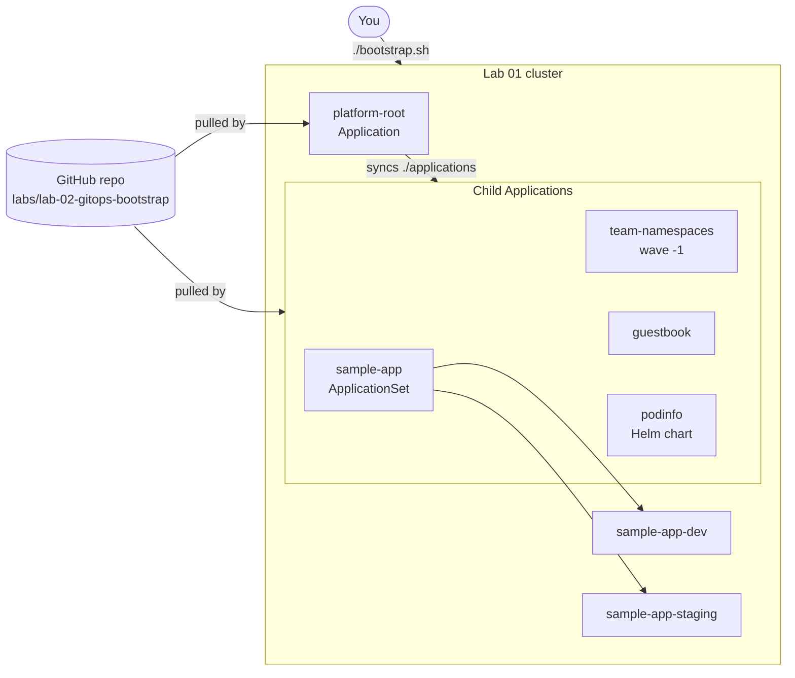

# Lab 02: GitOps Bootstrap with Argo CD

## Objectives

By the end of this lab you will be able to:

- Install Argo CD, pinned to an exact release, with Kustomize
- Explain the **App of Apps** pattern and find the single manifest you apply by hand
- Use **AppProjects** to limit what application teams can deploy and where
- Deploy three kinds of workload from Git: plain YAML, a Helm chart and an **ApplicationSet** generating per-environment Kustomize overlays
- Prove the GitOps loop works: change Git, watch the cluster follow, and watch self-heal undo a manual change

## Prerequisites

| Requirement | Notes |
|-------------|-------|
| [Lab 01](../lab-01-cluster-setup/README.md) cluster | Context `kind-platform-engineering` (or `k3d-platform-engineering`), with Traefik running on `localhost:8080` |
| kubectl | 1.33+ |
| Network access to `github.com` | Argo CD pulls manifests from Git, not from your laptop |
| `argocd` CLI | Optional, v3.5.x. Every step also works with `kubectl` |
| `git` and a GitHub account | Only needed for the "use your own fork" exercise |

Background reading:
[GitOps Principles](../../docs/05-gitops/gitops-principles.md),
[Argo CD Deep Dive](../../docs/05-gitops/argocd-deep-dive.md),
[Multi-cluster GitOps](../../docs/05-gitops/multi-cluster-gitops.md).

## Estimated Time: 30-40 minutes

(About 5 minutes of that is image pulls the first time Argo CD starts.)

---

## How it fits together



The only thing you apply by hand is [`app-of-apps.yaml`](app-of-apps.yaml). It
creates two AppProjects and one **root Application**. The root Application
watches the [`applications/`](applications/) directory in Git, and every YAML
file there is itself an `Application` or `ApplicationSet`. From then on, Git is
the source of truth.

### Files in this lab

| Path | Purpose |
|------|---------|
| [`argocd-install/`](argocd-install/) | Kustomize overlay: pinned Argo CD `v3.5.6` manifest, `argocd` namespace, Traefik ingress, small config patches |
| [`app-of-apps.yaml`](app-of-apps.yaml) | AppProjects `platform` and `apps`, plus the root Application |
| [`applications/`](applications/) | One file per child Application (or ApplicationSet) |
| [`applications/workloads/`](applications/workloads/) | The manifests those Applications deploy |
| [`bootstrap.sh`](bootstrap.sh) | Installs Argo CD, applies the root app, waits for sync |
| [`teardown.sh`](teardown.sh) | Removes everything in reverse order |

### What gets deployed

| Application | Source | Namespace | Sync wave | Access |
|-------------|--------|-----------|-----------|--------|
| `platform-root` | `applications/` | `argocd` | - | - |
| `team-namespaces` | `workloads/team-namespaces/` (quotas, namespaces) | `guestbook`, `podinfo` | -1 | - |
| `guestbook` | `workloads/guestbook/` (plain YAML) | `guestbook` | 0 | http://guestbook.localtest.me:8080 |
| `podinfo` | upstream Helm chart `podinfo` 6.15.0 | `podinfo` | 0 | http://podinfo.localtest.me:8080 |
| `sample-app-dev`, `sample-app-staging` | generated by the `sample-app` ApplicationSet from the Kustomize overlays | `sample-app-dev`, `sample-app-staging` | - | (ClusterIP only) |

---

## Step 1 - Check the cluster

```bash
kubectl config current-context        # kind-platform-engineering
kubectl get nodes                     # 3 nodes, all Ready
kubectl -n traefik get svc traefik    # NodePorts 30080 / 30443
```

If the context is wrong, run `kubectl config use-context kind-platform-engineering`.

## Step 2 - Review what you are about to install

Argo CD is pinned to one release in
[`argocd-install/kustomization.yaml`](argocd-install/kustomization.yaml):

```yaml
resources:
  - namespace.yaml
  - https://raw.githubusercontent.com/argoproj/argo-cd/v3.5.6/manifests/install.yaml
  - ingress.yaml
patches:
  - path: argocd-cm-patch.yaml              # poll Git every 60s, health check for child Apps
  - path: argocd-cmd-params-cm-patch.yaml   # server.insecure: serve HTTP behind Traefik
```

Render it without applying anything:

```bash
kubectl kustomize argocd-install | grep -E '^kind: (Deployment|StatefulSet)$' | wc -l
```

> **Why server-side apply?** The ApplicationSet CRD is larger than the 256 KiB
> limit on the `last-applied-configuration` annotation that client-side apply
> writes. `bootstrap.sh` uses `--server-side --force-conflicts` for that reason.

## Step 3 - Bootstrap

```bash
./bootstrap.sh
```

The script:

1. Applies `argocd-install/` with server-side apply
2. Waits for the Argo CD CRDs and every component to roll out
3. Applies `app-of-apps.yaml` (projects and the root Application)
4. Waits up to ~5 minutes for `platform-root` to report `Synced` and `Healthy`
5. Prints the UI address and the initial admin password

It is idempotent: running it again re-applies the same pinned manifests.

## Step 4 - Open the Argo CD UI

Open **http://argocd.localtest.me:8080** and log in as `admin`. Get the password with:

```bash
kubectl -n argocd get secret argocd-initial-admin-secret \
  -o jsonpath='{.data.password}' | base64 -d; echo
# or, with the CLI:
argocd admin initial-password -n argocd
```

No ingress? Use a port-forward instead. It uses local port **8081**, because host port 8080 is taken by the Lab 01 Traefik ingress (`localhost:8080`, `localhost:8443`):

```bash
kubectl -n argocd port-forward svc/argocd-server 8081:80
# then open http://localhost:8081
```

CLI login (optional):

```bash
argocd login argocd.localtest.me:8080 --plaintext --grpc-web --username admin
```

## Step 5 - Watch the App of Apps converge

```bash
kubectl -n argocd get applications -w
```

Expected final state (give it 2-3 minutes on the first run):

```
NAME               SYNC STATUS   HEALTH STATUS
guestbook          Synced        Healthy
platform-root      Synced        Healthy
podinfo            Synced        Healthy
sample-app-dev     Synced        Healthy
sample-app-staging Synced        Healthy
team-namespaces    Synced        Healthy
```

Notice the order: `team-namespaces` is **sync wave -1**, so its namespaces and
quotas exist before `guestbook` and `podinfo` (wave 0) try to deploy into them.
The custom health check in `argocd-cm-patch.yaml` is what makes the root app
wait for each child to become `Healthy` before moving on.

Inspect the tree of the root Application in the UI, or:

```bash
kubectl -n argocd get application platform-root -o jsonpath='{.spec.source.path}{"\n"}'
```

## Step 6 - Use the workloads

```bash
curl -s -H 'Host: guestbook.localtest.me' http://127.0.0.1:8080/ | grep -o '<h1>.*</h1>'
curl -s http://podinfo.localtest.me:8080/        # JSON with the UI message from the Helm values
kubectl -n sample-app-dev get deploy sample-app   # 1 replica (dev overlay)
kubectl -n sample-app-staging get deploy sample-app   # 2 replicas (staging overlay)
```

## Step 7 - Prove drift is corrected

Change the cluster by hand, bypassing Git:

```bash
kubectl -n guestbook scale deployment/guestbook --replicas=5
kubectl -n guestbook get deploy guestbook -w     # back to 2 within about a minute
```

`selfHeal: true` in [`applications/guestbook.yaml`](applications/guestbook.yaml)
means Argo CD treats Git as the desired state and reverts manual edits. The
Argo CD UI shows the `OutOfSync` state briefly before the correction.

## Step 8 - Make a change through Git (needs a fork)

Argo CD reads the repository on GitHub, not your laptop. To change the lab
through Git you must push to a repository you control. See
[Use your own fork](#use-your-own-fork) below, then:

1. Edit the message in [`applications/workloads/guestbook/configmap.yaml`](applications/workloads/guestbook/configmap.yaml)
2. Commit and push to your fork's `main` branch
3. Watch `guestbook` go `OutOfSync` and then back to `Synced` (about 60 seconds, the polling interval set in `argocd-cm-patch.yaml`)
4. `curl -s -H 'Host: guestbook.localtest.me' http://127.0.0.1:8080/` shows the new text. The nginx pod picks up the updated ConfigMap volume after the kubelet refreshes it, which can take up to a minute.

---

## Use your own fork

The lab files point at `https://github.com/GitOpsHub/platform-engineering-on-kubernetes`.
To change them, make your own copy:

```bash
# 1. Fork the repository on GitHub (or create an empty repo), then clone it
git clone https://github.com/<you>/platform-engineering-on-kubernetes
cd platform-engineering-on-kubernetes

# 2. Point the lab at your fork. This rewrites repoURL and targetRevision in
#    app-of-apps.yaml and applications/*.yaml. It does NOT touch the Argo CD install.
cd labs/lab-02-gitops-bootstrap
./bootstrap.sh --repo-url https://github.com/<you>/platform-engineering-on-kubernetes --rewrite

# 3. Commit and push the rewritten files. Argo CD only sees what is in Git.
cd ../..
git add labs/lab-02-gitops-bootstrap
git commit -m "Point lab 02 at my fork"
git push origin main
```

Other options:

| Flag | Effect |
|------|--------|
| `--repo-url <url>` | Sets the repo for the root app. Without `--rewrite` the child apps still point at upstream, and the script warns about it |
| `--revision <branch>` | Track a branch other than `main` |
| `--context <ctx>` | Use a kubectl context other than the current one |

Private fork? Argo CD needs credentials. Add them with
`argocd repo add https://github.com/<you>/platform-engineering-on-kubernetes --username <user> --password <token>`
before running `bootstrap.sh`.

**Upgrading Argo CD:** change the version in the URL in
[`argocd-install/kustomization.yaml`](argocd-install/kustomization.yaml) and
`ARGOCD_VERSION` in [`bootstrap.sh`](bootstrap.sh), then re-run `./bootstrap.sh`.

---

## Verification

```bash
# Every Application is Synced and Healthy
kubectl -n argocd get applications \
  -o custom-columns=NAME:.metadata.name,SYNC:.status.sync.status,HEALTH:.status.health.status

# AppProjects exist and the root app points at the expected path
kubectl -n argocd get appprojects platform apps
kubectl -n argocd get application platform-root -o jsonpath='{.spec.source.repoURL} {.spec.source.path}{"\n"}'

# Workloads are running
kubectl -n guestbook get deploy guestbook
kubectl -n podinfo get deploy podinfo
kubectl -n sample-app-dev get deploy sample-app

# Ingress routes work
curl -fsS -H 'Host: guestbook.localtest.me' http://127.0.0.1:8080/ >/dev/null && echo "guestbook OK"
curl -fsS -H 'Host: podinfo.localtest.me' http://127.0.0.1:8080/ >/dev/null && echo "podinfo OK"
```

Expected: six Applications, all `Synced` / `Healthy`, and both `OK` lines.

**Check the guard rails.** The `apps` project must refuse things it should not
allow. Try to create a RoleBinding through an app team's project:

```bash
cat <<'EOF' | kubectl apply -n argocd -f - 2>&1 || true
apiVersion: argoproj.io/v1alpha1
kind: Application
metadata:
  name: should-fail
  namespace: argocd
spec:
  project: apps
  source:
    repoURL: https://github.com/GitOpsHub/platform-engineering-on-kubernetes
    targetRevision: main
    path: labs/lab-02-gitops-bootstrap/applications/workloads/guestbook
  destination:
    server: https://kubernetes.default.svc
    namespace: kube-public   # not an allowed destination for project "apps"
EOF
kubectl -n argocd get application should-fail -o jsonpath='{.status.conditions[0].message}{"\n"}'
kubectl -n argocd delete application should-fail --ignore-not-found
```

The condition message says the destination is not permitted in project `apps`.

---

## Cleanup

```bash
./teardown.sh                  # deletes the root app first (cascades), then Argo CD
./teardown.sh --keep-argocd    # keep Argo CD, remove only the lab workloads
```

The teardown deletes the root Application first, so its finalizer removes the
child Applications and their workloads. Argo CD is removed only after that,
because nothing would be left to process the finalizers otherwise.

Lab 03 uses the same cluster, so you can keep the cluster itself. To delete it,
run `../lab-01-cluster-setup/teardown.sh`.

---

## Troubleshooting

### Applications stuck in `Unknown` or "repository not found"

Argo CD cannot read the repository. The repo URL is wrong, the fork is private
without credentials, or GitHub is unreachable from the cluster:

```bash
kubectl -n argocd get application platform-root -o jsonpath='{.status.conditions}{"\n"}'
kubectl -n argocd logs deploy/argocd-repo-server --tail=50
argocd repo list
```

### "application destination ... is not permitted in project"

A child Application targets a namespace the AppProject does not allow. Add the
namespace to `destinations` in [`app-of-apps.yaml`](app-of-apps.yaml) and commit.

### `team-namespaces` is `Healthy` but `guestbook` or `podinfo` is `OutOfSync`

Check `kubectl -n guestbook get resourcequota,limitrange`. If the namespace is
missing, wave -1 has not finished. Wait a minute, or force a sync:

```bash
argocd app sync team-namespaces
```

### `podinfo` pods rejected by Pod Security

The `podinfo` namespace enforces `baseline` and only warns about `restricted`.
Check for the admission message:

```bash
kubectl -n podinfo get events --sort-by=.lastTimestamp | tail -20
```

### Ingress returns 404 for `*.localtest.me`

Traefik from Lab 01 is missing or the Host header does not match. Check:

```bash
kubectl get ingress -A
kubectl -n traefik logs deploy/traefik --tail=30
curl -H 'Host: guestbook.localtest.me' http://127.0.0.1:8080/
```

If `localtest.me` does not resolve on your network, always use the `Host` header with `127.0.0.1`.

### `bootstrap.sh` times out waiting for `platform-root`

The script returns after about 5 minutes even on failure. Inspect the root app:

```bash
kubectl -n argocd describe application platform-root
kubectl -n argocd get applications
```

Then re-run `./bootstrap.sh`. It is safe to repeat.

### Port 8080 already in use

Host port 8080 belongs to the Lab 01 Traefik ingress, so it is always taken while Lab 01 runs. Do not port-forward to 8080. Use the Step 4 port-forward on 8081 (`kubectl -n argocd port-forward svc/argocd-server 8081:80`). If 8081 is also busy, pick any free port above 1024 and keep the remote port `80`.

---

## Next Steps

1. **Read**: [Argo CD Deep Dive](../../docs/05-gitops/argocd-deep-dive.md) and [Multi-cluster GitOps](../../docs/05-gitops/multi-cluster-gitops.md)
2. **Read**: [External Secrets](../../docs/06-secrets-management/external-secrets.md). Secrets are the next thing to put behind GitOps
3. **Lab 03**: [Build a Platform API](../lab-03-platform-api/README.md), a `WebApp` CRD and controller that Argo CD can deploy
4. **Practice**: add a `prod` overlay to `applications/workloads/sample-app/overlays/`. The ApplicationSet creates its Application automatically

---

## Resources

- [Argo CD Getting Started](https://argo-cd.readthedocs.io/en/stable/getting_started/)
- [Cluster Bootstrapping (App of Apps)](https://argo-cd.readthedocs.io/en/stable/operator-manual/cluster_bootstrapping/)
- [ApplicationSet controller](https://argo-cd.readthedocs.io/en/stable/operator-manual/applicationset/)
- [Sync waves and phases](https://argo-cd.readthedocs.io/en/stable/user-guide/sync-waves/)
- [Argo CD releases](https://github.com/argoproj/argo-cd/releases)
