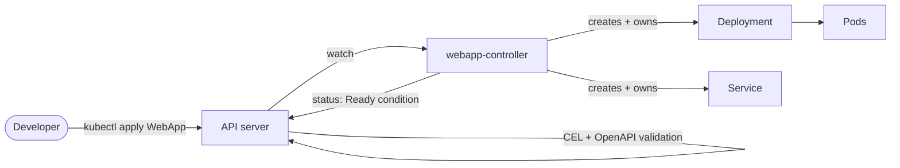

# Lab 03: Platform API - a WebApp Operator

## Objectives

By the end of this lab you will be able to:

- Define a custom API (`WebApp`, in `platform.mycompany.io/v1alpha1`) in Go and generate its CRD, OpenAPI schema and DeepCopy code
- Add server-side validation with **CEL** rules, so bad input is rejected before a controller sees it
- Write a reconciler that creates a Deployment and a Service, with **owner references** and **status conditions**
- Use a **finalizer** to control the order of cleanup on delete
- Unit-test a reconciler with the controller-runtime **fake client**, without a cluster
- Run the controller on your laptop, then build and deploy it into the Lab 01 cluster with RBAC

## Prerequisites

| Requirement | Version | Notes |
|-------------|---------|-------|
| [Lab 01](../lab-01-cluster-setup/README.md) cluster | - | Context `kind-platform-engineering`. The `developer-platform` and `platform-system` namespaces must exist |
| Go | 1.25+ | Required by the module (controller-runtime v0.23 needs 1.25). Go 1.22 is the minimum for the code itself |
| Docker | 25+ | Builds the controller image |
| kubectl | 1.33+ | |
| make | any | |
| kind | 0.33+ (as in Lab 01) | `make deploy` runs `kind load docker-image` |
| Network access | - | Go modules and `controller-gen` are downloaded on first use |

Background reading:
[Kubernetes API Primer](../../docs/01-kubernetes-fundamentals/api-primer.md),
[Controllers and Operators](../../docs/01-kubernetes-fundamentals/controllers-operators.md),
[Kubernetes CRDs](../../docs/09-platform-apis/kubernetes-crds.md),
[Platform API Design](../../docs/09-platform-apis/platform-api-design.md).

## Estimated Time

60-75 minutes

**Difficulty:** Advanced

---

## Files in this lab

| Path | Purpose |
|------|---------|
| [`api/v1alpha1/webapp_types.go`](api/v1alpha1/webapp_types.go) | The Go types. Markers (`+kubebuilder:...`) generate the CRD and validation |
| [`api/v1alpha1/zz_generated.deepcopy.go`](api/v1alpha1/zz_generated.deepcopy.go) | DeepCopy methods, generated by controller-gen |
| [`controllers/webapp_controller.go`](controllers/webapp_controller.go) | The reconciler: Deployment, Service, finalizer, status |
| [`controllers/webapp_controller_test.go`](controllers/webapp_controller_test.go) | Unit tests with the fake client |
| [`cmd/main.go`](cmd/main.go) | Manager entrypoint: flags, scheme, probes, leader election |
| [`crds/`](crds/) | The generated `WebApp` CustomResourceDefinition |
| [`deploy/`](deploy/) | ServiceAccount, RBAC, Deployment (Kustomize). `role.yaml` is generated |
| [`samples/`](samples/) | A valid WebApp, plus three invalid ones that must be rejected |
| [`Dockerfile`](Dockerfile) | Two-stage build, distroless, non-root |
| [`Makefile`](Makefile) | `build`, `run`, `test`, `install`, `deploy`, `undeploy`, plus codegen |

---

## How it fits together



The developer writes one small object: *what* to run. The controller turns it
into the Kubernetes objects that *how* to run it requires. Those objects carry
an owner reference back to the WebApp.

### The WebApp contract

```yaml
apiVersion: platform.mycompany.io/v1alpha1
kind: WebApp
metadata:
  name: hello
  namespace: developer-platform
spec:
  image: nginxinc/nginx-unprivileged:1.29-alpine   # explicit tag required, :latest rejected
  replicas: 2                                       # 0-10, default 1
  port: 8080                                        # default 8080
```

---

## Steps

Run every command from `labs/lab-03-platform-api` unless told otherwise.

### Step 1 - Read the API before you run anything

Open [`api/v1alpha1/webapp_types.go`](api/v1alpha1/webapp_types.go). Three things to notice:

1. **The Go type is the source of truth.** The `+kubebuilder:validation:...` comments
   above each field become OpenAPI schema in the CRD.
2. **Validation is server-side.** The `XValidation` rules are CEL expressions that the
   API server evaluates on every create and update.
3. **`Replicas` and `Port` are pointers.** A pointer distinguishes "unset" (the
   default applies) from an explicit `0`. An `int32` with `omitempty` could not tell them apart.

### Step 2 - Generate the code

```bash
make generate manifests
```

The first run downloads `controller-gen` with `go install`, so it needs network access. It installs a pinned `controller-gen` into `bin/` (not in the module's dependency
graph) and writes:

- `api/v1alpha1/zz_generated.deepcopy.go` from the `object` generator
- `crds/platform.mycompany.io_webapps.yaml` from the type markers
- `deploy/role.yaml` from the `+kubebuilder:rbac` markers in `controllers/`

Generated files are committed, so readers can see them without running the tools.
To check they are current:

```bash
make generate manifests && git diff --exit-code -- api crds deploy
```

Expected: no output and exit code 0 when the committed files are current.

Look at the CEL rules in the CRD:

```bash
grep -A3 'x-kubernetes-validations' crds/platform.mycompany.io_webapps.yaml
```

Expected: `x-kubernetes-validations` blocks with `rule:` and `message:` lines (the CEL rules for the image tag).

### Step 3 - Run the unit tests

```bash
make test
```

Expected: `ok` for the `controllers` package with a coverage figure, and no `FAIL` lines. Four tests pass and no cluster is involved. Add `-v` to `go test` (run `go test ./... -count=1 -v`) to see each test name.

| Test | What it proves |
|------|----------------|
| `TestReconcileCreatesDeploymentAndService` | Children exist, carry the right spec, and are owned by the WebApp. Ready is `False/WaitingForPods` |
| `TestReadyConditionFollowsDeploymentStatus` | When the Deployment reports ready replicas, the WebApp's `Ready` condition flips to `True` |
| `TestDeletionRunsFinalizerAndRemovesChildren` | Deleting a WebApp runs the finalizer, removes the children, then lets the WebApp go |
| `TestDefaultsWhenOptionalFieldsUnset` | Unset `replicas` and `port` fall back to 1 and 8080 |

Read [`controllers/webapp_controller.go`](controllers/webapp_controller.go) next to the tests. The fake client
(`sigs.k8s.io/controller-runtime/pkg/client/fake`) stores objects in memory and
implements the API semantics this lab depends on, such as finalizers and status
subresources.

### Step 4 - Install the CRD

```bash
make install
kubectl get crd webapps.platform.mycompany.io
kubectl explain webapp.spec --api-version=platform.mycompany.io/v1alpha1
```

`make install` applies `crds/` to the current context, so check it is `kind-platform-engineering` first (`kubectl config current-context`).

Expected: `customresourcedefinition.apiextensions.k8s.io/webapps.platform.mycompany.io created` (or `configured`), then the CRD with its creation time. `kubectl explain` prints the field descriptions from the generated schema, for example `image`, `port` and `replicas`.

### Step 5 - Run the controller on your laptop

Keep this running in its own terminal:

```bash
make run
```

It uses your current kubeconfig context, so make sure it is `kind-platform-engineering`.
With `--leader-elect` off (the default for `make run`) it does not need the leader-election RBAC.

In a second terminal, create a WebApp:

```bash
kubectl apply -f samples/webapp-hello.yaml
kubectl -n developer-platform get webapp hello
kubectl -n developer-platform get deploy,svc,pods -l app.kubernetes.io/instance=hello
```

Expected: the `make run` terminal logs a reconcile; `kubectl get webapp` shows `hello` with image `nginxinc/nginx-unprivileged:1.29-alpine`, DESIRED `2`; a Deployment `hello`, Service `hello` and two pods appear within seconds.

Inspect the ownership chain:

```bash
kubectl -n developer-platform get deploy hello \
  -o jsonpath='{.metadata.ownerReferences[0].kind}/{.metadata.ownerReferences[0].name}{"\n"}'
# WebApp/hello
```

Then read the status the controller wrote:

```bash
kubectl -n developer-platform get webapp hello -o yaml | sed -n '/^status:/,$p'
```

You should see `readyReplicas`, the in-cluster `url`, and a `Ready` condition.
The condition reads `False/WaitingForPods` until both pods pass their readiness probe, then `True/ReplicasReady`.

```bash
kubectl -n developer-platform get webapp hello   # printer columns: IMAGE, READY, DESIRED, STATUS
```

Stop `make run` with Ctrl-C when you are done with this step.

### Step 6 - Watch validation reject bad input

These samples must all be **rejected by the API server**, before any controller runs:

```bash
kubectl apply -f samples/invalid/latest-tag.yaml        # CEL: image must not use the :latest tag
kubectl apply -f samples/invalid/no-tag.yaml            # CEL: image must include an explicit tag or digest
kubectl apply -f samples/invalid/too-many-replicas.yaml # OpenAPI: replicas must be <= 10
```

Each command prints an `Invalid value` error that names the rule. Nothing is created: `kubectl -n developer-platform get webapps` still lists only `hello`.
Validation runs in the API server, so it applies to every client: kubectl, GitOps (Lab 02) and CI.

### Step 7 - Deploy the controller into the cluster

`make deploy` applies the CRD, builds the image, loads it into the kind cluster,
and applies `deploy/`:

```bash
make deploy
kubectl -n platform-system get deploy,pods -l app.kubernetes.io/name=webapp-controller
```

Expected: the build output, `deployment "webapp-controller" successfully rolled out`, and one `webapp-controller` pod `Running`. `make deploy` also needs Docker running and the kind cluster `platform-engineering` (override with `KIND_CLUSTER=<name>`).

The controller now runs under the `webapp-controller` ServiceAccount with the
ClusterRole generated from the `+kubebuilder:rbac` markers. Check its permissions:

```bash
kubectl auth can-i update deployments.apps -n developer-platform \
  --as=system:serviceaccount:platform-system:webapp-controller    # yes
kubectl auth can-i delete secrets -n developer-platform \
  --as=system:serviceaccount:platform-system:webapp-controller    # no
```

The controller can manage Deployments and Services, but it has no access to
Secrets. Least privilege comes from the markers in the code, not from a hand-written role.

Stop `make run` if it is still running, so that only the in-cluster controller reconciles. Then re-apply the sample:

```bash
kubectl apply -f samples/webapp-hello.yaml
kubectl -n developer-platform get webapp hello
```

Expected: `hello` is `unchanged`, and its READY column reaches `2`.

### Step 8 - Watch the controller correct drift

The controller owns the Deployment. Change it by hand:

```bash
kubectl -n developer-platform scale deploy/hello --replicas=5
kubectl -n developer-platform get deploy hello -w     # back to 2 within seconds
```

The `Owns(&appsv1.Deployment{})` watch sends the change to the reconciler, and
`CreateOrUpdate` sets `replicas` back to `spec.replicas`. Compare this with Lab 02,
where Argo CD corrects drift in the same way.

Now change the desired state. Edit `spec.replicas` to `3`:

```bash
kubectl -n developer-platform patch webapp hello --type=merge -p '{"spec":{"replicas":3}}'
kubectl -n developer-platform get webapp hello   # DESIRED=3, READY reaches 3
```

### Step 9 - Delete with the finalizer

The in-cluster controller from Step 7 must be running, because it removes the finalizer.

```bash
kubectl -n developer-platform get webapp hello \
  -o jsonpath='{.metadata.finalizers}{"\n"}'     # ["platform.mycompany.io/webapp-cleanup"]

kubectl -n developer-platform delete webapp hello --wait=false
kubectl -n developer-platform get webapp hello \
  -o jsonpath='{.metadata.deletionTimestamp}{"\n"}'  # set, but the object still exists

kubectl -n developer-platform get webapp hello      # disappears within a few seconds: Error from server (NotFound)
kubectl -n developer-platform get deploy,svc -l app.kubernetes.io/instance=hello   # No resources found
```

The WebApp stays in the API until the finalizer has removed the Deployment and Service
with foreground propagation. Owner references would clean these up in the background
anyway. The finalizer makes the order explicit, and it is the place to add cleanup that
owner references cannot do, such as deleting an external DNS record or a registry entry.

---

## Verification

Run these in order, from `labs/lab-03-platform-api`. Each should succeed:

```bash
make test                                                    # 4 tests PASS
kubectl get crd webapps.platform.mycompany.io                # CRD exists
kubectl -n platform-system rollout status deploy/webapp-controller
kubectl apply -f samples/webapp-hello.yaml                   # created or unchanged
kubectl -n developer-platform rollout status deploy/hello --timeout=120s
kubectl -n developer-platform get webapp hello \
  -o jsonpath='{.status.conditions[?(@.type=="Ready")].status}{"\n"}'   # True
```

Expected: the output of each command matches its trailing comment. `make test` ends with `ok`.

The controller does not create an Ingress, so `hello` is reachable only inside the
cluster (`http://hello.developer-platform.svc.cluster.local`). Exercise 1 exposes it.

---

## Exercises

1. **Expose the app.** Create an Ingress for the `hello` Service (port 80) on Traefik
   with host `hello.localtest.me`. Confirm `curl http://hello.localtest.me:8080/` answers.
   Should the controller create this Ingress, or should the developer? Discuss the trade-off.
2. **Add a field.** Add `spec.env` (a map of strings) and set it as container environment
   variables. You will need to update the type, regenerate (`make generate manifests`),
   and write a unit test.
3. **Break the controller on purpose.** Remove `Owns(&corev1.Service{})` in
   `SetupWithManager`, redeploy and delete the Service by hand. Does anything recreate it?
   Why not, and what happens when you put it back?
4. **Rate-limit the surface.** Add a CEL rule that forbids `port` below 1024 unless the
   image is in an allow-list, and write the matching sample.

---

## Cleanup

> **Warning:** `make uninstall` deletes the CRD and therefore every WebApp in the cluster. Run the commands in this order so the controller can still process finalizers.

```bash
kubectl delete -f samples/webapp-hello.yaml --ignore-not-found
make undeploy      # controller, ServiceAccount and RBAC
make uninstall     # CRD (deletes all WebApps)
```

Expected: each command prints `deleted` lines (or nothing if already gone). Left running: the Lab 01 cluster and platform components, and Argo CD if you did Lab 02. The local `webapp-controller:dev` Docker image remains; remove it with `docker rmi webapp-controller:dev`. The cluster itself is kept for [Lab 04](../lab-04-service-catalog/README.md).

---

## Troubleshooting

### `make run` fails with `no matches for kind "WebApp"`

The CRD is not installed. Run `make install`, then start `make run` again.

### `make deploy` shows `ImagePullBackOff` or `ErrImageNeverPull`

The image was not loaded into the cluster, or the tag does not match.

```bash
docker image ls webapp-controller
kind load docker-image webapp-controller:dev --name platform-engineering
kubectl -n platform-system describe pod -l app.kubernetes.io/name=webapp-controller | tail -15
```

On k3d, use `k3d image import webapp-controller:dev -c platform-engineering` instead.

### Controller logs `forbidden: ... cannot list resource "deployments"`

The ClusterRole is out of date. Regenerate it and redeploy:

```bash
make manifests
make deploy
kubectl auth can-i list deployments.apps --all-namespaces \
  --as=system:serviceaccount:platform-system:webapp-controller
```

### WebApp stuck with `Ready=False/WaitingForPods`

The pods are not ready. Check their events and logs:

```bash
kubectl -n developer-platform describe deploy hello
kubectl -n developer-platform get pods -l app.kubernetes.io/instance=hello
kubectl -n developer-platform logs deploy/hello --tail=20
```

A common cause is a wrong `spec.port`. The readiness probe checks the port named `http`.

### Pod Security warnings for `hello` pods

The controller sets the `restricted` fields on the pods it creates (non-root, seccomp
`RuntimeDefault`, no privilege escalation, all capabilities dropped). You should see no
warnings. If you do, check that your image runs as a non-root user, as
`nginx-unprivileged` does.

### WebApp will not delete

The finalizer waits for the Deployment and Service to disappear. Check that the
controller is running, since nothing else will release the finalizer:

```bash
kubectl -n platform-system get pods -l app.kubernetes.io/name=webapp-controller
kubectl -n developer-platform get deploy,svc -l app.kubernetes.io/instance=hello
```

Only if the controller is gone for good, remove the finalizer by hand. This skips the cleanup
the finalizer exists to do, so use it as a last resort:

```bash
kubectl -n developer-platform patch webapp hello --type=merge -p '{"metadata":{"finalizers":null}}'
```

### `go` picks up a different toolchain

The module requires Go 1.25. Go 1.21 and newer download the required toolchain
automatically (`GOTOOLCHAIN=auto`, the default), so you only need a recent Go. Check with `go version`.

---

## Next Steps

1. **Read**: [Platform API Design](../../docs/09-platform-apis/platform-api-design.md) and [Kubernetes CRDs](../../docs/09-platform-apis/kubernetes-crds.md)
2. **Lab 04**: [Service Catalog with Backstage](../lab-04-service-catalog/README.md). The catalog's templates scaffold `WebApp` objects like this one
3. **Lab 02 link**: put `samples/webapp-hello.yaml` in a GitOps repo and let Argo CD deploy it
4. **Read**: [Controllers and Operators](../../docs/01-kubernetes-fundamentals/controllers-operators.md)

---

## Resources

- [controller-runtime book](https://main.book.kubebuilder.io/) and [controller-runtime docs](https://pkg.go.dev/sigs.k8s.io/controller-runtime)
- [Kubebuilder markers reference](https://book.kubebuilder.io/reference/markers)
- [CEL validation rules for CRDs](https://kubernetes.io/docs/tasks/extend-kubernetes/custom-resources/custom-resource-definitions/#validation-rules)
- [Finalizers and owner references](https://kubernetes.io/docs/concepts/overview/working-with-objects/finalizers/)
