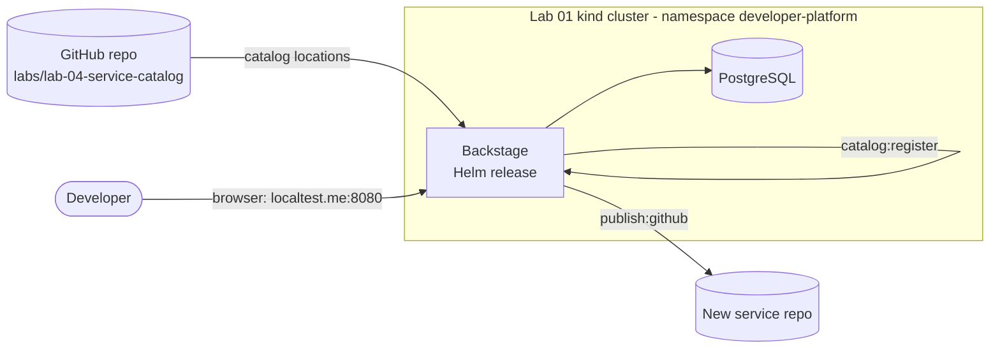

# Lab 04: Service Catalog with Backstage

## Objectives

By the end of this lab you will be able to:

- Install Backstage on Kubernetes with its **official Helm chart**, using an image you build yourself
- Describe a platform in the **software catalog**: Systems, Components, APIs, Resources, Groups and Users
- Create a **Software Template** that scaffolds a new service, with the Workload CR the platform expects, and registers it in the catalog
- Explain why a catalog is more than a wiki: entities have owners, lifecycles and relations, and templates keep them consistent

## Prerequisites

| Requirement | Version | Notes |
|-------------|---------|-------|
| [Lab 01](../lab-01-cluster-setup/README.md) cluster | - | Context `kind-platform-engineering`, Traefik on `localhost:8080`, namespace `developer-platform` |
| Docker | 25+ | Builds the Backstage image. Give Docker **8 GB RAM** or more |
| kubectl, kind | kubectl 1.33+, kind 0.33+ | |
| Helm | 3.8+ (4 works too) | Pulls the chart from `oci://ghcr.io/backstage/charts` |
| Node.js | Active LTS (22 or 24) | Builds the Backstage app. Check the [getting-started guide](https://backstage.io/docs/getting-started/) for the current requirement |
| Yarn 4 | via `corepack enable` | Do not use the Yarn 1 from `npm install -g yarn` |
| GitHub account and token | optional | Only for the **publish** step of the templates (token scope `repo`) |

Background reading:
[Software Catalog and Scaffolding](../../docs/08-self-service/service-catalog.md),
[Scaffolding](../../docs/08-self-service/scaffolding.md),
[Backstage](../../docs/07-internal-developer-platform/backstage.md).

## Estimated Time

60-90 minutes

**Difficulty:** Advanced

The first Backstage build takes 15-25 minutes (dependency install and TypeScript compilation). Everything else takes about 30 minutes.

---

## Files in this lab

| Path | Purpose |
|------|---------|
| [`backstage-config.yaml`](backstage-config.yaml) | The Backstage app-config: database, guest login (lab only), GitHub integration, catalog locations |
| [`helm-values.yaml`](helm-values.yaml) | Values for the official chart: image, config mount, secrets, ingress |
| [`postgres.yaml`](postgres.yaml) | PostgreSQL for Backstage (one pod, one PVC) |
| [`catalog-entities.yaml`](catalog-entities.yaml) | Entities: System, Component, API, Group, User, Resource |
| [`templates/workload-service/`](templates/workload-service/) | Template 1: a service that ships a `Workload` CR |
| [`templates/openapi-api/`](templates/openapi-api/) | Template 2: an OpenAPI contract registered as an API |
| [`deploy.sh`](deploy.sh) | Installs Postgres, the config, the secrets and the Backstage chart |
| [`teardown.sh`](teardown.sh) | Removes the release, Postgres (with its data) and the lab Secrets/ConfigMaps |

---

## How it fits together



Backstage reads the catalog from Git, not from your laptop, so the catalog entities and
templates live in this repository. The chart runs Backstage as a single pod. Postgres
holds the catalog and scaffolder state.

### Which Kubernetes objects Backstage creates

After `deploy.sh` finishes, these objects exist in the `developer-platform` namespace.


| Object | Name | Source |
|--------|------|--------|
| Helm release | `backstage` | `deploy.sh` (chart `backstage` 2.10.2) |
| Deployment, Service, Ingress | `backstage` | the chart |
| ConfigMap | `backstage-lab-config` | `backstage-config.yaml`, read by `deploy.sh` |
| Secret | `backstage-env` | `deploy.sh`: database connection and `GITHUB_TOKEN` |
| Deployment, Service, PVC | `backstage-postgres` | `postgres.yaml` |

---

## Steps

Prepare a terminal with kubectl pointing at `kind-platform-engineering`.

### Step 1 - Read the catalog before you run it

The catalog is a set of YAML files. Look at how the entities refer to each other:

```bash
grep -nE '^kind:|^  name:' catalog-entities.yaml
grep -nE 'owner:|system:|providesApis:|dependsOn:|memberOf:|members:' catalog-entities.yaml
```

Every `owner`, `system` and `providesApis` value is a reference to another entity.
Backstage draws those references as the relation graph you will see in the UI. If a
reference is wrong, the catalog shows it as unresolved, so the mistake is visible.

Expected: ten `kind:` entries (Group, Group, User, User, System, Component x3, API, Resource) and the `owner`/`system` lines that refer to them.

### Step 2 - Build the Backstage image

`deploy.sh` does not build an image. It loads one you built, because Backstage is an
application you own: it has your plugins and your `app-config`. Create the app
**outside this repository**:

```bash
mkdir -p ~/backstage-lab && cd ~/backstage-lab
npx @backstage/create-app@latest      # when prompted for the app name, enter: backstage
cd backstage
corepack enable                       # Yarn 4, from the packageManager field
yarn install                          # slow the first time
yarn build:backend                    # produces the bundles the Dockerfile copies
docker build -f packages/backend/Dockerfile -t backstage-lab:local .
```

Check the image exists:

```bash
docker image ls backstage-lab:local
```

Expected: one row, repository `backstage-lab`, tag `local`.

The `packages/backend/Dockerfile` created by `create-app` runs
`node packages/backend`. That is the command set in [`helm-values.yaml`](helm-values.yaml).

### Step 3 - Deploy Backstage

Go back to this lab's directory. Replace `<path-to-repo>` with the folder where you cloned this repository:

```bash
cd <path-to-repo>/labs/lab-04-service-catalog
BACKSTAGE_IMAGE=backstage-lab:local ./deploy.sh
```

The script:

1. Checks the Lab 01 cluster, the `developer-platform` namespace and the local image
2. Creates the `backstage-postgres` and `backstage-env` Secrets (the password is random and is kept on re-runs) and deploys Postgres
3. Publishes `backstage-config.yaml` as the ConfigMap `backstage-lab-config`
4. Loads the image into kind and runs `helm upgrade --install` with the official chart
5. Waits for the Backstage Deployment to roll out

Expected: the script ends with `Backstage is running.` and prints the UI, catalog and template URLs. Check with `kubectl -n developer-platform get deploy backstage backstage-postgres` (both `1/1`).

Optional flags:

| Flag or variable | Use it when |
|------------------|-------------|
| `GITHUB_TOKEN=<token>` | You want the **publish** step of the templates to create GitHub repositories |
| `--repo-url https://github.com/<you>/platform-engineering-on-kubernetes` | Your fork holds the catalog and the templates |
| `--ref <branch>` | The catalog is on a branch other than `main` |

### Step 4 - Sign in and explore the catalog

Open **http://backstage.localtest.me:8080**, choose **Continue as guest**, then:

1. **Catalog**: filter by kind. You should see the two Groups, two Users, the System `platform-lab`,
   three Components (`platform-api`, `backstage`, `guestbook`), the API `webapp-api` and the Resource
   `backstage-postgres`.
2. Open the **platform-api** Component. Check its owner, its lifecycle and the API it provides, `webapp-api`.
3. Open the **System** `platform-lab`. The graph shows everything in the system.

Catalog import takes about a minute after the pod starts. If the catalog is empty, check the logs:

```bash
kubectl -n developer-platform logs deploy/backstage | grep -iE 'catalog|location' | tail -10
```

### Step 5 - Create a service from a template

1. In the UI, open **Create** and choose **Service with a Workload**.
2. Fill in the form. Name: `orders`. Owner: `storefront-team`. System: `platform-lab`.
   Image repository: `ghcr.io/<you>`. Choose a GitHub repository location you own.
3. Run it. The steps are **Fetch skeleton**, **Publish to GitHub** and **Register in the catalog**.
4. When it finishes, open the new Component from the links on the last page.

Without `GITHUB_TOKEN` the publish step fails with an authentication error. Fetch still
works, so you can read the generated files in the step log. To publish, redeploy with a
token: `GITHUB_TOKEN=<token> ./deploy.sh` (replace `<token>` with a GitHub token that has the `repo` scope).

Expected with a token: all three steps are green and the new repository exists under your GitHub account.

Look at what the template produced. The skeleton is in
[`templates/workload-service/skeleton/`](templates/workload-service/skeleton/). The most important
file is `deploy/workload.yaml`, a `Workload` in `platform.mycompany.io/v1alpha1`:

```yaml
apiVersion: platform.mycompany.io/v1alpha1
kind: Workload
metadata:
  name: orders
spec:
  image: ghcr.io/<you>/orders:0.1.0
  replicas: 2
  port: 8080
  # ...remaining fields omitted
```

The developer sets `image`, `replicas` and `port`. Everything else (Deployment, Service,
probes, security context, Ingress) belongs to the platform.

> **Workload vs WebApp.** Lab 03 defines a smaller `WebApp` CRD so you can see the whole
> pattern in one controller. `Workload` is the platform's richer API, defined in
> [`code/workload-operator`](https://github.com/GitOpsHub/platform-engineering-on-kubernetes/tree/main/code/workload-operator). Both are Kubernetes custom resources,
> and the catalog treats them the same way.

### Step 6 - Create an API from a template

Open **Create** again and choose **OpenAPI contract**. It creates a repository with
`openapi.yaml` and `catalog-info.yaml`, and registers an API entity. It deploys nothing.

Open the new API in the catalog and look at its **Definition** tab. The contract came from
`openapi.yaml` through `$text`, a reference resolved when the catalog is read. Edit the
file in the new repository and the catalog updates.

### Step 7 - Change an entity and watch the catalog follow

This step needs a fork, as in Lab 02. Edit [`catalog-entities.yaml`](catalog-entities.yaml) in your
fork and change `guestbook`'s `lifecycle` from `production` to `experimental`. Commit and push, then
redeploy with `./deploy.sh --repo-url https://github.com/<you>/platform-engineering-on-kubernetes`.
Backstage re-reads locations on a timer (a few minutes by default), so the change appears in the
Catalog page after a short wait. This is the same loop as Lab 02, applied to the catalog.

---

## Verification

```bash
# Pods and services are up
kubectl -n developer-platform get deploy backstage backstage-postgres
kubectl -n developer-platform rollout status deploy/backstage --timeout=60s

# The readiness endpoint answers through Traefik (no login needed)
curl -fsS -o /dev/null -w '%{http_code}\n' http://backstage.localtest.me:8080/.backstage/health/v1/readiness   # 200
```

Expected: `deployment "backstage" successfully rolled out`, both Deployments show `READY 1/1`, the readiness check returns `200`, and the Catalog
page lists 10 entities (2 Groups, 2 Users, 1 System, 3 Components, 1 API, 1 Resource) plus the
2 Templates from the Create page.

---

## Cleanup

> **Warning:** `teardown.sh` deletes the Postgres PVC, so the catalog database and all scaffolder history are lost.

```bash
./teardown.sh
```

Expected: lines starting `==>` ending with `==> Teardown complete`. This removes the Helm release, Postgres with its data, and the lab Secrets and ConfigMaps. It keeps
the `developer-platform` namespace and the kind cluster, which Lab 01 owns. To remove the image, run
`docker image rm backstage-lab:local`. Delete the `~/backstage-lab` directory yourself when you no longer need it. Left running: the kind cluster and the Lab 01 platform components, plus anything from Labs 02 and 03.

---

## Troubleshooting

### `deploy.sh`: "image ... not found locally"

You skipped Step 2, or you used a different tag. Run `docker image ls`, then set
`BACKSTAGE_IMAGE=<name>:<tag>` to match.

### Backstage pod in `CrashLoopBackOff` with a database error

```bash
kubectl -n developer-platform logs deploy/backstage --tail=40
kubectl -n developer-platform get pods -l app.kubernetes.io/name=backstage-postgres
```

The usual cause is Postgres not ready yet. The Backstage pod retries on its own. If you see
`password authentication failed`, the database was created with another password. Run
`./teardown.sh` and then `./deploy.sh` again, so the Secret and the data volume are created together.

### Backstage pod `OOMKilled`

The node needs more memory. Raise Docker's memory to 8 GB or more, or raise `backstage.resources.limits.memory`
in [`helm-values.yaml`](helm-values.yaml) and run `./deploy.sh` again.

### Sign-in fails with a message about `dangerouslyAllowOutsideDevelopment`

The guest provider is blocked outside development mode. The lab sets the flag in
[`backstage-config.yaml`](backstage-config.yaml). Check that it is there and that
`deploy.sh` published the file (`kubectl -n developer-platform get cm backstage-lab-config -o yaml`).

### The catalog is empty, or entities show as unresolved

Backstage reads the locations from GitHub. Check:

```bash
kubectl -n developer-platform logs deploy/backstage | grep -iE 'error|location|github' | tail -20
```

Common causes: a wrong branch (use `--ref`), a fork without the lab files (use `--repo-url`), or
GitHub rate limits for unauthenticated reads (set `GITHUB_TOKEN`).

### Template publish step fails with 401 or 403

The token is missing or lacks the `repo` scope. Redeploy with `GITHUB_TOKEN=<token> ./deploy.sh`.
The token is stored in the `backstage-env` Secret. Do not put it in `backstage-config.yaml`.

### `http://backstage.localtest.me:8080` returns 404

The Traefik ingress from Lab 01 is missing, or the Host header does not match:

```bash
kubectl get ingress -n developer-platform
curl -H 'Host: backstage.localtest.me' http://127.0.0.1:8080/
```

### `helm` cannot pull the chart

Check network access to `ghcr.io`. The chart is public and needs no login. Test with
`helm show chart oci://ghcr.io/backstage/charts/backstage --version 2.10.2`.

---

## Next Steps

1. **Read**: [Software Catalog and Scaffolding](../../docs/08-self-service/service-catalog.md) and [Environment Provisioning](../../docs/08-self-service/environment-provisioning.md)
2. **Lab 05**: [Policy Engine](../lab-05-policy-engine/) enforces what the templates promise (registries, tags, labels)
3. **Exercise**: add a third template that scaffolds a `WebApp` (Lab 03) instead of a `Workload`. Decide which of the two should be the default for new services, and why
4. **Exercise**: write a catalog `Location` that points at your own team's repositories and register it through the UI

---

## Resources

- [Backstage: Software Catalog](https://backstage.io/docs/features/software-catalog/)
- [Backstage: Software Templates](https://backstage.io/docs/features/software-templates/)
- [Backstage: Helm chart](https://github.com/backstage/charts/tree/main/charts/backstage)
- [Backstage: Getting started](https://backstage.io/docs/getting-started/)
- [Scaffolder actions (fetch, publish, catalog)](https://backstage.io/docs/features/software-templates/builtin-actions)
