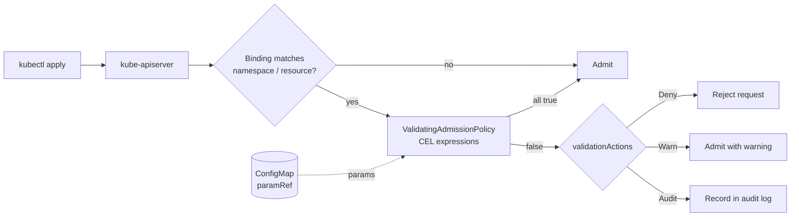

# CEL Expressions: ValidatingAdmissionPolicy and Binding

Kubernetes evaluates [CEL](https://kubernetes.io/docs/reference/using-api/cel/) expressions
inside the API server with no webhook, no controller and no extra pod. A
`ValidatingAdmissionPolicy` (VAP) holds the rule. A `ValidatingAdmissionPolicyBinding`
says where the rule applies and what it does on failure. Both are in
`admissionregistration.k8s.io/v1` and GA since Kubernetes 1.30.



## Anatomy of a policy

A VAP has five parts. Each one is shown in `cel-policies/`.

| Field | What it does | Example in this lab |
|-------|--------------|---------------------|
| `matchConstraints.resourceRules` | Which API groups, versions, resources and operations the policy can see | Pods and Deployments on `CREATE` and `UPDATE` |
| `paramKind` | The type of the optional parameter object | `v1` `ConfigMap` |
| `variables` | Named CEL expressions reused by later expressions | `containers` = regular plus init containers |
| `validations` | CEL expressions that must evaluate to `true` | Every image ends with a tag or digest |
| `messageExpression` / `message` | The text returned on failure | `[cel] images must not use the :latest tag: ...` |

`matchConditions` (in `replica-limit.yaml`) are a further filter applied before
`validations`. They are useful for exempting identities, here `system:` users.

## Walkthrough: `disallow-latest-tag.yaml`

```yaml
apiVersion: admissionregistration.k8s.io/v1
kind: ValidatingAdmissionPolicy
metadata:
  name: lab05-disallow-latest-tag
spec:
  failurePolicy: Fail                 # if CEL cannot run, reject the request
  matchConstraints:
    resourceRules:
      - apiGroups: [""]
        apiVersions: ["v1"]
        operations: ["CREATE", "UPDATE"]
        resources: ["pods"]
  variables:
    - name: containers
      expression: >-
        object.spec.containers +
        (has(object.spec.initContainers) ? object.spec.initContainers : [])
  validations:
    - expression: "variables.containers.all(c, !c.image.endsWith(':latest'))"
      messageExpression: >-
        '[cel] images must not use the :latest tag: ' +
        variables.containers.filter(c, c.image.endsWith(':latest')).map(c, c.image).join(', ')
    - expression: >-
        variables.containers.all(c,
          c.image.contains('@') || c.image.split('/')[c.image.split('/').size() - 1].contains(':'))
      message: "[cel] images must specify a tag or digest."
```

Notes:
- `has(object.spec.initContainers)` is needed because the field is optional. Without it, an
  error would stop evaluation.
- The second validation takes the last `/` segment before checking for `:`, so a registry
  port such as `localhost:5000/app` does not count as a tag.
- `failurePolicy: Fail` makes a CEL error reject the request. Use `Ignore` only when the
  policy is advisory.

## Binding: where and how the policy applies

```yaml
apiVersion: admissionregistration.k8s.io/v1
kind: ValidatingAdmissionPolicyBinding
metadata:
  name: lab05-disallow-latest-tag
spec:
  policyName: lab05-disallow-latest-tag
  validationActions: ["Deny"]
  matchResources:
    namespaceSelector:
      matchLabels:
        kubernetes.io/metadata.name: policy-test-cel
```

- One policy can have several bindings. The same policy can deny in one namespace and only
  warn in another.
- `validationActions` takes `Deny`, `Warn` and `Audit`, and they can be combined.
  `replica-limit.yaml` uses `["Deny", "Audit"]`.
- `matchResources` narrows the scope further, for example with `objectSelector`.

## Parameters: `allowed-registries.yaml` and `replica-limit.yaml`

A parameterised policy reads its limits from a ConfigMap instead of hard-coding them, so a
platform team can change the allow-list without editing the CEL.

```yaml
# In the policy
paramKind:
  apiVersion: v1
  kind: ConfigMap
validations:
  - expression: "object.spec.replicas <= int(params.data['maxReplicas'])"

# In the binding
paramRef:
  name: replica-limit
  namespace: policy-test-cel
  parameterNotFoundAction: Deny    # fail closed if the ConfigMap is missing
```

`params` is the bound object. For a ConfigMap, the values are under `params.data`.

## Checking the policy

```bash
kubectl get validatingadmissionpolicy
kubectl get validatingadmissionpolicybinding

# Dry-run to see the decision without storing the object
kubectl apply --dry-run=server -n policy-test-cel -f tests/fixtures/pod-latest-tag.yaml
```

A denial prints the policy name, the binding and the message, for example
`ValidatingAdmissionPolicy 'lab05-disallow-latest-tag' ... denied request: [cel] ...`.

## CEL vs Gatekeeper vs Kyverno

| Question | CEL (VAP) | Gatekeeper | Kyverno |
|----------|-----------|------------|---------|
| Extra component to run? | No (built into the API server) | Yes (controller and webhook) | Yes (controller and webhook) |
| Language | CEL | Rego | YAML patterns or CEL (`ValidatingPolicy`) |
| Mutate or generate? | No | Mutation CRDs (separate) | Yes |
| Offline tests | No dedicated CLI in this lab; use server-side dry-run | `gator verify` | `kyverno test` |
| Good fit | Simple, fast, no dependencies | Reusable library, audit reports | Generate, mutate and verify-images in one tool |

Choose CEL for simple validation that must not depend on another component. Choose
Kyverno when you also need mutation, generation or image verification. Choose Gatekeeper
when you need a large existing Rego library.

## Troubleshooting

- **The VAP has no effect.** A VAP does nothing until a binding references it.
  `kubectl get validatingadmissionpolicybinding` should list one that matches your namespace.
- **`parameterNotFoundAction: Deny` blocks everything.** The ConfigMap in `paramRef` is
  missing. Re-create it, or set the action to `Allow` for that binding.
- **CEL compile error on apply.** The policy is rejected with a message that names the
  failing expression. Check the field name (for example `initContainers` not `initContainer`)
  and the type of each value.
- **Message is not what you expect.** `messageExpression` takes precedence over `message`.

## Further reading

- [Validating Admission Policy](https://kubernetes.io/docs/reference/access-authn-authz/validating-admission-policy/)
- [CEL in Kubernetes](https://kubernetes.io/docs/reference/using-api/cel/)
- [Policy Engine concepts](../../docs/12-security-compliance/policy-engine.md)
